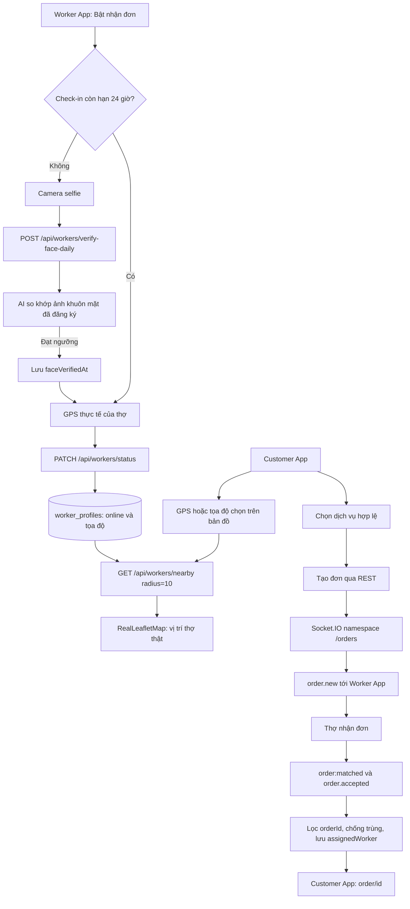

# Kiến trúc kết nối Khách và Thợ

Ảnh selfie hằng ngày được upload bằng multipart field `image`, đối chiếu với `faceProfile.facePhotoUrl`. AI lỗi hoặc không đạt ngưỡng sẽ không cấp mốc xác thực. Bật online cần tài khoản ACTIVE, hồ sơ APPROVED, dịch vụ đã đăng ký, GPS hợp lệ và check-in trong 24 giờ. Tắt online không yêu cầu GPS hoặc check-in.

Hai app dùng namespace `/orders`. Khách nghe cả hai alias khớp đơn, chỉ cập nhật đơn đang tìm thợ. Các alias join_order/leave_order vẫn được giữ để tương thích.

Kiểm tra thực tế bằng hai tài khoản trên thiết bị: check-in thợ, bật online, xác nhận vị trí thợ trên bản đồ khách, chọn dịch vụ, tạo đơn, nhận đơn, kiểm tra khách chuyển sang theo dõi với đúng thông tin thợ. Kiểm tra thêm từ chối GPS, hủy camera, AI không khả dụng, check-in quá hạn và kết nối lại socket.
