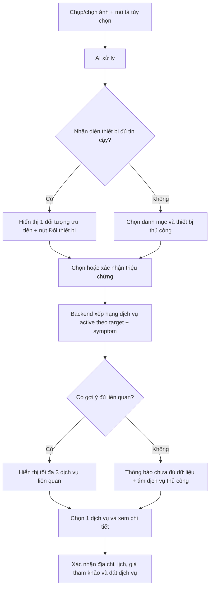

# FIXGO — AI RECOMMENDATION V3
## Đặc tả cập nhật toàn diện: nhận diện triệu chứng, đề xuất dịch vụ và trải nghiệm sau khi quét ảnh

**Ngày lập:** 14/11/2026<br>
**Dự án:** FixGo — Khóa luận tốt nghiệp<br>
**Repository triển khai:** `~/Work/do-an-fix-go-tho-tot`<br>
**Mốc tham chiếu:** `integration/fixgo-sprint-02`, HEAD được người dùng xác nhận `b50075f`<br>
**Tình trạng tài liệu:** Đặc tả yêu cầu/đề xuất; **chưa phải báo cáo chức năng đã triển khai hoặc được nghiệm thu**.<br>
**Phạm vi:** Customer AI Scan, AI inference, catalog Category–Target–Symptom–Service, API, quản trị dữ liệu, UX/UI, kiểm thử. Không mở khóa hoặc sửa Face Core/PAD.

---

## 0. Tóm tắt quyết định

**Chuyển mô hình nghiệp vụ từ** `Danh mục → Đối tượng → Dịch vụ` **sang** `Danh mục → Đối tượng → Triệu chứng → Dịch vụ`.

**Quyết định UX cốt lõi:** **KHÔNG hiển thị toàn bộ danh sách dịch vụ ngay sau khi quét ảnh.** Mục đích AI Scan là rút ngắn quá trình tìm dịch vụ: xác nhận thiết bị, chọn/xác nhận triệu chứng, chỉ đưa ra **tối đa 3 gợi ý dịch vụ liên quan**. Xem toàn bộ kết quả là hành động thứ cấp và phải được lọc theo đối tượng/triệu chứng (không phải toàn bộ catalog). Nếu không đủ cơ sở gợi ý, ưu tiên lựa chọn thủ công thay vì điền bừa.

AI có ba tầng phân biệt: **(1) nhận diện thiết bị**, **(2) quan sát/gợi ý dấu hiệu có thể nhìn thấy**, **(3) đối chiếu triệu chứng với dịch vụ thật trong DB**. AI **không được tự khẳng định nguyên nhân kỹ thuật** chỉ từ một bức ảnh, trừ khi có bằng chứng độc lập phù hợp.

**Thứ tự công việc:** P0 sửa HTTP 400 + trạng thái category/target và UX quá tải → P1 bổ sung tầng triệu chứng/catalog/API → P1 đánh giá và cải tiến nhận diện dấu hiệu → P2 tối ưu và đánh giá UX định lượng.

---

## 1. Cơ sở quan sát và mức độ chắc chắn

### 1.1 Những gì đã thấy trên Android/log (đã quan sát)

1. Trong modal **“Chẩn đoán sự cố AI 2.0”**, kết quả chỉ hiển thị danh mục **Điện lạnh**, dòng **“Điểm nhận diện nhóm: Chưa có”**, thông báo **“Ảnh chưa xác định được nguyên nhân hỏng”** và **“Chưa có giá tham khảo”**.
2. Modal dài, buộc cuộn đọc nhiều triệu chứng/dịch vụ; xuất hiện đồng thời lựa chọn *Máy lạnh chảy nước*, *Máy lạnh không lạnh*, *Tủ lạnh không lạnh*, *Máy giặt không vắt* và các dịch vụ khác dù người dùng đang thử ảnh **tủ lạnh bị đóng tuyết**.
3. Log `GET /service-categories`, `GET /services`, `GET /workers/nearby` phản hồi **200**; không đủ cơ sở kết luận mất kết nối Backend toàn hệ thống.
4. `POST /api/orders/diagnose-upload` phản hồi **201**, Cloudinary trả ảnh **200**, FastAPI `POST /ai/v2/diagnose` **200**. Đây là **thành công ở tầng HTTP**, **không chứng minh dự đoán chính xác**.
5. Hai yêu cầu `POST /api/orders/diagnose` trả **400 — “Thiết bị không thuộc danh mục”**, sau đó hai request cùng endpoint trả **201**. Chưa có request body/response body V2 nên **chưa kết luận chính xác nguyên nhân**. Có thể là category/target selection lệch, ID stale, dữ liệu catalog hoặc validation đúng với payload sai.
6. Cảnh báo `expo-image-picker` về `MediaTypeOptions` deprecated: việc cần bảo trì, **không chứng minh liên quan lỗi nhận diện**.
7. Ở mốc S04, Backend, Customer, Worker automated tests và router V2 đã được báo cáo PASS; **chưa có tập đánh giá ảnh lỗi đóng tuyết có nhãn độc lập**.

### 1.2 Điều chưa được chứng minh (phải audit)

- Response V2 có thực sự chọn đúng **target = Tủ lạnh** hay chỉ trả về **category = Điện lạnh**.
- Ảnh đã gửi có thấy lớp tuyết đủ rõ không; liệu AI có đoán theo mô tả văn bản hoặc dùng fallback V1 không.
- YOLO có class `frost_buildup`/`đóng tuyết`, CLIP có prompt sự cố, hay chỉ nhận diện vật thể.
- Catalog hiện có entity **Triệu chứng** hay mới có Category/Target/Service; có dịch vụ *tủ lạnh đóng tuyết* đang active không.
- Hai HTTP 201 cuối cùng ghi nhận nội dung gì và vì sao hợp lệ.
- Giá tham khảo có thật trong DB không; không tự suy diễn từ dòng “Chưa có giá tham khảo”.

> Quy tắc: Phân biệt **đã thấy**, **giả thuyết**, **đề xuất**, **đã sửa** và **đã nghiệm thu** trong mọi báo cáo.

---

## 2. Các vấn đề ưu tiên và hướng xử lý

| ID | Mức | Vấn đề | Hướng giải quyết | Điều kiện đóng |
|---|---|---|---|---|
| AI-P0-01 | P0 | `POST /orders/diagnose` trả 400 `Thiết bị không thuộc danh mục` | Truy vết payload, server validation, mapping category–target, stale UI state | Có test tái hiện; request hợp lệ 2xx, lệch quan hệ 400 rõ ràng; không nới validation |
| AI-P0-02 | P0 | Modal hiển thị quá nhiều dịch vụ, cuộn dài | Thiết kế flow theo bước và 1–3 gợi ý ưu tiên; mở rộng theo nhu cầu | Màn đầu không dump catalog; CTA chính dễ tìm trên thiết bị nhỏ |
| AI-P0-03 | P0 | Lẫn gợi ý máy lạnh/máy giặt với tủ lạnh | Target-scoped symptom/service filtering; reset state khi target đổi | Chọn tủ lạnh không thấy gợi ý sai target ở danh sách chính |
| AI-P0-04 | P0 | Người dùng khó biết AI chắc chắn điều gì | Hiển thị rõ “Thiết bị dự đoán”, “Dấu hiệu chưa chắc”, “Hãy xác nhận” | Không tuyên bố đã xác định nguyên nhân khi chỉ có category |
| AI-P1-01 | P1 | Chưa có tầng triệu chứng rõ ràng | Thiết kế `Symptom`, liên kết với Target và Service | Schema/API proposal được review; dữ liệu QA hợp lệ |
| AI-P1-02 | P1 | AI chưa gợi ý được đóng tuyết | Audit nhãn/prompt, baseline dấu hiệu trực quan, đánh giá ảnh có nhãn | Có báo cáo kết quả trên dữ liệu held-out; không tự gắn nhãn thành công |
| AI-P1-03 | P1 | Chưa giải thích tại sao đề xuất dịch vụ | Gắn suggestion với `symptomId`, bằng chứng, tiêu chí matching | Mỗi gợi ý có lý do ngắn gọn và source hợp lệ |
| AI-P1-04 | P1 | Không có giá tham khảo/giá có thể mơ hồ | Chỉ lấy giá từ DB; phân biệt giá niêm yết, ước tính, báo giá sau khảo sát | Không bịa giá, không hứa “báo giá tức thì” nếu chưa có |
| AI-P1-05 | P1 | Retry có thể giữ lựa chọn cũ | State machine modal, reset downstream khi đổi ảnh/category/target | Không gửi ID cũ; retry idempotent khi thích hợp |
| AI-P1-06 | P1 | Dữ liệu quản trị không có mapping triệu chứng | CRUD/mapping active/archived, kiểm quan hệ | Admin tạo/khóa symptom, link service, preview Customer |
| AI-P1-07 | P1 | Thiếu quan sát tracing V2/fallback | Correlation request IDs, structured diagnostic outcome | Truy được nguyên nhân 400 và nguồn kết quả mà không lộ PII |
| AI-P2-01 | P2 | Modal chiếm màn hình, khó đọc | Full-screen/bottom sheet có stepper, CTA cố định, accessibility | Thử trên máy nhỏ; nút chính không khuất bởi keyboard |
| AI-P2-02 | P2 | Cảnh báo image-picker deprecated | Cập nhật API phù hợp SDK thực tế và regression | Không warning mới/không vỡ camera/gallery |
| AI-P2-03 | P2 | Chưa có đo usability | Task-based testing + thời gian và tỷ lệ hoàn thành | Báo cáo số liệu được đo thật, không tự đặt kết quả |

**Quy tắc ưu tiên:** P0 phải giải quyết trước khi mở rộng quá nhiều chức năng. Việc thêm bảng mới **không tự sửa** HTTP 400 hoặc UX nhiều dịch vụ.

---

## 3. Thiết kế trải nghiệm mục tiêu (quan trọng nhất)

### 3.1 Luồng mới — tối thiểu bước, tối thiểu đọc



**Ưu tiên cho người dùng:** tìm đúng dịch vụ qua tối đa vài lựa chọn có ý nghĩa, không bắt người dùng đọc toàn bộ catalog.

### 3.2 Thiết kế màn hình sau quét (trạng thái đủ dữ liệu)

Ví dụ với ảnh **ngăn đá tủ lạnh đóng tuyết dày**:

```text
┌──────────────────────────────────────────┐
│ ← KẾT QUẢ PHÂN TÍCH              [×]     │
│ Ảnh thu nhỏ    Thiết bị: Tủ lạnh  [Đổi] │
│                                          │
│ Dấu hiệu có thể nhận thấy                │
│ • Đóng tuyết dày ở ngăn đá              │
│   [Đúng]  [Không đúng / Chọn triệu chứng]│
│                                          │
│ Bạn đang gặp vấn đề gì?                 │
│ [Đóng tuyết nhiều] [Lạnh yếu] [Khác]    │
│                                          │
│ Dịch vụ phù hợp với lựa chọn của bạn     │
│ ┌──────────────────────────────────────┐ │
│ │ Kiểm tra tủ lạnh đóng tuyết          │ │
│ │ Dựa trên triệu chứng bạn xác nhận    │ │
│ │ Giá: theo catalog hoặc khảo sát      │ │
│ │                      [Xem chi tiết]  │ │
│ └──────────────────────────────────────┘ │
│ [Xem thêm dịch vụ cho tủ lạnh]           │
│                                          │
│ [Tiếp tục đặt dịch vụ]                   │
└──────────────────────────────────────────┘
```

**Chú ý:** Nội dung dịch vụ trên chỉ là **tên ví dụ**. Chỉ hiển thị nếu đã có service active tương ứng trong database; nếu không có, phải chuyển sang đề xuất kiểm tra chung phù hợp thực tế hoặc chọn thủ công, **không tạo service ảo**.

### 3.3 Số lượng thông tin hiển thị

- **Mặc định:** một thiết bị ưu tiên (cho phép đổi); tối đa **3 triệu chứng gợi ý**; tối đa **3 dịch vụ** liên quan đã được kiểm tra catalog. Có thể **chỉ hiện 1 dịch vụ tốt nhất** nếu độ liên quan đủ mạnh.
- **Không có kết quả:** không hiển thị tràn toàn bộ dịch vụ. Cho phép **chọn thiết bị**, **tìm kiếm theo từ khóa**, hoặc **xem danh mục đã lọc**.
- **“Xem thêm”**: mở màn riêng hoặc bottom sheet danh sách **chỉ cho thiết bị đã chọn**, ưu tiên lọc theo triệu chứng. Có search, sắp xếp và nhóm, không tự đổ tất cả lên modal đầu.
- **Dịch vụ không liên quan**: không hiển thị như gợi ý AI.
- **Thông tin chi tiết** (mô tả công việc, phạm vi, chính sách, giá) chỉ mở khi chọn dịch vụ; không chèn hàng trăm chữ vào mỗi card.
- **CTA:** một nút chính tại mỗi bước, cố định ở chân màn; không tự động đặt dịch vụ khi AI trả lời.

### 3.4 Trạng thái UX bắt buộc

| Trạng thái | Giao diện/UX mong đợi |
|---|---|
| Loading | “Đang phân tích ảnh…”; không cho bấm gửi nhiều lần; có thoát/hủy và timeout phù hợp |
| Nhận diện thiết bị tự tin | “Có thể đây là: Tủ lạnh”; người dùng xác nhận hoặc đổi |
| Chỉ nhận diện category | “Nhận diện nhóm Điện lạnh, chưa rõ thiết bị”; yêu cầu chọn Target |
| Không chắc về triệu chứng | “Ảnh chưa đủ để xác định dấu hiệu”; hiển thị lựa chọn triệu chứng, không kết luận lỗi |
| Không liên quan/OOD | “Ảnh không thuộc nhóm thiết bị hỗ trợ”; cho chụp lại/chọn thủ công |
| Không có service matching | “Chưa tìm thấy dịch vụ phù hợp”; đổi triệu chứng/tìm trong target; không tạo giá ảo |
| API 400 category–target | “Thiết bị không thuộc danh mục đã chọn. Vui lòng chọn lại”; bảo toàn ảnh/draft, sửa được |
| AI service lỗi/mất mạng | Retry có giới hạn; chuyển sang chọn Category/Target/Symptom thủ công |
| Người dùng đổi category | Reset target, symptom, service và ranking cũ |
| Người dùng đổi target | Reset symptom/service không hợp lệ; chỉ tải dữ liệu target mới |
| Người dùng đổi symptom | Tính lại ranking và lựa chọn service; không giữ service không tương ứng |
| Giá chưa có | “Giá sẽ được thợ khảo sát/xác nhận”; không gọi đó là giá cố định hoặc báo giá tức thì |
| Đóng/mở modal | Có quy tắc lưu draft không nhạy cảm; không tự gửi lại request hoặc mất ảnh vô lý |

### 3.5 Nội dung/copy cần chỉnh

- Đổi “AI chẩn đoán nguyên nhân hỏng” thành **“AI gợi ý thiết bị và dấu hiệu”** nếu model chưa có chứng cứ chẩn đoán nguyên nhân.
- Tránh quảng cáo **“báo giá tức thì”** hoặc **“thợ đến trong 15 phút”** nếu hệ thống chưa bảo đảm bằng dữ liệu/quy trình thật.
- “Điểm nhận diện nhóm: Chưa có” nên ẩn nếu không có điểm đáng tin cậy, hoặc ghi “Chưa đủ cơ sở xác nhận thiết bị”; không hiển thị phần trăm giả.
- Trong kết quả, phân biệt **“AI gợi ý”** với **“Bạn đã xác nhận”**.
- Chỉ hiển thị giá từ DB và nêu rõ loại giá; không suy luận giá từ score AI.

---

## 4. Thiết kế nghiệp vụ và dữ liệu

### 4.1 Cấu trúc logic

```text
ServiceCategory (Danh mục)
  └─ ServiceTarget (Đối tượng/thiết bị)
       ├─ Symptom (Triệu chứng: tên, mô tả, dấu hiệu nhìn thấy, active)
       │    └─ SymptomService (liên kết N–N, priority/rule)
       │         └─ Service (dịch vụ có thật trong catalog)
       └─ Service (quan hệ target-service hiện tại giữ tương thích)
```

- Symptom phải có **ID ổn định**, `targetId`, tên tiếng Việt, alias/synonym, mô tả, nguồn/loại (`visual_observable`, `user_reported`, `requires_technician_check`), trạng thái active, thứ tự hiển thị và audit metadata theo thiết kế cuối.
- Không trộn **dấu hiệu quan sát** với **nguyên nhân kỹ thuật**. Ví dụ `đóng tuyết dày` là dấu hiệu/triệu chứng; `hỏng cảm biến xả đá` chỉ là giả thuyết cần thợ kiểm tra.
- Một triệu chứng có thể liên kết nhiều dịch vụ; một dịch vụ có thể áp dụng nhiều triệu chứng. Ranking phải được cấu hình/kiểm thử, không chỉ `LIKE` từ khóa.
- Ràng buộc chống liên kết chéo: Symptom, Target, Service phải thuộc quan hệ catalog hợp lệ; cần index/FK/unique theo schema thật.
- Dịch vụ active và giá **lấy từ DB**, không cho AI tạo item không tồn tại.
- Tối thiểu giữ tương thích với các `GET /service-categories`, `/service-targets`, `/services` và booking đang hoạt động.

### 4.2 Ví dụ dữ liệu mục tiêu (KHÔNG phải dữ liệu hiện có)

| Category | Target | Symptom | Dịch vụ có thể ghép (nếu tồn tại trong DB) |
|---|---|---|---|
| Điện lạnh | Tủ lạnh | Ngăn đá đóng tuyết dày bất thường | Kiểm tra/sửa chữa tủ lạnh |
| Điện lạnh | Tủ lạnh | Không lạnh/lạnh yếu | Kiểm tra hệ thống làm lạnh |
| Điện lạnh | Tủ lạnh | Rò nước | Kiểm tra xử lý rò nước tủ lạnh |
| Điện lạnh | Máy lạnh | Chảy nước | Kiểm tra/sửa máy lạnh chảy nước |
| Điện lạnh | Máy giặt | Không vắt | Kiểm tra/sửa máy giặt không vắt |

**Không tự thêm dữ liệu này vào `ondemand_db`; đầu tiên phải kiểm tra entity, services và cách đặt tên thực tế của catalog.**

### 4.3 Migration và bảo toàn dữ liệu

1. Audit Prisma schema hiện tại và tất cả callers, kiểm tra DB metadata read-only trước khi đề xuất DDL.
2. Thiết kế migration **additive** (Symptom + join), không phá quan hệ Category/Target/Service hiện tại.
3. Chạy trên **clone/disposable PostgreSQL** có backup/restore và test rollback/reapply trước.
4. Định nghĩa chiến lược backfill **chỉ cho dữ liệu đã xác minh**, không gán tùy tiện tất cả service vào mọi symptom.
5. Giữ compatibility layer cho client cũ trong giai đoạn chuyển đổi; không yêu cầu migrate DB FixGo để test giao diện P0.
6. **Không tự chạy** `prisma migrate`, `db push`, `seed`, `reset` trên DB chính; cần phê duyệt riêng sau khi review kế hoạch.

---

## 5. Contract API đề xuất (cần audit trước khi chốt)

### 5.1 Giữ route hiện có

- `POST /api/orders/diagnose-upload`: nhận ảnh; xác nhận response V2/fallback, trả category/target suggestions và detection evidence khi có.
- `POST /api/orders/diagnose`: chỉ chấp nhận category/target/symptom/service nhất quán; phân biệt chức năng “phân tích lại” với “xác nhận selection”. Không sử dụng endpoint chẩn đoán để tự tạo order.
- `GET /api/service-categories`, `GET /api/service-targets?categoryId=...`, `GET /api/services?targetId=...`: tái sử dụng và tối ưu filter theo contract hiện có.

### 5.2 API mới đề xuất (chưa xác nhận code có)

| Method/route đề xuất | Vai trò | Quy tắc |
|---|---|---|
| `GET /api/service-targets/:id/symptoms` | Danh sách symptom active cho target | Không lộ symptom target khác; phân trang/tối ưu kích thước |
| `GET /api/services/recommendations?targetId=&symptomIds=` | Trả top-K service active có chứng cứ matching | Backend validate IDs và quan hệ; giới hạn `limit <= 3` mặc định; có `hasMore` |
| `GET /api/service-targets/:id/services` hoặc filter route hiện có | Xem thêm dịch vụ cho đúng target | Search/pagination/active filter; tránh endpoint dư thừa |
| Admin CRUD/mapping endpoints | Quản trị triệu chứng và liên kết service | RBAC, audit log, không hard delete record đang được tham chiếu |

### 5.3 Response gợi ý — ví dụ contract, không phải dữ liệu thực tế

```json
{
  "category": { "id": "category-id", "name": "Điện lạnh" },
  "target": { "id": "target-id", "name": "Tủ lạnh", "source": "ai_suggestion" },
  "visualFindings": [
    { "code": "frost_buildup", "label": "Có thể có tuyết bám dày", "status": "UNCONFIRMED" }
  ],
  "selectedSymptomIds": ["symptom-id"],
  "recommendations": [
    {
      "serviceId": "existing-db-service-id",
      "reason": "Phù hợp với triệu chứng được xác nhận",
      "price": null,
      "priceType": "ON_INSPECTION"
    }
  ],
  "hasMore": false,
  "requiresUserConfirmation": true,
  "modelVersion": "actual-model-version",
  "fallbackUsed": false
}
```

- Không trả sample IDs/values như dữ liệu thật; xác định field names sau audit DTOs/schema.
- `confidence` nếu dùng phải nêu rõ nó là cosine/similarity/rank margin hay calibrated probability; **không hiển thị 95% tin cậy nếu chưa calibration**.
- API validation phải phân biệt `TARGET_CATEGORY_MISMATCH`, `SYMPTOM_TARGET_MISMATCH`, `SERVICE_NOT_AVAILABLE`, `UNSUPPORTED_IMAGE` và hạ tầng lỗi, có thông báo dễ hiểu.
- Tránh lặp `POST diagnose` để chỉ cập nhật local selection nếu không cần; request cần có idempotency/race guard ở client.

---

## 6. Điều chỉnh pipeline AI — không train lại vội

1. **Audit model artifact và label hiện tại**: YOLOv8n-cls phân loại gì, CLIP prompt là thiết bị hay lỗi, mô hình có nhìn thấy dấu hiệu `frost_buildup` không. Kiểm đường V2 và điều kiện fallback V1.
2. **Tách output** thành: `category_candidates`, `target_candidates`, `visual_findings`, `uncertainty_reason`. Không ép một `visual_finding` khi thiếu bằng chứng.
3. **Kết hợp ảnh + mô tả**: Nếu người dùng nhập “tủ lạnh đóng tuyết”, dùng thông tin này để tăng gợi ý triệu chứng, nhưng ghi **source = user_reported**, không gắn nhãn “AI nhìn thấy đóng tuyết” nếu chỉ có mô tả.
4. **Baseline trước fine-tune:** prompt CLIP chứa cảnh đóng tuyết, bình thường, máy lạnh/máy giặt, ảnh khó; so với đánh giá bằng nhãn chuẩn, có ngưỡng từ chối và thử nghiệm OOD.
5. **Nếu baseline không đạt:** xây dựng dataset nhiều nhãn theo `target + visible_symptom`, đa dạng thiết bị/ánh sáng/góc chụp/mức độ tuyết, người gán nhãn độc lập, split theo nguồn/thiết bị để tránh leakage. Không dùng nhiều ảnh gần trùng làm bộ test; quản lý bản quyền/consent của ảnh.
6. **Chỉ sử dụng các lớp có thể quan sát từ ảnh:** đóng tuyết, rò nước nhìn thấy, vỡ nứt; không kỳ vọng ảnh tự phát hiện hư cảm biến, block máy nén, rò gas bên trong hoặc các lỗi cần đo điện.
7. **Đo riêng** target accuracy/top-K, symptom precision/recall/F1 theo lớp, abstain/OOD false acceptance, ảnh mờ, latency p50/p95 end-to-end trên Android; không suy từ test unit hoặc benchmark synthetic.
8. **Dừng/rollback an toàn:** Nếu inference/mapping lỗi, quay về chọn category/target/symptom thủ công và không phỏng đoán service.

---

## 7. Frontend Customer — state và kỹ thuật

- Chia giao diện lớn hiện tại thành các bước rõ: **Ảnh → Thiết bị → Triệu chứng → Dịch vụ → Đặt lịch**. Cân nhắc full-screen flow thay modal kéo dài trên màn hình nhỏ; không cần ép 5 màn hình riêng nếu có thể gom bước hợp lý.
- Một nguồn state cho `image`, `categoryId`, `targetId`, `symptomIds`, `selectedServiceId`, `diagnosisRequestId` và `status`. Reset phụ thuộc khi upstream đổi.
- Không giữ `serviceId` cũ sau khi đổi target/symptom hoặc retry ảnh.
- Chặn double-tap và xử lý request đến sai thứ tự bằng request version/cancel logic.
- Tách rõ `AI suggestion`, `manual choice`, `confirmed` trong UI/state/API.
- Có chip chọn triệu chứng (multi-select nếu nghiệp vụ phù hợp); ô mô tả tự do tùy chọn, CTA chọn “Không biết lỗi gì”.
- Chỉ render top-K; phân trang hoặc lazy load màn “Xem thêm”. Không fetch full `/services` để đổ vào modal nếu có server-side filtering.
- Giá: chỉ hiện giá đã có nguồn thật, hoặc ghi “Thợ báo giá sau kiểm tra”; không lấy giá từ AI text.
- Hỗ trợ keyboard, font scaling, màn hình nhỏ, touch targets, loading/empty/error, nút đóng/quay lại, phục hồi sau background/cold-start.
- Không tự động POST order khi người dùng chỉ chụp ảnh/phân tích.

---

## 8. Backend và Admin

### Backend

- Giữ validation category→target, mở rộng target→symptom→service; lỗi trả code ổn định để frontend hiển thị đúng.
- Recommendation service đọc catalog active, kiểm ID/availability/currency, xếp hạng và **cắt tối đa 3 kết quả mặc định**.
- Nếu chưa có triệu chứng: không trả “mọi dịch vụ” dưới nhãn AI đề xuất; chỉ có đường manual browse target-scoped.
- Sắp xếp ranking có căn cứ: direct symptom match > target match > general check; gợi ý kiểm tra chung chỉ được dùng khi có service thật và disclosure phù hợp.
- API logs: requestId xuyên Customer/Nest/AI (khi khả thi), categoryId/targetId/symptomIds, model version, V1 fallback flag, reason code; tránh raw token, URL ảnh riêng tư, embedding hay dữ liệu cá nhân không cần thiết.
- Tương thích ARC-01/FSM, không tạo order trước khi user xác nhận dịch vụ và thông tin đặt lịch.

### Admin Web

- Quản lý danh mục → đối tượng → triệu chứng → mapping dịch vụ, có tìm kiếm/lọc theo cây.
- Bật/tắt symptom, sửa alias/keyword, quản lý liên kết symptom–service và priority; xem trước kết quả Customer.
- Cảnh báo symptom không có service active, service không có target hợp lệ, mapping chéo category.
- Không hard-delete dữ liệu đang được history/order tham chiếu; audit các thay đổi.
- Có chức năng import/export dữ liệu kiểm soát schema trên QA, tránh dùng seed tự động lên DB chính.

---

## 9. Quy tắc an toàn và phạm vi không thay đổi

- Không tự chạy migration / db push / seed / reset hoặc sửa dữ liệu trên `localhost:5432/ondemand_db`.
- Face Core production đang thiếu schema và PAD chưa được phê duyệt; **không bật flag, không bypass proof, không tạo verified=true giả**.
- Không chỉnh quy tắc thanh toán, payout hoặc Order FSM chỉ để demo AI.
- Không push/merge `main` tự động; mọi thay đổi nên theo commit nhỏ, review được, có test.
- Chỉ dùng ảnh có quyền sử dụng; cân nhắc retention, xóa ảnh và không đưa ảnh riêng tư vào logs.
- Không tuyên bố “độ chính xác AI” khi chưa có tập ảnh gán nhãn độc lập và metric đã đo.

---

## 10. Acceptance criteria — nghiệm thu theo mức ưu tiên

### P0 — Bắt buộc

- [ ] **AC-01:** Ảnh tủ lạnh được upload; đường `/diagnose-upload` và `/ai/v2/diagnose` được xác nhận; đối tượng thật trong response được ghi lại, không suy từ HTTP 200.
- [ ] **AC-02:** Category/Target mismatch có thể tái hiện; lựa chọn hợp lệ không bị HTTP 400, lựa chọn bất hợp lệ vẫn bị Backend từ chối rõ ràng.
- [ ] **AC-03:** Khi chọn target **Tủ lạnh**, các triệu chứng chính chỉ thuộc target đó; không xen máy lạnh/máy giặt.
- [ ] **AC-04:** Màn sau quét hiển thị **tối đa 3 dịch vụ** mặc định; không đổ toàn bộ catalog, kể cả khi AI không chắc.
- [ ] **AC-05:** Người dùng có thể đổi thiết bị, chọn triệu chứng thủ công, tìm dịch vụ phù hợp mà không phải cuộn hàng chục item.
- [ ] **AC-06:** Đổi category/target/ảnh không giữ IDs cũ; bấm nhanh/retry không tạo race hoặc chọn sai.
- [ ] **AC-07:** Ảnh không liên quan và AI lỗi có đường manual; không tạo sự cố/giá ảo.

### P1 — Sau khi có schema/API/AI evaluation

- [ ] **AC-08:** Symptom thuộc đúng target, trạng thái active và mapping service được kiểm tra; API không nhận quan hệ chéo.
- [ ] **AC-09:** Gợi ý service chỉ trả item active thuộc đúng target và triệu chứng, có service ID thật và reason rõ.
- [ ] **AC-10:** Tên/giá dịch vụ đến từ DB, phân biệt giá tham khảo với giá sau khảo sát.
- [ ] **AC-11:** AI có thể gợi ý đóng tuyết **hoặc abstain đúng** trên tập đánh giá; kết quả được đo riêng cho class đóng tuyết và false positives.
- [ ] **AC-12:** Backend/Customer/AI regression, OOD, fallback, mạng chậm/offline, Android UX đều có evidence.
- [ ] **AC-13:** Admin quản lý symptom–service an toàn, không sửa nhầm dữ liệu lịch sử.

### P2 — Chất lượng trải nghiệm

- [ ] **AC-14:** Test ít nhất các thiết bị Android/màn nhỏ có sẵn; font lớn, bàn phím, dark mode (nếu hỗ trợ), accessibility.
- [ ] **AC-15:** Trong usability pilot, ghi **thời gian tìm được dịch vụ, số bước, số lượt cuộn, tỷ lệ hoàn thành và lỗi chọn sai**; so sánh luồng cũ/mới. Không tự đặt số liệu mục tiêu đã đạt.

---

## 11. Test matrix thực tế (không đồng nghĩa các ca đã PASS)

| Case | Input/hành động | Kỳ vọng |
|---|---|---|
| T01 | Ảnh ngăn đá đóng tuyết, không mô tả | Nếu nhận dấu hiệu đủ cơ sở thì gợi ý; nếu không, yêu cầu xác nhận; chỉ target tủ lạnh |
| T02 | Cùng ảnh + nhập “tủ lạnh đóng tuyết dày” | Gợi ý triệu chứng dựa trên user text, phân biệt nguồn suy luận |
| T03 | Ảnh tủ lạnh bình thường | Không tự khẳng định hỏng xả đá |
| T04 | Ảnh máy lạnh, người đổi target sang tủ lạnh | Reset symptom/service cũ, không lỗi 400 vô lý |
| T05 | Ảnh phong cảnh/mặt người | OOD/abstain, có manual path |
| T06 | Ảnh tối/mờ | Giải thích không rõ, yêu cầu chụp lại |
| T07 | Category Điện lạnh + target thuộc danh mục khác | 400 hợp lệ với mã lỗi rõ; UI có cách sửa |
| T08 | Symptom inactive hoặc target không có service | Không hiển thị service ảo; manual fallback |
| T09 | 100 dịch vụ active trong catalog | Màn kết quả ban đầu vẫn tối đa 3, “Xem thêm” mới tải thêm |
| T10 | Chuyển category/target nhanh khi request cũ còn chạy | Response cũ không ghi đè state mới |
| T11 | FastAPI timeout hoặc lỗi 5xx | Retry hợp lý; chọn thủ công; không submit order |
| T12 | Dịch vụ không có giá | Không bịa giá; giải thích giá sau khảo sát |
| T13 | Back, dismiss, foreground/background | Không mất draft vô lý, không bấm gửi kép |
| T14 | Customer dùng Android qua ADB reverse | End-to-end đúng repo/Metro, log requestId nhất quán |
| T15 | So sánh catalog với kết quả | Tất cả service ID và price thực có trong DB |
| T16 | Admin vô hiệu hóa symptom/service trên QA | Recommendation thay đổi đúng sau sync/cache invalidation |

---

## 12. Kế hoạch triển khai để giao AI coding agent

| Sprint/task | Deliverable | Phụ thuộc | Gate |
|---|---|---|---|
| **V3-01 Debug** | Báo cáo root cause 400, payload/callsite, unit + Android reproduce | Hiện trạng S04 | T01/T04/T07 rõ, không bypass |
| **V3-02 UX Quick Win** | UI theo bước, top-3, chọn thủ công, target filtering theo catalog hiện tại | V3-01 | AC-03 đến AC-07 trên Android |
| **V3-03 Data Design** | ADR/sơ đồ Symptom–Service, migration additive, QA dry-run plan | Audit schema/DB | Chưa chạm DB dự án |
| **V3-04 API/Backend** | API symptoms, recommendation ranking, validation, tests | V3-03 | AC-08/09; schema QA riêng |
| **V3-05 Admin** | CRUD triệu chứng, link service, active filter | V3-04 | AC-13 |
| **V3-06 AI Evaluation** | Dữ liệu/nhãn, baseline image+text, OOD, report | Model audit, dữ liệu được phép dùng | AC-11 đo trên held-out |
| **V3-07 Android QA** | Full smoke + UX usability + regression | Các phần trước | AC-01 đến AC-15 theo phạm vi |

**Gợi ý phân công:** Codex audit/fix V3-01, Frontend UX V3-02; Gemini nghiên cứu AI symptoms/model evaluation V3-06 trên nhánh riêng nếu cần; chỉ một agent là integration owner. Không để hai agent đồng thời chỉnh cùng file trên repo chính.

### Prompt thực thi ngắn cho Codex/Gemini

> Đọc file `fixgo-ai-recommendation-v3-update-plan.md` này và source thực tế ở `~/Work/do-an-fix-go-tho-tot`. Trước tiên đối chiếu các giả thuyết với code; làm V3-01 và V3-02 theo thứ tự, ưu tiên giải quyết lỗi HTTP 400 và modal đổ toàn bộ dịch vụ. Không tự migration/seed DB, không chỉnh Face Core/PAD/ARC-01, không giả định model có lớp đóng tuyết. Báo cáo root cause, file đã đổi, test mới, screenshot Android cần nghiệm thu và phần nào chưa làm. Với V3-03 đến V3-07, chỉ lập phương án chi tiết trước khi cần quyết định schema/dataset.

---

## 13. Definition of Done

Một bản AI Recommendation V3 chỉ được coi là hoàn thành khi **người dùng chụp ảnh → hiểu AI đang chắc chắn điều gì → xác nhận đúng thiết bị/triệu chứng → thấy tối đa 3 dịch vụ thật, liên quan → chọn được dịch vụ mà không phải đọc toàn bộ catalog**, và các lỗi mạng/mapping/AI không làm kẹt luồng. Kết luận từ ảnh phải trung thực với năng lực model; mọi số liệu độ chính xác và hiệu năng phải được đo riêng trên dữ liệu thực nghiệm hợp lệ.

**Ghi chú bảo trì:** Khi agent audit phát hiện tên bảng, DTO, API hoặc logic khác dự thảo này, cập nhật tài liệu theo code thực tế trước khi triển khai. Không coi ví dụ/route đề xuất là tồn tại sẵn.
