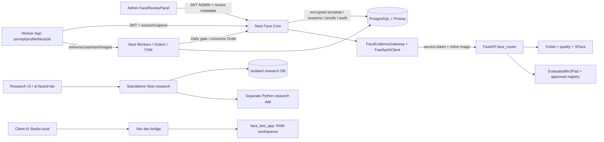
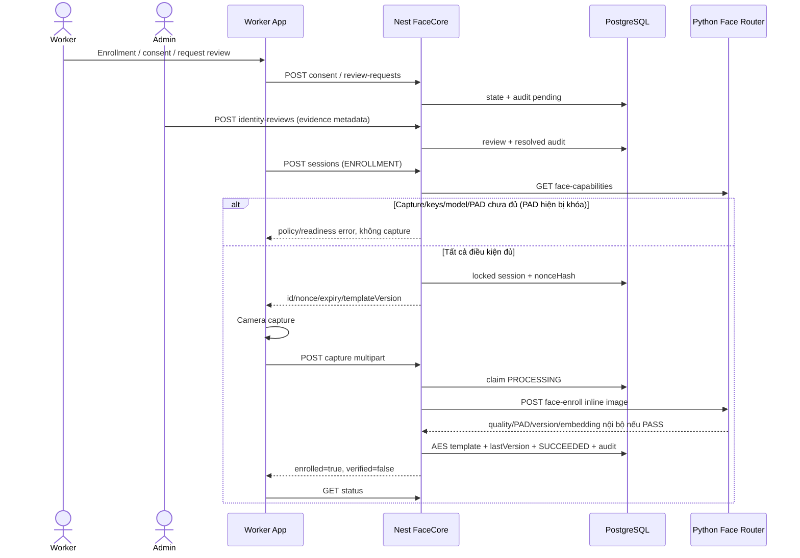
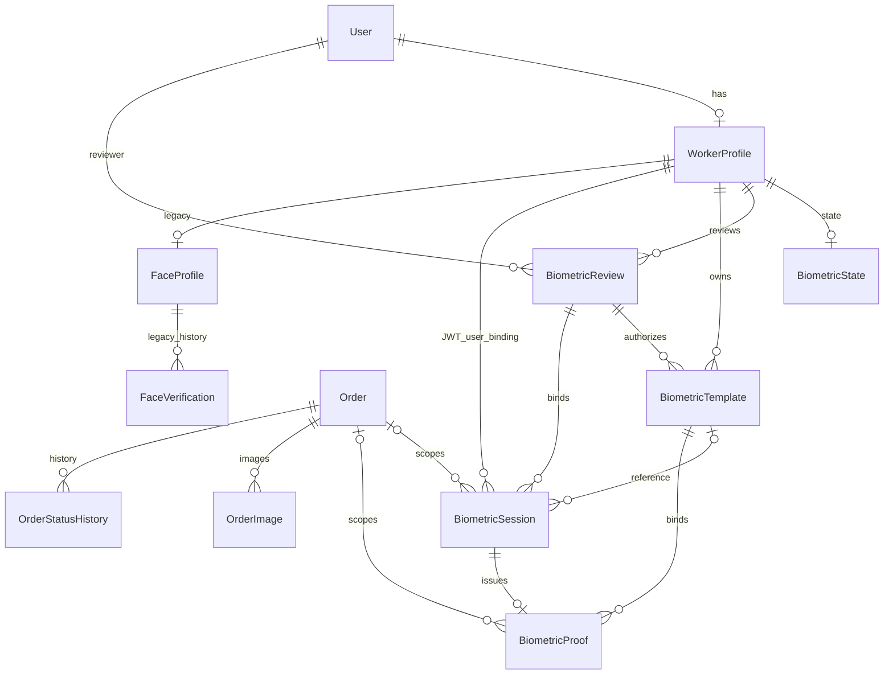
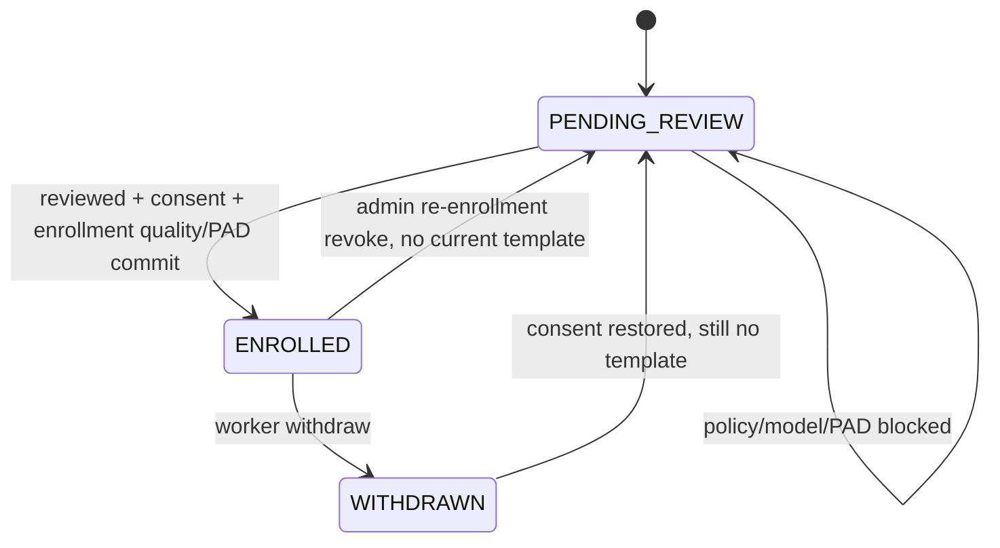
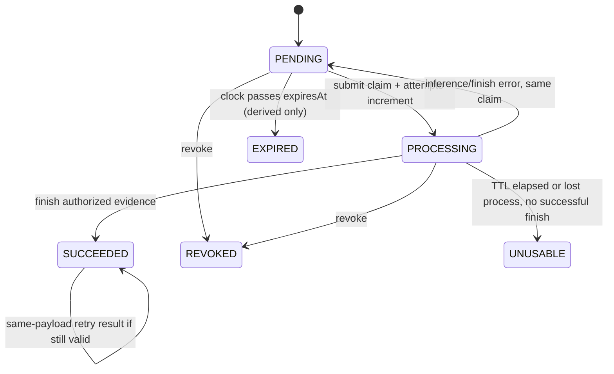
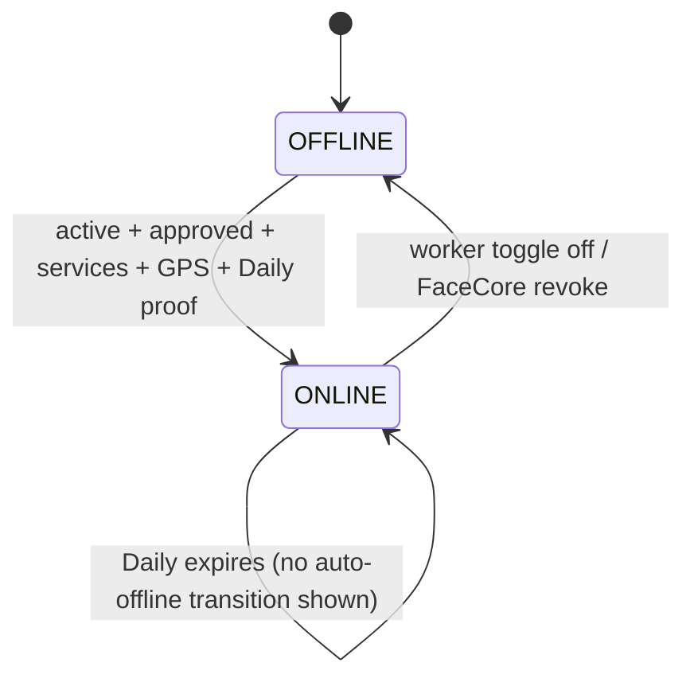
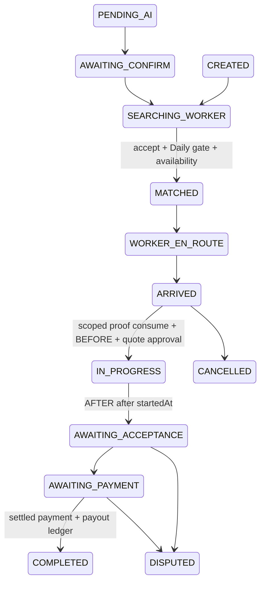

# BÁO CÁO FACEID HIỆN TẠI CỦA FIXGO

Ngày lập: 15/11/2026 — Asia/Ho_Chi_Minh. Căn cứ: mã nguồn đang tồn tại trong workspace. Báo cáo thực trạng; không chứa thiết kế thay thế, kế hoạch triển khai hay code sửa.

## CHƯƠNG 1 — TỔNG QUAN THỰC TRẠNG

FaceID hiện có **Face Core nghiệp vụ**, **research cô lập** và **sandbox local**. Ba nhánh dùng lại YuNet/SFace/MN3 ở các mức khác nhau nhưng không có cùng quyền cấp proof.

- **Face Core — IMPLEMENTED/BLOCKED:** có review danh tính, consent version, session có nonce, capture RAM, enrollment mã hóa, Daily proof và Order proof bền vững. Code chỉ cấp template/proof sau quality/PAD/evidence hợp lệ. Registry PAD Python và allowlist Nest hiện rỗng nên không thể coi hệ thống đã sẵn sàng enrollment/verification thật. Bằng chứng: `server/src/modules/workers/face/face-core.service.js:169`, `server/src/modules/workers/face/face-evidence.gateway.js:5`, `ai-service/pad_policy.py:36`.
- **Worker App — IMPLEMENTED/PARTIAL:** có login prompt, profile card, enrollment/reset, Daily và Order camera. Daily proof vẫn là gate online và nhận đơn. Order verification chỉ ở ARRIVED; start đòi scoped proof và BEFORE từ backend. Màn job hiện không có chức năng chụp/upload BEFORE. Bằng chứng: `worker-app/app/(worker)/(tabs)/index.jsx:68`, `worker-app/app/(worker)/job/[id].jsx:144`, `server/src/modules/orders/order-workflow.service.js:200`.
- **Research — IMPLEMENTED:** app/server/DB cô lập, lưu session và số đo whitelist, không tạo trusted template hoặc proof. `server/src/face-research/research.service.js:41`, `ai-service/face_research_app.py:18`.
- **Sandbox local — IMPLEMENTED:** mẫu tạm RAM và threshold thử nghiệm; có TEST_PASS/TEST_MATCH/testAccepted, nhưng verified=false, proof=null, padDecision=NOT_EVALUATED. Không cấp quyền cho worker/order. `ai-service/face_test_app.py:150`.

### Phạm vi và cách phân loại

Đã đọc nội dung hoặc các đoạn liên quan của **101 file source/config/schema/SQL** liệt kê ở Chương 2; tests được thống kê riêng ở Chương 9. Không tính ảnh, weights, tài liệu cũ hay file báo cáo vào số source. Với file lớn, audit tập trung implementation FaceID và call sites, không khẳng định đọc từng dòng toàn repository.

`IMPLEMENTED`: có code thực thi; `VERIFIED`: có kết quả kiểm chứng cụ thể; `BLOCKED`: code có nhưng gate chặn; `PARTIAL`: chỉ đủ một phần chuỗi; `NOT_IMPLEMENTED`: không tìm thấy implementation trong phạm vi đã search; `NOT_VERIFIED`: chưa đủ chứng cứ runtime. Một chức năng có thể IMPLEMENTED nhưng runtime NOT_VERIFIED/BLOCKED.

### Giới hạn kiểm chứng

Không chạy test, migration/seed/db push/reset, không tạo template/proof, không khởi động/dừng service/container trong nhiệm vụ hiện tại. Không đọc giá trị .env, không gọi API account thật, không đọc ảnh người thật. Test file hiện hữu được ghi EXISTS_NOT_RUN, không mặc định PASS.

Trong phần công việc trước yêu cầu này đã có một **load-only** bằng Python local: YuNet và SFace load thành công từ ai-service/weights, error=null; registry Python có 0 record. Không inference, không ảnh hoặc DB. Chỉ kết luận VERIFIED cho khả năng load artifact ở thời điểm phép kiểm đó; không coi đó là kết quả chạy mới hay chứng minh process production hiện tại. MN3, Android ML Kit, BlazeFace runtime, DB deployment và PAD accuracy: NOT_VERIFIED. Các tên biến cấu hình được nêu, không ghi giá trị secret.

## CHƯƠNG 2 — KIẾN TRÚC VÀ CẤU TRÚC MÃ NGUỒN

### Kiến trúc thực tế



Không có mũi tên từ research result hoặc testAccepted sang proof nghiệp vụ trong source đã kiểm tra. `ai-faceid-lab` có thể gọi cả Core và research qua hai client riêng; chọn Core vẫn chịu nguyên gate production.

### Module và call graph

`WorkersModule` import FaceCoreModule, đăng ký FaceIdentityController/Service (`server/src/modules/workers/workers.module.js:13`). `OrdersModule` import cùng FaceCoreModule (`server/src/modules/orders/orders.module.js:17`). FaceCoreModule cung cấp core/gateway/ready guard/controllers (`server/src/modules/workers/face/face-core.module.js:11`).

```text
WorkerLayout → FaceLoginPrompt → faceIdentityService.profile/status → faceSummary/facePrompt
Profile → useWorkerFaceStatus → FaceIdentityCard → face screen
Face screen → useFaceVerification → status/consent/review/sessions/capture
  capture: FaceReadyGuard → authorizeCapture → memory FileInterceptor → submit
  submit → workerTx claim → decrypt template → gateway.enroll/verify → FastApiAiClient
  → face_router → decode/extract_embedding/PAD/compare → finish transaction
  → enrollment template hoặc Daily/Order proof → App GET status xác nhận lại
Dashboard → hasShiftVerification → PATCH workers/status → updateAvailability → requireDaily
Dashboard accept → OrdersService.acceptOrder → OrderWorkflow.transition(MATCHED) → requireDaily
Job ARRIVED → Order capture → proof → PATCH status IN_PROGRESS / PATCH start
  → transition → consumeOrder + BEFORE + quote + update/history trong cùng transaction
  → event sau commit
```

Helper `face-proof-policy.js` là pure policy/test primitives; search không thấy production FaceCore gọi assessFaceSession/orderProofConsumptionWhere. Logic issuer thật nằm trong FaceCoreService, không suy từ comment 'proposed' của helper thành hiện trạng không có issuer.

### Danh mục file đã đọc

Mỗi đường dẫn `:1` dưới đây định danh file; bằng chứng function/line chi tiết ở các chương sau.

| # | File source | Vai trò trong phạm vi audit |
|---|---|---|
| 1 | `worker-app/app/(worker)/_layout.jsx:1` | Worker layout: auth/role gate, Stack và login prompt |
| 2 | `worker-app/app/(worker)/verification/face.jsx:1` | Màn Worker enrollment/reset/Daily/Order FaceID và camera/result modal |
| 3 | `worker-app/app/(worker)/(tabs)/index.jsx:1` | Dashboard online/Daily gate, incoming order/accept và active-order recovery |
| 4 | `worker-app/app/(worker)/job/[id].jsx:1` | Worker job detail: travel/arrived/scoped FaceID/start và refetch |
| 5 | `worker-app/src/features/auth/context/AuthContext.jsx:1` | Restore/login/logout auth state, session epoch và profile refresh |
| 6 | `worker-app/src/features/auth/services/workerEligibility.js:1` | Daily proof UI predicate và profile role/approval/services restrictions |
| 7 | `worker-app/src/features/face-verification/hooks/useFaceVerification.js:1` | Production Worker session/capture/consent/review/withdraw orchestration (customer copy legacy được ghi riêng) |
| 8 | `worker-app/src/features/face-verification/hooks/useWorkerFaceStatus.js:1` | Profile/status focus/foreground refresh với owner/generation fence |
| 9 | `worker-app/src/features/face-verification/components/LiveFaceCamera.jsx:1` | Native Expo camera + ML Kit guidance/final capture/cleanup |
| 10 | `worker-app/src/features/face-verification/components/LiveFaceCamera.web.jsx:1` | Web getUserMedia + BlazeFace guidance/blob capture/cleanup |
| 11 | `worker-app/src/features/face-verification/components/FaceLoginPrompt.jsx:1` | Advisory prompt một lần mỗi authenticated session |
| 12 | `worker-app/src/features/face-verification/components/FaceIdentityCard.jsx:1` | Profile enrollment/Daily summary, expiry và navigation actions |
| 13 | `worker-app/src/features/face-verification/components/VerificationResultModal.jsx:1` | Phân biệt requested/enrolled/verified/error trong modal |
| 14 | `worker-app/src/features/face-verification/services/faceIdentityService.js:1` | Worker API adapter profile/status/review request |
| 15 | `worker-app/src/features/face-verification/services/proof.js:1` | UI scope/version/issued/expiry/consumption predicate |
| 16 | `worker-app/src/features/face-verification/utils/faceStatus.js:1` | Map status/blockers thành summary và login prompt, Daily expiry |
| 17 | `worker-app/src/features/face-verification/utils/faceErrors.js:1` | Map backend safe error codes thành thông báo chụp lại/thử lại |
| 18 | `worker-app/src/features/face-verification/utils/captureQuality.js:1` | Single face/geometry/pose và stability1300ms guidance predicates |
| 19 | `worker-app/src/features/face-verification/utils/captureFiles.js:1` | Xóa file cache camera hoặc revoke web blob URL |
| 20 | `worker-app/src/features/orders/hooks/useOrderRecovery.js:1` | Backend refetch focus/foreground/socket, chống stale completion |
| 21 | `worker-app/src/services/api/apiClient.js:1` | Worker axios Bearer token, response unwrap, refresh/epoch và error handling |
| 22 | `worker-app/src/services/api/orderService.js:1` | Worker API adapter current/detail/accept/images/status-adjacent methods |
| 23 | `worker-app/src/services/api/faceService.js:1` | Legacy URL/multipart order face verification client |
| 24 | `worker-app/src/features/booking/services/bookingService.js:1` | Booking evidence helper; payload cũ khác OrderImage DTO |
| 25 | `worker-app/src/features/face-research/useFaceResearch.js:1` | Isolated research session/synthetic/camera/measurement/cache cleanup hook |
| 26 | `worker-app/src/features/face-research/ResearchScreen.jsx:1` | Android research UI, isolated connection/purpose/order/result |
| 27 | `worker-app/src/features/face-research/client.js:1` | Dedicated localhost-only research HTTP client không dùng auth refresh/logging production |
| 28 | `server/src/modules/workers/face/face-core.service.js:1` | Authority lifecycle: consent/review/template/session/proof/epoch/gates/transactions |
| 29 | `server/src/modules/workers/face/face-core.controller.js:1` | Worker Face Core endpoints và Admin review endpoints, explicit DTO validation |
| 30 | `server/src/modules/workers/face/face-core.config.js:1` | Feature/capture/consent/key/TTL/threshold/attempt/timeout configuration parser |
| 31 | `server/src/modules/workers/face/face-core.module.js:1` | DI wiring/export FaceCoreService, gateway, ready guard và controllers/lab |
| 32 | `server/src/modules/workers/face/face-identity.controller.js:1` | Worker status facade và enrollment/reset preflight routes |
| 33 | `server/src/modules/workers/face/face-identity.service.js:1` | Delegate enabled core hoặc disabled legacy-untrusted status; preflight rejected |
| 34 | `server/src/modules/workers/face/face-ready.guard.js:1` | Kiểm session/capture readiness trước memory multipart interception |
| 35 | `server/src/modules/workers/face/face-capture-blocked.guard.js:1` | Chặn unconditional legacy biometric capture trước cloud upload |
| 36 | `server/src/modules/workers/face/face-evidence.gateway.js:1` | Bridge AI evidence và double PAD approval/reference allowlist |
| 37 | `server/src/modules/workers/face/face-proof-policy.js:1` | Pure policy/nonce/conditional-consume predicates dùng trong tests, không production issuer |
| 38 | `server/src/modules/workers/face/template-crypto.js:1` | AES256GCM envelope seal/open và AAD/128float validation |
| 39 | `server/src/modules/workers/face/face-lab.controller.js:1` | Lab-only read-only inspector endpoint |
| 40 | `server/src/modules/workers/face/face-lab-inspector.service.js:1` | Own metadata inspector + derived session/proof/template lifecycle, không secret payload |
| 41 | `server/src/modules/workers/face/face-lab.guard.js:1` | Explicit non-production environment/flag gate, otherwise404 |
| 42 | `server/src/modules/workers/workers.service.js:1` | Professional profile/availability/Daily legacy comparison; requireDaily caller |
| 43 | `server/src/modules/workers/workers.controller.js:1` | Profile/online aliases và legacy capture HTTP guards |
| 44 | `server/src/modules/workers/workers.module.js:1` | Wire Workers/Identity facade với imported FaceCoreModule |
| 45 | `server/src/modules/workers/dto/face-core.dto.js:1` | Consent/session/capture/review/review-request/reject DTOs |
| 46 | `server/src/modules/workers/dto/update-availability.dto.js:1` | isOnline boolean và optional latitude/longitude declaration |
| 47 | `server/src/modules/orders/orders.service.js:1` | Order accept/status wrappers, image URL persistence và legacy verification |
| 48 | `server/src/modules/orders/orders.controller.js:1` | Order HTTP accept/travel/start/images/legacy FaceID routes |
| 49 | `server/src/modules/orders/orders.module.js:1` | Wire OrderWorkflow/OrdersRepository/guards và import FaceCoreModule |
| 50 | `server/src/modules/orders/order-workflow.service.js:1` | Canonical actor/ownership/FSM/locks/start proof consumption + evidence/quote gates |
| 51 | `server/src/modules/orders/order-access.guard.js:1` | Legacy order FaceID preguard current owner/worker/allowed stages |
| 52 | `server/src/modules/orders/constants/order-status.js:1` | Canonical order statuses, legacy aliases và permitted transitions |
| 53 | `server/src/modules/orders/validators/order-transition.validator.js:1` | Reject invalid normalized FSM edge |
| 54 | `server/src/modules/orders/dto/upload-order-image.dto.js:1` | JSON type ISSUE/BEFORE/AFTER và url DTO; không multipart bytes |
| 55 | `server/src/modules/orders/dto/update-order-status.dto.js:1` | Allowed requested stage strings + optional note DTO |
| 56 | `server/src/modules/orders/diagnosis/diagnosis-upload.interceptor.js:1` | Existing incident-image validation/storage wrapper; không BEFORE uploader |
| 57 | `server/src/infrastructure/external/ai/fastapi-ai.client.js:1` | AI HTTP transport, capabilities/template evidence validators, safe unavailable result |
| 58 | `server/src/infrastructure/external/ai/face-result.js:1` | Legacy/template contract predicates và legacy trusted gate luôn false |
| 59 | `server/src/infrastructure/external/ai/aiFallbackHelper.js:1` | Legacy face fallback TECHNICAL_ERROR/verified=false, không authority |
| 60 | `server/src/modules/auth/strategies/jwt.strategy.js:1` | Bearer signature/expiry/access type + ACTIVE user lookup, DB role |
| 61 | `server/src/modules/auth/guards/jwt-auth.guard.js:1` | Passport JWT guard và explicit Public metadata behavior |
| 62 | `server/src/modules/auth/guards/roles.guard.js:1` | Route/class Roles metadata guard |
| 63 | `server/src/modules/ai/ai.controller.js:1` | Legacy JWT comparison API (không Face Core proof issuer) |
| 64 | `server/src/modules/ai/ai.service.js:1` | Comparison delegation; không biometric account approval |
| 65 | `server/src/modules/ai/dto/verify-face.dto.js:1` | Legacy faceImageUrl/idCardImageUrl validation declaration |
| 66 | `server/src/config/cloudinary.config.js:1` | Existing avatar/worker-face/incident storage adapters; không in credentials |
| 67 | `server/src/config/storage.config.js:1` | Storage driver/S3 config declarations; không chứng minh actual uploader sử dụng |
| 68 | `server/src/main.js:1` | Main Nest bootstrap /api + validation; khác Python main được ghi riêng |
| 69 | `server/src/common/filters/http-exception.filter.js:1` | Custom error envelope class hiện hữu; không thấy đăng ký bootstrap inspected |
| 70 | `server/src/face-research/research.controller.js:1` | Isolated research JWT/capture guards và 5 HTTP endpoints |
| 71 | `server/src/face-research/research.service.js:1` | Isolated worker/order/participant/session/measurement validation and SQL persistence |
| 72 | `server/src/face-research/research.dto.js:1` | Research session UUIDv4/purpose/order scope và nonce DTO |
| 73 | `server/scripts/face-research/schema.sql:1` | Dedicated disposable face_research environment/sessions schema, không Prisma migration |
| 74 | `server/scripts/face-research/start.cjs:1` | Standalone research bootstrap, isolated localhost DB/environment/service config checks |
| 75 | `server/prisma/schema.prisma:1` | Worker/Order/legacy face và Biometric models, relations/uniques/indexes |
| 76 | `server/prisma/migrations/20261113190000_face_core_v2/migration.sql:1` | Face Core initial tables/CHECKs/immutable template |
| 77 | `server/prisma/migrations/20261113200000_face_binding_hardening/migration.sql:1` | Composite identity FKs/authority/immutability/epoch triggers hardening |
| 78 | `ai-service/main.py:1` | Production Python lifespan nạp YuNet/SFace, optional evaluated PAD và include face router |
| 79 | `ai-service/face_core.py:1` | Production inline decode/quality/SFace embedding/cosine/enrollment evidence |
| 80 | `ai-service/face_router.py:1` | Internal token-auth face endpoints, bounded JSON và model lock/threadpool |
| 81 | `ai-service/face_models.py:1` | Pinned YuNet/SFace loader, SHA256 checks và model version |
| 82 | `ai-service/face_pad.py:1` | Evaluated MN3 adapter: tight YuNet crop + approved decision gate |
| 83 | `ai-service/pad_mn3.py:1` | MN3 verified artifact/OpenVINO/preprocessor/measurement/timeout-poison provider |
| 84 | `ai-service/pad_policy.py:1` | PAD evaluation record validator và approval-dependent decision gate, registry rỗng |
| 85 | `ai-service/pad_contract.py:1` | PadEvidence/PadProvider contract và UnavailablePad |
| 86 | `ai-service/face_research.py:1` | Measurement-only acquisition/compare/quality/debug/latency pipeline |
| 87 | `ai-service/face_research_app.py:1` | Separate isolated Python research capabilities/inference API |
| 88 | `ai-service/face_test_app.py:1` | Local-only RAM workspace/session/template sandbox, provisional test decisions |
| 89 | `ai-faceid-lab/src/lib/api.ts:1` | Web lab client tách Core/research routes và redacted request tracing |
| 90 | `ai-faceid-lab/src/lib/types.ts:1` | Web lab Status/Session/Proof/Measurement response types |
| 91 | `ai-faceid-lab/vite.config.ts:1` | Loopback-only lab proxy Core/research; không public production hosting config |
| 92 | `client/src/features/workers/services/faceReviewService.js:1` | Admin pending/approve/reject API adapter |
| 93 | `client/src/features/workers/components/FaceReviewPanel.jsx:1` | Admin pending identity evidence/review approve/reject form |
| 94 | `client/src/pages/test-ai/hooks/useFaceTest.js:1` | Client AI Studio sandbox workspace/session/enroll/verify/history RAM orchestration |
| 95 | `client/src/services/test-ai/faceTestService.js:1` | Dev sandbox HTTP adapter + blob-to-inline conversion/error mapping |
| 96 | `client/scripts/faceTestPlugin.js:1` | Vite serve-only localhost bridge, lazy disposable model runtime, scoped assets |
| 97 | `customer-app/src/features/face-verification/hooks/useFaceVerification.js:1` | Legacy duplicate customer-app worker face hook có gallery; không production Worker Face Core hook |
| 98 | `server/src/modules/orders/orders.repository.js:1` | Order/detail/current active snapshot và workflow delegation |
| 99 | `server/src/app.module.js:1` | Main backend module imports, bao gồm Workers/Orders/AI |
| 100 | `ai-service/eval/face_evaluation.py:1` | Manifest/trials validation, calibration/evaluation metrics tooling; không tự duyệt PAD |
| 101 | `server/src/modules/workers/dto/face-preflight.dto.js:1` | Explicit boolean consent=true DTO cho preflight không thu biometric |

## CHƯƠNG 3 — TOÀN BỘ LUỒNG NGHIỆP VỤ HIỆN TẠI

Mỗi luồng dưới đây ghi điểm bắt đầu/kết thúc, actor, preconditions, I/O, API, xử lý/rẽ nhánh, state và lỗi. URL Nest nghiệp vụ có prefix `/api` (server/src/main.js:15); Worker apiClient đã cấu hình baseURL nên call sites viết route không prefix.

### 01. Sau khi Worker đăng nhập

- **Bắt đầu/actor:** worker login hoặc restore auth. AuthProvider nhận user/access token, kiểm sessionEpoch; WorkerLayout chỉ cho role WORKER và render FaceLoginPrompt. `worker-app/src/features/auth/context/AuthContext.jsx:11`, `worker-app/app/(worker)/_layout.jsx:7`.
- **Input/precondition:** auth state có user.id/token; prompt không bị dismissed ở cùng user/sessionEpoch, không đang /verification, /job, /profile.
- **Xử lý/API:** prompt GET `/workers/me`, GET `/workers/me/face/status` song song; facePrompt dựa profile approval, enrollment và Daily proof. Không tự mở camera, không ghi consent.
- **Output/state/kết thúc:** local modal mời enrollment/Daily hoặc không modal nếu proof còn hạn; 'Để sau' chỉ dismiss local. Login vẫn dùng được; online/start do server kiểm riêng.
- **Thất bại/rẽ nhánh:** status lỗi không trap modal; owner/abort checks tránh response phiên cũ. Login Google/Firebase/password dùng chung layout prompt. `worker-app/src/features/face-verification/components/FaceLoginPrompt.jsx:20`, `worker-app/src/features/face-verification/utils/faceStatus.js:89`.

### 02. Kiểm tra trạng thái FaceID

- **Bắt đầu/actor:** prompt/profile/face screen/job gọi status; JWT worker ACTIVE.
- **Input/API:** GET `/workers/me/face/status?orderId=...` (orderId optional); controller→FaceIdentityService.status. Nếu core enabled delegate FaceCore.status; disabled trả capability fail closed với LEGACY_UNTRUSTED/PENDING_REVIEW.
- **Xử lý:** capabilities trước workerTx; worker lock, đọc state/current template/review/pending audit và valid proofs. Order query phải current assigned worker; canVerifyOrder chỉ ARRIVED. `server/src/modules/workers/face/face-core.service.js:189`.
- **Output/state/kết thúc:** enrollmentStatus, template metadata/version, consent/review flags, blockers, canEnroll/canVerifyDaily/canVerifyOrder, Daily/Order proof metadata. Không phát proof, không upsert biometric state trong status.
- **Thất bại:** ACTIVE_WORKER_REQUIRED/ORDER_ACCESS_DENIED, core capability endpoint FACE_CORE_DISABLED; status facade disabled vẫn trả unavailable metadata. status trả proof metadata có thể đồng thời có blockers; hai thứ không đồng nghĩa quyền đã được xác nhận.

### 03. Đăng ký khuôn mặt lần đầu

- **Bắt đầu/actor:** worker chọn mode=enrollment tại face screen; profile APPROVED, consent hiện hành, identity review, crypto/capture/model/PAD readiness.
- **Input/API:** POST sessions `{purpose:ENROLLMENT,requestKey}`; POST sessions/:id/capture multipart nonce + image camera. Backend tự lấy worker từ JWT; không nhận embedding client.
- **Xử lý:** takeSelfie:72 kiểm canEnroll → tạo session trước camera → capture URI. submit:678 claim PROCESSING dưới worker lock; AI enrollment; finish:870 recheck authority/scope/epoch/review/quality/PAD/model/version; AES seal embedding, tạo template, lastVersion tăng, session SUCCEEDED.
- **Output/state/kết thúc:** `{enrolled:true,verified:false,template:metadata}`; App refetch status kiểm ENROLLED và đúng session.templateVersion. **Không tạo Daily/Order proof.** Modal hiện điều hướng tiếp Daily (`worker-app/app/(worker)/verification/face.jsx:60`).
- **Thất bại:** TEMPLATE_ALREADY_ENROLLED, CONSENT_REQUIRED, IDENTITY_REVIEW_REQUIRED, BIOMETRIC_DATA_POLICY_NOT_APPROVED, FACE_KEYS_NOT_CONFIGURED, IDENTITY_MODEL_NOT_READY, PAD_NOT_EVALUATED hoặc evidence/quality/PAD rejection. Runtime registry hiện khiến capture enrollment BLOCKED.

### 04. Ghi nhận consent

- **Bắt đầu/actor:** worker tick checkbox và bấm lưu ở enrollment; không tự ghi khi login.
- **Input/API:** hook recordConsent(true), POST `/workers/me/face/consent` `{consent:true,version:status.requiredConsentVersion}`. DTO Equals(true), version≤128; controller bodyAs validation.
- **Xử lý/state:** core.consent:412 kiểm version trùng config; workerTx upsert state, cập nhật consentVersion/consentedAt/withdrawnAt=null, audit CONSENT.
- **Output/kết thúc:** consent metadata; hook refresh status. Không tạo review/template/proof và không đổi epoch tại bước này.
- **Thất bại:** explicit consent invalid/version không đúng, inactive worker/core policy. Gọi lại có thể ghi audit và timestamp mới; không có requestKey idempotency cho consent.

### 05. Identity review và Admin approval

- **Bắt đầu/actor:** worker yêu cầu review, admin xử lý bằng evidence đã kiểm thực tế. Professional approval không phải biometric approval.
- **Input/API:** POST review-requests `{consent:true,kind:ENROLLMENT|REENROLLMENT}`; admin GET pending; POST identity-reviews với requestId optional, reviewedIdentity=true, kind, evidenceReference, SHA256 digest, reason, expiresAt; hoặc reject với requestId/reason.
- **Xử lý:** requestReview:333 giữ worker lock, kiểm expected kind theo lastVersion, trả pending cũ nếu có; request lưu BiometricAudit action IDENTITY_REVIEW_REQUESTED, reason JSON epoch, targetId kind. pendingReview:303 tìm tối đa 50 request mới nhất và resolution theo request ID. Admin phải ACTIVE ADMIN, worker APPROVED ACTIVE; review window >now và≤30 ngày. Panel hiện gửi cửa sổ 7 ngày (`client/src/features/workers/components/FaceReviewPanel.jsx:43`).
- **Output/state/kết thúc:** request submitted/PENDING hoặc review row + audit resolve. Reject chỉ close request, giữ template; approve REENROLLMENT revoke/delete trước khi tạo review mới cùng transaction. Review approval không tạo template/proof.
- **Thất bại:** REVIEW_KIND_INVALID, IDENTITY_ALREADY_REVIEWED, REVIEW_REQUEST_NOT_PENDING, ACTIVE_ADMIN_REQUIRED, IDENTITY_REVIEW_EVIDENCE_REQUIRED. Request không phải bằng chứng đã kiểm danh tính, digest/reference không tự chứng minh ngoài hệ thống.

### 06. Daily FaceID

- **Bắt đầu/actor:** worker mở face screen không orderId/mode enrollment/reset; default mode daily (`worker-app/app/(worker)/verification/face.jsx:12`). Preconditions template/consent/review/quality/PAD readiness.
- **Input/API:** sessions DAILY+requestKey, capture nonce+camera image; không orderId.
- **Xử lý/state:** verify decrypt trusted template, AI cosine + PAD; finish tạo DAILY proof với TTL mặc định 8h. Worker re-fetch status, đối chiếu proof ID/version/time/purpose/orderId=null; không dùng faceVerifiedAt.
- **Output/kết thúc:** verified=true và durable Daily proof nếu mọi gate pass; local result modal. requireDaily đọc proof, **không consume Daily**.
- **Thất bại:** không template, model mismatch, session expired, quality/PAD/match rejection, scope/replay/rate limit; hiện PAD_BLOCKED nên không coi Daily thật hoạt động.

### 07. Worker bật nhận đơn

- **Bắt đầu/actor:** dashboard switch online; profile đã tải, không active order/error; API JWT WORKER.
- **Input/API:** PATCH `/workers/status` `{isOnline:true,lat,lng}`; alias `/workers/me/availability` cùng service. `server/src/modules/workers/workers.service.js:196` updateAvailability.
- **Xử lý:** FE profileRestriction kiểm role/ACTIVE/APPROVED/services và hasShiftVerification(Daily proof); nếu thiếu mở Daily modal. Sau đó xin GPS, fetch coordinates, gửi PATCH. Backend kiểm boolean/GPS/range, ACTIVE/APPROVED/services; core enabled workerTx recheck services và requireDaily:248. Core disabled legacy trusted check luôn fail.
- **Output/state/kết thúc:** `{message,isOnline}`; update worker isOnline/location và socket admin sau xử lý; FE chỉ set local online sau ACK đúng boolean.
- **Thất bại/rẽ nhánh:** thiếu Daily/GPS/services/approval; permission/network error. Tắt online không yêu cầu Daily, không tự thu hồi proof. Không có timer trong backend tự offline lúc Daily hết hạn được thấy trong đoạn này.

### 08. Worker nhận đơn

- **Bắt đầu/actor:** incoming order dashboard hoặc accept API; worker ACTIVE, approved, online, có Daily proof, chưa busy.
- **Input/API:** POST `/orders/:id/accept` hoặc PATCH alias accept; no body workerId. OrdersService.acceptOrder:427→transition(MATCHED).
- **Xử lý:** khóa worker rồi order; check actor, order assignable/not taken; normalize status/FSM; current==target return unchanged trước Daily/busy checks. Accept mới gọi requireDaily (core enabled), isOnline/APPROVED, query active order; update workerId/status/history atomically.
- **Output/state/kết thúc:** `{success,order,changed}`; MATCHED; events sau commit, extra matched event chỉ khi changed. FE refetch current order.
- **Thất bại:** ORDER_ALREADY_TAKEN, DAILY_PROOF_REQUIRED, WORKER_NOT_AVAILABLE, WORKER_HAS_ACTIVE_ORDER, INVALID_TRANSITION; transaction rollback. Đây không phải kiểm timestamp 24h dù comment/Swagger cũ còn nói vậy.

### 09. Worker đến nơi ARRIVED

- **Bắt đầu/actor:** assigned worker từ MATCHED→WORKER_EN_ROUTE→ARRIVED.
- **Input/API:** job PATCH status `{status:WORKER_EN_ROUTE|ARRIVED}`; alias PATCH arriving/arrived. `worker-app/app/(worker)/job/[id].jsx:48`, workflow.transition:76.
- **Xử lý/state:** JWT actor/current owner và FSM, row locks/history/event. Job bắt đầu location tracker sau en route ACK, stop sau ARRIVED ACK.
- **Output/kết thúc:** order ARRIVED + statusHistory ARRIVED; lúc này ORDER session được phép. Không tạo proof tự động khi arrived.
- **Thất bại:** wrong owner, inactive/role, invalid transition/conflict/network; job reload. Không yêu cầu quét ORDER trong lúc MATCHED/en route.

### 10. Order FaceID

- **Bắt đầu/actor:** job ARRIVED chưa có valid orderProof→face route params orderId.
- **Input/API:** scoped status; sessions `{purpose:ORDER,orderId,requestKey}`; capture nonce+image. orderId lấy route, worker từ JWT.
- **Xử lý:** orderAccess:561 tại create/authorize/submit/finish khóa order và yêu cầu owner+ARRIVED. Proof issue bind session, template/epoch/model/PAD, worker và order; TTL mặc định 5 phút. App refetch scoped status xác nhận ID/version/purpose/order/TTL.
- **Output/state/kết thúc:** verified=true/proof; order vẫn ARRIVED, proof chưa consumed; modal router.back, job focus reload. Không tự upload BEFORE hay start.
- **Thất bại:** wrong worker/order, stage khác ARRIVED, missing template/consent, expired/revoked/rate limited, PAD/match lỗi. `isCurrentFaceProof()` chỉ là UI predicate, không authority server.

### 11. Chụp/lưu ảnh BEFORE

- **Bắt đầu/actor:** **không tìm thấy nút/màn camera BEFORE trong worker job hiện tại** sau search worker routes/imports. Backend có API ghi ảnh, chưa phải uploader bytes.
- **Input/API backend:** POST `/orders/:id/images` JSON `{type:BEFORE,url:http(s)}`; DTO UploadOrderImageDto, không multipart.
- **Xử lý:** uploadImage:465 order lock, actor ACTIVE/current owner; chỉ worker BEFORE@ARRIVED, AFTER@IN_PROGRESS; customer ISSUE ở early stages. Kiểm HTTP URL, dedupe order/type/url, tạo OrderImage mirror imageUrl/imageType với uploadedAt.
- **Output/state/kết thúc:** `{success:true,image}`; order vẫn ARRIVED. **Không kiểm/consume Order proof tại uploadImage**, không có uploaderId field hoặc proof FK trên ảnh.
- **Thất bại:** order missing/access denied, PHOTO_ACTION_NOT_ALLOWED, INVALID_PHOTO_URL. Comment controller nói upload S3 nhưng implementation chỉ ghi URL. bookingService.uploadEvidencePhoto gửi EVIDENCE/imageUrl khác DTO và không phải BEFORE camera thực thi.

### 12. Bắt đầu công việc IN_PROGRESS

- **Bắt đầu/actor:** job ARRIVED có local valid orderProof bấm start; hoặc worker PATCH `/orders/:id/start`, generic PATCH status IN_PROGRESS.
- **Input:** orderId, JWT, target status; không client proof token. `server/src/modules/orders/orders.service.js:810`→updateStatus:461→workflow.
- **Xử lý:** actor/owner/FSM; worker/order lock; nếu current==IN_PROGRESS trả changed=false trước consume. Lần chuyển mới, enabled core consumeOrder:1049 kiểm approved ACTIVE/consent/current template/scope/epoch/time, current order owner+ARRIVED, conditional consume count=1 + audit. Sau đó cần BEFORE uploadedAt≥arrival.createdAt, quote gần nhất approved nếu có, startedAt/update/history cùng transaction.
- **Output/state/kết thúc:** commit order IN_PROGRESS, proof consumedAt, audit/history một lần, event sau commit. UI không scan khi IN_PROGRESS.
- **Thất bại:** ORDER_FACE_PROOF_REQUIRED, PROOF_ALREADY_CONSUMED, MISSING_BEFORE_PHOTO, QUOTE_NOT_APPROVED, ORDER_STATE_CONFLICT; rollback cả consume/audit/history/order. Upload BEFORE thất bại thì proof giữ chưa consume; BEFORE thành công nhưng start thất bại thì ảnh giữ, proof rollback nếu tx lỗi. Chưa có frontend complete BEFORE→start path.

### 13. Proof hết hạn

- **Bắt đầu/actor:** thời gian server vượt expiresAt; không cần background job sửa state.
- **Input/xử lý:** status query chỉ lấy issuedAt≤now<expiresAt và unrevoked/unconsumed. requireDaily/consumeOrder kiểm DB clock. completed() khi retry capture thành công cũng kiểm proof TTL (`core:835`).
- **Output/state/kết thúc:** expired row vẫn lưu nhưng không trả active proof; DAILY_PROOF_REQUIRED/ORDER_FACE_PROOF_REQUIRED hoặc PROOF_EXPIRED_OR_CONSUMED. Client local Date.now cũng kiểm khi render.
- **Giới hạn:** job proof predicate không có timer; khi không rerender, UI có thể hiển thị cũ tới lần reload/render. Backend vẫn kiểm. isOnline không tự thành false bởi đoạn TTL query. Proof đã consume không làm việc đang IN_PROGRESS phải scan lại.

### 14. Proof bị thu hồi / withdraw

- **Bắt đầu/actor:** worker xác nhận Alert thu hồi, DELETE `/workers/me/face/template`; hoặc admin approve REENROLLMENT gọi revoke.
- **Input/xử lý:** workerTx lock; revoke:512 tăng epoch; mark template revoked/deleted và encrypted=DbNull; revoke proof/review; PENDING/PROCESSING sessions→REVOKED; worker offline; audit metadata.
- **Output/kết thúc:** withdrawnAt/templatesDeleted/proofsRevoked cho worker withdraw; consent cleared khi withdraw=true. Hook refresh state và xóa ảnh local.
- **Thất bại/race:** inactive/core disabled/network; delayed inference finish không qua epoch/state fence sau revoke. Không có code tự lùi order IN_PROGRESS hoặc xóa history/images trong revoke.

### 15. Đăng ký lại khuôn mặt

- **Bắt đầu/actor:** worker mode=reset; lastVersion>0/template hiện có/withdrawn. Reset screen không mở capture trực tiếp.
- **Input/API:** requestReview `{kind:REENROLLMENT,consent:true}`; admin review REENROLLMENT; worker consent nếu cần rồi enrollment session mới.
- **Xử lý/state:** request không overwrite mẫu. Admin approve gọi revoke(withdraw=false), epoch tăng/xóa payload/proof cũ, tạo review epoch mới; state.lastVersion không giảm. Enrollment tạo version lastVersion+1 và immutable model/AAD binding.
- **Output/kết thúc:** template phiên bản mới nếu mọi gate đủ; không tự Daily proof. Reset preflight luôn accepted=false, không phải API cấp lại mẫu. `core:467`, :909; `worker-app/app/(worker)/verification/face.jsx:54`.
- **Thất bại:** review kind/request evidence invalid, review window, PAD/keys/model/capture policy; pending request alone không thay template. Runtime re-enrollment thật vẫn BLOCKED bởi PAD.

### 16. Khôi phục khi mở lại app

- **Bắt đầu/actor:** process restart, focus/foreground, socket reconnect, user/order đổi.
- **Input/xử lý:** AuthProvider restore auth; useWorkerFaceStatus profile+status refetch với AbortController/owner/generation. useOrderRecovery:7 fetch current/detail trên focus, AppState active, connect và order:status_changed; không tin payload event làm state. Job load order/profile/scoped face status; status error bị catch→null.
- **Output/kết thúc:** order/backend proof là authority; local capture/session/requestKey không persist. Face hook refresh xóa nonce/capture/requestKey RAM rồi GET status; không có endpoint resume PENDING/PROCESSING session bằng app storage trong target hook.
- **Rẽ nhánh/lỗi:** old response bị generation fence; load failure hides stale data và retry; native ImagePicker background có exemption riêng, embedded camera đóng khi background. Upload/start timeout job reload; backend IN_PROGRESS retry changed=false. Pending PROCESSING do process server chết không có reclaim scheduler được thấy trong core; session expiry/rate window vẫn áp dụng.

### Sequence: enrollment hiện có (nhánh thành công có điều kiện)



### Sequence: Order proof và start hiện có, với điểm BEFORE còn thiếu ở UI

```mermaid
sequenceDiagram
  participant UI as Worker Job / Face Screen
  participant N as Nest Face Core
  participant F as Order Workflow
  participant AI as Python AI
  participant DB as PostgreSQL
  UI->>F: PATCH status ARRIVED
  F->>DB: ARRIVED + history, commit
  UI->>N: POST sessions ORDER + orderId
  N->>DB: owner/ARRIVED session
  UI->>N: POST capture nonce + image
  N->>AI: verify trusted template + PAD
  AI-->>N: evidence (chỉ qua khi policy đủ)
  N->>DB: durable ORDER proof
  UI->>N: GET scoped status
  Note over UI,F: Job UI chưa có BEFORE capture/upload
  Note over F,DB: API POST images JSON có thể ghi BEFORE@ARRIVED; không kiểm proof
  UI->>F: PATCH status IN_PROGRESS
  F->>DB: BEGIN worker/order locks
  F->>DB: consume scoped proof
  F->>DB: check BEFORE after arrival + quote
  alt Thiếu ảnh hoặc prerequisite
    F->>DB: ROLLBACK proof/audit/order/history
    F-->>UI: MISSING_BEFORE_PHOTO hoặc lỗi khác
  else Hợp lệ
    F->>DB: IN_PROGRESS + startedAt + history, COMMIT
    F-->>UI: changed=true; event sau commit
  end
```

## CHƯƠNG 4 — PHÂN TÍCH TỪNG FUNCTION QUAN TRỌNG

| File | Function | Được gọi từ | Input | Xử lý chính | Output | Side effects | Error |
|---|---|---|---|---|---|---|---|
| `server/src/modules/workers/face/face-core.service.js:51` | policy | workerTx/ready/status/requireDaily/consumeOrder | options | enabled và positive integer≤86400000 cho TTL/attempt/window/timeout; threshold finite [-1,1], consent text | void | không DB | FACE_CORE_DISABLED/FACE_POLICY_INVALID |
| `server/src/modules/workers/face/face-core.service.js:77` | workerTx | status/consent/session/submit/finish/withdraw | userId, callback | transaction; user WORKER ACTIVE; khóa worker row; re-read user; DB clock; maxWait/timeout10s | callback result | row lock, callback writes | ACTIVE_WORKER_REQUIRED/policy/DB timeout |
| `server/src/modules/workers/face/face-core.service.js:117` | current | status/create/finish/requireDaily/consume | tx,workerId | state→template cùng epoch,lastVersion, not revoked/deleted | template hoặc null | read | DB error |
| `server/src/modules/workers/face/face-core.service.js:130` | identityReview | status/createSession | state,template,now | Có template: reviewId exact worker/epoch/not revoked, bỏ expiry; chưa template: review còn hạn mới nhất | review/null | read | DB error |
| `server/src/modules/workers/face/face-core.service.js:169` | ready | createSession/authorizeCapture/submit | config + gateway caps | capture policy→crypto keys→identity readiness→evaluated PAD/model provenance | caps | HTTP capability call | BIOMETRIC_DATA_POLICY_NOT_APPROVED/FACE_KEYS_NOT_CONFIGURED/IDENTITY_MODEL_NOT_READY/PAD_NOT_EVALUATED |
| `server/src/modules/workers/face/face-core.service.js:189` | status | FaceIdentityService/CoreController | JWT userId, optional orderId | current template/review/pending requests, blockers và proof filters, ownership/stage | capability metadata | HTTP + locked DB reads | policy/ACTIVE_WORKER_REQUIRED/ORDER_ACCESS_DENIED |
| `server/src/modules/workers/face/face-core.service.js:303` | pendingReview | status/request/admin/review | tx,workerId,epoch | 50 request audit mới nhất; mỗi request tìm resolution targetId | PENDING metadata/null | read, có N+1 bounded queries | DB |
| `server/src/modules/workers/face/face-core.service.js:333` | requestReview | POST review-requests | consent,kind | approved worker; expected kind theo lastVersion; reuse pending; reviewed-before-enroll reject | submitted/request | audit pending only | EXPLICIT_REVIEW_CONSENT_REQUIRED/REVIEW_KIND_INVALID/IDENTITY_ALREADY_REVIEWED |
| `server/src/modules/workers/face/face-core.service.js:370` | adminReviewRequest | GET admin pending | adminId,workerId | ACTIVE ADMIN, worker exists, current epoch pending request | request/null | read | ACTIVE_ADMIN_REQUIRED/WORKER_NOT_FOUND |
| `server/src/modules/workers/face/face-core.service.js:390` | rejectReviewRequest | POST admin reject | requestId,reason | transaction admin active, worker lock, exact pending ID; append resolution | rejected/requestId | audit resolution | REVIEW_REQUEST_NOT_PENDING |
| `server/src/modules/workers/face/face-core.service.js:412` | consent | POST consent | userId,version | match config; workerTx state upsert; current consent timestamp, clear withdrawn | version/date | state+audit | CONSENT_VERSION_REQUIRED |
| `server/src/modules/workers/face/face-core.service.js:425` | review | POST admin identity-reviews | adminId,workerId,evidence metadata | admin/worker checks; deadline≤30d; request binding optional; reset revokes; create review | review metadata | review/audit; reset epoch/template/proof/offline | ACTIVE_ADMIN_REQUIRED/IDENTITY_REVIEW_EVIDENCE_REQUIRED/REENROLLMENT_REVIEW_REQUIRED |
| `server/src/modules/workers/face/face-core.service.js:512` | revoke | withdraw/review REENROLLMENT | tx,workerId,actorId,now,withdraw | epoch++; payload delete; revoke template/proof/session/review; offline | void | multiple tables + audit; cùng caller tx | DB rolls back |
| `server/src/modules/workers/face/face-core.service.js:555` | withdraw | DELETE template | JWT userId | workerTx→revoke(withdraw=true) | withdrawnAt/templatesDeleted/proofsRevoked | consent cleared, encrypted erased | policy/actor/DB |
| `server/src/modules/workers/face/face-core.service.js:561` | orderAccess | create/authorize/submit/finish/consume | tx,worker,purpose,orderId | ORDER lock current order, worker assignment, ARRIVED; nonORDER orderId must null | void | order lock | ORDER_ACCESS_DENIED/FACE_STAGE_NOT_ALLOWED/ORDER_SCOPE_INVALID |
| `server/src/modules/workers/face/face-core.service.js:570` | createSession | POST sessions | purpose,orderId,requestKey,userId | ready→workerTx→approval/consent/order→duplicate scope/expiry→creation quota→template/review→nonceHash | sessionMeta | session+SESSION_CREATED audit | INVALID_SESSION_INPUT/IDEMPOTENCY_SCOPE_CONFLICT/SESSION_EXPIRED/FACE_RATE_LIMITED/TEMPLATE_ALREADY_ENROLLED/TRUSTED_TEMPLATE_REQUIRED |
| `server/src/modules/workers/face/face-core.service.js:644` | sessionMeta/nonce | createSession duplicate/new | session row | HMAC id/worker/user from server key; return only metadata | id,purpose,orderId,nonce,expiry,templateVersion,state | no write | key/config |
| `server/src/modules/workers/face/face-core.service.js:655` | authorizeCapture | FaceReadyGuard | userId,sessionId | ready; same user/worker, consent/epoch/TTL, state PENDING or SUCCEEDED; order check | true | locked reads; before multipart | SESSION_ACCESS_DENIED/SESSION_EXPIRED_OR_BUSY |
| `server/src/modules/workers/face/face-core.service.js:678` | submit | capture and JSON submit controllers | sessionId,nonce,inline photo,userId | validate input; ready; claim tx; digest/nonce, ownership,scope,expiry,model,quota; decrypt; async inference; finish | enrolled result or proof | PROCESSING/attempts/digest/claim; transient plaintext; audit | INVALID_NONCE/REPLAY_PAYLOAD_CHANGED/SESSION_BUSY_OR_REVOKED/FACE_RATE_LIMITED/INLINE_CAPTURE_REQUIRED/evidence safe error |
| `server/src/modules/workers/face/face-core.service.js:835` | completed | submit on SUCCEEDED duplicate | tx,session | current template version/model; enrollment metadata; proof lineage/TTL/current validity | same enrollment/proof result | read | TRUSTED_TEMPLATE_REQUIRED/PROOF_EXPIRED_OR_CONSUMED |
| `server/src/modules/workers/face/face-core.service.js:870` | finish | submit after evidence | userId,sessionId,claimId,caps,evidence | workerTx recheck claim/epoch/consent/order/review/evidence; quality/PAD; enrollment encrypt or verify score | enrolled=true verified=false OR verified=true proof | atomic template/state/session/audit OR session/proof/audit | SESSION_EXPIRED_OR_REVOKED/INVALID_FACE_EVIDENCE/FACE_QUALITY_REJECTED/FACE_PAD_REJECTED/IDENTITY_NOT_VERIFIED |
| `server/src/modules/workers/face/face-core.service.js:1011` | eligibleWorker | requireDaily/consumeOrder | tx,workerId | WORKER ACTIVE APPROVED | worker | read | APPROVED_ACTIVE_WORKER_REQUIRED |
| `server/src/modules/workers/face/face-core.service.js:1024` | requireDaily | Workers.updateAvailability; Workflow accepting | tx,workerId | policy/eligible; current consent/template; Daily orderId null epoch/version/model/time valid | metaProof | read only, no consume | DAILY_PROOF_REQUIRED |
| `server/src/modules/workers/face/face-core.service.js:1049` | consumeOrder | Workflow target IN_PROGRESS | tx,workerId,orderId,actorId | eligible/consent/current template/proof filters; current order owner+ARRIVED; conditional count=1 | consumed metaProof | proof consumedAt + audit within caller tx | ORDER_FACE_PROOF_REQUIRED/PROOF_ALREADY_CONSUMED |
| `server/src/modules/workers/face/template-crypto.js:20` | sealTemplate/openTemplate | finish/submit | 128 finite floats, context,key,envelope | AES256GCM; random12byte IV,16byte tag; AAD worker/version/model; decrypt checks shape | envelope or transient vector | encrypted DB payload only in finish | INVALID_TEMPLATE_CONTEXT/KEY/EMBEDDING/FORMAT; auth failure |
| `server/src/modules/workers/face/face-evidence.gateway.js:14` | capabilities/enroll/verify | FaceCore | AI identity/PAD metadata | PAD true only exact modelVersion in Nest approved map + matching evaluation reference; delegate evidence | sanitized caps/evidence | HTTP client | unavailable caps/fallback NOT_EVALUATED |
| `server/src/infrastructure/external/ai/fastapi-ai.client.js:89` | verifyFaceTemplate | gateway.verify | backend template/photo/session/model | validate template/threshold/token; service HTTP15s; validTemplateFaceResult | evidence or TECHNICAL_ERROR | network, no persistence | FACE_SERVICE_UNAVAILABLE safe result |
| `server/src/infrastructure/external/ai/fastapi-ai.client.js:136` | enrollFaceTemplate | gateway.enroll | photo,session,worker,model/version | service HTTP15s; strict bindings; embedding accepted only quality/PAD PASS, proper method and shape | evidence/failure | network | FACE_SERVICE_UNAVAILABLE |
| `server/src/infrastructure/external/ai/fastapi-ai.client.js:114` | faceCapabilities | gateway | service token/config | GET caps15s; validate identity version regex+method; preserve PAD reference | caps/unavailable | network | safe false readiness |
| `server/src/infrastructure/external/ai/face-result.js:20` | validTemplateFaceResult | FastApiAiClient | result,expected context | bind worker/session; enum quality/PAD/decision; MATCH/NON_MATCH require model/version/method/score/threshold | boolean | none | false |
| `server/src/modules/workers/workers.service.js:196` | updateAvailability | workers status/availability controllers | JWT userId,isOnline,lat,lng | GPS/active/approval/services; core workerTx requireDaily; disabled legacy fail closed | message/isOnline | worker online/location, admin event | Daily required / unavailable / invalid coords |
| `server/src/modules/orders/order-workflow.service.js:74` | transition | orders accept/status/start wrappers | orderId,userId,status,options | worker→order lock; authorization/normalize/FSM/same-state; gates; optimistic update/history; event after commit | success/order/changed | atomic order/proof/audit/history, socket after commit | role/ownership/FSM/prerequisite/conflict |
| `server/src/modules/orders/orders.service.js:465` | uploadImage | POST images | orderId,{type,url},userId | order lock; actor+owner; allowed photo stage; HTTP URL; exact URL dedupe | success/image | OrderImage create only | PHOTO_ACTION_NOT_ALLOWED/INVALID_PHOTO_URL |
| `worker-app/src/features/face-verification/hooks/useFaceVerification.js:33` | refresh/cancel | mount/AppState/screen | orderId + AbortController | invalidate generation/request/capture; reload scoped status; native external camera exception | local status/error | RAM state/cache cleanup | statusError, no proof grant |
| `worker-app/src/features/face-verification/hooks/useFaceVerification.js:72` | takeSelfie/acceptCapture | screen + LiveFaceCamera callback | mode/orderId/status/URI | check backend capability; session first; nonce/scope/TTL shape; launch embedded/native camera | URI/cameraVisible | local camera/file, requestKey reuse | permission/session/expiry report |
| `worker-app/src/features/face-verification/hooks/useFaceVerification.js:111` | verify | submit button | current session+nonce+local URI | sync ref lock; FormData; capture POST30s; GET status; validate proof ID/version/scope/TTL or enrolled state | result/modal/onSuccess | local file deleted; capture refs clear only success | friendly faceErrorMessage; preserve for retry |
| `worker-app/src/features/face-verification/hooks/useWorkerFaceStatus.js:7` | useWorkerFaceStatus | profile | auth identity | profile/status allSettled; focus/active; abort/generation/owner fence | profile/status/loading/error/reload | local state only | partial fetch error |
| `worker-app/src/features/orders/hooks/useOrderRecovery.js:7` | useOrderRecovery | dashboard/job | load callback,identity | focus/active/reconnect/status event refetch; reject outdated completion | data/loading/error/reload | subscriptions + RAM | loader errors hide stale data |
| `worker-app/src/features/face-verification/utils/captureQuality.js:1` | assessNativeFaces/captureStability | native/web guidance | faces,image dimensions,previous,time | count/geometry/pose; stable duration1300ms, ≥4samples; resets movement/gap | ok/message/progress | none | UI guidance only |
| `ai-service/face_models.py:20` | load_face_models | main lifespan / research/test app | model directory | hash before/after load; OpenCV detector+recognizer; immutable hash version | FaceModels objects/error | load weights into RAM | MODEL_FILES_UNAVAILABLE/HASH_MISMATCH/LOAD_FAILED |
| `ai-service/face_core.py:43` | decode_capture | enroll/compare/research | bytes or inline data URI | strict JPEG/PNG/base64≤5MB; PIL dimensions≤12M; OpenCV decode BGR | BGR ndarray | transient RAM | INLINE_IMAGE_REQUIRED/INVALID_IMAGE_ENCODING/DECODE_FAILED |
| `ai-service/face_core.py:73` | extract_embedding | enroll/compare | image,detector,recognizer,policy | single YuNet15-value box/landmarks score; quality; SFace alignCrop/feature128 | feature or quality reason | model mutable context | NO_FACE/MULTIPLE_FACES/LIGHTING/BLUR/INVALID_EMBEDDING |
| `ai-service/face_core.py:103` | compare_capture | face_router._compare | capture,template/version/model,models,policy,pad | decode/extract; cosine; threshold; independently evaluate PAD | identity+quality+PAD evidence, verified=false | RAM only | technical safe result; no exception details |
| `ai-service/face_core.py:134` | enroll_capture | face_router._compare enrollment | photo/version/model/models/pad | quality extract; PAD; expose embedding only PAD PASS | embedding evidence or blocked result | RAM only | MODEL_NOT_READY/MODEL_OR_TEMPLATE_VERSION_INVALID/PAD_NOT_EVALUATED |
| `ai-service/face_pad.py:11` | EvaluatedMn3Pad.capabilities/assess | production router if configured | capture(image,detector),registry | load measurement model + approved gate; exact one face crop; measure; gate decide | PadEvidence | inference | NOT_EVALUATED/INCONCLUSIVE/PASS/FAIL |
| `ai-service/pad_mn3.py:18` | preprocess/ExperimentalMn3Pad.measure | evaluated/research/test pipeline | uint8 BGR128x128x3 | RGB mean/scale normalization; OpenVINO async inference + timeout/lock; output validate | real/spoof Measurement | bounded CPU request, timeout poison | PAD_PREPROCESS_INVALID/BUSY/TIMEOUT/OUTPUT_INVALID |
| `ai-service/pad_policy.py:134` | PadDecisionGate.status/decide | production adapter/research | measurement + approved record | exact version/hash/profile/crop; dataset approval/metrics; real≥record threshold iff approved | PadDecision | none | PAD_BLOCKED_DATA/BLOCKED_APPROVAL/rejected/version mismatch |
| `server/src/face-research/research.service.js:162` | ResearchService.submit | research capture/synthetic | nonce,photo/reference or synthetic | auth/participant/scope; claim/quota tx; AI outside tx; whitelist+finish tx; retry DONE same digest | measurement researchOnly | isolated sessions.result JSON; never trusted template/proof | RESEARCH_* rejection/timeout/busy/expiry |
| `ai-service/face_test_app.py:146` | sandbox process | test capture | workspace RAM,photo,purpose | acquire; provisional PAD.85/identity.60; store RAM embedding iff accepted enroll | testAccepted + measurements, proof=null | RAM workspace only | test-prefixed failures; not business proof |

### Async, timeout, retry và transaction

1. `submit` claim transaction kết thúc trước gọi AI; inference không giữ worker lock. Promise.race timeout mặc định15s; timer clear ở finally. FastApiAiClient có AbortSignal.timeout15s riêng. Nếu infer/finish throw, catch re-open workerTx chỉ reset PROCESSING với đúng claimId về PENDING, ghi INFERENCE_REJECTED/NO_PROOF_GRANTED; attempts **không giảm**. Late AI response không tự gọi finish lần hai sau race timeout.
2. Safe errors sau inference chỉ preserve FACE_QUALITY_REJECTED, FACE_PAD_REJECTED, IDENTITY_NOT_VERIFIED, SESSION_EXPIRED_OR_REVOKED; còn lại thành FACE_EVIDENCE_REJECTED. Fail ở ready/claim trước try giữ mã lỗi của gate. Exception/decrypted vector không đưa ra mobile (`server/src/modules/workers/face/face-core.service.js:801`).
3. Duplicate requestKey có cùng worker/purpose/order/epoch, chưa expired/revoked trả cùng session/nonce; duplicate submit SUCCEEDED chỉ cùng digest mới trả completed. Payload đổi→REPLAY_PAYLOAD_CHANGED. Quota: mặc định3 attempts/session, 5 sessions hoặc tổng5 attempts trong15 phút (config ở core.config:12); worker lock chống quota race nhiều instance.
4. `consumeOrder` không mở transaction riêng; caller workflow truyền tx. Query proof + updateMany count=1 + audit nằm cùng tx với BEFORE/quote/order/history. Source dùng explicit row locks trên worker rồi order; không thấy isolationLevel Serializable được đặt trong transaction này.
5. Review/withdraw và session claim/finish dùng cùng worker lock; epoch fence và immutable binding chống result cũ sau reset. Không có cancellation HTTP khiến server undo một success đã commit; client reload là phép đọc trạng thái thật.
6. Status là snapshot và UI predicate là display gating. Không có proof ký gửi trong client để server tin trực tiếp; consume chọn proof lưu DB. Không có distributed lock với process AI/model rollout được thể hiện ở code này.

## CHƯƠNG 5 — API INPUT/OUTPUT CONTRACT HIỆN TẠI

### Quy ước chung

**Đã kiểm tra 46 cặp HTTP method + route** trong bảng dưới; route alias tính riêng. Không coi tất cả 46 route là production API. Research và sandbox có namespace/process riêng. Asset proxy không tính như API nghiệp vụ, login/AFTER/payment không tính vào 46 endpoint FaceID/liên quan trực tiếp.

- **W**: Authorization Bearer access JWT + RolesGuard WORKER. JwtStrategy xác minh signature/expiry, từ chối refresh token, đọc user ACTIVE và lấy role từ DB (`server/src/modules/auth/strategies/jwt.strategy.js:18`). WorkerId thực suy từ userId→workerProfile; không body workerId.
- **A**: JWT + ADMIN, service còn kiểm ACTIVE ADMIN. Path `:id` là workerId, không userId.
- **S**: Python nội bộ header x-face-service-token; cấu hình thiếu→503, token sai→401; không dùng worker JWT làm service token. JSON inference phải Content-Type application/json.
- **R**: JWT research riêng, HS256, audience fixgo-face-research và issuer environmentId; role WORKER, exp/sub hợp lệ. Không chấp nhận JWT production như credential mặc định.
- **RS**: x-face-research-token, isolated flag và secret length gate; **T**: local-only flag + x-face-test-token; thêm x-face-workspace cho workspace routes. Browser sandbox đi Vite bridge, không nhìn service secret; bridge kiểm localhost/same origin và x-test-face-client.
- **E(X)**: controller trả `{success:true,data:X}`; không phải axios envelope. Worker apiClient interceptor đã trả response.data (`worker-app/src/services/api/apiClient.js:60`); hook unwrap response.data hoặc response. **TransitionResult** là `{success:true,order,changed,cancellationFee?}`. Không tự coi mọi endpoint có data wrapper.
- POST không có HttpCode override dùng Nest mặc định201; GET/PATCH/DELETE thông thường200. Swagger ở accept có thể khai200 dù POST thực không set HttpCode. Lỗi Forbidden401/403/NotFound404/Conflict409/BadRequest400/limit413 theo guards/framework và exception thực.
- Main ValidationPipe bật whitelist/transform nhưng JS controller Bind có thể không đủ reflected DTO metadata. Face Core tự `bodyAs` với whitelist+forbidNonWhitelisted nên kiểm runtime explicit. Preflight cũng kiểm explicit. Các DTO availability/order/AI tồn tại nhưng không tuyên bố tự động validation đầy đủ nếu chưa runtime chứng minh. Service có validation quan trọng riêng.
- Có `AllExceptionsFilter` source tại `server/src/common/filters/http-exception.filter.js:10`, nhưng không thấy main.js/AppModule đăng ký global filter đó. Không khẳng định active envelope lỗi custom. Core dùng Nest exceptions; Python thường `{detail:code}`, inference nhiều lỗi biểu diễn ở response200 body.

### Endpoint inventory và contract

Path/query/body cần thiết được nêu trong cột Input; không có query/body nếu ghi none. Bảng là mô tả schema source, không ghi token/nonce/embedding mẫu thực.

| # | Method | URL | Auth/headers bổ sung | Input | Response success | Error/gate chính | Controller → service (source) | Database / side effect |
|---|---|---|---|---|---|---|---|---|---|
| 1 | GET | /api/workers/me/face/status | W | query orderId? | E(Status) | ACTIVE_WORKER_REQUIRED / ORDER_ACCESS_DENIED | `server/src/modules/workers/face/face-identity.controller.js:17` FaceIdentityService.status→core.status or disabled metadata | state/template/review/audit/proof/order reads |
| 2 | GET | /api/workers/me/face/capabilities | W | query orderId? | E(Status) | FACE_CORE_DISABLED / ORDER_ACCESS_DENIED | `server/src/modules/workers/face/face-core.controller.js:65` core.status | same locked reads; external caps |
| 3 | POST | /api/workers/me/face/consent | W | JSON consent=true,version string≤128 | E(consentVersion,consentedAt) | FACE_INPUT_INVALID / CONSENT_VERSION_REQUIRED | `server/src/modules/workers/face/face-core.controller.js:75` core.consent | state upsert/update + audit |
| 4 | POST | /api/workers/me/face/sessions | W | JSON purpose ENROLLMENT/DAILY/ORDER,requestKey UUID,orderId? UUID (ORDER required) | E(SessionMeta) | readiness / CONSENT_REQUIRED / IDENTITY_REVIEW_REQUIRED / IDEMPOTENCY_SCOPE_CONFLICT / FACE_RATE_LIMITED | `server/src/modules/workers/face/face-core.controller.js:87` core.createSession | locked worker/order; session+audit; duplicate read |
| 5 | POST | /api/workers/me/face/sessions/:id/submit | W | path id; JSON nonce≤128, photo inline JPEG/PNG≤90000chars DTO | E(EnrollmentResult or VerificationResult) | FACE_INPUT_INVALID / INLINE_CAPTURE_REQUIRED / nonce/session/evidence errors | `server/src/modules/workers/face/face-core.controller.js:104` core.submit | claim + finish transactions, template or proof |
| 6 | POST | /api/workers/me/face/sessions/:id/capture | W + FaceReadyGuard | path id; multipart image≤5MiB,nonce; MIME JPEG/PNG; one file/one text field | E(EnrollmentResult or VerificationResult) | readiness / SESSION_EXPIRED_OR_BUSY / JPEG_OR_PNG_REQUIRED / nonce/replay/quality/PAD errors | `server/src/modules/workers/face/face-core.controller.js:122` authorizeCapture→submit | same; image memory only |
| 7 | POST | /api/workers/me/face/review-requests | W | JSON consent=true,kind ENROLLMENT/REENROLLMENT | E(submitted,request) | EXPLICIT_REVIEW_CONSENT_REQUIRED / REVIEW_KIND_INVALID / IDENTITY_ALREADY_REVIEWED | `server/src/modules/workers/face/face-core.controller.js:159` core.requestReview | audit pending under worker lock |
| 8 | DELETE | /api/workers/me/face/template | W | no body | E(withdrawnAt,templatesDeleted,proofsRevoked) | core policy/actor/DB | `server/src/modules/workers/face/face-core.controller.js:176` core.withdraw→revoke | epoch/consent/template/proof/session/review/offline/audit |
| 9 | POST | /api/workers/me/face/enrollment/preflight | W | JSON only consent=true | E(Status+action ENROLLMENT,accepted=false,errorCode ENROLLMENT_POLICY_UNAVAILABLE) | EXPLICIT_CONSENT_REQUIRED_NO_BIOMETRIC_INPUT | `server/src/modules/workers/face/face-identity.controller.js:22` FaceIdentityService.preflight | status reads only; no request saved |
| 10 | POST | /api/workers/me/face/reset/preflight | W | JSON only consent=true | E(Status+action RESET,accepted=false,errorCode RESET_REVIEW_WORKFLOW_UNAVAILABLE) | same explicit consent error | `server/src/modules/workers/face/face-identity.controller.js:29` preflight(reset=true) | status reads; no reset saved |
| 11 | GET | /api/admin/workers/:id/face/review-request | A | path id=workerId | E(request/null) | ACTIVE_ADMIN_REQUIRED / WORKER_NOT_FOUND | `server/src/modules/workers/face/face-core.controller.js:196` core.adminReviewRequest | user/worker/state/audit read |
| 12 | POST | /api/admin/workers/:id/face/review-request/reject | A | path workerId; JSON requestId UUID,reason nonblank≤160 | E(rejected=true,requestId) | FACE_INPUT_INVALID / REVIEW_REQUEST_NOT_PENDING | `server/src/modules/workers/face/face-core.controller.js:206` core.rejectReviewRequest | worker lock + audit resolution |
| 13 | POST | /api/admin/workers/:id/face/identity-reviews | A | reviewedIdentity=true,kind,evidenceReference [A-Za-z0-9:_-]{1,128}, evidenceDigest SHA256,reason≤160,expiresAt ISO,requestId?UUID | E(id,kind,approvedAt,expiresAt,reviewerId) | IDENTITY_REVIEW_EVIDENCE_REQUIRED / REENROLLMENT_REVIEW_REQUIRED / REVIEW_REQUEST_NOT_PENDING | `server/src/modules/workers/face/face-core.controller.js:221` core.review | review+audit; REENROLLMENT revoke/deletion in tx |
| 14 | GET | /api/workers/me | W | no body | raw worker profile incl user/services/wallet | worker not found | `server/src/modules/workers/workers.controller.js:56` WorkersService.getProfile | worker/user/services read; not proof response |
| 15 | PATCH | /api/workers/status | W | JSON isOnline boolean,lat/lng when true | raw message,isOnline | Daily/GPS/approval/services errors | `server/src/modules/workers/workers.controller.js:113` WorkersService.updateAvailability | worker update + Daily read in workerTx |
| 16 | PATCH | /api/workers/me/availability | W | same availability input | same message,isOnline | same gates | `server/src/modules/workers/workers.controller.js:123` same updateAvailability | same |
| 17 | POST | /api/workers/verify-face-daily | W + CaptureBlocked | multipart image nominal; guard throws before interceptor storage | no success in HTTP path | 403 FACE_CAPTURE_UNAVAILABLE: ENROLLMENT_PAD_AND_PROOF_REQUIRED | `server/src/modules/workers/workers.controller.js:100` guard; legacy verifyFaceDaily unreachable via guarded HTTP | no upload/write after gate rejection |
| 18 | GET | /api/orders/worker/current | W | no body | raw active order or null | JWT/role/DB | `server/src/modules/orders/orders.controller.js:156` getCurrentWorkerOrder→repository | worker+latest active order/images/history read |
| 19 | GET | /api/orders/:id | JWT + related actor | path orderId | raw order detail | ORDER access/not found | `server/src/modules/orders/orders.controller.js:170` OrdersService.getOrderById | order/images/history read |
| 20 | POST | /api/orders/:id/accept | W | path orderId,no workerId body | TransitionResult | ORDER_ALREADY_TAKEN / DAILY_PROOF_REQUIRED / WORKER_NOT_AVAILABLE / WORKER_HAS_ACTIVE_ORDER / INVALID_TRANSITION | `server/src/modules/orders/orders.controller.js:235` acceptOrder→transition MATCHED | worker/order locks,order+history; Daily read |
| 21 | PATCH | /api/orders/:id/accept | W | same | same | same | `server/src/modules/orders/orders.controller.js:262` same acceptOrder | same |
| 22 | PATCH | /api/orders/:id/status | W | path id; JSON status,note?; DTO supports WORKER_EN_ROUTE,WORKER_ARRIVING,ARRIVED,IN_PROGRESS,AWAITING_ACCEPTANCE,AWAITING_CONFIRMATION | TransitionResult | INVALID_TRANSITION / ORDER_ACCESS_DENIED / ORDER_FACE_PROOF_REQUIRED / MISSING_BEFORE_PHOTO / QUOTE_NOT_APPROVED | `server/src/modules/orders/orders.controller.js:319` updateStatus→transition | order/history; start consumes proof+audit |
| 23 | PATCH | /api/orders/:id/arriving | W | path id; no body | TransitionResult | ownership/FSM | `server/src/modules/orders/orders.controller.js:513` markArriving→transition WORKER_EN_ROUTE | order/history |
| 24 | PATCH | /api/orders/:id/arrived | W | path id; no body | TransitionResult | ownership/FSM | `server/src/modules/orders/orders.controller.js:523` markArrived→transition ARRIVED | order/history arrival |
| 25 | PATCH | /api/orders/:id/start | W | path id; no body | TransitionResult | proof/BEFORE/quote/FSM errors | `server/src/modules/orders/orders.controller.js:531` startWork→transition IN_PROGRESS | atomic proof consume/order/history/audit |
| 26 | POST | /api/orders/:id/images | JWT + service actor/ownership | path id; JSON type ISSUE/BEFORE/AFTER,url nonempty string | raw success=true,image | PHOTO_ACTION_NOT_ALLOWED / INVALID_PHOTO_URL / ORDER_ACCESS_DENIED | `server/src/modules/orders/orders.controller.js:341` OrdersService.uploadImage | order lock; dedupe/create OrderImage; no proof check |
| 27 | POST | /api/orders/:id/face-verify | W + OrderAccess + CaptureBlocked | nominal JSON photoUrl | no success via guarded HTTP | 403 FACE_CAPTURE_UNAVAILABLE or access/stage | `server/src/modules/orders/orders.controller.js:275` guard→legacy verifyFace (not trusted issuer) | no writes |
| 28 | POST | /api/orders/:id/face-verify-upload | W + OrderAccess + CaptureBlocked | nominal multipart image≤5MiB | no success via guarded HTTP | same capture blocker | `server/src/modules/orders/orders.controller.js:300` guard before Cloudinary interceptor | no storage after rejection |
| 29 | POST | /api/ai/verify-face | JWT only, no WORKER role decorator | JSON faceImageUrl,idCardImageUrl as read by controller; DTO exists | raw legacy identity result; not proof | safe TECHNICAL_ERROR/unavailable result on transport/invalid contract | `server/src/modules/ai/ai.controller.js:27` AiService.verifyFace→FastApiAiClient.verifyFace | no biometric/account approval writes |
| 30 | GET | /api/workers/me/face/lab/inspect | LabDebug then W | query orderId? string≤128 | E(labOnly,serverTime,worker,consent,state,templates,sessions,proofs,audit,order,policy) | 404 when disabled/production; ORDER_SCOPE_INVALID / ORDER_ACCESS_DENIED | `server/src/modules/workers/face/face-lab.controller.js:17` FaceLabInspectorService.inspect | read-only max20 rows per collection, no nonce/encrypted payload |
| 31 | GET | /ai/face-capabilities | S | no body | raw identityModelReady,modelVersion,verificationMethod,padDecision,padEvaluated,padModelVersion,padEvaluationReference,padErrorCode,errorCode | 401 FACE_SERVICE_UNAUTHORIZED / 503 FACE_SERVICE_AUTH_NOT_CONFIGURED | `ai-service/face_router.py:40` face_capabilities | no DB |
| 32 | POST | /ai/face-enroll | S | JSON photo inline,workerId,sessionId,templateVersion int,modelVersion | raw enrollment evidence; embedding only internally after evaluated PAD PASS | 401/503 auth,415 JSON_REQUIRED,413 FACE_PAYLOAD_TOO_LARGE,400 INVALID_FACE_REQUEST; inference errors in 200 body | `ai-service/face_router.py:58` _face_inference→enroll_capture | no DB/persistence |
| 33 | POST | /ai/face-verify | S | JSON photo,templateEmbedding backend-selected,workerId,sessionId,templateVersion,modelVersion | raw identity/quality/PAD evidence; verified=false | same transport/parser errors; model/template/image errors in body | `ai-service/face_router.py:52` _face_inference→compare_capture | no DB |
| 34 | POST | /api/v1/ai/verify-face | S | same template contract (not legacy URL DTO) | same | same | `ai-service/face_router.py:53` alias same face_verify | no DB |
| 35 | GET | /face-research/capabilities | R | none | E(researchOnly,cameraAllowed,proofAllowed=false,padEvaluated=false,syntheticAvailable,model/PAD diagnostics) | RESEARCH_AUTH_REQUIRED / RESEARCH_WORKER_DENIED / RESEARCH_AI_UNAVAILABLE | `server/src/face-research/research.controller.js:34` ResearchService.capabilities | isolated worker/participant reads + AI caps |
| 36 | POST | /face-research/sessions | R | JSON purpose,requestKey UUIDv4,orderId? string≤128 | E(id,purpose,orderId,expiresAt,nonce,state,researchOnly) | RESEARCH_MODEL_NOT_READY / IDEMPOTENCY_CONFLICT / ORDER_STAGE_INVALID / RATE_LIMITED | `server/src/face-research/research.controller.js:36` ResearchService.create | isolated face_research.sessions insert; no trusted template |
| 37 | POST | /face-research/sessions/:id/synthetic | R | JSON nonce; photos forbidden | E(whitelisted Measurement) | RESEARCH_NONCE_INVALID / SESSION_EXPIRED / REPLAY_CHANGED / AI_TIMEOUT | `server/src/face-research/research.controller.js:38` ResearchService.submit synthetic | claim/result in isolated sessions |
| 38 | POST | /face-research/sessions/:id/capture | R + ResearchCaptureGuard | header x-research-nonce; multipart image,reference?;≤5MiB each; reference required real DAILY/ORDER | E(Measurement) | RESEARCH_CAPTURE_NOT_APPROVED / CONSENT_REQUIRED / REVIEW_REQUIRED / REFERENCE_CAPTURE_REQUIRED | `server/src/face-research/research.controller.js:40` authorizeCapture/submit | RAM image; isolated measurement JSON only |
| 39 | DELETE | /face-research/sessions | R | none | E(researchOnly,sessionsDeleted,mediaStored=false,templatesStored=false) | RESEARCH_WORKER_DENIED | `server/src/face-research/research.controller.js:47` ResearchService.erase | DELETE own research sessions only |
| 40 | GET | /research/capabilities | RS | none | raw researchOnly,captureAllowed,padEvaluated=false,proofAllowed=false,model/PAD/evaluation policy | 503 RESEARCH_NOT_CONFIGURED / 401 RESEARCH_UNAUTHORIZED | `ai-service/face_research_app.py:38` Python research capabilities | no DB |
| 41 | POST | /research/infer | RS | JSON workerId,sessionId, synthetic=true OR photo/referencePhoto; whitelist keys | raw research measurement, verified/enrolled false,proof null | JSON_REQUIRED / RESEARCH_INPUT_INVALID / RESEARCH_CAPTURE_NOT_APPROVED / RESEARCH_BUSY / RESEARCH_PAYLOAD_TOO_LARGE | `ai-service/face_research_app.py:47` infer_research under exclusive model lock | RAM inference only |
| 42 | GET | /capabilities (sandbox; client proxy /api/test-face/capabilities) | T | none | raw testOnly,proofAllowed=false,persistentStorage=false,model readiness,thresholds,TTLs | LOCAL_TEST_MODE_REQUIRED / LOCAL_TEST_UNAUTHORIZED | `ai-service/face_test_app.py:98` sandbox capabilities | RAM app state only |
| 43 | POST | /workspaces (sandbox) | T | JSON exactly consent=true | workspace handle + expiresInSeconds1800 | EXPLICIT_TEST_CONSENT_REQUIRED / TEST_WORKSPACE_LIMIT | `ai-service/face_test_app.py:112` new_workspace | RAM workspace; max16 |
| 44 | DELETE | /workspace (sandbox) | T + workspace header | header x-face-workspace; no body | deleted=true | local auth; unknown handle deletion is idempotent | `ai-service/face_test_app.py:124` erase | RAM workspace delete |
| 45 | POST | /sessions (sandbox) | T + workspace header | JSON exactly purpose ENROLL/VERIFY | id,nonce,expiresInSeconds120 | TEST_TEMPLATE_REQUIRED / DELETE_TEST_TEMPLATE_FIRST / TEST_PURPOSE_INVALID / TEST_WORKSPACE_EXPIRED | `ai-service/face_test_app.py:130` sandbox session | RAM latest session replaces older sessions |
| 46 | POST | /sessions/{sid}/capture (sandbox) | T + workspace header | JSON exactly nonce,photo; path sid | testOnly,verified=false,proof=null,testAccepted,templateStoredInMemory,scores,quality/reasons/versions | TEST_AI_BUSY / TEST_NONCE_INVALID / TEST_SESSION_EXPIRED_OR_CONSUMED / INVALID_TEST_IMAGE / TEST_INFERENCE_FAILED | `ai-service/face_test_app.py:193` capture→process | claim delete before await; RAM template only |

### Schema output nghiệp vụ cụ thể

**Status (core enabled):** `enrollmentStatus` ENROLLED/WITHDRAWN/PENDING_REVIEW; `template` id/version/modelVersion/revokedAt/deletedAt hoặc null; `templateVersion`; requiredConsentVersion/consentVersion/consentRequired; identityReviewApproved; reviewRequestSubmitted/reviewRequest/reviewKind/canRequestReview; blockers[]; canEnroll/canRequestReset/canVerifyDaily/canVerifyOrder; padDecision INCONCLUSIVE nếu evaluated, ngược lại NOT_EVALUATED; dailyProof/orderProof metadata hoặc null. `server/src/modules/workers/face/face-core.service.js:270`.

**SessionMeta:** id,purpose,orderId,nonce,expiresAt,templateVersion,state. Nonce được HMAC deterministic từ session id/worker/user, chỉ nonceHash lưu DB. `server/src/modules/workers/face/face-core.service.js:644`.

**EnrollmentResult:** verified=false,enrolled=true,template metadata. **VerificationResult:** verified=true,proof metadata. Proof meta chỉ id,purpose,orderId,templateVersion,issuedAt,expiresAt,consumedAt; không trả ciphertext/vector/service secret. `server/src/modules/workers/face/face-core.service.js:18`, :26, :955, :1008.

**Python evidence:** identityDecision MATCH/NON_MATCH/INCONCLUSIVE/TECHNICAL_ERROR; identityScore nullable [-1,1]; verificationMethod; model/templateVersion; qualityDecision PASS/FAIL/NOT_EVALUATED; padDecision/PAD model/error; workerId/sessionId echo type-checked. verified luôn false trong Python production outcome; Nest issuer quyết định authorization. Enrollment method yunet_sface_embedding, embedding chỉ nội bộ nếu evaluated PAD PASS. Client không nhận raw AI evidence/vector trực tiếp từ core response.

**Research Measurement:** researchOnly=true,verified=false,enrolled=false,proof=null; purpose/order/session IDs; identityDecision MEASURED/REFERENCE_NOT_PROVIDED/INCONCLUSIVE; scores; quality/referenceQuality; detection/referenceDetection; alignment; identity/quality/PAD policy metadata; versions, sanitized errors và latencyMs. Nest whitelist loại embeddings/media/extra authority fields (`server/src/face-research/research.service.js:41`).

**Legacy URL mismatch:** FastApiAiClient.verifyFace gửi photoUrl/idCardImageUrl vào router mới vốn nhận photo/templateEmbedding/model/version. Đây không phải same contract với verifyFaceTemplate. Kể cả legacy service identity MATCH, workers/order legacy vẫn throw FACE_PROOF_UNAVAILABLE; HTTP legacy capture còn bị guard unconditional chặn. `/api/ai/verify-face` chỉ comparison interface, không account approval/proof issuer.

## CHƯƠNG 6 — PHÂN TÍCH AI MODEL VÀ IMAGE PIPELINE

### 6.1. Model và vị trí sử dụng

| Model | Artifact / nguồn load | Input / output được chứng minh trong code | Đường chạy và kiểm chứng |
|---|---|---|---|
| YuNet | face_detection_yunet_2023mar.onnx; `ai-service/face_models.py:6`, load_face_models:20; main lifespan FACE_MODEL_DIR hoặc WEIGHTS_DIR `ai-service/main.py:237` | Wrapper nhận ảnh OpenCV BGR H×W×3; setInputSize W,H; detect trả N×15 (bbox4, landmarks10,score1); detector init320×320, score_threshold .6,NMS .3,top_k5000 | Core/research/sandbox dùng cùng loader. Local load-only trước đó thành công; process production runtime NOT_VERIFIED. ONNX tensor name/dynamic shape nội bộ chưa inspect artifact: NOT_VERIFIED |
| SFace | face_recognition_sface_2021dec.onnx; `ai-service/face_models.py:7`, :33 | BGR aligned crop từ alignCrop(image,15value face); feature shape(1,128), finite nonzero; match FR_COSINE→scalar[-1,1]. Unit smoke dùng synthetic112×112 nhưng không chứng minh accuracy | Core/research/sandbox; local load-only thành công, identity real-person benchmark NOT_VERIFIED |
| MN3 anti-spoof | anti-spoof-mn3.onnx; production FACE_PAD_MODEL_PATH `ai-service/main.py:248`, research FACE_RESEARCH_PAD_MODEL `ai-service/face_research_app.py:29`, sandbox FACE_TEST_PAD_MODEL `ai-service/face_test_app.py:48`; dev cache mount ở `client/scripts/faceTestPlugin.js:27` | uint8 BGR128×128×3 crop→RGB normalized→float32 contiguous[1,3,128,128]; OpenVINO model input/output shapes kiểm exact; output[1,2], [real,spoof], finite0..1,sum≈1 | ExperimentalMn3Pad đo score; EvaluatedMn3Pad chỉ quyết định qua approved registry. Chưa chạy load/inference MN3 trong nhiệm vụ; tìm weights local trước đó không thấy file tên spoof/mn3, không kết luận cache ngoài weights không có |
| ML Kit face detection | Native package @react-native-ml-kit/face-detection, import `worker-app/src/features/face-verification/components/LiveFaceCamera.jsx:14` | URI ảnh local→faces với frame/rotationY/Z; không embedding/identity result | Android camera guidance, không PAD. Native binary/model bundled details và chạy điện thoại thật NOT_VERIFIED |
| BlazeFace | /faceid/blaze_face_short_range.tflite; MediaPipe tasks-vision; `worker-app/src/features/face-verification/components/LiveFaceCamera.web.jsx:90` | detectForVideo→boundingBox/keypoints; UI map thành frame và ước lượng pose; score min .6 | Web camera guidance; Wasm asset local, delegate GPU fallback CPU. Không model biometric authority, runtime browser/device NOT_VERIFIED |

YuNet pinned SHA256 `8f2383e4dd3cfbb4553ea8718107fc0423210dc964f9f4280604804ed2552fa4`; SFace `0ba9fbfa01b5270c96627c4ef784da859931e02f04419c829e83484087c34e79`. Identity modelVersion là `yunet-sface:` ghép hai hash; Nest capabilities kiểm regex exact format. MN3 version là `experimental:anti-spoof-mn3:` ghép artifact SHA; không phải 'approved model' chỉ vì tên version tồn tại (`ai-service/pad_mn3.py:12`). Không trích nội dung weights hay embeddings vào báo cáo.

### 6.2. Pipeline Face Core thực thi

1. **Capture/transport:** mobile tạo session trước camera; native URI hoặc web blob/data URI→multipart image+nonce. FaceReadyGuard chạy trước interceptor. Nest dùng memoryStorage (≤5MiB, one file), MIME JPEG/PNG, đổi buffer thành inline data URI và gọi submit. Không upload ảnh Face Core sang Cloudinary tại path này (`server/src/modules/workers/face/face-core.controller.js:122`).
2. **Authority và trusted template:** Nest lấy worker từ JWT/DB, nonceHash từ session, current template/keyId từ DB; ảnh/query client không được chọn reference. submit chỉ nhận inline JPEG/PNG; không nhận URL/path/embedding từ mobile (`server/src/modules/workers/face/face-core.service.js:678`).
3. **Decode:** Python cv2/numpy ready; bytes hoặc JPEG/PNG base64 strict; bounded body/image≤5MiB; PIL đọc kích thước trước allocation decode, ≤12,000,000 pixels; cv2.imdecode COLOR tạo BGR. URL/local path bị từ chối (`ai-service/face_core.py:43`).
4. **Detection:** setInputSize theo ảnh, detect exactly1 face. Zero→NO_FACE, nhiều→MULTIPLE_FACES. Face array phải15 giá trị finite, score≥.6; face tối thiểu80px mỗi chiều, bbox không vượt ảnh. Vi phạm→INVALID_DETECTION/FACE_SIZE_OR_CROP (`ai-service/face_core.py:73`).
5. **Quality:** crop face; grayscale mean brightness40..220; Laplacian CV_64F variance≥60 và finite. Không đạt→LIGHTING/BLUR, qualityDecision FAIL. Đây là quality heuristic, không phải model PAD.
6. **Alignment/feature:** SFace alignCrop với5 landmark, crop nonempty; feature(1,128), tất cả finite và norm>0. Lỗi→safe technical result; không dùng detection score làm identity score.
7. **Matching:** với DAILY/ORDER, backend-selected decrypted template kiểm128floats/version/model exact; recognizer.match cosine. score finite[-1,1], threshold mặc định .60 (env FACE_IDENTITY_THRESHOLD, policy constructor finite[-1,1]);≥threshold MATCH, dưới NON_MATCH. Threshold provisional chưa calibrated; không phải probability/accuracy.
8. **PAD:** compare/enroll gọi provider.assess((image,detector)); provider absent→UnavailablePad NOT_EVALUATED. EvaluatedMn3Pad chạy single-face tight bbox floor/ceil clamped, resize linear128, đo MN3 rồi approved gate. Không có rule 'blink/head movement = PAD PASS'.
9. **Output:** Python production luôn verified=false; identity+quality+PAD evidence bound worker/session/model/version. Enrollment chỉ attach embedding sau PAD PASS có model version. Nest verify/enroll clients kiểm contract; finish rechecks quality/PAD/model/context trước tạo durable proof hoặc template. AI trả MATCH đơn độc không đủ.

Production router dùng threading.Lock quanh _compare vì detector.setInputSize và recognizer mutable (`ai-service/face_router.py:12`), chạy threadpool để không block event loop. Token auth trước body parse. Python stream bound JSON body trước json.loads; không Pydantic request model đầy đủ, validation phân tán ở route/core. `workerId/sessionId` được echo nếu string; Python không tự chứng minh identity JWT hay order ownership.

### 6.3. MN3 preprocessing và PAD gate

`ai-service/pad_mn3.py:18` yêu cầu profile `bgr-u8-128-to-rgb-nchw-normalized-v1`. BGR đảo RGB, float32, trừ MEAN `[151.2405,119.5950,107.8395]`, chia SCALE `[63.0105,56.4570,55.0035]`, transpose NCHW thêm batch. Đây là hằng preprocessing, không dữ liệu của cá nhân. Checksum artifact trước OpenVINO read_model bằng bytes trong RAM, tránh path replacement race; compile CPU, 2 threads mặc định, f32 hint, một infer request.

`measure()` có lock nonblocking; timeout mặc định1000ms→PAD_TIMEOUT, poison provider.error và cancel request; busy→PAD_BUSY. Output bất thường→PAD_OUTPUT_INVALID; measure không tạo proof. `ExperimentalMn3Pad.assess()` luôn NOT_EVALUATED cho measurement tốt, INCONCLUSIVE khi lỗi. `EvaluatedMn3Pad.capabilities()` chỉ padEvaluated khi model.error=null và gate.status() không có blocker (`ai-service/face_pad.py:16`).

Registry `APPROVED_EVALUATIONS` tại `ai-service/pad_policy.py:36` hiện rỗng. Một record phải khớp model/artifact/preprocessing/crop; có protocol/dataset manifest/report hashes, threshold selection trên calibration split khác evaluation split, subject disjoint, provenance và approval role/reference. Source yêu cầu tối thiểu300 bona-fide trials,30 subjects,100 attacks mỗi loại print/screen/video_replay; APCER≤.05, BPCER≤.10, failure-to-acquire≤.05. Đây là tiêu chí gate trong code, **không phải số đo đạt được của FixGo**.

- Không record→PAD_BLOCKED_DATA; data không đạt→PAD_EVALUATION_REJECTED; thiếu approved role/reference→PAD_BLOCKED_APPROVAL; wrong version→PAD_EVALUATION_VERSION_MISMATCH.
- Record hợp lệ + measurement valid: real≥record.real_score_threshold→PASS, ngược lại FAIL. Source registry hiện không có threshold approved để áp dụng.
- Nest `APPROVED_FACE_PAD` cũng rỗng và yêu cầu evaluation reference exact match (`server/src/modules/workers/face/face-evidence.gateway.js:20`). Vì vậy chỉ Python tự báo padEvaluated=true chưa đủ mở core.
- Scope `ready()` còn yêu cầu captureApproved + cryptoReady + identity model readiness. Chưa đọc env thật, nên không khẳng định các gate ngoài PAD đang bật/tắt ở deployment.

### 6.4. Research và sandbox khác production thế nào

| Thuộc tính | Face Core | Research isolated | Sandbox local AI Studio |
|---|---|---|---|
| Identity reference | Backend encrypted template đã review | Hai ảnh trong cùng research session khi DAILY/ORDER, không trusted enrollment reference | Mẫu enrollment tạm RAM workspace |
| Kết quả identity | MATCH/NON_MATCH evidence, Nest có thể issue proof qua tất cả gates | MEASURED/reference missing/inconclusive | TEST_MATCH/TEST_NON_MATCH/testAccepted |
| PAD authority | evaluated provider + registry Python + allowlist Nest | padDecision NOT_EVALUATED; high score vẫn số đo; Nest validator không nhận PASS/FAIL research padPolicy | provisional testPadDecision TEST_PASS/TEST_FAIL, production padDecision vẫn NOT_EVALUATED |
| Threshold PAD | Chỉ approved record | Không có approved record hiện tại | .85 hardcoded thử nghiệm, PROVISIONAL_UNCALIBRATED |
| Persistence | Encrypted template + session/proof/audit PostgreSQL | Dedicated DB sessions.result JSON; không media/template/proof | RAM workspace≤30 phút; session120s; không persistent DB |
| Quyền business | Có khi proof hợp lệ, subject to policy | proofAllowed=false | proofAllowed=false, verified=false, proof=null |

Research infer chạy acquisition identity/PAD độc lập để lỗi một nhánh không giả tạo/xóa score nhánh còn lại (`ai-service/face_research.py:28`). Research app có isolation/protocol/capture approval/token; synthetic tạo blank image phía server. Nest research whitelist không cho embeddings/media/authority fields persist. Standalone start ràng DB localhost có marker environment riêng, không bootstrap AppModule (`server/scripts/face-research/start.cjs:12`).

Sandbox `face_test_app.py` giữ workspace dictionary, monotonic clock, sweeper30s, max16 workspaces; handle TTL30 phút tính từ touched. Session latest-only, nonce compare constant-time, delete session trước await nên capture failure phải tạo session mới, khác idempotent SUCCEEDED replay của Face Core. Accepted enrollment có thể giữ feature.copy trong RAM. Client hook useFaceTest duy trì history tối đa20 trong RAM và có export số đo, không dùng token worker. Vite bridge là dev-only, có thể lazy-start disposable container khi truy cập; **không truy cập/khởi động bridge trong audit này**.

### 6.5. Trạng thái kiểm chứng model

- **VERIFIED giới hạn:** local loader YuNet/SFace đã load thành công ở phần công việc trước; không chứng minh detect/recognize người thật hoặc service deployment.
- **IMPLEMENTED:** source inference/checksum/preprocessing/error/timeout; test cases có thật.
- **BLOCKED:** production PAD approval registries rỗng, nên không phát mới template/proof qua production path với defaults này.
- **NOT_VERIFIED:** recognition FAR/FRR, PAD APCER/BPCER thực, demographic/device coverage, inference latency trên deployment, native/Web runtime. Không có kết luận accuracy/anti-spoof thành công từ việc thấy artifact hoặc test mock.

## CHƯƠNG 7 — DATABASE VÀ VÒNG ĐỜI SINH TRẮC HỌC

### 7.1. ER và authority binding



BiometricAudit không vẽ FK worker/user vì schema chỉ scalar actorId/workerId; 'gắn với worker' là convention query/audit trong code. Proof.orderSession có thêm composite FK bảo đảm orderId cùng session; session worker binding dùng workerId+userId. FK order chỉ ràng order tồn tại, current assignment được kiểm thêm service/SQL trigger, không ghi lại lịch sử proof khi đổi assigned worker.

### 7.2. Từng model: fields, writer/reader, lifecycle

| Model / source | Trường chính và quan hệ | Unique/FK/SQL bổ sung | API ghi / API đọc | Lifecycle / revoke |
|---|---|---|---|---|
| BiometricState — `server/prisma/schema.prisma:534` | workerId,epoch,lastVersion,consentVersion,consentedAt,withdrawnAt | workerId PK/FK worker CASCADE; epoch/version nonnegative, monotonic trigger | consent/review/session state helper/enrollment/revoke ghi; status/session/submit/gates/lab đọc | state initial epoch0/version0; consent cập nhật; reset epoch tăng; withdraw clear consent, không giảm lastVersion |
| BiometricReview — schema:546 | workerId,reviewerId,kind,evidenceReference/evidenceDigest/reason,approvedAt/expiresAt/revokedAt,epoch | FK worker và reviewer User; unique(id,workerId,epoch); SQL authority admin/worker/epoch và digest; review expiry>approvedAt | admin identity-reviews tạo; withdraw/reset revoke; status/session/finish/research participant đọc | ENROLLMENT/REENROLLMENT approved record; request pending không nằm bảng này; revoke lịch sử, không delete row trong revoke |
| BiometricTemplate — schema:568 | workerId,version,epoch,reviewId,modelVersion,keyId,encrypted JSON,consentVersion,createdAt/revokedAt/deletedAt | unique(workerId,version); composite review FK; composite identity key; SQL partial unique một active template/worker; immutable identity fields/envelope | finish ENROLLMENT tạo; withdraw/admin reset erase payload; current/status/submit/gates/lab đọc | active→revoked+deleted; ciphertext SQL NULL via Prisma.DbNull, record metadata giữ; version không overwrite |
| BiometricSession — schema:591 | workerId,userId,purpose,orderId?,requestKey,epoch,templateId?,templateVersion,modelVersion,reviewId,nonceHash,state,attempts,captureDigest,claimId,errorCode,createdAt/expiresAt/consumedAt | unique(workerId,requestKey); composite worker+user/template/review; Order FK RESTRICT; SQL purpose/order/template/state CHECKs, immutable scope | createSession insert; submit/finish/revoke update; retry/status inspector read | PENDING→PROCESSING→SUCCEEDED; error resets PENDING với attempts giữ; revoke→REVOKED; expiry derived by time, không có EXPIRED stored state |
| BiometricProof — schema:626 | sessionId,workerId,templateId/version,epoch,purpose,orderId?,modelVersion,padModelVersion,policyVersion,identityScore,issuedAt/expiresAt/consumedAt/revokedAt | sessionId UNIQUE; composite session/template/order FK; SQL purpose only DAILY/ORDER,score[-1,1],TTL>0; immutable scope/TTL và consumed/revoked monotonic | finish verification insert; consumeOrder consumes ORDER; revoke invalidates; status/requireDaily/consume/lab read | active→expired by clock, consumed for ORDER, or revoked; Daily not consumed by requireDaily |
| BiometricAudit — schema:655 | id,actorId,workerId,action,reason,targetId?,createdAt | PK id,index worker/time; **không FK actor/worker**, không SQL append-only trigger thấy trong hai migrations đã đọc | consent/review/session/enroll/issue/consume/revoke/errors append; status/admin pending/lab read | append-only theo service writer convention, không khẳng định DB cấm mọi UPDATE/DELETE; pending/resolved encoded actions |
| WorkerProfile — schema:47 | userId,isOnline,faceVerifiedAt legacy,approvalStatus,kycStatus,idCard fields,location,services; biometric relations | userId unique; composite unique(id,userId) dùng session binding; FK user | worker profile/availability; core.revoke offline; require gates read | faceVerifiedAt không trusted proof; professional APPROVED độc lập biometric review/template |
| Order — schema:191 | workerId/customerId,status,updatedAt,startedAt,completedAt,images/history/proofs/sessions | worker/customer FKs, enum status, indexes; proof/session FK RESTRICT hard delete when evidence exists | accept/transition cập nhật; capture checks/read detail/recovery | FSM authoritative; FaceID success không tự đổi order.status |
| OrderImage — schema:259 | orderId,type,url,uploadedAt,imageUrl/imageType aliases,description,createdAt | order FK CASCADE; index orderId; không uploader FK/proof binding/unique(order,type,url) | POST images tạo sau actor/stage/URL checks; detail/start/completion read | upload dedupe bằng order lock+findFirst; BEFORE/AFTER cùng bảng, không bị revoke FaceID xóa |
| OrderStatusHistory — schema:246 | orderId,status,note,changedBy?,createdAt | order FK CASCADE,index orderId | transition append; detail/recovery/start check arrival & quote | lịch sử stage; start lấy ARRIVED sớm nhất |
| FaceProfile/FaceVerification — schema:277 / :291 | legacy facePhotoUrl,faceEmbedding?,isRegistered; capturedPhotoUrl,similarityScore,isMatched,verifiedAt,orderId? | workerId unique face profile; FK profile/order history | legacy service đọc reference; không thấy writer provisioning hoặc trusted proof grant trong production paths đã search | legacy profile bị status disabled gắn LEGACY_UNTRUSTED; không tự chuyển thành BiometricTemplate |
| face_research.sessions — `server/scripts/face-research/schema.sql:4` | snake_case user/worker/order/purpose/request_key/nonce_hash/model/pad/TTL/state/attempts/claim/digest/result JSON | riêng schema+environment marker; unique(worker_id,request_key); FK users/workers/orders; state CHECK,attempt0..3 | research create/submit/erase; không production core reads | PENDING→PROCESSING→DONE; error→PENDING; TTL; DELETE own sessions thật qua research erase |

### 7.3. SQL có enforcement ngoài Prisma

`server/prisma/migrations/20261113190000_face_core_v2/migration.sql:166` thêm active-template partial unique, CHECKs và template immutable trigger. `server/prisma/migrations/20261113200000_face_binding_hardening/migration.sql:1` đổi composite FKs, Order RESTRICT, envelope shape/session terminal checks, review/template/session authority, proof scope immutability, state monotonic. Không đủ chỉ đọc Prisma để kết luận enforcement.

Proof insert trigger đòi session SUCCEEDED/consumed, issuedAt trong session window, current active template/epoch/consent và ORDER current owner ARRIVED. Session insert trigger cũng đòi current review/consent/user/worker, ORDER owner ARRIVED. Việc các migrations/trigger đã apply lên DB deployment: NOT_VERIFIED; không query DB trong audit.

**Điểm lệch thực tế:** core.identityReview với template hiện hữu bỏ expiry, coi expiresAt là cửa sổ lấy mẫu (`server/src/modules/workers/face/face-core.service.js:133`), nhưng session insert SQL kiểm review.expiresAt>clock_timestamp() cho cả DAILY/ORDER (`server/prisma/migrations/20261113200000_face_binding_hardening/migration.sql:164`). Có thể status/UI canVerify nhưng DB INSERT từ chối sau cửa sổ review. Đây là đối chiếu source, chưa chạy case DB này.

### 7.4. Dữ liệu nhạy cảm và bảo vệ thực tế

- Template encrypted bằng AES-256-GCM, IV12 bytes ngẫu nhiên/tag16 bytes, key32 bytes, AAD workerId/templateVersion/modelVersion. keyId lưu cùng record để mở đúng key; code dùng key map config, không lưu key trong schema (`server/src/modules/workers/face/template-crypto.js:4`, `server/src/modules/workers/face/face-core.config.js:2`). Key custody/HSM/key retirement operational và encryption disk/backup NOT_VERIFIED.
- Embedding plaintext chỉ transient khi decrypt/inference/enrollment evidence; không đưa trong core response mobile. BiometricAudit không ghi ảnh/vector/ciphertext; captureDigest/hash và nonceHash vẫn là metadata nhạy cảm, inspector không xuất chúng.
- Face Core upload memoryStorage; ảnh inline transient Python, không file URL persistence tại path này. Không khẳng định buffer RAM được secure-zero hoặc không có crash dump; code không thể hiện cơ chế đó.
- Withdraw xóa ciphertext hiện tại/historical templates chưa deleted, revoke sessions/proofs/reviews và epoch fence. Không có code chứng minh purge backups, toàn bộ legacy FaceProfile ảnh cloud hay media retention ở hạ tầng.
- Legacy workerFaceStorage folder fixgo/worker-faces có config Cloudinary, nhưng guarded endpoints reject trước interceptor nên không đồng nghĩa đang thu ảnh qua endpoint đó. BEFORE URL API không xử lý biometric face capture.
- Research lưu whitelist measurements, không raw media/embedding; sandbox có feature RAM nhưng verified=false và workspace TTL/delete. Không đọc nội dung ảnh/vector trong audit.

## CHƯƠNG 8 — STATE MACHINE VÀ CÁC GATE NGHIỆP VỤ

### 8.1. Trạng thái FaceID/UI, session và proof



Đây là trạng thái response derived, không enum BiometricState. `enrollmentStatus` chỉ theo current template/withdrawnAt; blockers có thể cùng tồn tại với ENROLLED. Review request pending ở audit có riêng flag. Disabled facade có LEGACY_UNTRUSTED nếu FaceProfile cũ. canRequestReset true khi có template không đồng nghĩa có API reset/capture tự động.



Không tự ghi EXPIRED/UNUSABLE vào DB state. Inspector sessionLifecycle chỉ chuyển PENDING hết hạn thành display EXPIRED; PROCESSING quá hạn có thể vẫn display PROCESSING (`server/src/modules/workers/face/face-lab-inspector.service.js:19`). SUCCEEDED sessions không đổi REVOKED trong revoke updateMany vì query chỉ PENDING/PROCESSING; epoch/proof/template revoke vẫn vô hiệu replay.

Proof state derived: revokedAt ưu tiên REVOKED, consumedAt→CONSUMED, issuedAt tương lai→NOT_YET_VALID, expiry≤now→EXPIRED, còn lại ACTIVE (`server/src/modules/workers/face/face-lab-inspector.service.js:11`). Daily active được đọc nhiều lần; ORDER active chỉ consume một lần khi start tx commit. Không có token boolean verified trong client thay cho proof DB.

### 8.2. Worker availability và Order FSM





Diagram lược bớt cạnh CANCELLED; bảng source đầy đủ tại `server/src/modules/orders/constants/order-status.js:53`: PENDING_AI,AWAITING_CONFIRM,CREATED,SEARCHING_WORKER,MATCHED,WORKER_EN_ROUTE,ARRIVED,IN_PROGRESS đều có CANCELLED; AWAITING_ACCEPTANCE/AWAITING_PAYMENT không có cạnh hủy trực tiếp. DISPUTED/COMPLETED/CANCELLED không có outgoing transition. Legacy aliases SEARCHING→SEARCHING_WORKER,ASSIGNED→MATCHED,WORKER_ARRIVING→WORKER_EN_ROUTE,AWAITING_CONFIRMATION→AWAITING_ACCEPTANCE,PAID→COMPLETED.

### 8.3. Gate matrix thực thi

| Gate / source function | Điều kiện cho phép | Điều kiện từ chối / code | State / transaction |
|---|---|---|---|
| Auth — JwtStrategy.validate, `server/src/modules/auth/strategies/jwt.strategy.js:18` | access token valid, sub string, DB user ACTIVE; role lấy DB | refresh token/invalid sub→ACCESS_TOKEN_REQUIRED; inactive→ACTIVE_ACCOUNT_REQUIRED; signature/expiry401 | read DB, no FaceID grant |
| Role — RolesGuard.canActivate, `server/src/modules/auth/guards/roles.guard.js:13` | roles metadata khớp DB role; public decorator bypass theo explicit route | role mismatch403 | no DB writes |
| Core policy — core.policy:51 | enabled; TTL/count/window/threshold/consent config valid | FACE_CORE_DISABLED / FACE_POLICY_INVALID | no mutation trước gate |
| Capture readiness — core.ready:169 | captureApproved, key32+nonceKey≥32, identity ready, evaluated PAD/model versions | BIOMETRIC_DATA_POLICY_NOT_APPROVED / FACE_KEYS_NOT_CONFIGURED / IDENTITY_MODEL_NOT_READY / PAD_NOT_EVALUATED | caps HTTP outside workerTx; no capture storage |
| Enrollment/session — core.createSession:570 | worker APPROVED, consent, review, no active template for enrollment; template current model for verify; scope/quota/idempotency valid | WORKER_APPROVAL_REQUIRED / CONSENT_REQUIRED / IDENTITY_REVIEW_REQUIRED / TEMPLATE_ALREADY_ENROLLED / TRUSTED_TEMPLATE_REQUIRED / FACE_RATE_LIMITED | worker lock + optional order lock; session/audit tx |
| Multipart preguard — core.authorizeCapture:655 | own user+worker; consent/epoch/TTL; PENDING or SUCCEEDED; current owner ARRIVED if ORDER | SESSION_ACCESS_DENIED / SESSION_EXPIRED_OR_BUSY / FACE_STAGE_NOT_ALLOWED | read lock tx before memory interceptor |
| Submit nonce/replay — core.submit:678 | hash constant-time, same scope/model/epoch, pending or idempotent success same digest | INVALID_NONCE / REPLAY_PAYLOAD_CHANGED / SESSION_BUSY_OR_REVOKED / SESSION_EXPIRED_OR_REVOKED | claim tx increments attempts; no long AI in tx |
| Evidence commit — core.finish:870 | claim/epoch/review/context match; quality PASS; PAD PASS+same PAD model; embedding/match method and score valid | INVALID_FACE_EVIDENCE / FACE_QUALITY_REJECTED / FACE_PAD_REJECTED / IDENTITY_NOT_VERIFIED | template or proof+session+audit atomic |
| Online — WorkersService.updateAvailability:196 | correct bool/GPS, ACTIVE,APPROVED,services; requireDaily when true and core enabled | missing/expired Daily→DAILY_PROOF_REQUIRED; old core-disabled trust always false | workerTx locked recheck; offline toggle skips Daily |
| Accept — Workflow.transition accepting:186 | actor WORKER, assignable order/FSM, valid Daily, online approved, no active busy order | ORDER_ALREADY_TAKEN / DAILY_PROOF_REQUIRED / WORKER_NOT_AVAILABLE / WORKER_HAS_ACTIVE_ORDER | worker→order locks; order/history commit then events |
| BEFORE storage — OrdersService.uploadImage:465 | ACTIVE assigned worker + ARRIVED + BEFORE + HTTP URL | ORDER_ACCESS_DENIED / PHOTO_ACTION_NOT_ALLOWED / INVALID_PHOTO_URL | order lock only; DB image create/dedupe; **không Face Core proof gate** |
| Start — workflow target IN_PROGRESS:200 + consumeOrder:1049 | current worker eligible, consent/current template; ORDER proof same worker/order/template/model/epoch, valid time, not consumed/revoked; owner ARRIVED; BEFORE after arrival; quote approved | ORDER_FACE_PROOF_REQUIRED / PROOF_ALREADY_CONSUMED / MISSING_BEFORE_PHOTO / QUOTE_NOT_APPROVED | same order tx consumes proof+audit+order/history; errors rollback; same-state retry returns unchanged before gate |
| Legacy capture — FaceCaptureBlockedGuard.canActivate `server/src/modules/workers/face/face-capture-blocked.guard.js:6` | không có success branch | FACE_CAPTURE_UNAVAILABLE: ENROLLMENT_PAD_AND_PROOF_REQUIRED | reject before cloud storage/interceptor |
| Lab inspector — FaceLabDebugGuard `server/src/modules/workers/face/face-lab.guard.js:14` | flag true + NODE_ENV development/test/staging; JWT worker and own scope | otherwise404; wrong worker/order403 | read only; no new proof |
| Research live capture — ResearchService.authorizeCapture:154 | isolated/config approved protocol + participant consent/review/epoch + own session/nonce/order | RESEARCH_CAPTURE_NOT_APPROVED / CONSENT_REQUIRED / REVIEW_REQUIRED / SESSION_DENIED | isolated tx; no production grant |

**Những kiểm tra không có ở gate tiêu thụ hiện tại:** requireDaily và consumeOrder không gọi ready/capabilities live; consume kiểm proof.modelVersion bằng current template.modelVersion, không đối chiếu với AI process version hiện tại hoặc current PAD registry lần nữa. Chỉ status/session/capture/inference issue path có readiness. Không suy từ readiness mới bị block rằng mọi proof lịch sử trong DB đã tự revoked; DB runtime chưa đọc.

**Liên hệ BEFORE:** order proof không tự tạo OrderImage; API ảnh không consume proof; start consume trước khi kiểm ảnh nhưng rollback cùng tx nếu thiếu. Start chỉ kiểm image.type BEFORE và timestamp sau arrival, không kiểm uploader/proof FK vì không có field đó. Assignment hiện tại được authorization ở request upload, chưa có immutable image uploader provenance trong schema. UI job chỉ disabled start theo valid proof, không theo hasBefore backend; vì vậy có đường lỗi MISSING_BEFORE_PHOTO hợp lệ ở source hiện tại.

## CHƯƠNG 9 — TESTS VÀ TÌNH TRẠNG KIỂM CHỨNG

### 9.1. Test inventory

Tất cả test source dưới đây: **EXISTS_NOT_RUN** trong audit này. Không chạy tests có DB/service/container/temporary file side effects. Bảng ghi nội dung case tìm thấy trong source, không phải test result. Parameterized test declarations không được đếm thành số test runtime; không dùng số assertion làm độ bao phủ.

| File test | Case/nhóm được thấy trong source (trích tên ngắn) | Kiểm chứng |
|---|---|---|
| `worker-app/__tests__/faceCoreFlow.test.js:25` | daily uses backend session before camera and trusts only refetched matching proof; per-order upload success cannot substitute proof of another order; success response without persisted proof stays failure | EXISTS_NOT_RUN |
| `worker-app/__tests__/faceLoginPrompt.test.js:12` | offers first enrollment after login and later stays dismissed for same session; opens enrollment explicitly, never starts camera on login; does not prompt when daily proof remains valid | EXISTS_NOT_RUN |
| `worker-app/__tests__/faceResearchConfig.test.js:6` | normal Worker configuration keeps its application identity and plugins; research configuration selects a separate package/router without project credentials | EXISTS_NOT_RUN |
| `worker-app/__tests__/faceResearchFlow.test.js:15` | default policy never opens camera or uploads an image; synthetic %s uses actual backend nonce and never accepts authority; network failure retry preserves request key and session nonce | EXISTS_NOT_RUN |
| `worker-app/__tests__/faceScreen.test.js:16` | daily shows pending state with capture disabled and no gallery option; enrollment requires consent, reports no queued request; order context stays distinct and returning cancels state | EXISTS_NOT_RUN |
| `worker-app/__tests__/faceStatus.test.js:7` | skips login scan only with current daily proof and available verification; distinguishes first enrollment, pending review and withdrawn sample; captures only after multiple stable samples, resets on movement/gaps/multiple faces | EXISTS_NOT_RUN |
| `worker-app/__tests__/workerEligibility.test.js:3` | rejects invalid or expired shift %s; rejects even a recent legacy timestamp without trusted proof; allows an approved active worker with registered services | EXISTS_NOT_RUN |
| `worker-app/__tests__/activeOrderRecovery.test.js:24` | restores %s after a fresh mount; clears stale state on authoritative empty/terminal %j; hides previous data for HTTP %s and retries | EXISTS_NOT_RUN |
| `server/src/modules/workers/face/face-capture-blocked.spec.js:30` | rejects %s before storing capture; JSON reference cannot bypass capture gate; status response is metadata and matches worker envelope | EXISTS_NOT_RUN |
| `server/src/modules/workers/face/face-identity.spec.js:8` | approved professional profile is not approved biometric identity; reject missing or unauthorized worker %#; legacy reference is quarantined and no overwrite occurs | EXISTS_NOT_RUN |
| `server/src/modules/workers/face/face-lab.http.spec.js:30` | production: 404 before authentication, inspector never called; flag absent in development: 404; enabled: still requires JWT and WORKER role | EXISTS_NOT_RUN |
| `server/src/modules/workers/face/face-lab.spec.js:30` | pending session past expiry reads EXPIRED; terminal states unchanged; returns lifecycle metadata scoped by JWT worker and never biometric/secret fields; foreign order is denied instead of exposing other worker records | EXISTS_NOT_RUN |
| `server/src/modules/workers/face/face-proof-policy.spec.js:17` | synthetic PAD PASS only establishes eligibility, never a grant; PAD %s cannot grant; nonce replay after consumption and stale nonce rejected | EXISTS_NOT_RUN |
| `server/src/modules/workers/face/face-worker-flow.spec.js:116` | persists one pending request per epoch and does not create a template or proof; request requires consent, approved worker and correct first/reset kind; reset request keeps active template, admin rejection closes only that request | EXISTS_NOT_RUN |
| `server/src/infrastructure/external/ai/face-live-contract.spec.js:9` | identity model readiness cannot approve PAD even when an AI response claims it; unavailable or invalid capability contract remains closed; enrollment can report quality PASS with PAD unevaluated without publishing embedding | EXISTS_NOT_RUN |
| `server/src/infrastructure/external/ai/face-security.spec.js:19` | accepts explicit matching and non-matching contracts only; %s fails closed with a bounded request; aborts a stalled fetch rather than waiting indefinitely | EXISTS_NOT_RUN |
| `server/src/infrastructure/external/ai/face-template.spec.js:9` | identity match remains explicitly not PAD evaluated; missing auth configuration does not call service | EXISTS_NOT_RUN |
| `server/src/face-research/research.spec.js:4` | research score never acquires authority or persists unexpected embedding; invalid evidence fails closed: %j; keeps debug geometry/reasons but strips landmarks | EXISTS_NOT_RUN |
| `ai-service/eval/test_face_evaluation.py:25` | test_valid; test_rejections; test_wilson | EXISTS_NOT_RUN |
| `ai-service/eval/test_face_live_bridge.py:23` | test_actual_nest_transport_and_real_models_fail_closed_without_face_or_pad | EXISTS_NOT_RUN |
| `ai-service/eval/test_face_metrics.py:9` | test_empty_never_becomes_zero_error; test_identity_denominators_keep_nonacquisition_separate; test_pad_species_denominators | EXISTS_NOT_RUN |
| `ai-service/eval/test_face_models.py:20` | test_quality_sample_never_releases_embedding_without_pad; test_identity_match_remains_separate_and_cannot_be_authorization; test_missing_or_wrong_hash_artifacts_fail_closed | EXISTS_NOT_RUN |
| `ai-service/eval/test_face_pad_integration.py:24` | test_runtime_without_review_never_releases_template; test_approved_exact_provider_can_release_embedding_to_internal_backend; test_fail_or_error_prevents_enrollment | EXISTS_NOT_RUN |
| `ai-service/eval/test_face_research.py:27` | test_independent_measurements_no_authority_or_embedding; test_identity_error_does_not_fabricate_or_suppress_pad_score; test_pad_error_does_not_become_pass_or_suppress_identity | EXISTS_NOT_RUN |
| `ai-service/eval/test_face_security.py:49` | test_identity_match_is_not_pad_or_proof; test_non_match; test_missing_models | EXISTS_NOT_RUN |
| `ai-service/eval/test_face_test_app.py:51` | test_consent_auth_and_local_mode_required; test_enroll_verify_no_authority_or_biometric_output; test_no_template_on_pad_failure_and_technical_error | EXISTS_NOT_RUN |
| `ai-service/eval/test_pad_contract.py:8` | test_default_never_passes; test_decisions_need_provenance | EXISTS_NOT_RUN |
| `ai-service/eval/test_pad_mn3.py:19` | test_missing; test_checksum; test_channel_normalization | EXISTS_NOT_RUN |
| `ai-service/eval/test_pad_policy.py:27` | test_runtime_registry_is_empty_so_no_runtime_pass_exists; test_high_real_score_without_evaluation_is_not_evaluated; test_no_environment_switch | EXISTS_NOT_RUN |
| `ai-faceid-lab/src/lib/api.test.ts:22` | bearer header, no cookies, unwrap data, trace has no token/body; rejection becomes ApiError with code and status; network failure is NETWORK_UNAVAILABLE | EXISTS_NOT_RUN |
| `ai-faceid-lab/src/lib/camera.test.ts:8` | permission denied rejects with CAMERA_PERMISSION_DENIED; missing mediaDevices (insecure origin) is unsupported; requests front camera without audio | EXISTS_NOT_RUN |
| `ai-faceid-lab/src/lib/security.test.ts:18` | no client-chosen workerId is ever sent | EXISTS_NOT_RUN |
| `ai-faceid-lab/src/lib/timeline.test.ts:8` | PAD unavailable: Face Core refuses session creation with PAD_NOT_EVALUATED; consent revoked surfaces at POLICY even when raised during session creation; proof consumed is a PROOF failure | EXISTS_NOT_RUN |
| `ai-faceid-lab/src/lib/trials.test.ts:6` | rows contain exactly the face_metrics.py whitelist; identity trial uses cosine and SFace timing; non-scored outcomes never invent a score | EXISTS_NOT_RUN |
| `ai-faceid-lab/src/lib/workflow.test.ts:11` | step lists follow each workflow; BLOCKED and FAIL stay distinct; no token → Connect is the active step | EXISTS_NOT_RUN |
| `ai-faceid-lab/src/components/FlowPanel.test.tsx:21` | Face Core: PAD unavailable blocks at session creation and never issues proof; Research synthetic: real-shaped measurement maps to stages, no proof; Nonce replay/forgery is rejected by backend and shown at SESSION | EXISTS_NOT_RUN |
| `client/src/features/workers/components/FaceReviewPanel.test.jsx:9` | requires explicit identity review and sends evidence bound to the pending request; an API failure is visible and never fabricates a pending request or approval | EXISTS_NOT_RUN |
| `client/src/pages/test-ai/utils/faceQuality.test.js:5` | requires exactly one sufficiently large complete face; resets stability on bad quality or frame gaps; rejects dark and blurred frames | EXISTS_NOT_RUN |
| `server/test/face/core.integration.js:54` | enrollment persists encrypted versioned template, reviewed evidence and metadata audit; professional approval alone or consent without review cannot enroll; default gateway and data policy remain closed, with no template or capture sent | EXISTS_NOT_RUN |
| `server/test/arc01.e2e-spec.js:233` | legacy timestamp cannot replace daily proof, and missing FaceCore wiring remains closed; daily proof cannot replace ORDER proof and production capture readiness remains closed; valid legacy alias persists canonical travel state and history | EXISTS_NOT_RUN |
| `ai-faceid-lab/e2e/faceid-lab.spec.ts:82` | connection: real capabilities show PAD NOT_EVALUATED and blocked gates; connection settings: tokens hidden by default, dialog keyboard-closable, disabled reasons shown; enrollment (Face Core): consent → session blocked by data policy + PAD, no template; withdraw | EXISTS_NOT_RUN |
| `client/e2e/face-test.spec.js:27` | real WASM camera detection rejects synthetic no-face; consent and mobile layout; camera permission refusal is actionable; real model API rejects no-face image, nonce replay and deleted workspace | EXISTS_NOT_RUN |

Đã khảo sát **42 file test** trong inventory này; tách riêng với 101 file source/config/schema/SQL ở Chương 2.

### 9.2. Các lớp kiểm thử đã có

- **Worker hooks/UI unit:** faceCoreFlow có session-before-camera, per-order scope, refetch proof, enrollment≠Daily, retry requestKey, consent/withdraw, embedded camera và review request. faceScreen kiểm blocked camera/preflight/order context/offline. faceStatus/workerEligibility kiểm Daily proof, approval/role/services và capture geometry/stability. faceLoginPrompt kiểm mỗi auth session, skip Daily valid và không auto camera. activeOrderRecovery kiểm focus/foreground/reconnect, stale requests, active statuses,404/401/500/error retry.
- **Nest unit/security:** capture-blocked HTTP guard trước storage; explicit preflight validation; AES key/AAD/tampering; pure policy nonce/scope; gateway PAD double approval; request lifecycle admin/worker; lab debug404/ownership/secret filtering; AI contract no fallback authorization.
- **PostgreSQL integration:** `server/test/face/core.integration.js:1` có URL isolation guard, fixtures/truncate, encrypted enrollment, concurrent requestKey/capture, replay/nonce/worker/order, inference timeout/quota, PAD non-pass, Daily≠Order, atomic double start, rollback BEFORE, TTL DB clock, revoke during inference, key/version/epoch/FK/immutability, assignment change và HTTP multipart guards. Có test declarations không nghĩa runtime hiện pass.
- **Order end-to-end:** `server/test/arc01.e2e-spec.js:31` đòi disposable DB URL, không fallback project DB; covers order policy/FSM/settlement integration. Không chạy ở audit read-only.
- **Python synthetic unit:** contract/parser/quality/detection/match, invalid shape/score/template/version, no external URL load, PAD contract/preprocessor/hash/timeout/poison/busy/output; evaluated provider dùng explicit synthetic approval fixtures; research diagnostics và sandbox local no authority.
- **Model/transport smoke tests:** `ai-service/eval/test_face_models.py:39` và `ai-service/eval/test_face_live_bridge.py:22` chỉ chạy real model branch khi FACE_TEST_MODEL_DIR explicit. Live bridge khởi FastAPI process/thread và gọi Nest transport; nội dung synthetic blank, không accuracy benchmark. Không chạy trong lượt này.
- **Metrics/evaluation tooling tests:** test_face_metrics/test_face_evaluation kiểm denominator, manifest/split integrity, no images in trials, calibration-only threshold selection và insufficient data. Chỉ thấy tooling/tests, không chứng minh có approved real PAD report.
- **Web lab unit/E2E:** ai-faceid-lab tests API error extraction/redaction, workflow/timeline/result classification, capture/security/trials; Playwright source có fake browser camera, blocked Core, synthetic NO_FACE, ownership/nonce/replay/expiry/offline/timeout diagnostics. client AI Studio có sandbox enrollment/verify/clear và faceQuality tests. Không coi simulated/fake camera thành Android thực.
- **Admin:** FaceReviewPanel test kiểm evidence/request payload, pending/reject/approve UI. Panel được dùng trong WorkerDetailModal (`client/src/features/workers/components/WorkerDetailModal.jsx:170`).

### 9.3. Android camera và khoảng trống bằng chứng

Có unit tests cho geometry/stability và hook embedded camera, nhưng search test worker-app không thấy direct test gọi ML Kit native FaceDetection hoặc CameraView.takePictureAsync trên điện thoại thật. Vì vậy native ML Kit load/permission/frame rotation/front-camera behavior/auto-capture trên Android là NOT_VERIFIED. Browser camera mocks cũng không thay thế kiểm chứng này.

Không thấy test chứng minh worker job hoàn tất camera BEFORE→upload→start, vì path camera/upload BEFORE chưa có trong màn job. Không thấy direct regression cho review expiry service-vs-trigger; cũng chưa thấy case thể hiện live PAD approval/model change được kiểm lại ở consumeOrder (source method không gọi ready). Không có benchmark biometric/PAD được chấp thuận từ inventory đã đọc. Các khoảng trống này là ghi nhận bằng chứng, không roadmap.

**Fixture mismatch được thấy:** beforeEach gateway.capabilities trong `server/test/face/core.integration.js:49` trả modelVersion/padEvaluated/padModelVersion nhưng không identityModelReady; `FaceCoreService.ready():175` đòi identityModelReady===true. Search file không thấy field này hay override ready. Do đó các case gọi ready với stub mặc định có dấu hiệu không đồng bộ source contract. Đây là kết luận tĩnh về fixture, **không ghi FAIL/PASS suite vì chưa chạy**.

### 9.4. Bằng chứng đã có và giới hạn

| Kiểm tra | Kết quả được phép kết luận |
|---|---|
| Source callers/guards/transactions/schema/tests | Đã đọc implementation và call sites; IMPLEMENTED/PARTIAL/BLOCKED theo code |
| YuNet/SFace load-only ở phần công việc trước yêu cầu hiện tại | VERIFIED chỉ khả năng load local artifacts tại thời điểm đó; không inference/accuracy/production |
| Các file test của bảng inventory | EXISTS_NOT_RUN, không PASS |
| PAD real dataset/subject-disjoint/calibration/APCER/BPCER | NOT_VERIFIED; runtime registry rỗng là BLOCKED bằng source |
| DB migrations/trigger hiện có trên deployment | NOT_VERIFIED; chỉ đọc schema/SQL |
| Real Android/Web camera và storage/cloud ACL | NOT_VERIFIED |

## CHƯƠNG 10 — TỔNG HỢP THỰC TRẠNG

### 10.1. Ma trận chức năng

| ID | Chức năng | Có source | Hoạt động xác nhận | Tình trạng | Bằng chứng |
|---|---|---|---|---|---|
| F01 | Login prompt dùng chung sau auth | Có | Source; tests EXISTS_NOT_RUN | IMPLEMENTED, runtime NOT_VERIFIED | `worker-app/src/features/face-verification/components/FaceLoginPrompt.jsx:12`; `worker-app/app/(worker)/_layout.jsx:20` |
| F02 | Profile FaceID/capability refresh | Có | Source | IMPLEMENTED | `worker-app/src/features/face-verification/hooks/useWorkerFaceStatus.js:7`; worker-app/src/features/face-verification/components/FaceIdentityCard.jsx:6 |
| F03 | Explicit versioned consent | Có | Source/DTO và audit writer | IMPLEMENTED | `server/src/modules/workers/face/face-core.service.js:412` |
| F04 | Worker identity review request / admin approve/reject | Có | Source; panel/unit tests chưa chạy | IMPLEMENTED | `server/src/modules/workers/face/face-core.service.js:333`, :390, :425; `client/src/features/workers/components/FaceReviewPanel.jsx:4` |
| F05 | Enrollment encrypted template, không issue proof | Có | Conditional path rõ; real PAD chưa duyệt | BLOCKED (implementation có) | `server/src/modules/workers/face/face-core.service.js:909`; `server/src/modules/workers/face/face-evidence.gateway.js:5` |
| F06 | Daily session/capture/proof | Có | Conditional path; chưa xác thực thật | BLOCKED cho phát proof mới với PAD registry hiện tại | `server/src/modules/workers/face/face-core.service.js:570`, :978; `ai-service/pad_policy.py:36` |
| F07 | Daily gate online và accept | Có | Hai production callers và filters | IMPLEMENTED; availability thực NOT_VERIFIED | `server/src/modules/workers/workers.service.js:248`; `server/src/modules/orders/order-workflow.service.js:190` |
| F08 | Order session chỉ assigned worker ARRIVED | Có | Service+SQL checks; tests chưa chạy | IMPLEMENTED, verification mới BLOCKED bởi PAD | `server/src/modules/workers/face/face-core.service.js:561`; `server/prisma/migrations/20261113200000_face_binding_hardening/migration.sql:168` |
| F09 | Order proof scope/version/epoch/TTL | Có | Source+FK; runtime DB chưa đọc | IMPLEMENTED | `server/src/modules/workers/face/face-core.service.js:978`, :1049; `server/prisma/schema.prisma:626` |
| F10 | Consume một lần cùng start transaction | Có | Conditional update+same-state retry+rollback code | IMPLEMENTED; concurrency runtime NOT_VERIFIED | `server/src/modules/orders/order-workflow.service.js:85`, :175, :206, :302; `server/src/modules/workers/face/face-core.service.js:1076` |
| F11 | BEFORE API ghi URL và stage checks | Có | Implementation rõ, không bytes upload | PARTIAL | `server/src/modules/orders/orders.service.js:465` |
| F12 | Chụp/upload BEFORE trong worker job | Không thấy trong scoped route/import search | Không có call path | NOT_IMPLEMENTED trong WorkerJobDetailScreen hiện tại | `worker-app/app/(worker)/job/[id].jsx:117`; `worker-app/src/services/api/orderService.js:78` chỉ JSON method |
| F13 | BEFORE phải sau ARRIVED trước start | Có | Backend predicate và rollback | IMPLEMENTED | `server/src/modules/orders/order-workflow.service.js:209` |
| F14 | Chặn BEFORE upload bằng Order proof | Không trong uploadImage | Source cho thấy không có check proof | NOT_IMPLEMENTED tại API ảnh hiện tại | `server/src/modules/orders/orders.service.js:465` |
| F15 | Native camera ML Kit + auto stability | Có | Source only | NOT_VERIFIED runtime; IMPLEMENTED guidance | `worker-app/src/features/face-verification/components/LiveFaceCamera.jsx:18`; worker-app/src/features/face-verification/utils/captureQuality.js:38 |
| F16 | Web BlazeFace + GPU/CPU guidance | Có | Source only | NOT_VERIFIED runtime; IMPLEMENTED guidance | `worker-app/src/features/face-verification/components/LiveFaceCamera.web.jsx:89` |
| F17 | YuNet/SFace artifact loader | Có | Local load-only trước đó thành công | VERIFIED giới hạn load local | `ai-service/face_models.py:20`; không kết luận accuracy |
| F18 | MN3 preprocessing/inference measurement | Có | Source và synthetic tests chưa chạy | IMPLEMENTED; real runtime NOT_VERIFIED | `ai-service/pad_mn3.py:40` |
| F19 | PAD đủ authority production | Gate có, approval registry rỗng | Source xác nhận không approved record | BLOCKED | `ai-service/pad_policy.py:36`; `server/src/modules/workers/face/face-evidence.gateway.js:5` |
| F20 | Withdraw/reset payload delete + epoch fence | Có | Source atomic operations | IMPLEMENTED; runtime DB NOT_VERIFIED | `server/src/modules/workers/face/face-core.service.js:512` |
| F21 | Re-enroll review mới, version tăng | Có | Source; runtime PAD blocked | BLOCKED cho enrollment thật, IMPLEMENTED lifecycle | `server/src/modules/workers/face/face-core.service.js:467`, :909 |
| F22 | Foreground/focus/reconnect recovery | Có | Source+unit cases chưa chạy | IMPLEMENTED, pending capture/session resume PARTIAL | `worker-app/src/features/orders/hooks/useOrderRecovery.js:7`; useFaceVerification.js:33 |
| F23 | Legacy FaceProfile/faceVerifiedAt tự mở quyền | Legacy data có; trust gate luôn false | Source khẳng định fail closed | BLOCKED | `server/src/infrastructure/external/ai/face-result.js:17`; `server/src/modules/workers/face/face-capture-blocked.guard.js:6` |
| F24 | Research số đo không authority | Có | Source whitelist và isolation | IMPLEMENTED; live capture approval NOT_VERIFIED | `server/src/face-research/research.service.js:41`; `ai-service/face_research_app.py:18` |
| F25 | Sandbox tạm RAM/test thresholds | Có | Source local-only/test flags | IMPLEMENTED; run local hiện NOT_VERIFIED | `ai-service/face_test_app.py:38`; `client/scripts/faceTestPlugin.js:16` |
| F26 | Lab read-only inspector | Có | Env/ownership/redaction source | IMPLEMENTED, deployment flag NOT_VERIFIED | `server/src/modules/workers/face/face-lab-inspector.service.js:28` |
| F27 | DB constraints/trigger deployment | Prisma+SQL có | Chỉ source, không DB query | NOT_VERIFIED deployment | `server/prisma/migrations/20261113200000_face_binding_hardening/migration.sql:158` |
| F28 | Real recognition/PAD benchmark | Tooling/tests có; approved evidence không có trong registry | Không có kết quả thực được xác minh | NOT_VERIFIED | `ai-service/pad_policy.py:36`; `ai-service/eval/face_evaluation.py:238` |

### 10.2. Vấn đề phát hiện — chỉ ghi nhận thực trạng

1. **Production PAD blocked:** hai approval registry rỗng. Việc model load/score cao/research TEST_PASS không đủ phát proof. Enrollment, Daily và ORDER success paths là code conditional, chưa là khả năng operational đã nghiệm thu.
2. **Job thiếu BEFORE UI:** màn job có ARRIVED scan và start, không camera/upload BEFORE. Backend start yêu cầu BEFORE, vì thế proof valid vẫn có thể nhận MISSING_BEFORE_PHOTO. `worker-app/app/(worker)/job/[id].jsx:144`, `server/src/modules/orders/order-workflow.service.js:209`.
3. **Ảnh BEFORE chưa proof-gated:** JSON URL upload chỉ actor/owner/stage/URL, không check Order proof, không xử lý bytes, không uploader/proof FK. Start chỉ type+timestamp so arrival. `server/src/modules/orders/orders.service.js:465`, schema:259.
4. **Review expiry lệch service/DB:** status/current template review bỏ expiresAt, SQL session insert không bỏ. Không đủ evidence runtime để nói case này đã hoạt động qua cửa sổ review. `server/src/modules/workers/face/face-core.service.js:133`, `server/prisma/migrations/20261113200000_face_binding_hardening/migration.sql:164`.
5. **Consume không readiness live:** requireDaily/consumeOrder không gọi gateway.ready/caps; modelVersion so current template, không model đang phục vụ, không current PAD approval/review independent check tại consume. Không suy status blockers tự thu hồi mọi proof đã lưu. `server/src/modules/workers/face/face-core.service.js:1024`, :1049.
6. **UI TTL/recovery có giới hạn:** proof predicate dùng Date.now khi render; job không timer; status error bị catch null và không hiển thị lỗi FaceID riêng. Nonce/requestKey/capture RAM bị reset khi refresh/process restart; không resume server session từ disk. `worker-app/app/(worker)/job/[id].jsx:22`, :28; hook:33.
7. **Double-tap UI không đồng nhất:** hook Face capture có synchronous ref lock; job changeStage dùng pending React state, không ref lock. Backend same-state row-locked idempotency vẫn là lớp chống duplicate commit. `worker-app/app/(worker)/job/[id].jsx:38`; workflow:175.
8. **Unreclaimed PROCESSING:** inference catch bình thường reset bằng claim fence; không thấy worker/janitor recover claim khi server process chết giữa claim và finish. TTL/rate quotas vẫn chặn stale result; inspector không tự map PROCESSING expired thành EXPIRED. `core:753`, :801; inspector:19.
9. **Legacy URL contract khác router template:** legacy verifyFace gửi URL fields nhưng Python path mới đòi inline/template/version. Legacy trust không cấp proof, capture HTTP guard chặn unconditional. Customer-app còn hook gallery/legacy endpoint; đó không phải Worker Face Core hiện tại. `server/src/infrastructure/external/ai/fastapi-ai.client.js:70`; `customer-app/src/features/face-verification/hooks/useFaceVerification.js:5`.
10. **Comment/Swagger lạc implementation:** accept/availability comments nhắc24h timestamp, code hiện durable Daily TTL mặc định8h; controller ảnh nói upload S3, code chỉ ghi URL. DTO UpdateOrderStatus Swagger enum mô tả ngắn hơn service/DTO accepted values. Dùng implementation làm kết luận, không lấy comment làm proof.
11. **Fixture integration chưa đồng bộ readiness:** gateway stub thiếu identityModelReady, source ready đòi true. Chưa chạy tests, không báo suite PASS/FAIL từ tên file hoặc log cũ. `server/test/face/core.integration.js:49`.
12. **Dữ liệu/crypto operations chỉ source-level:** có AES/AAD/delete/epoch; chưa chứng minh DB migration deployed, key custody, backup purge hay cloud ACL. Audit không đọc secret/biometric samples và không thao tác DB để xác minh.
13. **Research/test acceptance khác authority:** sandbox dùng provisional PAD .85 và giữ feature RAM nhưng không trusted proof; research có approved participant gates riêng và chỉ lưu measurement. Tên ENROLLMENT trong research purpose không có nghĩa BiometricTemplate production đã được tạo.
14. **JWT config fallback hiện hữu:** JwtStrategy có secretOrKey fallback trong source khi biến cấu hình thiếu; không ghi giá trị fallback vào báo cáo, không xác minh env deployment. `server/src/modules/auth/strategies/jwt.strategy.js:13`.

### 10.3. Phạm vi hoàn tất báo cáo

Báo cáo mô tả **16 luồng**, **49 function/helper quan trọng** trong bảng Chương 4 và **46 endpoint** Chương 5, với danh mục source/tests và giới hạn runtime tách biệt. Không có code thay thế, diff, luồng mới, roadmap, API sửa hoặc migration đề xuất. Trong phạm vi yêu cầu hiện tại, chỉ tạo/cập nhật file báo cáo này; không sửa source code.
