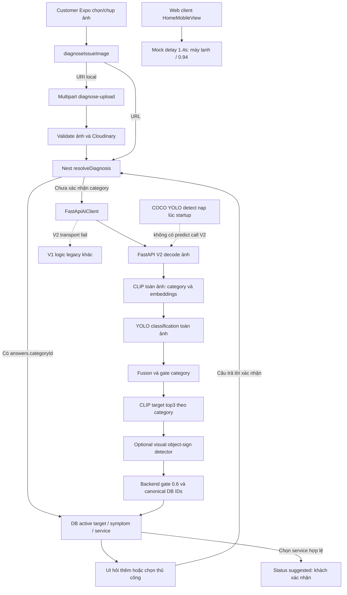

# Pipeline inference hiện hành

## Truy vết frontend → backend → AI → UI

1. Customer chụp/chọn URI; AiScanModal gọi diagnoseIssueImage. Local file/content dùng multipart `/orders/diagnose-upload`, blob fetch→FormData, remote URL dùng JSON `/orders/diagnose`. Customer adapter kiểm status contract và không tạo fake diagnosis khi lỗi. [customer-app/src/features/home/components/AiScanModal.tsx:198 — AiScanModal image analysis](/home/vanvi/Work/do-an-fix-go-tho-tot/customer-app/src/features/home/components/AiScanModal.tsx:198) [customer-app/src/services/api/aiService.ts:76 — diagnoseIssueImage](/home/vanvi/Work/do-an-fix-go-tho-tot/customer-app/src/services/api/aiService.ts:76).
2. Upload backend kiểm magic/MIME/10MB, gọi Cloudinary incidentStorage (limit 1200×1200), nhận URL. JSON route không upload; ordersService gọi resolver với request ID, không tạo đơn ở bước diagnose. [server/src/modules/orders/diagnosis/diagnosis-upload.interceptor.js:64 — DiagnosisImageStorage](/home/vanvi/Work/do-an-fix-go-tho-tot/server/src/modules/orders/diagnosis/diagnosis-upload.interceptor.js:64) [server/src/modules/orders/orders.controller.js:83 — OrdersController.diagnoseUpload](/home/vanvi/Work/do-an-fix-go-tho-tot/server/src/modules/orders/orders.controller.js:83) [server/src/config/cloudinary.config.js:29 — incidentStorage: Cloudinary limit 1200px](/home/vanvi/Work/do-an-fix-go-tho-tot/server/src/config/cloudinary.config.js:29) [server/src/modules/orders/orders.service.js:82 — OrdersService.diagnose](/home/vanvi/Work/do-an-fix-go-tho-tot/server/src/modules/orders/orders.service.js:82).
3. Resolver đọc active categories. Nếu answers.categoryId hợp lệ, bỏ qua AI inference và resolve câu trả lời trong DB; nếu không, transport gọi V2 trước, V1 nếu request thất bại. Hết cả hai → unavailable/null confidence. [server/src/modules/orders/diagnosis/diagnosis-resolver.js:19 — resolveCategory](/home/vanvi/Work/do-an-fix-go-tho-tot/server/src/modules/orders/diagnosis/diagnosis-resolver.js:19) [server/src/infrastructure/external/ai/fastapi-ai.client.js:30 — FastApiAiClient.diagnoseIncident](/home/vanvi/Work/do-an-fix-go-tho-tot/server/src/infrastructure/external/ai/fastapi-ai.client.js:30).
4. AI decode bytes/base64/URL/local path bằng OpenCV. CLIP processor xử lý **toàn ảnh**, encode ảnh, cosine với embeddings category/target/static subservice. Sau đó YOLO classification toàn ảnh trả probs. Không có object bbox crop trong luồng này. [ai-service/recommendation/image_utils.py:12 — decode_image_to_cv2](/home/vanvi/Work/do-an-fix-go-tho-tot/ai-service/recommendation/image_utils.py:12) [ai-service/recommendation/router.py:35 — diagnose_v2](/home/vanvi/Work/do-an-fix-go-tho-tot/ai-service/recommendation/router.py:35) [ai-service/clip_classifier.py:132 — _encode_image](/home/vanvi/Work/do-an-fix-go-tho-tot/ai-service/clip_classifier.py:132) [ai-service/clip_classifier.py:251 — predict_clip_full](/home/vanvi/Work/do-an-fix-go-tho-tot/ai-service/clip_classifier.py:251).
5. V2 fusion: khi đủ hai model, 0,6 CLIP +0,4 YOLO; nếu YOLO top=other_unclear thì dùng CLIP; description keyword có thể nhân score category×1,8 rồi normalize. Gate0,48/margin0,10. Target matching lọc category, cosine≥0,20, top3; source=(cosine+1)/2 không accuracy. [ai-service/recommendation/category_classifier.py:17 — fuse_category_scores/evaluate_categories](/home/vanvi/Work/do-an-fix-go-tho-tot/ai-service/recommendation/category_classifier.py:17) [ai-service/recommendation/target_matcher.py:8 — match_targets](/home/vanvi/Work/do-an-fix-go-tho-tot/ai-service/recommendation/target_matcher.py:8).
6. Optional visual detector chạy sau CLIP/YOLO fusion; có thể bổ sung category/target từ object detection nếu đủ điều kiện. Live đang disabled và không có defect boxes; source có nhánh object+sign nhưng chưa hoạt động trong request đã kiểm. [ai-service/recommendation/router.py:35 — diagnose_v2](/home/vanvi/Work/do-an-fix-go-tho-tot/ai-service/recommendation/router.py:35) [ai-service/recommendation/visual_detector.py:26 — VisualDetector.predict/load_visual_detector](/home/vanvi/Work/do-an-fix-go-tho-tot/ai-service/recommendation/visual_detector.py:26).
7. Backend gate category mặc định0,6, canonicalize slug→active UUID. Target AI là candidate, người dùng phải xác nhận. V2 candidate lists không được chuyển nguyên vẹn vào result (payload mặc định rỗng, resolver chủ yếu giữ suggestedTarget). Sau target selection hỏi symptoms/cho chọn manual services; final suggestedServiceId phải là DB ID đúng target/category. [server/src/modules/orders/diagnosis/diagnosis-resolver.js:19 — resolveCategory](/home/vanvi/Work/do-an-fix-go-tho-tot/server/src/modules/orders/diagnosis/diagnosis-resolver.js:19) [server/src/modules/orders/diagnosis/diagnosis-resolver.js:106 — resolveDiagnosis](/home/vanvi/Work/do-an-fix-go-tho-tot/server/src/modules/orders/diagnosis/diagnosis-resolver.js:106) [server/src/modules/orders/diagnosis/diagnosis-resolver.js:70 — resolveService](/home/vanvi/Work/do-an-fix-go-tho-tot/server/src/modules/orders/diagnosis/diagnosis-resolver.js:70).
8. UI DiagnosisChoices nhận kết quả, chọn category/target/symptom/service qua request mới; booking chỉ mở khi status=suggested và serviceId có thật. Không tự đặt lịch từ image evidence. [customer-app/src/components/diagnosis/DiagnosisChoices.jsx:10 — DiagnosisChoices](/home/vanvi/Work/do-an-fix-go-tho-tot/customer-app/src/components/diagnosis/DiagnosisChoices.jsx:10) [customer-app/src/features/home/components/AiScanModal.tsx:198 — AiScanModal image analysis](/home/vanvi/Work/do-an-fix-go-tho-tot/customer-app/src/features/home/components/AiScanModal.tsx:198).

## Mermaid — đúng nhánh source đang có

## Các điểm dễ hiểu sai

CLIP predict_clip_full vẫn tính static subservice embeddings/probs nội bộ, nhưng **V2 không xuất chúng thành service recommendation**; backend bỏ qua proposed service từ ảnh và yêu cầu xác nhận. V1 có thể trả static slug/price và chọn first service khi thiếu subservice; không đồng nhất nó với DB service cuối. [ai-service/clip_classifier.py:251 — predict_clip_full](/home/vanvi/Work/do-an-fix-go-tho-tot/ai-service/clip_classifier.py:251) [ai-service/recommendation/router.py:35 — diagnose_v2](/home/vanvi/Work/do-an-fix-go-tho-tot/ai-service/recommendation/router.py:35) [ai-service/main.py:543 — V1 first-service fallback](/home/vanvi/Work/do-an-fix-go-tho-tot/ai-service/main.py:543) [server/src/modules/orders/diagnosis/diagnosis-resolver.js:106 — resolveDiagnosis](/home/vanvi/Work/do-an-fix-go-tho-tot/server/src/modules/orders/diagnosis/diagnosis-resolver.js:106).

Mô tả người dùng có ảnh hưởng category V2 bằng luật keyword, không learned multimodal diagnosis. Khi không có ảnh/model, description không được tự tạo category thành công. V1 JSON đọc imageUrl nhưng không lấy description từ JSON vào biến Form; multipart có thể dùng description. Transport fallback V1 vì thế không tương đương V2.

Live sample synthetic burn candidate có raw V2 confidence0,5506, thấp hơn gate backend0,6; không gọi đó là category được chấp nhận end-to-end. Health classifier_mode=clip không có nghĩa V2 chỉ chạy CLIP: V2 handler vẫn gọi cả classifier nếu có.
