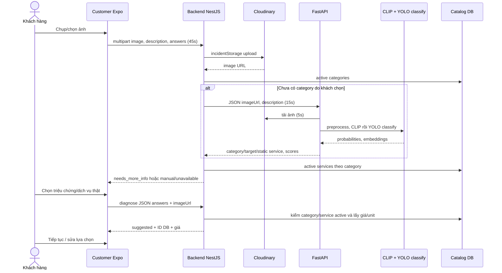

# Truy vết pipeline phân tích ảnh

Ngày lập: 13/11/2026 (Asia/Ho_Chi_Minh). Baseline: `integration/fixgo-sprint-02`, HEAD `5baac7bfb97e4349eee263af7520a001792fff78`.

Quy ước: **VERIFIED** = xác nhận bằng code/artifact hoặc phép thử được nêu; **INFERRED** = suy luận còn cần kiểm chứng; **NOT VERIFIED** = chưa đủ bằng chứng; **RECOMMENDED** = đề xuất, chưa triển khai. VERIFIED về code không đồng nghĩa PASS E2E hoặc độ chính xác thực địa.

## Chuỗi xử lý

Mọi symbol/dòng trong bảng có thể tra và nhấp qua [evidence index](09-evidence-index.md); chỉ các đoạn code được mô tả là VERIFIED, E2E Android là NOT VERIFIED.

| Bước | File / hàm | Hành vi xác nhận |
|---|---|---|
| 1 | Customer `AiScanModal.tsx:handleLaunchCamera/handleLaunchLibrary` | Expo ImagePicker chọn ảnh; quality .8; nhận asset.uri |
| 2 | `AiScanModal.tsx:startAiScanProcess` | Gọi diagnoseIssueImage; generation ref tránh kết quả cũ; UX tối thiểu 2,2 giây không là latency model |
| 3 | `aiService.ts:diagnoseIssueImage` | Native URI → FormData `image`; blob URI web mới fetch blob; description/answers JSON; timeout upload 45s, URL JSON 30s |
| 4 | `apiClient.js` request interceptor | Token nếu có, request ID; Axios JSON default được per-request multipart override; response interceptor trả response.data |
| 5 | `orders.controller.js:diagnoseUpload` | Public route, FileInterceptor image, Cloudinary incidentStorage; lưu trước khi handler chạy; không yêu cầu JWT; imageUrl từ file.path |
| 6 | `orders.controller.js:diagnoseUpload` | Parse answers; reject không ảnh/JSON sai; gọi ordersService.diagnose |
| 7 | `orders.service.js:diagnose` → `diagnosis-resolver.js:resolveDiagnosis` | Validate shape/answer allowlist; load active categories; nếu category do khách chọn thì bỏ qua AI |
| 8 | `fastapi-ai.client.js:diagnoseIncident` | POST JSON /ai/diagnose với imageUrl/description; AbortSignal 15s; lỗi/HTTP không OK → unavailable |
| 9 | `main.py:diagnose`, `decode_image_to_cv2` | Đọc JSON imageUrl hoặc multipart field file; requests URL timeout 5s; bytes→imdecode BGR; JSON description không được lấy từ request.json |
| 10 | `clip_classifier.py:_encode_image`, `predict_clip_full` | BGR→RGB PIL→CLIPProcessor→normalized image embedding; normalized mean prompt embeddings; category softmax; target/service scores |
| 11 | `main.py:diagnose` | CLIP chạy trước, rồi YOLO classifier; ensemble/override; không detection box trong endpoint |
| 12 | `main.py:diagnose` | Chọn category theo score/margin; target theo CLIP category hint; dịch vụ theo static category; description boost chỉ hoạt động khi description nhận được qua Form |
| 13 | `diagnosis-resolver.js:resolveDiagnosis` | Chỉ nhận category engine=model confidence>=threshold (mặc định .6); map ID/slug category sang DB; bỏ target/service/giá từ AI |
| 14 | `diagnosis-resolver.js:resolveDiagnosis` | Query active services theo category; khách xác nhận symptom rule hoặc service ID → giá/unit DB; nếu chưa chọn trả needs_more_info |
| 15 | `aiService.ts`, `DiagnosisChoices.jsx`, `HomeScreen.tsx:handleConfirmAiBooking` | Adapter response; chọn lại category/service; chỉ cho tiếp khi suggested và có ID; truyền sang booking; booking tải detail ID thật |

## Lỗi và khoảng trống

**VERIFIED:** FileInterceptor Cloudinary có thể lỗi trước khi vào handler nên thiếu log handler chưa chứng minh request chưa tới server. Chưa có limits fileSize/filter MIME tại interceptor diagnose-upload. Timeout 45s mobile bao gồm upload và downstream; 15s AI không giới hạn thời gian Cloudinary trước đó. Retry chỉ thấy token refresh 401, không retry upload network vô hạn.

**VERIFIED:** Backend JSON description bị FastAPI bỏ qua; đây là khác biệt contract cần task riêng vì AI read-only. Thêm targetId vào pipeline và thay ranking cần thiết kế riêng; audit không triển khai lại.

**NOT VERIFIED:** Quyền đọc content URI trên V2536A, ảnh HEIC/AVIF thực tế, kích thước file gây lỗi, logcat, MIME thực được native gửi. Curl hoạt động không loại trừ các lỗi này.
