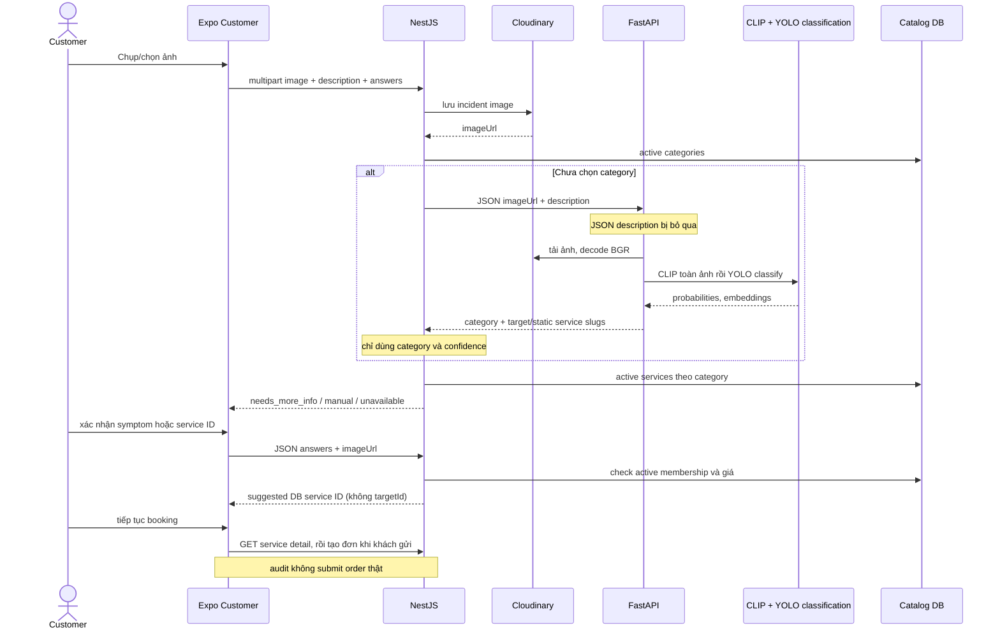

# Luồng nhận diện ảnh thực tế

Baseline **`be082dc91bc05ff3c05177acd72fe786fc478f6a`**, branch `integration/fixgo-sprint-02`; ngày 13/11/2026, Asia/Ho_Chi_Minh. Hai commit `1a5ef38`, `a173810` là ancestor; working tree sạch trước audit.

**VERIFIED**: code/artifact hoặc phép kiểm nêu rõ; **INFERRED**: hệ quả hợp lý chưa đo; **NOT VERIFIED**: thiếu chứng cứ; **RECOMMENDED**: đề xuất chưa triển khai. “VERIFIED theo code” không có nghĩa đã khai thác live, benchmark chính xác hoặc PASS Android E2E. Evidence IDs dẫn tới file, symbol và dòng tại baseline trong [chỉ mục](13-evidence-index.md).

## Call chain đến output cuối cùng

| Bước / loại xử lý | File + symbol qua evidence | Hành vi thực |
|---|---|---|
| Chụp/chọn — UI | `AiScanModal.handleLaunchCamera/handleLaunchLibrary`, `startAiScanProcess` | Expo asset.uri; quality .8, generation tránh response cũ; animation delay không là latency model [E61](13-evidence-index.md#e61) |
| Chuẩn file — integration | diagnoseIssueImage [E08](13-evidence-index.md#e08) | file/content native→FormData image; web blob mới fetch blob; MIME theo extension, timeout45s; remote URL→JSON30s |
| Upload — infrastructure | OrdersController.diagnoseUpload [E06](13-evidence-index.md#e06) | Public; incidentStorage Cloudinary trước handler; parse answers rồi OrdersService.diagnose |
| Điều phối — business | resolveDiagnosis [E05](13-evidence-index.md#e05) | Validate answer keys; category do khách xác nhận thì không gọi AI; nếu chưa thì AI client |
| Backend→AI — integration | FastApiAiClient.diagnoseIncident [E07](13-evidence-index.md#e07) | JSON imageUrl/description; AbortSignal15s; lỗi→unavailable |
| Decode/preprocess — CV | decode_image_to_cv2 [E45](13-evidence-index.md#e45) | tải URL5s→imdecode BGR; hỗ trợ bytes/base64/local path; không kiểm quality/số đối tượng |
| Text contract | main.diagnose [E01](13-evidence-index.md#e01) | JSON chỉ lấy imageUrl, bỏ description; Form description mới vào keyword boost |
| Inference — ML | predict_clip_full rồi yolo_cls_model.predict [E01](13-evidence-index.md#e01) [E03](13-evidence-index.md#e03) | Toàn ảnh, embedding normalized; YOLO category probs. Không detector/crop từng đối tượng |
| Fusion — rule-based | main.diagnose:448–527 [E01](13-evidence-index.md#e01) | Thỏa nhánh ensemble/override, text boost .35, acceptance threshold/margin |
| Target/service — ML + fallback | predict_target_from_feat / predict_sub_service_from_feat [E03](13-evidence-index.md#e03) [E01](13-evidence-index.md#e01) | Target dynamic prompts; service static category softmax, không ràng target; không subservice thì lấy đầu danh mục, score*.92 |
| Final API business | resolveDiagnosis [E05](13-evidence-index.md#e05) | Bỏ target/service AI; active category score≥.6→active services theo category. Chưa triệu chứng trả needs_more_info |
| Khách xác nhận — UI/business | DiagnosisChoices [E09](13-evidence-index.md#e09) | category/serviceId/symptom; không có target picker trong AI response; mỗi answer gọi diagnose JSON với imageUrl cũ |
| Booking | HomeScreen.handleConfirmAiBooking→useBooking→createOrder [E10](13-evidence-index.md#e10) [E11](13-evidence-index.md#e11) [E12](13-evidence-index.md#e12) | Cần suggested + category/service; detail ID bổ sung target; giá server, không tin giá client |

## Sơ đồ hiện tại — VERIFIED theo code

**VERIFIED:** confidence fusion không calibration. Code gán trọng số theo top score bình phương; loại other_unclear khỏi YOLO rồi renormalize, nên một nhãn OOD có thể mất ảnh hưởng trong ensemble. **INFERRED:** Có thể tăng false positive khi model bất đồng; cần ablation trên test set độc lập. `CLASSIFIER_MODE`/`CLIP_MIN_CONF` có config nhưng không điều khiển lựa chọn trong diagnose như tên gợi ý. [E01](13-evidence-index.md#e01)

**NOT VERIFIED:** Android ERR_NETWORK root cause, pixel signal mất do crop trên ảnh người dùng, latency CPU production. CUS-QA-01 cũ chỉ có host multipart201, không retest thiết bị ở lần này. `adb devices` hiện không có máy. Không gọi live upload/inference trong audit02 vì upload sẽ ghi Cloudinary và môi trường live không phải cô lập.
