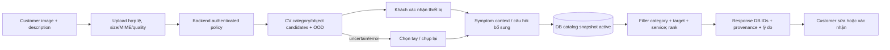
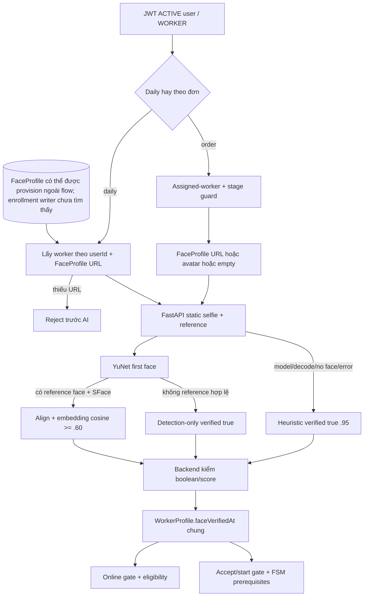
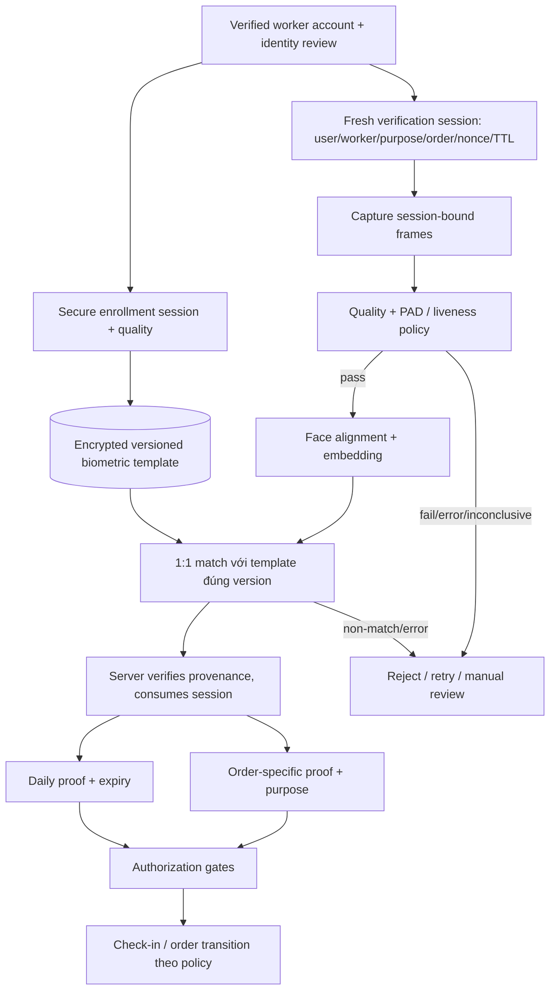

# Kiến trúc hiện tại và kiến trúc khuyến nghị

Baseline **`be082dc91bc05ff3c05177acd72fe786fc478f6a`**, branch `integration/fixgo-sprint-02`; ngày 13/11/2026, Asia/Ho_Chi_Minh. Hai commit `1a5ef38`, `a173810` là ancestor; working tree sạch trước audit.

**VERIFIED**: code/artifact hoặc phép kiểm nêu rõ; **INFERRED**: hệ quả hợp lý chưa đo; **NOT VERIFIED**: thiếu chứng cứ; **RECOMMENDED**: đề xuất chưa triển khai. “VERIFIED theo code” không có nghĩa đã khai thác live, benchmark chính xác hoặc PASS Android E2E. Evidence IDs dẫn tới file, symbol và dòng tại baseline trong [chỉ mục](13-evidence-index.md).

## AI recommendation — so sánh phương án (RECOMMENDED/INFERRED)

Không có benchmark để gán phần trăm tăng accuracy hay latency tương lai.

| Tiêu chí | 1. Giữ YOLO+CLIP+rules, sửa retrieval | 2. Category→target→symptom→DB ranking | 3. Embedding multimodal retrieval + triệu chứng |
|---|---|---|---|
| Đúng object/service dự kiến | Giữ lỗi taxonomy/fusion nếu không sửa | Dễ đo từng bước, bớt đoán lỗi ẩn | Linh hoạt mô tả/catalog, dễ lẫn ngoại hình và symptom |
| Dữ liệu | Ảnh thật test + prompts/rules | Object labels + symptom taxonomy/service relevance | Pairs ảnh-text, hard negatives, relevance labels |
| Train | Có thể không train | Baseline pretrained trước, fine-tune khi cần | Pretrained trước, contrastive train tốn hơn |
| CPU/RAM | Hai model hiện tại; profile trước | Gate/reuse embedding, ít hơn nếu bỏ model không có ích | Encode ảnh một lần, text cache/index có version |
| Catalog | Cần bỏ static embedding list | DB active IDs và category-target invariant rõ | Thêm service dễ embed nhưng cần regression retrieval |
| Giải thích/khóa luận | Nhanh nhưng fusion khó biện hộ | Phù hợp nguồn lực sinh viên, câu hỏi có lý do | Hợp hướng nghiên cứu retrieval; eval khó hơn |
| Rủi ro | Fallback/score tùy ý | Giảm khi abstain và khách xác nhận | Không tự chứng minh lỗi ẩn, vẫn cần xác nhận |

**RECOMMENDED:** Phương án2, tận dụng CLIP pretrained làm object candidate baseline. YOLO classifier chỉ giữ nếu ablation cho thấy lợi ích trên dữ liệu sạch. Không có fault model mà ảnh chỉ thấy thiết bị thì hỏi symptom; không train classifier nhãn nguyên nhân không quan sát được. So khớp DB ID và trả nhiều service hợp lệ, giải thích theo triệu chứng, người dùng được sửa.

## Image recommendation khuyến nghị — CHƯA TRIỂN KHAI

Hiện tại thực thi xem diagram [02](02-image-diagnosis-current-flow.md); các node target confirmation/retrieval ba tầng/ranking trong sơ đồ này là đề xuất.

## Worker Face ID hiện tại — VERIFIED theo code

Nguồn từng nhánh [E24](13-evidence-index.md#e24) [E25](13-evidence-index.md#e25) [E26](13-evidence-index.md#e26) [E29](13-evidence-index.md#e29) [E30](13-evidence-index.md#e30) [E23](13-evidence-index.md#e23). Không có node PAD/enrollment đã thực thi. Mismatch compare không ghi timestamp mới; diagram tập trung nhánh pass, failure chi tiết ở [08](08-security-trust-boundary.md).

## Worker Face ID — ba lựa chọn tương lai

| Tiêu chí | A. YuNet+SFace+quality+enrollment1:1 | B. A + passive PAD + session/replay | C. B + challenge-based liveness server-side |
|---|---|---|---|
| Nhận đúng người | Cần threshold validation, template đáng tin | Như A, PAD có thể giảm bona fide coverage | Như B; challenge thêm lỗi thao tác/khuyết tật cần UX phù hợp |
| Ảnh in/màn hình/video | Không có bảo đảm PAD | Có khả năng theo attack/device đã test, chưa chắc unknown attacks | Thêm tín hiệu động; không bảo đảm mọi replay/deepfake |
| Replay/injection | Session/replay vẫn cần, không được bỏ | Session bind+one-use ngăn một số replay giao thức; PAD không tự chống injection | Random challenge+server timing có ích; camera hook/feed giả vẫn là threat riêng |
| UX/Android latency | Một ảnh, ít bước | Một/vài frame, đo Android/CPU thật | Nhiều frame/thao tác, accessibility và mạng khó hơn |
| Dữ liệu/train | Genuine/impostor consented; giữ pretrained baseline | PAD licensed baseline + data attack/bona fide theo device | Thêm video/challenge labels và protocol temporal |
| CPU/GPU | Hai mạng nhẹ tương đối, cần profile, chưa đo | Tăng tài nguyên tùy PAD backbone | Tăng capture/network/temporal cost; không mặc định bắt buộc GPU |
| Quyền riêng tư | Template cần mã hóa/access/retention | Thêm frames PAD, tối thiểu lưu | Video/challenge data tăng nhạy cảm, TTL ngắn và quyền rõ |
| Khả thi khóa luận | Baseline cần có, không claim chống ảnh giả | Cân bằng nếu pretrained PAD có license và benchmark đạt | Phức tạp hơn, scope L/XL; không chọn chỉ vì trông “cao cấp” |
| Giới hạn phải công bố | Identity matching không PAD | Domain shift, attack chưa thấy, injection | Deepfake thích ứng/camera injection chưa được chứng minh chặn |

**RECOMMENDED:** Làm A đúng/fail-closed trước; chọn B cho bản thử nghiệm chống presentation attack khi có license và đánh giá độc lập. C chỉ thêm nếu threat model/nguồn lực/benchmark chứng minh cần. Không train lại SFace mặc định; không dùng blink/head-turn đơn giản làm chứng nhận anti-spoof.

## Worker Face ID khuyến nghị — CHƯA TRIỂN KHAI

**RECOMMENDED:** AI chỉ cung cấp evidence/decision có method/model/version; authorization ở Nest. Database proof bền vững, one-use khi cần, không dùng response client hoặc timestamp toàn cục thay mọi mục đích. Manual review không được cấp thành công tự động do technical error.
