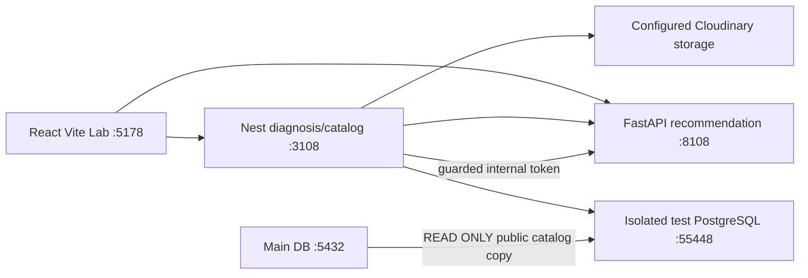

# AI-REC-LAB-03 — Final report

Ngày 14/11/2026, Asia/Ho_Chi_Minh. Worktree `/home/vanvi/Work/fixgo-recommendation-lab`, branch `feature/ai-recommendation-lab`, HEAD `f6534d6`. Kế thừa Lab-01/02; không viết lại UI hoặc thuật toán.

**Kết luận: READY_WITH_DOCUMENTED_LIMITATIONS.** Pipeline chức năng **READY_FOR_TESTING** trên DB test cô lập, đã chạy toàn bộ browser journey ảnh → tối đa 3 dịch vụ. **MODEL_QUALITY_VALIDATED=false / BLOCKED_DATA** cho ảnh thực. Không tuyên bố 100% hoặc READY_TO_MERGE: lỗi upload 500 lịch sử với ảnh hợp lệ chưa quy được nguyên nhân, migration history production có khoảng trống và chưa có held-out real-photo dataset được review.

## 1. Architecture và runtime



- Node 20.20.2/npm 10.8.2; Nest 11.1.28; Prisma client 6.19.3. Existing dependencies are read from the main checkout; source under test is this worktree.
- Python 3.14.4; FastAPI 0.162.0, torch 2.14.1, transformers 5.20.2, ultralytics 8.4.188. Local/cache weights only, HF offline mode.
- Chromium 159.0.8154.6 via Playwright, desktop 1440×1000 and mobile viewport 390×844. Browser tooling installed outside repo.
- Nest adapter mounts real production diagnosis/catalog controllers, services, validation and Cloudinary storage. It excludes full AppModule/order queue jobs and blocks unrelated routes. API DB reads remain in read-only transactions even against the test DB.
- AI adapter uses production V2/V1 handlers and existing CLIP/YOLO implementations; no main Face/PAD lifespan or FaceID requests.
- Runtime config is read into memory from the existing config file. Shared secrets/.env, production flags and thresholds were not changed. Debug token is generated locally in ignored `.runtime/`, mode 0600.

## 2. End-to-end evidence

[Browser E2E](runtime-03/browser-e2e.json): **16 assertions PASS**, no browser JavaScript errors. Real image bytes from a synthetic test image went through browser upload → Cloudinary → backend AI inference → canonical category/target → user confirmation → approved TEST symptoms → actual database mapping → service cards.

| Scenario | Actual result |
| --- | --- |
| One valid mapping | 1 service, DB price 110000, reason tied to selected TEST symptom |
| Exactly 3 valid mappings | 3 services, hasMore=false |
| 4 valid mappings | capped at 3, hasMore=true |
| Empty mapping | 200 items=[], NO_ACTIVE_MAPPING, no error alert |
| Inactive mapping / inactive service | 200 items=[], no invalid recommendation |
| Change target | symptom selection/cards reset before confirmation; next target returns only its own symptoms |
| Unapproved / inactive symptom | 400 SYMPTOM_NOT_AVAILABLE |
| Foreign-target symptom | 400 SYMPTOM_TARGET_MISMATCH |
| Wrong category/target pair | 400 TARGET_CATEGORY_MISMATCH |
| Limit=4 | 400 INVALID_LIMIT |
| Disabled catalog process on :3110 | 503 SYMPTOM_CATALOG_NOT_ENABLED, distinct from valid empty |
| Owned test DB stopped | 503 CATALOG_DB_UNAVAILABLE; after restart, recommendation 200 with 1 item |
| AI low confidence | V2 accepts 0.5529 at gate .48, backend .6 does not pass; thresholds unchanged |
| AI unavailable | Real connection-refused test: backend status unavailable + ai_unavailable, not mock success |

[HTTP policy matrix](runtime-03/policy.json): **16 PASS**. [DB failure](runtime-03/db-unavailable.json), [DB recovery](runtime-03/db-recovery.json), [AI offline](runtime-03/ai-offline-evidence.json). Empty results do not stand in for feature/DB outages.

Approved fixtures are **TEST ONLY, NOT BUSINESS APPROVAL**. The source production catalog was not approved, imported into symptom tables, or changed. Success proves functional gates and transport, not image recognition quality on real devices.

## 3. Database isolation

Container: `fixgo-rec-lab03-postgres`, label `fixgo.task=AI-REC-LAB-03`, existing PostGIS 16 image, no shared writable volume. Published only at 127.0.0.1:55448. Dedicated role `fixgo_rec_lab`, database `fixgo_recommendation_lab`; main DB is localhost:5432/ondemand_db.

`runtime/test-db.cjs` guards the exact host, port, DB name and role, rejects other URLs, and queries current_database/current_user/server port before mutation batches/transactions. Passwords/full shared DSN are never printed. The test container uses loopback-only trust authentication and contains only public catalog plus labelled fixtures; it is not a production deployment pattern.

[Database evidence](runtime-03/database.json) includes identity, actual constraints, production migration digest, source hash and fixture IDs. Only 6 categories/70 targets/693 services were copied from source inside a repeatable-read READ ONLY transaction. No users, orders, biometric data or secrets were copied.

Main catalog hash before/after: **45b4a4ee1990628fa35e5f555bd54b9e7806e555711c7d55aebe3382b409a258**, unchanged. [Final source snapshot](runtime-03/main-after.json) still shows 6/70/693, no symptom tables and shared symptom flag unset. No migration/seed/reset/write was performed on ondemand_db. Hash evidence covers these catalog rows, not an assertion that unrelated concurrent systems never wrote other tables.

## 4. Migration and fixtures

Audit found no `_prisma_migrations` table in source and no service_targets creation in historical SQL migrations. Blind `prisma migrate deploy` is therefore not claimed to work. On the isolated test DB only:

1. Extract the three catalog models from current Prisma schema, remove unrelated relations and the V3 composite index, generate a catalog-only baseline SQL using Prisma migrate diff.
2. Apply that baseline, then execute the existing production `20261114000000_symptom_catalog_v3/migration.sql` unchanged.
3. Query PostgreSQL constraints and exercise real negative writes: missing category parent FK, active NEEDS_REVIEW CHECK, cross-target composite mapping FK. All are rejected; transactions/statements roll back.
4. Copy public catalog and upsert deterministic UUID fixtures. Re-running setup preserves IDs/prices/policy and does not reset source/test schema.

Fixtures: 9 TEST symptoms (approved active, NEEDS_REVIEW/inactive, approved inactive, other target, empty, inactive mapping/service cases); 5 TEST services (4 active, 1 inactive); 10 mappings across one/three/many/inactive scenarios. Copied services remain intact. Test DB totals are 6 categories, 70 targets and 698 services.

These checks run against real PostgreSQL/Prisma, not just migration file presence. Full production migration history reconciliation, unrelated schema and Face migrations are outside this task; no shared Prisma schema/SQL file was changed.

## 5. Upload root cause and fix

**Corrupt image 500: reproduced and fixed.** Cloudinary returned a non-Nest error with http_code 400; Multer/Nest surfaced it as generic 500. Existing storage also ran before pixel-format validation. New diagnosis-only interceptor buffers at most 10 MB, checks MIME/signature before storage, retains the existing Cloudinary folder/transformation/upload result, and maps errors safely:

- Invalid MIME/signature/decode: 400 IMAGE_INVALID; over limit: 413.
- Storage upstream failure/auth/unclassified rejection: 502 STORAGE_UNAVAILABLE.
- Storage timeout: 504 STORAGE_TIMEOUT.
- No raw upstream messages, credentials, URLs, buffers or stack traces in the public error payload; structured upload log includes request ID, stage, elapsed, status and safe code only.

Bounded replay: [before](runtime-03/upload-before.json): 3 valid uploads 201, corrupt image 500. [After](runtime-03/upload-after.json): 3 valid uploads 201, corrupt image **400 in ~4 ms**, before Cloudinary. Browser workflow/benchmark also perform valid storage uploads. No unexplained 500 occurred in this defined after-fix regression.

**Historical intermittent valid-image 500: not reproduced, root cause OPEN.** No evidence supports blaming a specific Cloudinary/backend/timeout fault in the earlier attempt. The fix does not pretend to explain it, retry forever or turn errors into HTTP 200. Future occurrence must be correlated using new upload stage/code logs; documented limitation remains.

## 6. API/debug contracts and impact

[Internal debug contract](recommendation-debug-contract.md) implements the earlier proposal, authenticated and default-off outside explicit dev/staging/test configuration. Both backend and AI reject missing auth; both prohibit production mode even if a flag is accidentally true.

- `POST /api/internal/recommendation/inspect` proxies to protected AI `/ai/v2/internal/diagnose-debug`.
- Same-request CLIP/YOLO scores, fusion/target gates, model readiness, stage outcomes/latency, artifact fingerprints and catalog version/source are available in UI.
- Thresholds are constants shared with computation: .48 category, .10 margin, .20 target similarity. Backend .6 comes from effective AI_CONFIDENCE_THRESHOLD/default. No threshold lowered.
- Catalog metadata and target embeddings publish atomically from the same CLIP reload. V2 now reports backend source/version and 70 targets instead of init/0; normal target IDs are canonical DB IDs where available. Content version changes when metadata changes, not only key names.
- Frontend header ID, backend header/body ID and backend-to-AI request ID propagate consistently. [Correlation evidence](runtime-03/correlation.json) and [same-request telemetry](runtime-03/telemetry.json).
- Database connection/schema errors in diagnosis/catalog return safe 503 codes. Existing public success fields remain; no endpoint removed. Invalid-image 500→4xx and unavailable-storage 502/504 are intentional error corrections.
- Shared edits are limited to recommendation modules, diagnosis-only controller/service path, and the diagnosis method in the AI client. No Face methods, entrypoints, Customer/Worker or payment/order FSM logic were changed.

Pure model loading latency is not measured per request; readiness is reported. Image decode includes URL fetch. HTTP elapsed and per-model stage compute are labelled separately. Internal inspector is an additional inference when invoked; benchmark opt-in metadata collection sets telemetrySampledSeparately=true.

## 7. Benchmark results and limitations

[Browser JSON export](runtime-03/benchmark-workflow.json), [CSV export](runtime-03/benchmark-workflow.csv). One **synthetic TEST fixture workflow** completed with real HTTP inference and actual mapping: category/target top1/top3/service recall@3 all 1 on that one constructed sample, false recommendations 0, failure rate 0. This is functional evidence only, not a quality estimate. The exported file is authoritative for measured latencies and model/config/catalog fingerprints.

Pipeline now supports target top1/top3, category accuracy, macro service recall@3, false recommendation count, failure rate, abstention and latency p50/p95. Errors stay in applicable metric denominators; N/A is preserved when GT is absent. Optional authenticated metadata capture stores actual artifact hashes/config gates/catalog snapshot and states that the telemetry inference was separate from the metric V2 request.

Version 2 manifests require source/review/split metadata, per-image SHA-256 and annotation provenance, reject byte duplicates and overlap with declared train hashes, and verify uploaded bytes against expected hashes. Version 1 remains compatible for prior smoke manifests. SHA cannot detect near duplicates or dishonest/incomplete provenance; independent review is required.

**Real-photo result: BLOCKED_DATA.** Repo eval examples are drawn with OpenCV, and dataset manifest reports synthetic/leaky provenance. [Collection/annotation protocol](real-photo-benchmark.md) defines consent/source, independent labels, acceptable services, hashes, train/eval separation and reviewed manifest format. No real accuracy was invented.

## 8. Browser screenshots

- [Desktop one service](runtime-03/desktop-one-service.png)
- [Desktop cap 3 services](runtime-03/desktop-three-services.png)
- [Mobile service cards](runtime-03/mobile-three-services.png)
- [Valid empty mapping](runtime-03/empty-mapping.png)
- [Authenticated same-request inspector](runtime-03/same-request-inspector.png)
- [Debug timeline](runtime-03/debug-timeline.png)
- [Benchmark/export](runtime-03/benchmark-workflow.png)

Chromium E2E checks accessible upload/control names, disabled states, explicit confirmation, repeated symptom changes, responsive overflow, response validation, cards, reason/price, trace/export and console errors. Lab-02 loading/timeout/retry/error screenshots and component regressions remain valid historical evidence. This is viewport QA, not a full WCAG audit or physical-device acceptance.

## 9. Test matrix

| Test | Result / evidence |
| --- | --- |
| Frontend unit/component/contracts | PASS — 29 tests, 2 files |
| Backend diagnosis/symptom regressions | PASS — 57 tests, 7 suites |
| PostgreSQL migration/fixture tests | PASS — actual CHECK, parent/composite FK checks and idempotent rerun; guarded test DB only |
| HTTP catalog/recommendation/debug policy | PASS — 16 cases |
| Browser full journey + benchmark/export | PASS — 16 assertions |
| AI contracts/security/catalog/hash regression | PASS — 19 tests |
| Real model inference | PASS execution — local CLIP/YOLO via actual HTTP/browser; synthetic pixels |
| Corrupt/valid bounded upload regression | PASS after fix — 3×201 + 1×400, no unexplained 500 in this set |
| DB unavailable/recovery | PASS — 503 specific code, then 200/one item |
| Catalog disabled | PASS — separate owned process :3110 returns 503 flag code |
| AI unavailable | PASS — owned AI stopped, backend returns unavailable/ai_unavailable |
| Frontend TypeScript/Vite | PASS |
| Backend Babel compile | PASS — source compiled to temporary build directory |
| Real-photo quality benchmark | BLOCKED_DATA |
| Historical valid-image intermittent 500 root cause | OPEN / not reproduced in bounded replay |

Commands are below. Unit/model doubles are clearly separate from real PostgreSQL, storage, model and browser evidence. No synthetic model output is substituted into runtime success tests.

## 10. Files changed and review scope

Tracked source edits:

- `ai-service/clip_classifier.py`; `recommendation/{router.py,catalog_manager.py,category_classifier.py,target_matcher.py}` — coherent snapshot, protected telemetry, correlation and named unchanged thresholds.
- `server/src/infrastructure/external/ai/fastapi-ai.client.js` — diagnosis correlation only.
- `server/src/modules/orders/{orders.controller.js,orders.service.js}` and `diagnosis/diagnosis-resolver.js` — upload boundary, correlation and catalog error translation only.
- `server/src/modules/symptoms/{symptoms.controller.js,symptoms.service.js,symptom-catalog.js}` — authenticated inspector and safe availability errors.

New source: diagnosis upload interceptor/tests, recommendation debug guard/helper/tests; AI debug security/hash tests. Existing untracked Lab source adds inspector, benchmark metadata/metrics/version2 validation and tests; runtime scripts add test DB setup, policy/E2E/bounded replay. Docs/evidence include this report, contracts, real-photo protocol, runtime-03 JSON/CSV/PNG and earlier Lab-01/02 artifacts.

`.runtime/` is ignored and contains only local generated SQL/fixtures/token; it must not be staged. No package/dependency install into shared backend, no schema/migration changes, no FaceID/Worker/Customer source changes. Git review must include untracked files because Lab-01/02 were never committed.

## 11. Runbook and remaining blockers

From worktree root (adjust executable/dependency paths for another machine):

```bash
export NODE_PATH=/home/vanvi/Work/do-an-fix-go-tho-tot/server/node_modules
export LAB_CONFIG_FILE=/home/vanvi/Work/do-an-fix-go-tho-tot/server/.env
# Once on a new machine: dedicated container only; never substitute the project DB name/port.
docker run -d --name fixgo-rec-lab03-postgres --label fixgo.task=AI-REC-LAB-03 --env POSTGRES_USER=fixgo_rec_lab --env POSTGRES_DB=fixgo_recommendation_lab --env POSTGRES_HOST_AUTH_METHOD=trust -p 127.0.0.1:55448:5432 postgis/postgis:16-3.4-alpine
# On this machine the container already exists; use docker start fixgo-rec-lab03-postgres.
node ai-recommendation-lab/runtime/test-db.cjs
```

Start each runtime in its own terminal:

```bash
LAB_DATABASE_MODE=isolated node ai-recommendation-lab/runtime/backend.cjs
/home/vanvi/Work/do-an-fix-go-tho-tot/ai-service/.venv/bin/python ai-recommendation-lab/runtime/ai.py
LAB_BACKEND_ORIGIN=http://127.0.0.1:3108 LAB_AI_ORIGIN=http://127.0.0.1:8108 npm run dev --prefix ai-recommendation-lab
# Optional separate disabled-catalog runtime for policy tests:
LAB_DATABASE_MODE=isolated LAB_CATALOG_DISABLED=true LAB_BACKEND_PORT=3110 node ai-recommendation-lab/runtime/backend.cjs
```

Open http://127.0.0.1:5178. Upload synthetic sample or permitted real device photo, confirm target, select a `[TEST]` symptom. For the predefined scenarios choose target `Cây bóng mát / Cây lớn`, category Làm vườn. `[TEST] one`, `[TEST] three`, `[TEST] many`, `[TEST] empty` exercise policies. Fixtures are not a production service catalog. For internal inspector, enter the local ignored debug token into UI Bearer token in session memory; never paste it into reports. Enable benchmark telemetry only when intentionally collecting an additional internal measurement.

```bash
npm test --prefix ai-recommendation-lab
npm run build --prefix ai-recommendation-lab
node ai-recommendation-lab/runtime/policy-03.cjs
LAB_PLAYWRIGHT_MODULE=/tmp/fixgo-rec-lab-02-browser/node_modules/playwright node ai-recommendation-lab/runtime/e2e-03.cjs
LAB_REPLAY_PHASE=after node ai-recommendation-lab/runtime/upload-replay.cjs
# From server/: existing Jest executable/dependencies with this worktree's config
NODE_PATH=/home/vanvi/Work/do-an-fix-go-tho-tot/server/node_modules /home/vanvi/Work/do-an-fix-go-tho-tot/server/node_modules/.bin/jest --config ./package.json --runInBand diagnosis symptom
# From ai-service/:
PYTHONPATH=. /home/vanvi/Work/do-an-fix-go-tho-tot/ai-service/.venv/bin/python -m unittest eval.test_recommendation_pipeline eval.test_diagnose_contract eval.test_recommendation_debug
```

Failure tests stop **only owned** test resources: AI process by recorded PID for `LAB_EVIDENCE_RUN=03 node runtime/verify-offline.cjs`; DB container by its exact name/label to check 503, then start it again. Never use broad pkill, project DB DDL or another agent's port/runtime. Actual upload tests create synthetic Cloudinary test assets and should not be looped without bounds.

Remaining: collect reviewed real-photo data; investigate any recurrence of historical nominal upload 500 with structured logs; reconcile production migration history in a separate deployment review; review internal-token operations before any staging deployment; physical mobile/accessibility acceptance as needed. No Customer integration changes were made.

## 12. Merge readiness

**READY_WITH_DOCUMENTED_LIMITATIONS**, not READY_TO_MERGE. Functional lab gates and E2E are verified on isolated test data, with all selected regressions passing. Real model quality is unvalidated. Historical intermittent 500 cannot be declared root-caused from a non-reproducing bounded run. Production migration deployment is not authorized or validated by this catalog-only disposable baseline.

No files staged, no commit/push/merge/reset. Before a human-approved merge: review all tracked and untracked source, keep `.runtime/`/secrets out of staging, review the narrowly scoped shared changes and choose whether the documented limitations are acceptable for a dev-only lab merge. Runtime processes created by this task are stopped at handoff; the dedicated test container/fixtures are preserved for replay and can be started explicitly. Claude/FaceID runtime and shared PostgreSQL/Redis are not stopped.
