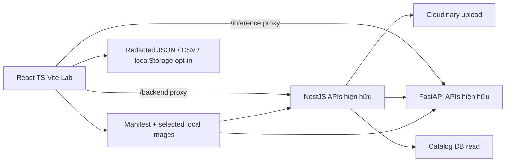

> **AI-REC-LAB-03 mới nhất:** full browser workflow đã đạt trên DB test cô lập; kết luận READY_WITH_DOCUMENTED_LIMITATIONS. Xem [final report](recommendation-lab-final-report.md). Nội dung Lab-01/02 dưới đây là lịch sử.

# AI-REC-LAB-02 — Runtime Integration, Visual QA & Debug Verification

Cập nhật ngày 14/11/2026 (Asia/Ho_Chi_Minh), cùng worktree/branch `feature/ai-recommendation-lab`, HEAD `f6534d6`. **Nghiệm thu một phần**: đã chạy HTTP thật với Cloudinary, NestJS, model local và catalog DB read-only; Chromium desktop/mobile đã đạt sau hai sửa lỗi nhỏ trong Lab. **Chưa nghiệm thu toàn bộ ảnh → dịch vụ**: DB chính chưa có schema triệu chứng, flag unset; không migrate hoặc tự approve để tạo success.

## Runtime environment và ranh giới an toàn

| Thành phần | Đã kiểm tra / cấu hình phiên QA |
| --- | --- |
| OS / Node / npm | Linux, Node 20.20.2, npm 10.8.2 |
| NestJS / Prisma | NestJS 11.1.28, Prisma client 6.19.3; dùng dependencies có sẵn của checkout chính, source từ worktree này |
| Python | 3.14.4; FastAPI 0.162.0, uvicorn 0.54.0, torch 2.14.1, transformers 5.20.2, ultralytics 8.4.188, httpx 0.28.1 |
| Model | Local `yolov8n-cls-fixgo.pt`, SHA256 `959d3e9823c55ae0948ce08d75261dca630678d22228404ae03dd4ee7dc7532d`; CLIP ViT-B/32 trong HF cache; offline mode, không download model |
| Browser | Playwright Chromium 159.0.8154.6; cài tooling ở `/tmp/fixgo-rec-lab-02-browser`, không đổi dependencies app |
| Ports | Ban đầu :3000/:8000/:3108/:8108/:5178 trống. Phiên này: NestJS 127.0.0.1:3108, FastAPI 127.0.0.1:8108, Vite 127.0.0.1:5178. Không dùng port 5199 của tiến trình khác |
| Config | Worktree không có server/.env; đọc config hiện hữu `/home/vanvi/Work/do-an-fix-go-tho-tot/server/.env` vào memory. Chỉ báo tên biến/config không nhạy cảm; không chép secret vào repo hoặc sửa .env |
| DB chính | `localhost:5432/ondemand_db`, đọc được. Mọi operation catalog/diagnosis trong Nest adapter bọc transaction `SET TRANSACTION READ ONLY` |
| Catalog | 6 categories, 70 targets, 693 services. `symptoms` và `symptom_services` chưa tồn tại; `SYMPTOM_CATALOG_ENABLED` unset trong config nguồn, adapter giữ false |
| Cloudinary | Credentials hiện hữu dùng được; multipart production storage đã upload/read ảnh synthetic thật trong `fixgo/incidents`. Không dùng ảnh người/PII. Các test có tạo assets test; không xóa tài nguyên không xác định |

[Preflight](runtime-02/preflight.json) và [postflight](runtime-02/postflight.json): catalog SHA256 trước/sau **giống nhau** `45b4a4ee1990628fa35e5f555bd54b9e7806e555711c7d55aebe3382b409a258`; transaction_read_only=on, counts và trạng thái schema không đổi. Không có migration/seed/reset/approve/flag change trên hệ thống dùng chung. Không sửa Customer/Worker/FaceID hoặc entrypoint shared; không commit/push/merge/reset.

Không chạy full Nest `AppModule`, vì kéo theo Redis/queue/order runtime không cần cho kiểm thử read-only. Adapter test mount **production OrdersController, SymptomsController, ServicesController**, cùng service diagnosis/resolver, validation, guards public và Cloudinary storage thật. Chỉ expose allowlist diagnosis/catalog; route tạo đơn bị 404. Mỗi operation DB thực thi trong transaction read-only. Adapter không phải nghiệm thu full AppModule, worker jobs hoặc auth flows.

FastAPI adapter mount router V2 và handler V1/health production, chỉ load CLIP/YOLO; không chạy main lifespan hay Face/PAD inference. CLIP đọc 70 targets qua backend read-only lúc load. Normal startup tương thích code là backend `npm run dev` (Babel/Nest) và AI `uvicorn main:app`; **không chạy hai full entrypoint đó** trong phiên này để giữ phạm vi an toàn.

## Endpoints đã chạy qua HTTP thật

| Endpoint | Kết quả quan sát cuối |
| --- | --- |
| `GET :8108/health` | 200, CLIP=true, yolo_cls=true, engine=model |
| `GET :8108/ai/v2/catalog/status` | 200 nhưng version=init, targetCount=0; không phản ánh CLIP cache 70 targets, xem issue bên dưới |
| `GET :3108/api/service-categories` | 200, 6 categories / 693 active services |
| `GET :3108/api/service-targets` | 200, 70 targets; được CLIP gọi thật trong startup |
| `POST :3108/api/orders/diagnose-upload` | 201 với ảnh synthetic hợp lệ qua Cloudinary → AI; category/target canonical, needs_more_info; upload lỗi có 400 hoặc 500 tùy nguyên nhân |
| `POST :3108/api/orders/diagnose` | 201: confirmation đúng ID; low confidence/OOD manual_selection; AI offline status=unavailable |
| `GET :3108/api/service-targets/:id/symptoms` | 503, code SYMPTOM_CATALOG_NOT_ENABLED |
| `GET :3108/api/services/recommendations?...&limit=3` | 503, code SYMPTOM_CATALOG_NOT_ENABLED; không đi vào query bảng chưa có |
| `POST :8108/ai/v2/diagnose` | 200, real fusion/category/target candidates trên ảnh synthetic |
| `POST :8108/ai/diagnose` | 200 trong Chromium, raw CLIP/YOLO scores hiển thị trong Model inspector |
| `POST :3108/api/orders` | 404 LAB_ROUTE_DISABLED trong adapter; không tạo order |

[HTTP evidence](runtime-02/http-evidence.json) lưu response đã redact URL/ảnh, IDs, HTTP status và elapsed. Có attempt upload hợp lệ trả 500 ở [evidence lần lỗi](runtime-02/http-evidence-upload-failure.json); lần cuối và browser đã thành công, nhưng nguyên nhân transient 500 chưa chứng minh nên **không đánh dấu lỗi đó đã giải quyết**. Một lần setup adapter đăng ký ServicesController trước SymptomsController gây route shadow; đã sửa thứ tự theo AppModule (Symptoms trước Services) trước khi chốt evidence. Đây là lỗi harness, không kết luận production đang route sai.

## Test matrix cuối

| Test case | Kết quả | Bằng chứng / giới hạn |
| --- | --- | --- |
| Valid upload → Cloudinary → AI → canonical category/target | PASS | HTTP 201, confidence 0.9773, category lam-vuon, target canonical từ catalog; synthetic pixels, không phải ảnh held-out thực |
| Explicit device confirmation | PASS | HTTP 201, target canonical được backend xác nhận |
| Approved symptoms → service recommendations thành công | **BLOCKED** | DB chính chưa có 2 bảng, flag unset, không có approved data để chứng minh |
| No active mapping thật | **BLOCKED** | Gate 503 chặn trước mapping; không thể phân biệt empty mapping hợp lệ từ dữ liệu thật hiện tại |
| Low-confidence / threshold mismatch | PASS | V2 dien-lanh confidence 0.5529; backend ngưỡng 0.6 giữ manual_selection + image_uncertain |
| OOD/ambiguous | PASS | sua_dien/other_unclear synthetic abstain; không tự nhận category hoặc suy lỗi thiết bị |
| Catalog disabled | PASS | Symptoms và recommendations cùng 503 + code rõ, UI không tạo checkbox/service giả |
| Missing upload | PASS | 400, message yêu cầu ảnh |
| Corrupt upload được từ chối | PASS | Cloudinary reject, không tạo diagnosis success |
| Corrupt upload trả actionable 4xx | **FAIL** | Cloudinary http_code=400 `An unknown file format not allowed`, Nest trả generic 500. Có log sanitized trong runtime-errors.jsonl |
| Nominal upload ổn định qua các lần chạy | **FAIL / intermittent** | Đã có nominal 500 rồi lần sau PASS; chưa có log đủ để quy nguyên nhân attempt trước |
| AI service offline thật | PASS | Sau khi dừng **owned test AI**: backend HTTP 201, status=unavailable, reasonCodes=[ai_unavailable]; không tính thành abstention success |
| API timeout trong Chromium | PASS | Fault injection giữ browser request trước upstream; AbortController 1000 ms trả API_TIMEOUT + stage backend inference/catalog. Không giả model timeout |
| Retry sau đổi timeout 1000 → 45000 | PASS | Bỏ fault injection, upload/inference thật thành công; regression kiểm current config |
| Browser desktop/mobile empty, upload preview, loading/error | PASS | 1440×1000 và 390×844, không horizontal overflow tại empty/confirmed diagnosis |
| Browser confirm device → disabled catalog | PASS | Target retained, error stage rõ, không symptom options giả |
| Browser chọn approved symptom / top3 service | **BLOCKED** | Thiếu schema/data thật; không thay bằng fixture thành công |
| Browser Model inspector + Debug timeline/health | PASS | CLIP/YOLO/fusion thật, HTTP latency, IDs, no JavaScript errors trong run cuối |
| Browser benchmark category-only | PASS thực thi | 1 sample **synthetic**, real HTTP; category correct 1/1, targetTop3/serviceRecall=null vì không có GT. Không chứng minh accuracy tổng quát |
| Unit/contract/UI regression | PASS | `npm test --prefix ai-recommendation-lab`: **27 tests, 2 files** |
| TypeScript/Vite | PASS | `npm run build --prefix ai-recommendation-lab` |

HTTP matrix machine-readable: 10 PASS, 1 FAIL, 2 BLOCKED trong run cuối; nominal upload intermittent failure được giữ riêng, không loại bỏ. Browser matrix: 12 PASS, 0 FAIL, 1 BLOCKED. AI offline là evidence riêng. Các counts là số assertions trong harness, không phải thống kê độ chính xác model.

## Visual evidence và lỗi đã sửa trong Lab

Chromium chạy thành công thay Firefox headless bị lỗi render ở Lab-01. Đã kiểm tra ảnh desktop và mobile bằng mắt: layout readable, control không tràn ngang ở các viewport/state đã chụp. Chưa đo accessibility contrast toàn diện hoặc chạy trên điện thoại vật lý.

- [Desktop empty](runtime-02/desktop-empty.png), [mobile empty](runtime-02/mobile-empty.png).
- [Loading có network fault](runtime-02/desktop-loading-fault-injection.png), [timeout/error](runtime-02/desktop-timeout-fault-injection.png), [retry → real diagnosis](runtime-02/desktop-real-diagnosis.png).
- [Desktop confirmation/catalog disabled](runtime-02/desktop-confirm-catalog-disabled.png), [mobile confirmation/catalog disabled](runtime-02/mobile-confirm-catalog-disabled.png).
- [Model inspector thật](runtime-02/desktop-model-inspector.png), [debug/health](runtime-02/desktop-debug-health.png), [synthetic category benchmark](runtime-02/desktop-benchmark-synthetic.png).
- [Browser assertions](runtime-02/visual-evidence.json), [JSON export từ browser benchmark](runtime-02/browser-benchmark.json).

Hai lỗi Lab đã sửa, không viết lại UI/thuật toán:

1. **P0 FIXED:** `LabApi` giữ native fetch rồi gọi dưới dạng `this.fetcher(...)`, Chromium báo `Illegal invocation`, chặn toàn bộ request. Sửa default transport thành wrapper gọi global fetch đúng receiver. [Evidence trước sửa](runtime-02/visual-evidence-before-fix.json), [screenshot trước sửa](runtime-02/desktop-browser-fetch-failure-before-fix.png). Regression mới đảm bảo không gọi native fetch với LabApi receiver.
2. **P1 FIXED:** retry closure có thể giữ config API/timeout cũ. API factory hiện đọc config ref hiện tại; unit/UI test và Chromium xác nhận đổi timeout rồi retry thành công.

## Debug trace verification

- **Correlation một hop PASS:** backend middleware echo X-Request-ID từ client trong response header. Diagnosis payload tạo requestId UUID khác. Lab ưu tiên header cho serverRequestId và raw response vẫn giữ diagnosis ID; không coi hai ID là một. FastApiAiClient chưa forward ID sang AI, AI chưa echo ID; **distributed correlation chưa đạt**.
- **Threshold phân biệt được:** cùng ảnh synthetic và score 0.5529, V2 nhận category còn backend ngưỡng 0.6 yêu cầu manual. Raw confidence/reasonCodes cho thấy nguyên nhân gate, không cần đổi threshold.
- **Catalog phân biệt được khi flag disabled:** HTTP 503 + SYMPTOM_CATALOG_NOT_ENABLED, stage approved symptoms/DB. UI không kết luận empty mapping từ 503.
- **AI offline phân biệt được ở backend outcome:** HTTP 201 vẫn có status unavailable và ai_unavailable. [Evidence offline](runtime-02/ai-offline-evidence.json). Không suy model lỗi từ HTTP status đơn lẻ.
- **Upload/backend lỗi còn thiếu chi tiết:** generic 500 chỉ có stage backend inference/catalog tại Lab; chưa phân biệt được upload storage với resolver/backend exception nếu thiếu server-side evidence. Test-only filter ghi sanitized error metadata tại [runtime-errors.jsonl](runtime-02/runtime-errors.jsonl); không expose endpoint mới.
- **Latency:** HTTP elapsed client bao gồm network/storage/model/backend. Upload nominal cuối khoảng 2344.8 ms; confirmation 27.5 ms. Browser category-only benchmark end-to-end 1856.9 ms, V2 HTTP 101.2 ms. Không có pure model/stage timing production để quy phần chậm.
- **Catalog status có hai nguồn:** V2 manager báo init/0 nhưng CLIP đã load 70 targets. Source audit cho thấy manager và CLIP embedding cache riêng; V2 fallback static target metadata khi manager empty. Không tự gọi catalog sync/bật flag để sửa bề ngoài. Chưa có snapshot version thống nhất đủ dùng làm model/catalog provenance.

Không thêm endpoint shared. Proposal tiếp theo: internal guarded debug contract gồm `clientRequestId`, `diagnosisRequestId`, `aiRequestId`, stage/outcome, actual model hashes, catalog source/version/count, per-stage elapsed, sanitized failure code; token server-to-server riêng + dev flag mặc định tắt. Cần review contract và tác động router/entrypoint trước implementation. Không expose capture/DSN/credentials và không đổi response production hiện có.

## Issues và điều kiện trước khi nghiệm thu đầy đủ

| Priority | Issue | Trạng thái / bước tiếp |
| --- | --- | --- |
| P0 | Browser native fetch illegal invocation | FIXED + regression + Chromium |
| P1 | Retry dùng config cũ | FIXED + regression + Chromium |
| P1 | Chưa có symptom schema/approved mapping trong môi trường có thể chạy | BLOCKED. Chuẩn bị DB test cô lập có schema tương thích và dữ liệu được chủ catalog duyệt; cung cấp DSN test rõ ràng. Không migrate/approve DB chính trong task này |
| P1 | Nominal upload từng trả generic 500 | OPEN intermittent; replay với sanitized storage/server correlation, xem evidence attempt lỗi; không đổi credentials hoặc giả success |
| P2 | Corrupt upload storage 400 bị map thành generic 500 | OPEN; đề xuất contract 4xx/code upload rõ ràng trong diagnosis/storage boundary, review trước thay shared |
| P2 | Correlation IDs chưa xuyên chuỗi, thiếu stage latency/weight hash | OPEN debug contract proposal, chưa sửa shared |
| P2 | V2 catalog status init/0 khác CLIP cache70/fallback metadata | OPEN; cần thống nhất nguồn/version catalog, không tự sync trong phiên QA |

Trước nghiệm thu toàn bộ: chạy approved symptom success và no-active-mapping trên **catalog đã duyệt trong DB test**; kiểm invalid/inactive mapping bằng dữ liệu test được kiểm soát; xử lý/giải thích lỗi upload 500; bổ sung real-photo held-out manifest đã review; chạy thêm mobile device QA nếu yêu cầu nghiệm thu sản phẩm. Kết quả synthetic/category-only hiện tại không thay thế các điều kiện này.

## Replay và files của Lab-02

Chạy từ root worktree; `LAB_CONFIG_FILE` là file có sẵn chỉ đọc, không chứa secrets trong command. Thay đường dẫn dependency/runtime theo máy nếu cần.

```bash
export NODE_PATH=/home/vanvi/Work/do-an-fix-go-tho-tot/server/node_modules
export LAB_CONFIG_FILE=/home/vanvi/Work/do-an-fix-go-tho-tot/server/.env
node ai-recommendation-lab/runtime/preflight.cjs
# Terminal riêng: chỉ diagnosis/catalog, read-only DB
node ai-recommendation-lab/runtime/backend.cjs
# Terminal riêng: loopback AI, không Face lifespan
/home/vanvi/Work/do-an-fix-go-tho-tot/ai-service/.venv/bin/python ai-recommendation-lab/runtime/ai.py
# Terminal riêng: Lab proxy tới runtime test
LAB_BACKEND_ORIGIN=http://127.0.0.1:3108 LAB_AI_ORIGIN=http://127.0.0.1:8108 npm run dev --prefix ai-recommendation-lab
# Khi cả hai runtime sẵn sàng
node ai-recommendation-lab/runtime/verify-http.cjs
LAB_PLAYWRIGHT_MODULE=/tmp/fixgo-rec-lab-02-browser/node_modules/playwright node ai-recommendation-lab/runtime/visual-qa.cjs
# Chỉ sau khi dừng owned AI test process; không dừng service dùng chung
node ai-recommendation-lab/runtime/verify-offline.cjs
LAB_SNAPSHOT_NAME=postflight.json node ai-recommendation-lab/runtime/preflight.cjs
npm test --prefix ai-recommendation-lab
npm run build --prefix ai-recommendation-lab
```

Chromium tooling đã được cài ngoài repo bằng `npm install --prefix /tmp/fixgo-rec-lab-02-browser playwright` và binary install tương ứng. `verify-http`/browser QA upload ảnh synthetic vào Cloudinary thật; cân nhắc chi phí/storage khi replay nhiều lần. Chỉ replay với config/môi trường được phép và schema/flag khớp preflight; scripts không tự migrate/approve.

Changed so với Lab-01: sửa `src/api.ts`, `src/main.tsx`, thêm 2 regression tests trong tests hiện có; thêm `runtime/{preflight.cjs,backend.cjs,ai.py,verify-http.cjs,verify-offline.cjs,visual-qa.cjs}`; evidence JSON/JSONL/PNG trong `docs/ai-labs/runtime-02/`; cập nhật report/README. Không thay package manifests, shared backend/AI handlers/schema hoặc các app khác.

Các tiến trình test do phiên này tạo được dừng sau kiểm thử; services dùng chung/port 5199 không bị dừng. Cần replay commands để mở lại Lab với runtime test. Phần Lab-01 bên dưới là snapshot lịch sử; các BLOCKED runtime/browser cũ được thay bằng kết quả Lab-02 ở trên, còn approved-data blockers vẫn tồn tại.

---

# AI-REC-LAB-01 — Recommendation Testing Lab

Ngày: 14/11/2026, Asia/Ho_Chi_Minh. Workspace `/home/vanvi/Work/fixgo-recommendation-lab`, branch `feature/ai-recommendation-lab`, baseline/HEAD `f6534d6`.

Đã triển khai web lab độc lập, model/diagnosis inspector, benchmark HTTP thật, trace và export. Build và automated tests PASS. Inference pixel thật với CLIP + YOLO đã chạy qua V2 router cô lập trên 6 ảnh synthetic. **End-to-end upload → Cloudinary → backend → catalog DB → dịch vụ thật: BLOCKED**, do backend `:3000` và AI service `:8000` chưa chạy. Không coi smoke/HTTP doubles là nghiệm thu end-to-end.

## Phase 1 — Audit trước implementation

Không tìm thấy AGENTS.md áp dụng trong worktree hoặc các thư mục cha đã kiểm tra. Đã dùng skill `sites` theo nhánh local-only và `vibe-ui`; không tạo hosting/deploy hoặc sửa workspace khác.

| Thành phần đã đọc | Kết quả audit |
| --- | --- |
| `ai-service/main.py`, `clip_classifier.py` | FastAPI main lifespan load YOLO/CLIP cùng các model khác. CLIP `openai/clip-vit-base-patch32`, model local/cache có sẵn; không sửa main hoặc khởi động Face lifespan |
| `recommendation/router.py`, `schemas.py`, `category_classifier.py`, `target_matcher.py`, `catalog_manager.py`, `image_utils.py` | V2 fusion category + target embedding. Không có CLIP/YOLO raw scores, stage latency, artifact hash trong response V2. Catalog fallback tĩnh có thể dùng slug; model version chỉ là chuỗi khai báo |
| `server/.../orders.controller.js`, diagnosis resolver/input-validator/payload-builder, `fastapi-ai.client.js` | Upload multipart `image` lưu Cloudinary; JSON confirmation dùng `imageUrl` + `answers`. Backend gọi V2 trước, chỉ fallback V1 khi transport/response không dùng được; engine unavailable phải được hiển thị. Backend không forward category/target candidates và không forward artifact version từ AI đầy đủ |
| `server/.../symptoms/{symptom-catalog,symptoms.controller,symptoms.service}.js`, services controller | Public symptoms lọc APPROVED/active; response không expose hai trường reviewStatus/isActive. Recommendations lọc cả mapping/service/parent category/target, tối đa 3, trả lý do và giá DB. Flag tắt trả 503 `SYMPTOM_CATALOG_NOT_ENABLED` |
| Prisma schema + `20261114000000_symptom_catalog_v3/migration.sql` | Bảng Symptom/SymptomService/audit, composite FK same-target, CHECK active ⇒ APPROVED. Chỉ đọc; không validate bằng DB, migrate, seed, generate hoặc reset |
| Customer `aiService.ts`, `DiagnosisChoices.jsx`, AI Scan modal | Giữ target server-confirmed; upload rồi trả lời bằng canonical IDs, reset downstream và khóa concurrent request. Không sửa Customer |
| `eval/benchmark_recommendation.py`, fixtures/report; tests pipeline/contract | Benchmark cũ đọc predicted fixtures + simulated latency, không thực hiện inference. Không dùng báo cáo cũ làm evidence model thật |
| V3 update plan, V3 report + Phase C report, implementation data-contract docs | Phase C là implementation mới nhất; dữ liệu proposal vẫn NEEDS_REVIEW/inactive, không tự duyệt/import. Dataset hiện hữu có synthetic/leakage đã được audit trước đây |

### Hợp đồng API đang dùng

| Endpoint thật | Request / response được Lab sử dụng |
| --- | --- |
| `POST /api/orders/diagnose-upload` | multipart `image`, `description`, `answers="{}"`; response diagnosis canonical IDs, imageUrl, requestId, available categories/targets |
| `POST /api/orders/diagnose` | JSON `{imageUrl, description, answers:{categoryId,targetId?}}`; xác nhận category/target, không tạo order |
| `GET /api/service-targets/:id/symptoms?categoryId=` | Array triệu chứng active/APPROVED theo public contract; lỗi/empty phải hiển thị |
| `GET /api/services/recommendations?...&limit=3` | targetId, categoryId, symptomIds; response `{items,hasMore,...}`. Client từ chối service sai target/category, inactive, provenance sai, không khớp symptom hoặc hơn 3 |
| `GET /api/service-categories` | Catalog read để kiểm tra backend/DB reachability gián tiếp; không chứng minh sức khỏe DB độc lập |
| `POST /ai/v2/diagnose` | multipart `file`, `description`; V2 top category/target candidates, confidence, model_version, engine/source |
| `POST /ai/diagnose` | V1 inspector tùy chọn, multipart `file`; lấy `clip_probs`, `all_probs`. Là lần inference riêng, không phải intermediate V2 |
| `GET /health`, `GET /ai/v2/catalog/status` | Model readiness và catalog version/targetCount; không gọi sync |

API live runtime: kiểm tra bằng curl thấy connection refused ở cả hai cổng mặc định. Hợp đồng backend được kiểm tra từ source và regression hiện hữu, **chưa có live backend payload của phiên này**. Payload V2 thực nằm trong evidence smoke bên dưới.

### Phát hiện có giá trị debug

- V2 category gate mặc định 0.48/margin 0.10; backend confidence threshold mặc định 0.6. Smoke ảnh `dien_lanh_0001.jpg` trả accepted category với confidence **0.5529**: backend ở cấu hình mặc định sẽ không nhận category này. Không đổi thresholds để làm đẹp kết quả.
- Target confidence từ matcher là `(cosine + 1)/2`, không phải xác suất đã hiệu chuẩn. Lab hiển thị similarity/score thật kèm giới hạn này.
- HTTP 200/201 không chứng minh model sẵn sàng hoặc prediction đúng. Benchmark ghi engine unavailable là lỗi, không tính thành abstention thành công.
- V2 không cung cấp internal request ID; client tự tạo ID riêng qua X-Request-ID, không tuyên bố có distributed correlation. Backend requestId giữ riêng khi có.

## Phase 2–4 — Kiến trúc và chức năng



- Image testing: file preview, size/MIME/signature/browser decode checks, description, real submit, skeleton loading, error stage/retry, khóa double click. Đổi ảnh/mô tả/category/target làm mất lựa chọn downstream.
- Model inspector: V2 fusion + top-K category/target, score gốc; V1 CLIP/YOLO riêng khi bấm chạy. Nêu rõ các request độc lập có thể khác nhau. Chưa có telemetry thì hiển thị unavailable, không tạo số.
- Diagnosis inspector: canonical category ID/slug, target ID/slug, explicit confirmation, public approved symptoms, 1–10 selected symptom IDs, tối đa 3 dịch vụ có reason/price/mapping symptom IDs. Catalog flag false/missing approval không bị thay bằng legacy symptom rules hay mock success.
- Benchmark: manifest có ground truth riêng, provenance bắt buộc, ảnh local, SHA-256, sequential real HTTP requests, deterministic metric calculation trên response. Ground truth không được dùng sửa predicted target. Cancel dừng sau sample hiện tại. Lưu results theo sample/model, export JSON/CSV, localStorage chủ động; không persist ảnh/token/description.
- Debug: client/server request IDs tách riêng, endpoint/status/error stage, HTTP elapsed, model/catalog health, sanitized raw responses và trace export. Benchmark traces cũng xuất hiện trong Debug.
- UI responsive dark theo skill vibe-ui, không cần font/CDN/image ngoài. Proxy local giới hạn loopback mặc định.

Metric definitions đầy đủ và format manifest trong [README](../../ai-recommendation-lab/README.md). Category/top3 đến từ V2 inspector; service recall đến từ backend flow độc lập. JSON giữ rõ hai declared versions và request traces. Nếu runtime đổi model/catalog giữa run, phải phân nhóm version trước khi so sánh; Lab không tuyên bố đã pin model server.

## Hướng dẫn chạy

```bash
cd /home/vanvi/Work/fixgo-recommendation-lab/ai-recommendation-lab
npm ci
npm run dev
# http://127.0.0.1:5178
```

Backend/AI cần được vận hành với cấu hình dự án đã duyệt; báo cáo này không tự restart service hay bật feature flag. Đổi origins qua `LAB_BACKEND_ORIGIN`/`LAB_AI_ORIGIN` khi chạy Vite, xem `.env.example`; không sửa `.env` dùng chung. Token nhập trong UI chỉ giữ trong memory và chỉ gửi backend.

Vite proxy `/backend` → origin backend `/api`, `/inference` → origin AI. `npm run build` tạo static dist, không đóng gói proxy; preview/hosting cần reverse proxy tương đương. Không publish Lab/AI trực tiếp.

Manifest mẫu trong [manifest.example.json](../../ai-recommendation-lab/manifest.example.json) chứa placeholder có nhãn rõ, không phải dataset/evidence. Thay bằng ID/slug/ground truth thật đã được review. Không tự import proposal chưa duyệt.

## Phase 5 — Test commands và kết quả

| Command / kiểm tra | Kết quả | Giới hạn |
| --- | --- | --- |
| `npm test --prefix ai-recommendation-lab` | **PASS: 25 tests, 2 files** | Unit/API contract/benchmark orchestration + jsdom UI, dùng doubles rõ ràng |
| `npm run build --prefix ai-recommendation-lab` | **PASS** TypeScript strict + Vite production | Không thay browser acceptance |
| Backend Jest `diagnosis symptom --runInBand` | **PASS: 38 tests, 5 suites** | Existing isolated tests; không kết nối DB dự án |
| Python `-m unittest eval.test_recommendation_pipeline eval.test_diagnose_contract` | **PASS: 13 tests** | Existing deterministic contract/model doubles |
| CLI `eval/recommendation_lab_smoke.py` | **PASS thực thi: 6/6 HTTP 200, engine=model**, CLIP ready, YOLO loaded | Real pixel inference qua in-process ASGI; synthetic, không đo generalization |
| GET local Vite `http://127.0.0.1:5178/` | **PASS: HTTP 200** | Kiểm tra server/entrypoint |
| Firefox headless screenshot | **BLOCKED**: RenderCompositorSWGL failed mapping framebuffer; không có screenshot | Chưa nghiệm thu visual browser/responsive thật |
| Live backend/AI default origins | **BLOCKED**: connection refused ở :3000/:8000 | Chưa chạy full HTTP upload/catalog/approved mapping |
| Benchmark ảnh thật có nhãn + approved symptom DB | **BLOCKED**: chưa có manifest real held-out được review hoặc live services/catalog | Không báo accuracy/recall thực tế |

Tests mới bao gồm ảnh hợp lệ/sai content/rỗng/quá lớn, không category/target, low confidence, malformed success, catalog inactive/flag disabled, symptom unapproved/foreign target, invalid service/top3, AI offline, timeout, redaction, ground truth validation, metric denominators/partial recall, CSV injection, predicted target không bị GT sửa, luồng UI xác nhận trước symptom, retry khi catalog tắt và reset sau đổi mô tả.

Các dependency Python/backend dùng environment có sẵn của checkout chính **chỉ làm executable/dependency read**; source under test là worktree hiện tại. Lệnh reproducible của phiên:

```bash
# Từ server/
NODE_PATH=/home/vanvi/Work/do-an-fix-go-tho-tot/server/node_modules \
  /home/vanvi/Work/do-an-fix-go-tho-tot/server/node_modules/.bin/jest \
  --config ./package.json --runInBand diagnosis symptom

# Từ ai-service/
PYTHONPATH=. /home/vanvi/Work/do-an-fix-go-tho-tot/ai-service/.venv/bin/python \
  -m unittest eval.test_recommendation_pipeline eval.test_diagnose_contract

PYTHONPATH=. /home/vanvi/Work/do-an-fix-go-tho-tot/ai-service/.venv/bin/python \
  eval/recommendation_lab_smoke.py \
  --output ../docs/ai-labs/recommendation-inference-smoke.json
```

Có thể thay executable bằng Python/Jest của environment riêng đã cài dependencies tương ứng. Smoke đặt HF offline, backend deliberately disconnected và mount **chỉ recommendation router**; không chạy main lifespan/Face modules, không download weights, không dùng project DB. Catalog target dùng fallback tĩnh hiện hữu, không tự xây thuật toán khác.

### Benchmark evidence

[recommendation-inference-smoke.json](recommendation-inference-smoke.json) lưu SHA-256 từng ảnh/YOLO weights, V2 response đầy đủ, confidence/top-K/version và ASGI elapsed từng sample. Đây là evidence **real inference trên ảnh synthetic**, không phải synthetic-prediction benchmark cũ và không phải benchmark ảnh thật.

| Ảnh synthetic | Accepted category | Confidence | ASGI elapsed ms |
| --- | --- | --- | --- |
| dien_lanh_0001 | dien-lanh | 0.5529 | 815.42 |
| lam_vuon_0001 | lam-vuon | 0.9766 | 115.80 |
| other_unclear_0001 | abstain | null | 69.31 |
| sua_dien_0001 | abstain | null | 70.41 |
| sua_nuoc_0001 | sua-nuoc | 0.9186 | 68.28 |
| thiet_bi_0001 | thiet-bi | 0.8998 | 69.18 |

Không gán target/service ground truth cho bộ smoke, không tính target accuracy/service recall hoặc chất lượng ảnh thực từ dữ liệu này. Không xác nhận AI nhận diện triệu chứng đóng tuyết.

## API/DB changes và đề xuất telemetry

**Không thay đổi API production, schema, migration, flags, catalog data hoặc entrypoint.** Không tạo endpoint mới vì các API hiện có đủ cho vòng kiểm tra cơ bản. Không chạy migration/seed/reset, không tự duyệt symptoms, không sửa .env, không commit/push/merge/reset.

Đề xuất cho task sau, **chưa thực hiện**: endpoint internal `POST /ai/v2/internal/diagnose-debug` có flag dev mặc định false, service-token guard dùng secret riêng backend-to-AI, không public/CORS rộng; chạy cùng inference context rồi trả CLIP/YOLO probs/fusion/target scores, actual weight hashes, stage durations, catalog version và correlation ID. Tác động: thay router/schema diagnosis nội bộ; nếu phải đăng ký router/middleware trong main thì cần review riêng vì entrypoint dùng chung. Không thay response production hoặc ngưỡng. DB health trực tiếp chỉ qua endpoint backend có quyền tương đương, không expose DSN/error SQL. Đây là đề xuất bảo vệ, không phải endpoint đã có.

## Files changed

Tất cả là file mới:

- `ai-recommendation-lab/{package.json,package-lock.json,tsconfig.json,vite.config.ts,index.html,.env.example}` — app/tooling/proxy local.
- `ai-recommendation-lab/src/{main.tsx,style.css}` — 5 màn hình và responsive styling.
- `ai-recommendation-lab/src/{api.ts,contracts.ts}` — client, redaction, timeout, contract validation.
- `ai-recommendation-lab/src/benchmark.ts` — manifest, orchestration, metrics, CSV/JSON.
- `ai-recommendation-lab/tests/{lab.test.ts,ui.test.tsx}` — 25 tests.
- `ai-recommendation-lab/{README.md,manifest.example.json}` — cách chạy và dataset contract.
- `ai-service/eval/recommendation_lab_smoke.py` — isolated real-model smoke, dùng thuật toán/router hiện có.
- `docs/ai-labs/{recommendation-lab-report.md,recommendation-inference-smoke.json}` — bàn giao và evidence.

Không sửa worker-app, customer-app, Face/PAD/proof, ai-testing-lab, payment/order FSM hoặc workspace của agent khác.

## Known issues và hướng tích hợp Customer

1. Chưa có live backend/Cloudinary/approved DB data nên cần người vận hành khởi động services và cung cấp catalog đã được review; không dùng proposal inactive làm dữ liệu thành công.
2. Telemetry V2 chưa đủ để quy lỗi riêng CLIP vs YOLO trong **cùng request**. V1 inspector chỉ là phép đo riêng. Pure inference latency/model artifact fingerprint/correlation toàn chuỗi cần backend hỗ trợ thêm.
3. Model/catalog version không được pin trong benchmark; chỉ lưu version API khai báo. Data provenance là khai báo của chủ manifest, không có cơ chế xác minh độc lập.
4. Storage local có quota; UI báo lỗi khi không lưu được. Kết quả được redact theo key/pattern; không phải hệ thống DLP tổng quát. Không nhập secrets vào mô tả tự do.
5. Visual browser/responsive acceptance chưa hoàn tất do Firefox renderer lỗi. jsdom interaction tests và build đã đạt.
6. Khi tích hợp Customer sau: dùng canonical IDs/server-confirmed target, reset downstream, giữ max3/approval gates, chỉ lấy giá DB, không chuyển target similarity thành damage confidence; thêm correlation telemetry theo proposal trước. Reuse contract/metric definitions đã kiểm chứng, không đưa dev token/proxy/raw debug panel vào Customer App. Chạy held-out real-photo benchmark + Android QA trước nghiệm thu.

## Git status / diff summary

Không stage hoặc commit. Thay đổi đều untracked, vì vậy `git diff --stat` thông thường rỗng; không diễn giải là không có source mới. `git status --short` dự kiến có ba nhóm:

```text
?? ai-recommendation-lab/
?? ai-service/eval/recommendation_lab_smoke.py
?? docs/ai-labs/
```

Kiểm tra cuối bằng `git status --short`, `git diff --stat`, `git diff --check` và danh sách file untracked; report/evidence đều nằm trong phạm vi đã cho phép.
