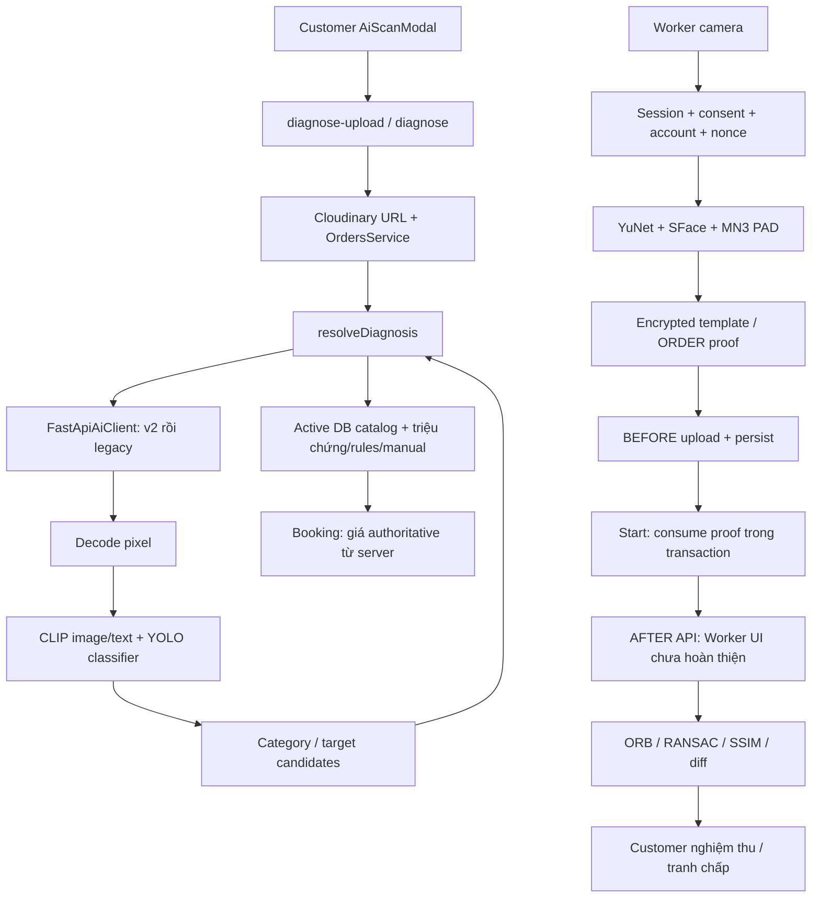

# 02 — Kiến trúc hiện hành và môi trường

Baseline/phạm vi xem [00](00-executive-summary.md). Sơ đồ thể hiện call chain source; không phải chứng nhận deployment.

## Điểm nối source

| Thành phần / symbol | Bằng chứng hiện hành | Ý nghĩa |
|---|---|---|
| Customer `AiScanModal`, `diagnoseIssueImage` | [AiScanModal.tsx:198](../../customer-app/src/features/home/components/AiScanModal.tsx#L198), [aiService.ts:70](../../customer-app/src/services/api/aiService.ts#L70) | URI camera/gallery → multipart bytes hoặc URL HTTP |
| `DiagnosisImageStorage._handleFile`, `OrdersController.diagnoseUpload` | [storage:64](../../server/src/modules/orders/diagnosis/diagnosis-upload.interceptor.js#L64), [controller:89](../../server/src/modules/orders/orders.controller.js#L89) | Validate magic/MIME/10MB, storage rồi URL cho resolver |
| `resolveDiagnosis`, `FastApiAiClient.diagnoseIncident` | [resolver:105](../../server/src/modules/orders/diagnosis/diagnosis-resolver.js#L105), [client:30](../../server/src/infrastructure/external/ai/fastapi-ai.client.js#L30) | AI trả candidate, Nest quyết canonical ID và dịch vụ |
| FastAPI `diagnose_v2`, `predict_clip_full` | [router:34](../../ai-service/recommendation/router.py#L34), [CLIP:251](../../ai-service/clip_classifier.py#L251) | Thực sự encode ảnh; YOLO gọi `predict(source=cv_img)` |
| Catalog `sync_catalog`, `reload_targets` | [catalog_manager.py:51](../../ai-service/recommendation/catalog_manager.py#L51), [CLIP:75](../../ai-service/clip_classifier.py#L75) | GET catalog backend; khi lỗi dùng static target fallback; chưa chứng minh catalog DB live đồng nhất |
| `FaceCoreService.submit/finish` | [core:443](../../server/src/modules/workers/face/face-core.service.js#L443), [finish:635](../../server/src/modules/workers/face/face-core.service.js#L635) | Backend chọn template; AI không tự cấp quyền |
| `require_face_auth`, `_face_inference` | [face_router.py:31](../../ai-service/face_router.py#L31) | Internal token, inline image, threadpool inference |
| `BeforePhotoCapture`, `OrderBeforeMediaService` | [camera:35](../../worker-app/src/features/orders/components/BeforePhotoCapture.jsx#L35), [media:13](../../server/src/modules/orders/order-before-media.service.js#L13) | Rear camera, scoped Cloudinary resource, reauthorize |
| `verifyCompletion`, `compareBeforeAfter` | [orders:505](../../server/src/modules/orders/orders.service.js#L505), [AI client:56](../../server/src/infrastructure/external/ai/fastapi-ai.client.js#L56) | Đọc BEFORE/AFTER của đơn, gọi CV; còn fallback success |
| Web client | [useFaceTest.js](../../client/src/pages/test-ai/hooks/useFaceTest.js), [faceTestService.js](../../client/src/services/test-ai/faceTestService.js), [faceReviewService.js](../../client/src/features/workers/services/faceReviewService.js) | Lab/inspection và compatibility review; không phải bằng chứng app worker E2E hay CCCD verification |

## Model và artifact

| Model | Vị trí / nguồn / inference | Xác minh audit |
|---|---|---|
| YOLOv8n classifier FixGo, 6 lớp | `weights/yolov8n-cls-fixgo.pt`; pipeline [train_model:27](../../ai-service/training/train.py#L27) fine-tune từ `yolov8n-cls.pt` | 2.974.408 bytes; SHA256 `959d3e9823c55ae0948ce08d75261dca630678d22228404ae03dd4ee7dc7532d`; load + predict thật đạt |
| YOLOv8n COCO detector | `weights/yolov8n.pt`; [download_models.py:27](../../ai-service/scripts/download_models.py#L27) trỏ Ultralytics assets v8.3.0 | 6.549.796 bytes; SHA256 `f59b3d833e2ff32e194b5bb8e08d211dc7c5bdf144b90d2c8412c47ccfc83b36`; file có, không dùng để kết luận phát hiện fault |
| CLIP ViT-B/32 | `openai/clip-vit-base-patch32`, Hugging Face cache; [load_clip:92](../../ai-service/clip_classifier.py#L92) không pin revision trong `from_pretrained` | Load offline + logits finite; suite thật gọi đúng wrapper. Cần pin commit/hash để tái lập deployment |
| YuNet 2023mar | `weights/face_detection_yunet_2023mar.onnx`; OpenCV Zoo | 232.589 bytes; hash `8f2383e4dd3cfbb4553ea8718107fc0423210dc964f9f4280604804ed2552fa4`; loader kiểm hash và load đạt |
| SFace 2021dec | `weights/face_recognition_sface_2021dec.onnx`; OpenCV Zoo | 38.696.353 bytes; hash `0ba9fbfa01b5270c96627c4ef784da859931e02f04419c829e83484087c34e79`; loader đạt; chưa đo matching người thật |
| anti-spoof-mn3 | Path cấu hình riêng, không trong weights chính; [manifest](../implementation/face-id/pad-mn3-manifest.json), [pad_mn3.py:11](../../ai-service/pad_mn3.py#L11) | Pinned hash `c4c99af04603b62d7e44f6f4daeb33e0daeccc696008c0b1d62f6f5cebbb3262`; provider capabilities local experimental ready; chưa đo PAD quality |
| ML Kit / BlazeFace | [LiveFaceCamera.jsx](../../worker-app/src/features/face-verification/components/LiveFaceCamera.jsx), [web](../../worker-app/src/features/face-verification/components/LiveFaceCamera.web.jsx), `worker-app/public/faceid/` | Guidance capture phía thiết bị; không cấp identity proof |

Giấy phép: Ultralytics AGPL-3.0/Enterprise theo [nhà phát hành](https://www.ultralytics.com/license); CLIP code MIT theo [LICENSE](https://github.com/openai/CLIP/blob/main/LICENSE), model card nêu giới hạn nghiên cứu/ngôn ngữ; YuNet [MIT](https://raw.githubusercontent.com/opencv/opencv_zoo/main/models/face_detection_yunet/LICENSE), SFace [Apache-2.0](https://raw.githubusercontent.com/opencv/opencv_zoo/main/models/face_recognition_sface/LICENSE). Cần lưu license theo revision artifact và quyền dataset riêng khi bàn giao/thương mại. Không mặc định toàn FixGo đã tuân thủ chỉ từ license upstream. MN3 có manifest nguồn nhưng chưa audit đầy đủ quyền phân phối artifact/dữ liệu của deployment.

## Khởi động, dependencies và hạ tầng

- [main.py:191](../../ai-service/main.py#L191) load classifier, optional detector, pinned face loader và CLIP trong lifespan; lỗi model không làm mọi route unavailable. `/health` có model status; HTTP 200 không chứng minh cả ba AI sẵn sàng.
- [Dockerfile](../../ai-service/Dockerfile) chạy `uvicorn main:app`, preload CLIP, PyTorch CPU. `face_app:app` là entrypoint chỉ Face ID; chạy entrypoint này thay main sẽ không cung cấp diagnosis/compare. Chưa kiểm process deployment đang dùng entrypoint nào.
- [requirements.txt](../../ai-service/requirements.txt) phần lớn dùng `>=`; OpenVINO pin `2026.4.1`; torch/torchvision cài riêng trong Docker. `httpx` được decoder v2 import trực tiếp nhưng không được liệt kê trực tiếp trong requirements; môi trường audit có sẵn, clean image cần kiểm riêng. Không cài gì trong task.
- Venv hiện tại: torch 2.14.1, torchvision 0.29.1, ultralytics 8.4.188, transformers 5.20.2, opencv-python-headless 5.0.0.93, fastapi 0.162.0, openvino 2026.4.1. Đây là phiên bản thực đo, không suy từ requirements.
- Máy audit khoảng 14 GiB RAM, đồ họa Intel UHD (Raptor Lake-P); chưa có bằng chứng GPU CUDA. YOLO/CLIP/SFace CPU chạy được ở các kiểm tra hẹp. Chưa benchmark throughput/concurrency và chưa load Qwen.
- AI local `.env` được module đọc; chỉ xuất cờ không nhạy cảm: `FACE_PAD_MODE=experimental`, threshold `.85`. Provider báo `padEvaluated=false`, `padExperimentalReady=true`. Không suy ra backend đang dùng cùng flags hoặc đang chạy; không in secret, template hay ảnh mặt.
- Không khởi động/dừng server dự án, không gọi upload/booking hoặc DB. Model primitive chạy trong process audit và TestClient. Deployment schema/trigger/token/storage/TLS/quota: NOT_VERIFIED.

## Đối chiếu tài liệu cũ

Đã tham khảo bộ worker bắt buộc `01`, `02`, `05`, `09`, `10`; customer audit `00`/`06`; ai-core audit `00`; faceid one-scan, self-enrollment và experimental PAD. Các báo cáo khác thời điểm có thể mâu thuẫn:

| Claim lịch sử | Source hiện tại |
|---|---|
| Face heuristic/detection-only verified | Đã thay bằng SFace/template contract và fail-closed; không lặp lại như lỗi hiện hành |
| Chưa có enrollment/PAD | Đã có self-enrollment và MN3 threshold experimental; chất lượng/PAD evaluated vẫn thiếu |
| Daily 24h là gate accept | Accept hiện không Daily; ORDER proof kiểm khi Start; default DAILY proof 8h |
| BEFORE UI chưa có | Đã có camera/storage/OrderImage BEFORE; AFTER chưa có ở job route |
| Phải có manual identity review, review hết hạn chặn | Self-enrollment bỏ gate review; `finish` ghi `reviewId:null`; manual review API bị removed |
| Compare fallback và Customer 94% | Vẫn còn, đã đối chiếu source và tái hiện FastAPI |

Tài liệu [ONE-SCAN-FINAL-IMPLEMENTATION](../faceid/ONE-SCAN-FINAL-IMPLEMENTATION.md) không đủ phản ánh thay đổi self-enrollment/experimental PAD sau đó. Ưu tiên source baseline này.
