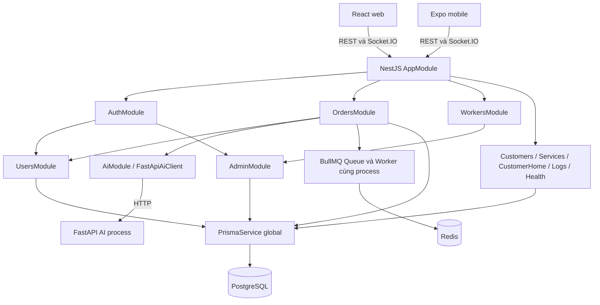

# Project discovery và cấu trúc

## Mục lục

- [Cây repository](#cây-repository)
- [Application và module](#application-và-module)
- [Entry points](#entry-points)
- [Dependency graph](#dependency-graph)
- [Coverage](#coverage)

## Cây repository

```text
.
├── doan-kltn-backend/            NestJS API, business logic, queue worker
│   ├── src/main.js               bootstrap HTTP
│   ├── src/app.module.js         composition root
│   ├── src/common/               guards, role metadata, filter/interceptor
│   ├── src/config/               configuration adapters
│   ├── src/infrastructure/       Prisma, Redis, AI/payment clients
│   ├── src/modules/              business feature modules
│   ├── src/health/               HTTP liveness
│   ├── prisma/                   schema, migrations, seed/import utilities
│   └── test/                     bootstrap test, race simulation
├── doan-kttn-frontend/            React web: admin, worker và customer portal
│   └── src/
│       ├── app/                  providers và router wrapper
│       ├── routers/              actual route tree và menus
│       ├── features/             auth, customer, dashboard, users, workers...
│       ├── components/           layout, feedback, table, UI primitives
│       ├── services/             Axios, socket, token storage
│       └── store/, types/, utils/
├── doan-kltn-mobile/             Expo app: customer và worker
│   ├── app/                      file-based routes: auth/user/worker/common
│   ├── src/features/             hooks, services, components theo feature
│   ├── src/screens/order/        bộ màn hình order flow có React Query
│   ├── src/services/             API, socket, Firebase, storage
│   ├── src/store/                Zustand order state
│   ├── src/components/           map adapters, error boundary
│   └── __tests__/                auth/profile UI tests
├── ai-service/
│   ├── main.py                   FastAPI, inference, schemas, image utilities
│   ├── clip_classifier.py        CLIP model và embedding lifecycle
│   ├── category_helper.py        normalize/match category
│   ├── service_catalog.py        catalog và text prompts tĩnh
│   ├── training/, eval/          offline ML tooling
│   ├── scripts/                  download models, HTML test UI
│   ├── dataset/, runs/, weights/ dữ liệu/artifacts; không coi là app khác
│   └── Dockerfile
├── docker-compose.yml           PostGIS, Redis, AI container
├── scripts/update-ip.js         ghi config network cho mobile
├── setup.*, dev-local.*, stop.*  local orchestration
├── .agents/                     rules/context/skills và workflow tham khảo
├── .doc/, README.md, *.md        tài liệu cũ, chỉ là bối cảnh
└── docs/architecture-analysis/   bộ báo cáo này
```

**CONFIRMED:** Multi-application repository, không có root `package.json`/npm workspace. Package manager npm theo lockfile từng app và `setup.sh`; AI dùng pip/venv. Không thấy shared library riêng, Nx/Turborepo/Lerna hoặc worker deployment riêng. [setup.sh:40](../../setup.sh#L40) — `setup application dependencies`, [dev-local.sh:57](../../dev-local.sh#L57) — `local process orchestration`.

## Application và module

| Backend module | Trách nhiệm AS-IS | Data boundary / dependency | Trạng thái |
|---|---|---|---|
| auth | password/Google/Firebase login, OTP/reset, JWT | Users, AdminGateway, Redis, eSMS, email | CONFIRMED: `AuthModule`, `AuthService`, `OtpService` |
| users | user lookup/profile/avatar/phone | UsersRepository → Prisma | CONFIRMED: `UsersModule` |
| customers | customer profile/address book | Prisma trực tiếp | CONFIRMED: `CustomersModule` |
| workers | hồ sơ, dịch vụ, approval submission, availability, nearby | Prisma + AdminGateway | CONFIRMED: `WorkersModule` |
| services | public category/target/service catalog | Prisma read queries | CONFIRMED: `ServicesModule` |
| customer-home | summary và active-order projection cho UI | Prisma, có tạo Wallet trong GET | CONFIRMED: `CustomerHomeModule` |
| orders | diagnose/create/match/accept/status/payment/review/schedule | Prisma + repositories + AI + queue + socket | CONFIRMED: `OrdersModule` |
| admin | users/workers/catalog/orders/settings/analytics/dashboard | shared Prisma + AdminGateway | CONFIRMED: `AdminModule` |
| ai | endpoints trung gian gọi AI client | FastApiAiClient + Prisma | CONFIRMED: `AiModule`; có drift contract |
| logs | nhận client error, append local file | filesystem | CONFIRMED: `LogsModule` |
| health | trả `status: ok` | không check data services | CONFIRMED: `HealthModule` |
| payments | payment URL/webhook skeleton | OrdersRepository/Workflow, mock PaymentClient | Có code nhưng **không reachable từ AppModule import graph** |
| configurations/images/locations/matching/realtime/reviews/wallets | directory `.gitkeep` | chưa có module executable | NOT FOUND implementation trong các directory này |
| login | tài liệu `login.md` | không có runtime module | CONFIRMED documentation only |

Điểm vào graph: [doan-kltn-backend/src/app.module.js:17](../../doan-kltn-backend/src/app.module.js#L17) — `AppModule`. Orders export cả gateway, repository, workflow, queue: [doan-kltn-backend/src/modules/orders/orders.module.js:24](../../doan-kltn-backend/src/modules/orders/orders.module.js#L24) — `OrdersModule.exports`. Payments không được import từ các module active; sự hiện diện của model Payment và method `OrdersService.processPayment` **không** có nghĩa `PaymentsModule` đã được mount.

Web có 10 feature directory: admin wrapper; analytics; auth; customer; dashboard; orders; services; settings; users; workers. Web không chỉ là admin: route customer `/`, `/services`, worker `/worker/dashboard`, public `/mobile` trong [doan-kttn-frontend/src/routers/routes.jsx:34](../../doan-kttn-frontend/src/routers/routes.jsx#L34) — `AppRoutes`. Các route payments/commissions/disputes là placeholder tại dòng 57–59.

Mobile có auth, booking, face-verification, home, services được triển khai đáng kể; chat, image-analysis, location, orders, payment dưới `src/features` chủ yếu barrel/placeholder. Tuy nhiên API/order screens/store hoạt động ở thư mục khác, nên không suy rằng “project không có order/payment”. [doan-kltn-mobile/src/store/useOrderStore.js:3](../../doan-kltn-mobile/src/store/useOrderStore.js#L3) — `useOrderStore`, [doan-kltn-mobile/src/services/api/orderService.js:3](../../doan-kltn-mobile/src/services/api/orderService.js#L3) — `orderService`.

## Entry points

1. Backend `bootstrap`: `NestFactory.create(AppModule)` → Config/Prisma/Redis/business modules → global prefix/CORS/ValidationPipe/Swagger → listen. Prisma `$connect` và queue `Worker` khởi tạo qua lifecycle. [doan-kltn-backend/src/main.js:8](../../doan-kltn-backend/src/main.js#L8) — `bootstrap`, [doan-kltn-backend/src/infrastructure/database/prisma.service.js:5](../../doan-kltn-backend/src/infrastructure/database/prisma.service.js#L5) — `PrismaService`, [doan-kltn-backend/src/modules/orders/order-queue.service.js:52](../../doan-kltn-backend/src/modules/orders/order-queue.service.js#L52) — `onModuleInit`.
2. Web `index.html` → `src/main.jsx` → `App` → `AppProvider` (Theme/Auth) → `AppRouter` (BrowserRouter) → `AppRoutes`. [doan-kttn-frontend/src/main.jsx:6](../../doan-kttn-frontend/src/main.jsx#L6) — `ReactDOM.createRoot`, [doan-kttn-frontend/src/app/providers/AppProvider.jsx:5](../../doan-kttn-frontend/src/app/providers/AppProvider.jsx#L5) — `AppProvider`, [doan-kttn-frontend/src/app/router/index.jsx:5](../../doan-kttn-frontend/src/app/router/index.jsx#L5) — `AppRouter`.
3. Mobile manifest `main: expo-router/entry` → `app/_layout.jsx`: global error boundary, AuthProvider, Stack; auth route groups tổ chức màn hình. [doan-kltn-mobile/package.json:5](../../doan-kltn-mobile/package.json#L5) — `main`, [doan-kltn-mobile/app/_layout.jsx:16](../../doan-kltn-mobile/app/_layout.jsx#L16) — `RootLayout`.
4. AI `uvicorn main:app` → FastAPI `lifespan` nạp YOLO/YuNet/SFace/CLIP theo khả năng/weights → handlers. [ai-service/Dockerfile:41](../../ai-service/Dockerfile#L41) — `CMD`, [ai-service/main.py:179](../../ai-service/main.py#L179) — `lifespan`, [ai-service/clip_classifier.py:33](../../ai-service/clip_classifier.py#L33) — `load_clip`. Model thực tế nạp thành công **NOT VERIFIED**.

## Dependency graph



Sơ đồ rút gọn cạnh business chính; không vẽ mỗi dependency framework hoặc mỗi module global import. Redis subscriber nằm trong Orders gateway. `@Global` giúp inject Prisma/Redis rộng: [doan-kltn-backend/src/infrastructure/database/prisma.module.js:4](../../doan-kltn-backend/src/infrastructure/database/prisma.module.js#L4) — `PrismaModule`, [doan-kltn-backend/src/infrastructure/redis/redis.module.js:4](../../doan-kltn-backend/src/infrastructure/redis/redis.module.js#L4) — `RedisModule`. Chưa phát hiện import cycle Nest module ở graph tĩnh; setter gateway tạo liên kết object ngược OrdersService → Queue → Gateway, không tự chứng minh circular DI.

## Coverage

Scan source cập nhật lần cuối gồm backend 113 file/12.460 dòng; web 174/23.954; mobile src 130/20.419 và routes 38/14.248; AI Python 10/2.798. Tổng **465 file, 73.879 dòng** theo bộ lọc JS/JSX/TS/TSX/Python; không tính dependencies/generated/build/binary. Đây là số dòng vật lý, không phải executable LOC hay test coverage.

Tất cả module được inventory; mức deep review khác nhau. Danh sách file, symbol và phạm vi bỏ qua được ghi tại [11-evidence-index](11-evidence-index.md), không đồng nhất automated scan với manual line-by-line audit.
