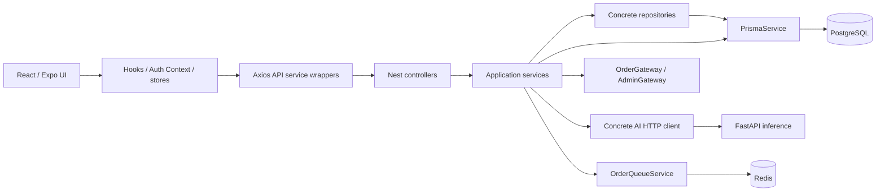

# Software Architecture — AS-IS

## Mục lục

- [Phân loại có bằng chứng](#phân-loại-có-bằng-chứng)
- [Layer và dependency](#layer-và-dependency)
- [Data/control flow](#datacontrol-flow)
- [Boundary và trade-off](#boundary-và-trade-off)

## Phân loại có bằng chứng

| Kiến trúc | Kết luận / confidence | Bằng chứng và giới hạn |
|---|---|---|
| Client–Server | CONFIRMED / cao | Web/mobile gọi HTTP Nest và Socket.IO; Nest gọi AI HTTP. `apiClient`, `FastApiAiClient` |
| Layered Architecture | CONFIRMED đặc điểm / cao | `UsersController → UsersService → UsersRepository → PrismaService`; Orders vừa qua repository vừa Prisma trực tiếp |
| N-Tier | INFERRED / vừa | UI/API/data có thể tách runtime; actual deployment topology NOT VERIFIED |
| Modular Monolith | INFERRED / cao, kiến trúc backend chủ đạo | `AppModule` compose nhiều feature trong một Nest process, cùng Prisma/database |
| Feature-Based | CONFIRMED / cao | backend `modules/*`; web/mobile `features/*` với components/hooks/services; một số placeholder |
| Vertical Slice | INFERRED đặc điểm / vừa | feature locality có; không thấy mỗi use case tự đóng gói handler/domain/storage độc lập |
| Dedicated service / Microservice | CONFIRMED AI tách process; microservice ecosystem NOT FOUND | FastAPI độc lập qua HTTP, không thấy DB client chính; chưa có service discovery, independent release evidence |
| Event-Driven | CONFIRMED cục bộ / cao | Socket events, Redis subscriber, BullMQ jobs; nghiệp vụ chính vẫn request/response, không phải mọi transition phát durable domain event |
| BFF | INFERRED đặc điểm / vừa | `CustomerHomeService.getSummary/getActiveOrder` và dashboard aggregate cho UI; cùng backend phục vụ nhiều client, không có BFF process riêng |
| MVC | INFERRED phần Controller/Model; full server MVC NOT FOUND | Nest controllers và Prisma models, view là React app riêng, không server template render |
| MVVM/MVP | NOT FOUND cấu trúc chính thức | custom hooks tổ chức presentation logic, không đủ để khẳng định ViewModel/Presenter contract |
| Clean Architecture | NOT FOUND tuân thủ hệ thống | business service import Nest/Prisma/Gateway; thiếu domain entity/use-case port độc lập |
| Hexagonal | NOT FOUND hoàn chỉnh | có integration wrapper, nhưng Orders phụ thuộc concrete FastApiAiClient và Prisma, không domain-owned port |
| Onion | NOT FOUND | không có inner domain core và dependency hướng vào core được thực thi |
| CQRS | NOT FOUND formal | get vs update methods chỉ là CRUD/read projection; không command/query dispatch hoặc model tách riêng |
| Event Sourcing | NOT FOUND | lưu mutable Order; history là audit trail, không rebuild state từ event stream |
| DDD | NOT FOUND tactical structure | Order/Worker là business vocabulary, nhưng Prisma anemic models, không thấy aggregate invariants/value objects/bounded-context ownership |

Bằng chứng chính: [doan-kltn-backend/src/modules/users/users.controller.js:29](../../doan-kltn-backend/src/modules/users/users.controller.js#L29) — `UsersController`, [doan-kltn-backend/src/modules/users/users.service.js:6](../../doan-kltn-backend/src/modules/users/users.service.js#L6) — `UsersService`, [doan-kltn-backend/src/modules/users/users.repository.js:6](../../doan-kltn-backend/src/modules/users/users.repository.js#L6) — `UsersRepository`, [doan-kltn-backend/src/modules/orders/orders.service.js:9](../../doan-kltn-backend/src/modules/orders/orders.service.js#L9) — `imports`, [doan-kltn-backend/src/modules/customer-home/customer-home.service.js:24](../../doan-kltn-backend/src/modules/customer-home/customer-home.service.js#L24) — `getSummary`.

Không dùng tên thư mục `infrastructure`, `repository` hoặc từ “microservice” trong README để chứng minh Clean/Hexagonal/DDD.

## Layer và dependency

Đây là **source dependency và call direction rút gọn**, không cam kết mọi UI đi qua hook/store. Ví dụ UI cũng tự gọi service và local storage. Module không có database schema isolation.

- Presentation: controller route/guard/body binding, React component và navigation.
- Application/business: service điều phối check, DB, AI và phát event.
- Data access: repository ở Users/Orders/Payments; direct Prisma phổ biến ở Orders/Admin/Customers/Workers/Services/CustomerHome.
- Infrastructure: Prisma/Redis lifecycle, HTTP client, Cloudinary storage; queue nằm trong feature Orders.
- AI: handler, schemas, image algorithms và lifecycle cùng `main.py`; catalog/prompts và CLIP tách file.

**CONFIRMED:** DI là container cấp dependency, không đồng nghĩa Dependency Inversion. `@Dependencies(PrismaService, OrdersGateway, FastApiAiClient, ...)` phụ thuộc concrete infrastructure. [doan-kltn-backend/src/modules/orders/orders.service.js:31](../../doan-kltn-backend/src/modules/orders/orders.service.js#L31) — `OrdersService DI`.

## Data/control flow

HTTP: client → interceptor gắn bearer → route guards → body binding/global pipe → controller → service → DB/integration → serialize → client normalize → state → UI. Không thấy business repository riêng trong phần lớn direct-Prisma paths. Không vẽ exception filter/transform interceptor như active middleware vì chưa thấy registration: [doan-kltn-backend/src/main.js:8](../../doan-kltn-backend/src/main.js#L8) — `bootstrap`, [doan-kltn-backend/src/common/filters/http-exception.filter.js:10](../../doan-kltn-backend/src/common/filters/http-exception.filter.js#L10) — `AllExceptionsFilter`, [doan-kltn-backend/src/common/interceptors/transform.interceptor.js:5](../../doan-kltn-backend/src/common/interceptors/transform.interceptor.js#L5) — `TransformInterceptor`.

Async: create DB transaction commit → schedule BullMQ → scan nearby → emit socket. Queue/event publish **không cùng database transaction**. Nếu crash sau commit trước enqueue/broadcast, trạng thái DB tồn tại nhưng side effect có thể thiếu. Đây là suy luận failure window từ thứ tự await, chưa fault-injection. [doan-kltn-backend/src/modules/orders/orders.service.js:251](../../doan-kltn-backend/src/modules/orders/orders.service.js#L251) — `createOrder`.

## Boundary và trade-off

| Quan sát | Ưu điểm | Hạn chế | Cải thiện incremental |
|---|---|---|---|
| Feature modules + một DB | navigation dễ, transaction xuyên model đơn giản | database ownership rộng, nhiều service biết cùng schema | giữ monolith, tách service theo use case trước |
| AI process Python riêng | dùng ML ecosystem và lifecycle độc lập | HTTP failure/timeout/contract drift | adapter trả engine/degraded state rõ; timeout + contract checks |
| Concrete repository + direct ORM lẫn nhau | CRUD nhanh | abstraction không nhất quán; mock khó và query legacy sai | chọn boundary cho nghiệp vụ rủi ro, không ép mọi CRUD qua interface |
| Web/mobile feature hooks | reuse state orchestration, UI nhỏ hơn | duplicated contracts và fallback | schema/codegen contract sau khi API ổn định |
| Global Prisma/Redis | wiring ít | mọi feature có thể truy cập data layer | quy định ownership bằng module exports/lint ở chỗ cần |

Impact ưu tiên là reliability/security, effort nhỏ–vừa mỗi boundary; trade-off tăng file/interface và test maintenance. Không có bằng chứng cần tách thêm microservice; tăng network boundaries lúc invariant chưa rõ sẽ làm khó debug và transaction hơn.
