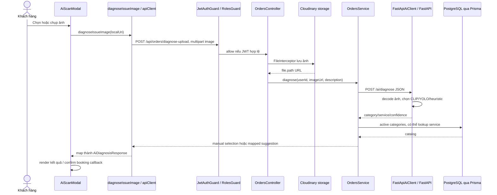
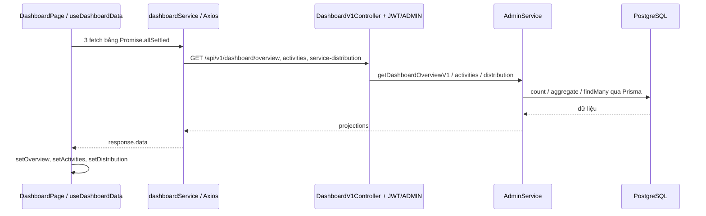
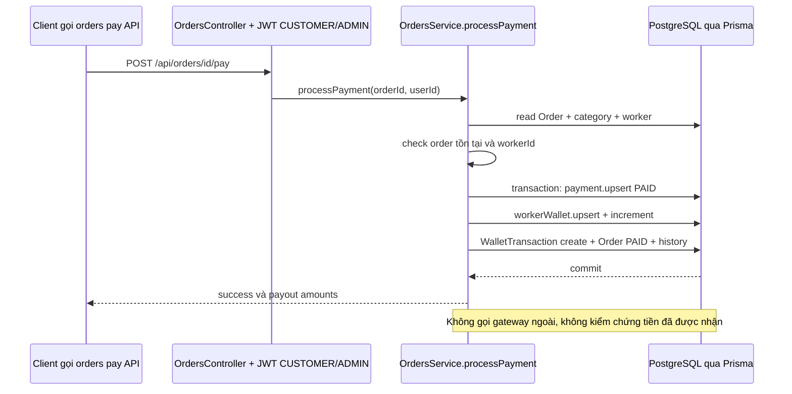

# Runtime và data flow — AS-IS

## Mục lục

- [1. Web login](#1-web-login)
- [2. Mobile upload và AI](#2-mobile-upload-và-ai)
- [3. Mobile booking và nhận đơn](#3-mobile-booking-và-nhận-đơn)
- [4. Dashboard](#4-dashboard)
- [5. Thanh toán](#5-thanh-toán)
- [Async và failure semantics](#async-và-failure-semantics)

**CONFIRMED source trace**, **NOT VERIFIED runtime** cho mọi luồng dưới đây. Diagram mô tả lời gọi hiện có; không dùng happy path để bỏ qua bug đã xác định. HTTP guards/pipes không phải custom Express middleware; không vẽ một Repository nếu luồng gọi Prisma trực tiếp.

## 1. Web login

Entry UI: [doan-kttn-frontend/src/features/auth/components/LoginForm.jsx:1](../../doan-kttn-frontend/src/features/auth/components/LoginForm.jsx#L1) — `LoginForm`, [doan-kttn-frontend/src/features/auth/pages/LoginPage.jsx:1](../../doan-kttn-frontend/src/features/auth/pages/LoginPage.jsx#L1) — `LoginPage` → auth context [doan-kttn-frontend/src/store/authStore.jsx:46](../../doan-kttn-frontend/src/store/authStore.jsx#L46) — `AuthProvider.login` → [doan-kttn-frontend/src/features/auth/services/auth.service.js:10](../../doan-kttn-frontend/src/features/auth/services/auth.service.js#L10) — `authService.login`.

```mermaid
sequenceDiagram
  actor U as Người dùng
  participant UI as Login UI / AuthProvider
  participant C as web authService / Axios
  participant AC as AuthController
  participant AS as AuthService
  participant US as UsersService / UsersRepository
  participant DB as PostgreSQL qua Prisma
  U->>UI: Nhập email hoặc phone và password
  UI->>C: login(credentials)
  C->>AC: POST /api/auth/login
  Note over C,AC: Request interceptor có thể gắn token cũ; route login public
  AC->>AS: login(identifier, password)
  AS->>US: findByEmailOrPhone(identifier)
  US->>DB: user.findFirst + profiles
  DB-->>AS: User gồm passwordHash
  AS->>AS: check BLOCKED, bcrypt.compare, JWT sign
  AS-->>C: accessToken + sanitizedUser
  C->>C: lưu token/user localStorage
  C-->>UI: response.data
  UI->>UI: cập nhật Context, role navigation
```

Service explicit reject thiếu input/unknown user/blocked/bad password. Không có DB write khi login password thành công; DB write xuất hiện ở register hoặc social account linking. [doan-kltn-backend/src/modules/auth/auth.controller.js:69](../../doan-kltn-backend/src/modules/auth/auth.controller.js#L69) — `login`, [doan-kltn-backend/src/modules/auth/auth.service.js:153](../../doan-kltn-backend/src/modules/auth/auth.service.js#L153) — `login`, [doan-kltn-backend/src/modules/users/users.repository.js:42](../../doan-kltn-backend/src/modules/users/users.repository.js#L42) — `findByEmailOrPhone`.

Request protected tiếp theo: Axios bearer → `JwtAuthGuard` → `JwtStrategy.validate` chuyển `sub` thành `id/userId`, role lấy token → `RolesGuard` so metadata. Không thấy strategy đọc user status mới từ DB. [doan-kltn-backend/src/modules/auth/strategies/jwt.strategy.js:15](../../doan-kltn-backend/src/modules/auth/strategies/jwt.strategy.js#L15) — `validate`, [doan-kltn-backend/src/modules/auth/guards/roles.guard.js:12](../../doan-kltn-backend/src/modules/auth/guards/roles.guard.js#L12) — `canActivate`. Vì vậy block sau khi cấp JWT không tự thu hồi token theo code này; tác động phụ thuộc expiry và policy endpoint khác.

Google/Firebase là flow khác: `verifyIdToken` → find/link/create user → token. Không đồng nhất Google ID token, Firebase ID token và access token nội bộ. [doan-kltn-backend/src/modules/auth/auth.service.js:245](../../doan-kltn-backend/src/modules/auth/auth.service.js#L245) — `googleLogin`, [doan-kltn-backend/src/modules/auth/auth.service.js:365](../../doan-kltn-backend/src/modules/auth/auth.service.js#L365) — `firebaseGoogleLogin token verification`.

## 2. Mobile upload và AI

UI [doan-kltn-mobile/src/features/home/components/AiScanModal.tsx:39](../../doan-kltn-mobile/src/features/home/components/AiScanModal.tsx#L39) — `AiScanModal` gọi [doan-kltn-mobile/src/services/api/aiService.ts:30](../../doan-kltn-mobile/src/services/api/aiService.ts#L30) — `diagnoseIssueImage`. URI `file://`, `content://`, `ph://` tạo multipart field **image**; URL online đi JSON `/orders/diagnose`.



Evidence backend: [doan-kltn-backend/src/modules/orders/orders.controller.js:74](../../doan-kltn-backend/src/modules/orders/orders.controller.js#L74) — `diagnoseUpload`, [doan-kltn-backend/src/modules/orders/orders.service.js:74](../../doan-kltn-backend/src/modules/orders/orders.service.js#L74) — `diagnose`, [doan-kltn-backend/src/infrastructure/external/ai/fastapi-ai.client.js:29](../../doan-kltn-backend/src/infrastructure/external/ai/fastapi-ai.client.js#L29) — `diagnoseIncident`, [ai-service/main.py:392](../../ai-service/main.py#L392) — `diagnose`.

Data chủ yếu: binary ảnh → remote URL → prediction → DB category ID mapping → mobile display model. **Luồng diagnose này không persist AIAnalysis/Order**; chỉ upload media và read catalog. Không vẽ AI kết nối PostgreSQL vì không thấy DB client trong AI runtime.

Failure semantics: HTTP AI fail thì backend trả heuristic; confidence thấp thì manual selection. Mobile lại có fallback khi backend lỗi. Confidence cao không chứng minh model chạy; backend mapping không giữ đầy đủ `engine/decision_source`. Màn hình có thể hiển thị gợi ý suy đoán như AI thành công. [doan-kltn-mobile/src/services/api/aiService.ts:95](../../doan-kltn-mobile/src/services/api/aiService.ts#L95) — `diagnoseIssueImage fallback`, [doan-kltn-backend/src/infrastructure/external/ai/fastapi-ai.client.js:47](../../doan-kltn-backend/src/infrastructure/external/ai/fastapi-ai.client.js#L47) — `diagnoseIncident fallback`.

Web có flow upload riêng **không tương đương**: [doan-kttn-frontend/src/features/customer/services/orderApi.js:14](../../doan-kttn-frontend/src/features/customer/services/orderApi.js#L14) — `diagnoseImage` gửi multipart field `file` vào `/orders/diagnose`, nhưng endpoint upload thực tế là `/orders/diagnose-upload` field `image`. Contract mismatch CONFIRMED; lỗi HTTP cụ thể NOT VERIFIED.

## 3. Mobile booking và nhận đơn

Reachable booking route: [doan-kltn-mobile/app/(user)/booking/index.jsx:1](../../doan-kltn-mobile/app/(user)/booking/index.jsx#L1) — `route re-export` → `create-booking.jsx` → [doan-kltn-mobile/src/features/booking/hooks/useBooking.js:188](../../doan-kltn-mobile/src/features/booking/hooks/useBooking.js#L188) — `submitOrder` → [doan-kltn-mobile/src/features/booking/services/bookingService.js:13](../../doan-kltn-mobile/src/features/booking/services/bookingService.js#L13) — `createBooking` → [doan-kltn-mobile/src/services/api/orderService.js:24](../../doan-kltn-mobile/src/services/api/orderService.js#L24) — `createOrder`.

```mermaid
sequenceDiagram
  participant UI as CreateBooking / useBooking
  participant C as bookingService / apiClient
  participant CT as OrdersController + guards
  participant OS as OrdersService
  participant DB as PostgreSQL qua Prisma
  participant Q as BullMQ Redis queue
  participant G as OrderGateway /orders
  UI->>C: createBooking(payload)
  C->>CT: POST /api/orders
  CT->>OS: createOrder(authenticated User ID, body)
  OS->>DB: category lookup
  OS->>DB: transaction: Order SEARCHING_WORKER + history + optional BEFORE image
  DB-->>OS: newOrder với id
  OS->>Q: scheduleRadiusExpansion sau 180000ms
  OS->>DB: Haversine scan workers
  OS->>G: broadcastNewOrderToWorkers(workers, order)
  G->>G: namespace-wide emit, không lọc recipient workers
  OS-->>C: flat object chứa id/status
  C->>C: đọc orderId hoặc order.id; thiếu result.id nên sinh ORD timestamp
  C-->>UI: orderId có thể là ID giả
  UI->>UI: SEARCHING, countdown 120s
  UI->>G: ý định joinOrderRoom qua socketService
  Note over UI,G: client mặc định root namespace, gateway ở /orders: không cùng namespace
```

Evidence: [doan-kltn-backend/src/modules/orders/orders.controller.js:95](../../doan-kltn-backend/src/modules/orders/orders.controller.js#L95) — `createOrder`, [doan-kltn-backend/src/modules/orders/orders.service.js:194](../../doan-kltn-backend/src/modules/orders/orders.service.js#L194) — `createOrder`, [doan-kltn-backend/src/modules/orders/orders.gateway.js:387](../../doan-kltn-backend/src/modules/orders/orders.gateway.js#L387) — `broadcastNewOrderToWorkers`.

**CONFIRMED defect:** response backend là `{...order, nearbyWorkersCount, message}`, mobile Axios unwrap `response.data`, nhưng booking facade không đọc `result.id` và fallback `ORD-${Date.now()}`. Không vẽ UI tracking thành công: không có trace bảo đảm ID đó tồn tại DB. [doan-kltn-backend/src/modules/orders/orders.service.js:323](../../doan-kltn-backend/src/modules/orders/orders.service.js#L323) — `createOrder return`, [doan-kltn-mobile/src/features/booking/services/bookingService.js:36](../../doan-kltn-mobile/src/features/booking/services/bookingService.js#L36) — `createBooking result mapping`, [doan-kltn-mobile/src/services/api/apiClient.js:81](../../doan-kltn-mobile/src/services/api/apiClient.js#L81) — `response interceptor`.

**CONFIRMED mismatch:** hook nghe `order.accepted/order.timeout`; gateway emit `order:matched/order.matched/order:no_worker_found`. Mobile `SocketService.connect` gọi root URL, server order gateway namespace `/orders`; root gateway chỉ AdminGateway. [doan-kltn-mobile/src/features/booking/hooks/useBooking.js:121](../../doan-kltn-mobile/src/features/booking/hooks/useBooking.js#L121) — `socket subscription`, [doan-kltn-mobile/src/services/socket/socketService.js:56](../../doan-kltn-mobile/src/services/socket/socketService.js#L56) — `connect`, [doan-kltn-backend/src/modules/orders/orders.gateway.js:26](../../doan-kltn-backend/src/modules/orders/orders.gateway.js#L26) — `WebSocketGateway`.

Nhận đơn từ thợ gọi `POST /orders/:id/accept` → JWT/WORKER → `acceptOrder`: tìm WorkerProfile, check face timestamp trong 24h → transaction row lock `SELECT ... FOR UPDATE`, check open status và workerId null → update MATCHED + history → emit. [doan-kltn-backend/src/modules/orders/orders.service.js:622](../../doan-kltn-backend/src/modules/orders/orders.service.js#L622) — `acceptOrder`. Đây là actual path, khác legacy `OrderWorkflowService.assignWorker` conditional update SEARCHING → ASSIGNED. Row lock một order không tự ngăn một worker nhận nhiều order khác nhau đồng thời.

`src/screens/order/*` có flow khác, dùng React Query + Zustand. Scan caller chỉ thấy barrel export bộ màn hình này, chưa thấy route render và **NOT FOUND QueryClientProvider**. Không lấy nó làm luồng mobile end-to-end đã nối đầy đủ. `PaymentReviewScreen` và `SearchingScreen` được phân tích như implementation path có điều kiện mount.

## 4. Dashboard

Reachable web route `/admin/dashboard` → [doan-kttn-frontend/src/features/dashboard/hooks/useDashboardData.js:24](../../doan-kttn-frontend/src/features/dashboard/hooks/useDashboardData.js#L24) — `fetchData` gọi đồng thời overview/activities/distribution qua [doan-kttn-frontend/src/features/dashboard/services/dashboard.service.js:17](../../doan-kttn-frontend/src/features/dashboard/services/dashboard.service.js#L17) — `getOverview` → [doan-kltn-backend/src/modules/admin/dashboard-v1.controller.js:54](../../doan-kltn-backend/src/modules/admin/dashboard-v1.controller.js#L54) — `getOverview` có JWT + ADMIN → [doan-kltn-backend/src/modules/admin/admin.service.js:2327](../../doan-kltn-backend/src/modules/admin/admin.service.js#L2327) — `getDashboardOverviewV1` → Prisma count/aggregate → response → chart state.



Partial failure được giữ riêng, không hủy tất cả dashboard. Một số growth field hardcode, nên không gọi tất cả KPI là số liệu tính từ DB. Source overview filter active statuses theo bộ cũ, doanh thu chỉ COMPLETED; order mới MATCHED/PAID có thể bị thiếu. [doan-kltn-backend/src/modules/admin/admin.service.js:2377](../../doan-kltn-backend/src/modules/admin/admin.service.js#L2377) — `getDashboardOverviewV1 filters`, dòng 2416 growth literal. Event subscription có code nhưng actual realtime kết nối đúng namespace **NOT VERIFIED**, có mismatch được nêu trên.

## 5. Thanh toán

Backend route **đã mount**: [doan-kltn-backend/src/modules/orders/orders.controller.js:410](../../doan-kltn-backend/src/modules/orders/orders.controller.js#L410) — `payOrder` → `OrdersService.processPayment`. `PaymentReviewScreen.payMutation` có caller API nhưng mount UI chưa xác nhận. Không lấy PaymentsModule skeleton làm gateway thanh toán đang hoạt động.



**CONFIRMED:** transaction atomic nhiều write nhưng không idempotent. `Payment.orderId @unique` chỉ ngăn nhiều Payment row; nhánh upsert update vẫn increment ví và tạo ledger mỗi lần. `userId` chỉ dùng history, chưa check owner. Không có payment-state precondition hoặc signed provider receipt. [doan-kltn-backend/src/modules/orders/orders.service.js:1071](../../doan-kltn-backend/src/modules/orders/orders.service.js#L1071) — `processPayment`, [doan-kltn-backend/prisma/schema.prisma:307](../../doan-kltn-backend/prisma/schema.prisma#L307) — `Payment`, [doan-kltn-backend/prisma/schema.prisma:367](../../doan-kltn-backend/prisma/schema.prisma#L367) — `WalletTransaction`.

## Async và failure semantics

- BullMQ Queue + Worker khởi tạo trong Nest process; delayed 3 phút, radius 5 → 7 → 9 → 11 khi tối đa 3 attempt. Comment “15km” không đạt với giới hạn attempt hiện tại. [doan-kltn-backend/src/modules/orders/order-queue.service.js:121](../../doan-kltn-backend/src/modules/orders/order-queue.service.js#L121) — `processJob`.
- `broadcastToNearbyWorkers` chỉ được gọi nếu tồn tại, nhưng gateway không định nghĩa method đó. Job ghi history/mở lịch tiếp, **không có re-scan+broadcast đúng method**. Không có `attempts/backoff` retry options trong `.add`; các job lặp ở đây là nghiệp vụ radius expansion, không retry lỗi.
- Redis Pub/Sub subscriber có, chưa thấy publisher cho ba channel trong active source. Không thể kết luận multi-instance delivery hoàn chỉnh.
- DB commit rồi emit/queue không atomic; outbox là cải tiến có thể cân nhắc sau invariant fix. Socket failure bị catch/warn nên HTTP vẫn có thể success.
- `scheduleOrder` chỉ update lịch và status, không tạo delayed execution tương ứng; `scheduledAt` trong createOrder không trì hoãn matching. Đây chưa phải scheduling engine đầy đủ.
