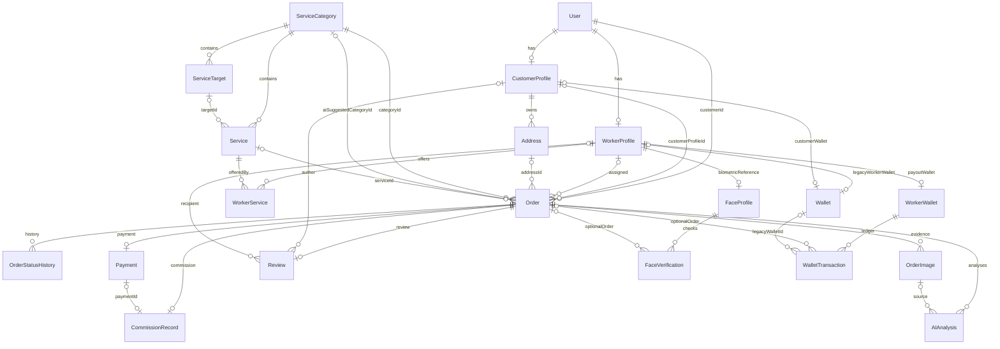

# Database và Data Architecture

## Mục lục

- [Engine và schema](#engine-và-schema)
- [ER diagram](#er-diagram)
- [Constraints và indexes](#constraints-và-indexes)
- [Transactions và consistency](#transactions-và-consistency)
- [Query và migration review](#query-và-migration-review)

## Engine và schema

**CONFIRMED:** Prisma PostgreSQL datasource, extensions btree_gist/PostGIS; Compose image PostgreSQL 16/PostGIS 3.4. **NOT VERIFIED:** server thực tế, schema applied, extension availability, row counts, query plan. [doan-kltn-backend/prisma/schema.prisma:6](../../doan-kltn-backend/prisma/schema.prisma#L6) — `datasource db`, [docker-compose.yml:4](../../docker-compose.yml#L4) — `postgres service`.

| Nhóm | Models và ý nghĩa |
|---|---|
| Identity | User; CustomerProfile và WorkerProfile mỗi userId unique; role/status enums |
| Catalog | ServiceCategory → ServiceTarget → Service; Service.targetId optional; WorkerService many-to-many có customPrice/isAvailable |
| Fulfillment | Order, OrderStatusHistory, OrderImage, Review |
| AI / biometric | FaceProfile, FaceVerification, AIAnalysis; JSON embedding/raw result |
| Finance | Payment, CommissionRecord, WorkerWallet, Wallet, WalletTransaction |
| Config / promotions | SystemSetting, Voucher |
| GIS metadata | spatial_ref_sys, WorkerProfile.currentLocation Unsupported geometry |

Models là ORM data records, không thấy domain aggregate class. AIAnalysis/FaceVerification model tồn tại **không chứng minh** mọi Orders AI path ghi các bảng này; trace hiện chủ yếu cập nhật worker timestamp hoặc image score.

## ER diagram

Cardinality từ `schema.prisma`; rút gọn attributes, không chứa dữ liệu thật. Tên `customerId` của Order trỏ **User**, khác `Address.customerId` trỏ **CustomerProfile**.

Wallet có hai FK optional unique, không thấy CHECK bắt buộc đúng một owner; ER optional phản ánh schema fields, không suy ra quan hệ hai chiều luôn tồn tại. Voucher/SystemSetting/spatial_ref_sys đứng riêng, không vẽ association nghiệp vụ chưa có FK. Evidence [doan-kltn-backend/prisma/schema.prisma:180](../../doan-kltn-backend/prisma/schema.prisma#L180) — `Order`, [doan-kltn-backend/prisma/schema.prisma:341](../../doan-kltn-backend/prisma/schema.prisma#L341) — `WorkerWallet`, [doan-kltn-backend/prisma/schema.prisma:352](../../doan-kltn-backend/prisma/schema.prisma#L352) — `Wallet`.

## Constraints và indexes

- UUID string primary keys và `@default(uuid())` phổ biến. Email/phone/googleId nullable unique; profile userId unique; WorkerService composite unique(workerId, serviceId). [doan-kltn-backend/prisma/schema.prisma:12](../../doan-kltn-backend/prisma/schema.prisma#L12) — `User`, [doan-kltn-backend/prisma/schema.prisma:165](../../doan-kltn-backend/prisma/schema.prisma#L165) — `WorkerService`.
- Payment.orderId, Review.orderId, CommissionRecord.orderId unique; WorkerWallet.workerId unique. Đây là cardinality constraint, không tự chống payout lặp. [doan-kltn-backend/prisma/schema.prisma:307](../../doan-kltn-backend/prisma/schema.prisma#L307) — `Payment`.
- Monetary columns Decimal(12,2), nhưng service convert sang JS Number và Math.round. Commission hiện lưu cả float percent, float rate và model khác nhau. [doan-kltn-backend/prisma/schema.prisma:192](../../doan-kltn-backend/prisma/schema.prisma#L192) — `Order price fields`, [doan-kltn-backend/src/modules/orders/orders.service.js:1087](../../doan-kltn-backend/src/modules/orders/orders.service.js#L1087) — `processPayment math`.
- Order index: status, workerId, customerId, categoryId; history/orderImage index orderId; WalletTransaction walletId/orderId. Chưa thấy composite index cho `customerId + createdAt` hoặc `workerId + status` trong schema; cần EXPLAIN trước đề nghị index production.
- Geometry GIST + `(currentLat,currentLng)` index ở WorkerProfile. Query matching không dùng `ST_DWithin`, `ST_Distance` hoặc geometry operand; không được nói GIST tăng tốc query Haversine hiện tại. [doan-kltn-backend/prisma/schema.prisma:79](../../doan-kltn-backend/prisma/schema.prisma#L79) — `WorkerProfile indexes`, [doan-kltn-backend/src/modules/orders/orders.service.js:561](../../doan-kltn-backend/src/modules/orders/orders.service.js#L561) — `matchNearbyWorkers SQL`.
- FK cascade cho nhiều profile/catalog/child records; một số Order relation không khai báo cascade. Deletion policy cần business review, không suy rằng mọi lịch sử tài chính được bảo toàn. `AdminService.deleteUser/deleteOrder/deleteServiceCategory` có xóa data liên quan. [doan-kltn-backend/src/modules/admin/admin.service.js:323](../../doan-kltn-backend/src/modules/admin/admin.service.js#L323) — `deleteUser`, [doan-kltn-backend/src/modules/admin/admin.service.js:931](../../doan-kltn-backend/src/modules/admin/admin.service.js#L931) — `deleteOrder`.

Không thấy DB CHECK `rating 1..5`, số tiền không âm, đúng một Wallet owner hoặc unique partial index “một active order/worker” trong schema/migrations đang có. Đây là **NOT FOUND** constraint, không khẳng định DB thực tế không được bổ sung thủ công.

## Transactions và consistency

| Operation | Boundary hiện có | Khoảng trống |
|---|---|---|
| createOrder | transaction Order + history + optional image | enqueue/matching/socket ngoài transaction |
| acceptOrder | row lock Order + status assign + history | eligibility worker check trước tx; không lock/capacity toàn worker |
| processPayment | Payment + wallet + ledger + Order + history cùng tx | missing owner/payment proof/idempotency, transaction không giải quyết repeat |
| updateStatus | status + history cùng tx | không central transition validation, check trước tx |
| reviewOrder | upsert review + aggregate + update rating cùng tx | concurrent reviews khác order có thể làm derived rating stale tùy isolation; NOT VERIFIED |
| updateServices | deleteMany + createMany mapping cùng tx | eligibility dùng cả WorkerService và serviceCategoryIds ở nơi khác |
| address default | unset defaults rồi create/update bằng nhiều call | không transaction + DB unique default, potential race |
| getSummary | GET có thể create Wallet | read path có side effect, concurrent create catch/warn |

Evidence: [doan-kltn-backend/src/modules/orders/orders.service.js:252](../../doan-kltn-backend/src/modules/orders/orders.service.js#L252) — `createOrder transaction`, [doan-kltn-backend/src/modules/orders/orders.service.js:648](../../doan-kltn-backend/src/modules/orders/orders.service.js#L648) — `acceptOrder transaction`, [doan-kltn-backend/src/modules/orders/orders.service.js:1100](../../doan-kltn-backend/src/modules/orders/orders.service.js#L1100) — `processPayment transaction`, [doan-kltn-backend/src/modules/orders/orders.service.js:1215](../../doan-kltn-backend/src/modules/orders/orders.service.js#L1215) — `reviewOrder transaction`, [doan-kltn-backend/src/modules/workers/workers.service.js:123](../../doan-kltn-backend/src/modules/workers/workers.service.js#L123) — `updateServices`, [doan-kltn-backend/src/modules/customers/customers.service.js:124](../../doan-kltn-backend/src/modules/customers/customers.service.js#L124) — `createAddress`, [doan-kltn-backend/src/modules/customer-home/customer-home.service.js:48](../../doan-kltn-backend/src/modules/customer-home/customer-home.service.js#L48) — `getSummary`.

Data contract drift đã xác nhận:

1. `Order.customer → User`; `OrdersRepository.findById` lại include `customer.user` như CustomerProfile. Prisma schema không có User.user relation. Đây là structural query defect; thời điểm/runtime exception phụ thuộc path được gọi. [doan-kltn-backend/src/modules/orders/orders.repository.js:16](../../doan-kltn-backend/src/modules/orders/orders.repository.js#L16) — `findById customer include`.
2. `getActiveOrder` dùng `customerProfile.id` filter `Order.customerId`, còn create dùng `userId`. Widget có thể không thấy đơn mới; status filter cũng thiếu SEARCHING_WORKER/MATCHED/WORKER_EN_ROUTE/AWAITING_ACCEPTANCE. [doan-kltn-backend/src/modules/customer-home/customer-home.service.js:126](../../doan-kltn-backend/src/modules/customer-home/customer-home.service.js#L126) — `getActiveOrder`, [doan-kltn-backend/src/modules/orders/orders.service.js:255](../../doan-kltn-backend/src/modules/orders/orders.service.js#L255) — `createOrder`.
3. Worker profile API đọc `wallet` legacy nhưng payout cập nhật `workerWallet`. Không có sync hai bảng trong `processPayment`, có thể UI balance khác payout source. [doan-kltn-backend/src/modules/workers/workers.service.js:41](../../doan-kltn-backend/src/modules/workers/workers.service.js#L41) — `getProfile wallet include`, [doan-kltn-backend/src/modules/orders/orders.service.js:1123](../../doan-kltn-backend/src/modules/orders/orders.service.js#L1123) — `processPayment workerWallet`.
4. Price/cancellation/status fields legacy tồn tại cạnh field mới; `category.commissionPercent` được đọc nhưng ServiceCategory không có field đó; fallback 15% làm runtime không crash nhưng không lấy SystemSetting.defaultCommissionRate. [doan-kltn-backend/src/modules/orders/orders.service.js:246](../../doan-kltn-backend/src/modules/orders/orders.service.js#L246) — `createOrder commission`, [doan-kltn-backend/prisma/schema.prisma:103](../../doan-kltn-backend/prisma/schema.prisma#L103) — `ServiceCategory`, [doan-kltn-backend/prisma/schema.prisma:403](../../doan-kltn-backend/prisma/schema.prisma#L403) — `SystemSetting`.

## Query và migration review

**CONFIRMED query efficiency positives:** getMyOrders có cap 50 và count/list song song; catalog tree include nested relation để lấy hierarchy; dashboard dùng DB aggregate/count. [doan-kltn-backend/src/modules/orders/orders.service.js:393](../../doan-kltn-backend/src/modules/orders/orders.service.js#L393) — `getMyOrders`, [doan-kltn-backend/src/modules/services/services.service.js:23](../../doan-kltn-backend/src/modules/services/services.service.js#L23) — `getCategoryTree`, [doan-kltn-backend/src/modules/admin/admin.service.js:2342](../../doan-kltn-backend/src/modules/admin/admin.service.js#L2342) — `getDashboardOverviewV1`.

**CONFIRMED limits:** catalog list/tree không pagination; repository findAll/findByCustomerId/findByWorkerId không take/skip; analytics load toàn orders trong kỳ rồi bucket/filter tại Node. Không thể kết luận gây timeout với data nhỏ, nhưng memory/CPU tăng theo số row. [doan-kltn-backend/src/modules/orders/orders.repository.js:102](../../doan-kltn-backend/src/modules/orders/orders.repository.js#L102) — `findAll`, [doan-kltn-backend/src/modules/admin/admin.service.js:1792](../../doan-kltn-backend/src/modules/admin/admin.service.js#L1792) — `getAnalyticsRevenue`.

**N+1:** Không xác nhận classic per-row database lookup trên các traced paths; nested Prisma include không đủ chứng minh một SQL query hay N+1. **NOT VERIFIED** query count/latency và execution plan vì không chạy DB/query logging.

**CONFIRMED migration drift:** init migration enum chỉ bộ trạng thái cũ; migration sau chỉ CREATE EXTENSION postgis. Schema hiện có ServiceTarget, WorkerWallet, Voucher/SystemSetting, fields/enums mới chưa được thể hiện đầy đủ trong hai migration. [doan-kltn-backend/prisma/migrations/20260827130333_init/migration.sql:11](../../doan-kltn-backend/prisma/migrations/20260827130333_init/migration.sql#L11) — `OrderStatus SQL`, [doan-kltn-backend/prisma/migrations/20260828165045_add_postgis/migration.sql:1](../../doan-kltn-backend/prisma/migrations/20260828165045_add_postgis/migration.sql#L1) — `PostGIS extension`. Local startup dùng `prisma db push` ([dev-local.sh:36](../../dev-local.sh#L36) — `Prisma sync`), giải thích khả năng dev DB khác migration history; **INFERRED**, chưa kiểm tra actual DB.

Đề xuất: xác lập canonical IDs/status/finance source; thêm guarded payment transition + unique ledger key; baseline migration có review trên disposable DB; rồi đo EXPLAIN, chọn spatial query hoặc bounding-box. Impact High, effort vừa–lớn vì cần tương thích data cũ; trade-off migration/backfill phức tạp hơn giữ hai model, nhưng giảm semantic drift lâu dài.
