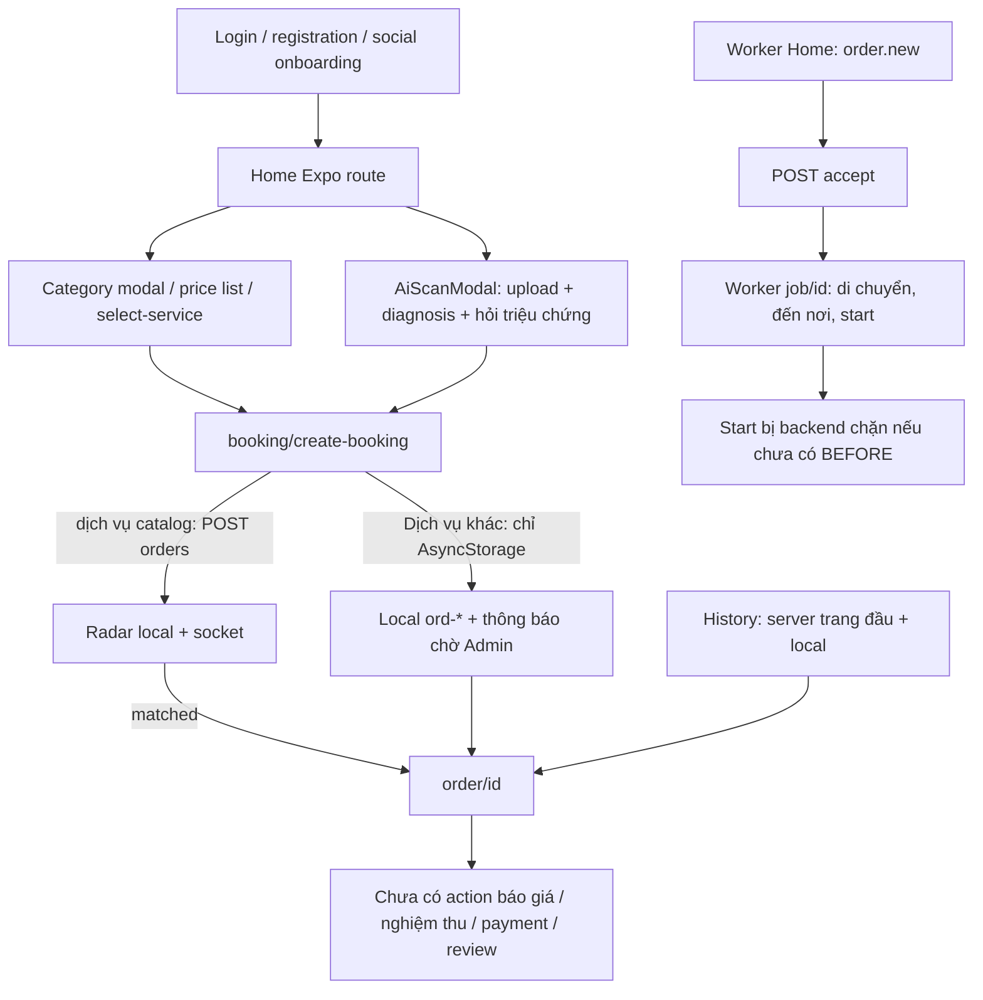

# Current user flow và repository map

## Cấu trúc được đối chiếu

| Thành phần | Vai trò thực tế / điểm vào |
|---|---|
| customer-app | Expo Router entry, app/_layout cung cấp AuthProvider/GlobalErrorBoundary; routes trong app, UI/hooks trong src |
| worker-app | Expo Router riêng; Home nhận order.new, job/[id] thực hiện tiến độ, daily face và GPS |
| server | Nest /api prefix, auth/catalog/customer-home/orders/payments/workers/admin; Prisma schema và BullMQ/Redis |
| ai-service | FastAPI diagnosis, face verification, compare before/after; các nhánh model và heuristic |
| client | Web quản trị; không phải Customer mobile; AdminService ảnh hưởng lifecycle đơn |
| docs, .doc, scripts | Tài liệu/hỗ trợ; không được coi là chức năng đã triển khai |

Bằng chứng entry: [customer-app/package.json:5](../../customer-app/package.json#L5), [customer-app/app/_layout.jsx:19](../../customer-app/app/_layout.jsx#L19), [server/src/main.js:15](../../server/src/main.js#L15).

## Đường đi đang được nối

Bằng chứng tuyến Home [customer-app/src/features/home/screens/HomeScreen.tsx:122](../../customer-app/src/features/home/screens/HomeScreen.tsx#L122); nhánh tạo catalog/cache [customer-app/app/(user)/booking/create-booking.jsx:320](../../customer-app/app/(user)/booking/create-booking.jsx#L320); nhánh local [customer-app/app/(user)/booking/create-booking.jsx:221](../../customer-app/app/(user)/booking/create-booking.jsx#L221); worker [worker-app/app/(worker)/(tabs)/index.jsx:146](../../worker-app/app/(worker)/(tabs)/index.jsx#L146). Không suy từ comment “hỗ trợ mọi trạng thái” rằng route đã có đầy đủ CTA.

## Đánh giá từng flow

| Flow | Phân loại theo mã | Hành vi xác định / giới hạn | Bằng chứng |
|---|---|---|---|
| Authentication | PARTIAL | Login/refresh/reset OTP có implementation; session restore local, deep-link guard và OTP proof business chưa kín; delivery thật NOT_VERIFIED | [customer-app/src/features/auth/services/authService.js:19](../../customer-app/src/features/auth/services/authService.js#L19); [server/src/modules/auth/auth.service.js:195](../../server/src/modules/auth/auth.service.js#L195) |
| Home / Discovery | PARTIAL + MOCK | Catalog/nearby gọi API; lỗi/empty thay catalog mẫu, sao/review count/voucher sinh local | [customer-app/src/features/home/hooks/useHomeData.ts:268](../../customer-app/src/features/home/hooks/useHomeData.ts#L268) |
| Category → Object → Service | IMPLEMENTED theo mã; error UX PARTIAL | Tree API, target filter và wizard đẩy id dịch vụ sang booking; catch lỗi modal/wizard chủ yếu log | [customer-app/src/features/home/hooks/useCategoryDetailModal.ts:20](../../customer-app/src/features/home/hooks/useCategoryDetailModal.ts#L20); [customer-app/src/features/services/hooks/useSelectServiceWizard.ts:39](../../customer-app/src/features/services/hooks/useSelectServiceWizard.ts#L39); [server/src/modules/services/services.controller.js:28](../../server/src/modules/services/services.controller.js#L28) |
| AI Diagnosis | IMPLEMENTED theo mã; model thực NOT_VERIFIED | Upload image, trả bốn diagnosis outcomes, hỏi triệu chứng/dịch vụ; chỉ confirmed suggested mới đặt | [customer-app/src/services/api/aiService.ts:24](../../customer-app/src/services/api/aiService.ts#L24); [server/src/modules/orders/diagnosis/diagnosis-resolver.js:76](../../server/src/modules/orders/diagnosis/diagnosis-resolver.js#L76) |
| Booking chuẩn | PARTIAL | POST tạo server id thật, giá lấy catalog, cache sau ack; GPS/text và ảnh/lịch/idempotency còn gap | [customer-app/src/features/booking/hooks/useBooking.js:169](../../customer-app/src/features/booking/hooks/useBooking.js#L169); [server/src/modules/orders/orders.service.js:83](../../server/src/modules/orders/orders.service.js#L83) |
| Dịch vụ khác | MOCK | Local ord-*; không POST; admin demo/expire cũng local | [customer-app/app/(user)/booking/create-booking.jsx:221](../../customer-app/app/(user)/booking/create-booking.jsx#L221) |
| Matching / Dispatch | BROKEN | Lần đầu scan Haversine và phát order.new; mở rộng gọi method không tồn tại; timeout client khác server | [server/src/modules/orders/order-queue.service.js:134](../../server/src/modules/orders/order-queue.service.js#L134); [customer-app/src/features/booking/hooks/useBooking.js:13](../../customer-app/src/features/booking/hooks/useBooking.js#L13) |
| Worker Tracking | BROKEN trên route thật; component riêng PARTIAL | Detail không join room, event status sai; GPS thiếu lọc id, ETA mặc định; watcher worker không resume | [customer-app/app/(user)/order/[id].jsx:101](../../customer-app/app/(user)/order/[id].jsx#L101); [worker-app/src/hooks/useWorkerLocationTracker.js:10](../../worker-app/src/hooks/useWorkerLocationTracker.js#L10) |
| On-site Survey | PARTIAL | Có ARRIVED, BEFORE gate; chưa có UI khảo sát/upload trong Worker job route | [server/src/modules/orders/order-workflow.service.js:194](../../server/src/modules/orders/order-workflow.service.js#L194); [worker-app/app/(worker)/job/[id].jsx:125](../../worker-app/app/(worker)/job/[id].jsx#L125) |
| Quotation Approval | PARTIAL / tích hợp route BROKEN | adjust-price tăng giá tại ARRIVED, history note; chưa bắt buộc quote gốc, reject gây kẹt | [server/src/modules/orders/orders.service.js:693](../../server/src/modules/orders/orders.service.js#L693) |
| Job Execution | PARTIAL | Backend start/finish gates có; Worker route thiếu ảnh và CTA finish | [server/src/modules/orders/order-workflow.service.js:194](../../server/src/modules/orders/order-workflow.service.js#L194) |
| Acceptance | PARTIAL / route NOT_IMPLEMENTED | API accept/dispute và component có mutation; route thật chưa render, component còn ảnh/điểm demo | [customer-app/src/screens/order/AcceptanceScreen.jsx:43](../../customer-app/src/screens/order/AcceptanceScreen.jsx#L43); [server/src/modules/orders/orders.service.js:598](../../server/src/modules/orders/orders.service.js#L598) |
| Payment | BROKEN + MOCK | /pay chỉ finalize recorded settlement; payment repo/adapter không hoàn chỉnh; UI rời không checkout | [server/src/modules/orders/orders.service.js:610](../../server/src/modules/orders/orders.service.js#L610); [server/src/modules/payments/payments.repository.js:29](../../server/src/modules/payments/payments.repository.js#L29) |
| Review | IMPLEMENTED API; route NOT_IMPLEMENTED | Review upsert và tính rating transaction cho chủ đơn completed/paid; chưa có entry từ detail | [server/src/modules/orders/orders.service.js:615](../../server/src/modules/orders/orders.service.js#L615) |
| History | PARTIAL | GET orders mặc định trang đầu + merge local; thiếu nhãn state và final price ưu tiên sai | [customer-app/src/services/storage/orderStorage.js:94](../../customer-app/src/services/storage/orderStorage.js#L94) |
| Support / Notifications | NOT_IMPLEMENTED ở routes được đọc | help/notifications placeholder; dispute có lưu trạng thái nhưng không ticket/resolution | [customer-app/app/common/help.jsx:1](../../customer-app/app/common/help.jsx#L1); [customer-app/app/(user)/(tabs)/notifications.jsx:1](../../customer-app/app/(user)/(tabs)/notifications.jsx#L1) |

## Routes Customer và các route compatibility

Đây là inventory file routes, **không phải kết luận mỗi route có nghiệp vụ**. Group `(auth)/(user)/(worker)` là tổ chức Expo Router, không nên mặc định là segment URL công khai. App scheme hiện hữu cần kiểm thử linking từ cấu hình ứng dụng và các phiên bản đã cài trước khi đổi route. Trong audit chưa xóa/đổi bất kỳ route nào.

| Route file (dưới customer-app/app) | Phân loại / caller hoặc vai trò |
|---|---|
| [customer-app/app/(auth)/_layout.jsx:1](../../customer-app/app/(auth)/_layout.jsx#L1) | Layout / route configuration, không phải một nghiệp vụ riêng |
| [customer-app/app/(auth)/forgot-password.jsx:1](../../customer-app/app/(auth)/forgot-password.jsx#L1) | PARTIAL: auth/registration/reset; backend & delivery theo giới hạn CUS-18 |
| [customer-app/app/(auth)/login-worker.jsx:1](../../customer-app/app/(auth)/login-worker.jsx#L1) | PARTIAL: auth/registration/reset; backend & delivery theo giới hạn CUS-18 |
| [customer-app/app/(auth)/login.jsx:1](../../customer-app/app/(auth)/login.jsx#L1) | PARTIAL: auth/registration/reset; backend & delivery theo giới hạn CUS-18 |
| [customer-app/app/(auth)/register-customer.jsx:1](../../customer-app/app/(auth)/register-customer.jsx#L1) | PARTIAL: auth/registration/reset; backend & delivery theo giới hạn CUS-18 |
| [customer-app/app/(auth)/register-worker.jsx:1](../../customer-app/app/(auth)/register-worker.jsx#L1) | PARTIAL: auth/registration/reset; backend & delivery theo giới hạn CUS-18 |
| [customer-app/app/(auth)/register.jsx:1](../../customer-app/app/(auth)/register.jsx#L1) | PARTIAL: auth/registration/reset; backend & delivery theo giới hạn CUS-18 |
| [customer-app/app/(user)/(tabs)/_layout.jsx:1](../../customer-app/app/(user)/(tabs)/_layout.jsx#L1) | Layout / route configuration, không phải một nghiệp vụ riêng |
| [customer-app/app/(user)/(tabs)/index.jsx:1](../../customer-app/app/(user)/(tabs)/index.jsx#L1) | Home entry; xem HomeScreen.tsx |
| [customer-app/app/(user)/(tabs)/notifications.jsx:1](../../customer-app/app/(user)/(tabs)/notifications.jsx#L1) | NOT_IMPLEMENTED: placeholder |
| [customer-app/app/(user)/(tabs)/orders.jsx:1](../../customer-app/app/(user)/(tabs)/orders.jsx#L1) | PARTIAL: History → order/[id] |
| [customer-app/app/(user)/(tabs)/profile.jsx:1](../../customer-app/app/(user)/(tabs)/profile.jsx#L1) | PARTIAL: profile → edit/wallet/vouchers, logout |
| [customer-app/app/(user)/_layout.jsx:1](../../customer-app/app/(user)/_layout.jsx#L1) | Layout / route configuration, không phải một nghiệp vụ riêng |
| [customer-app/app/(user)/booking/address.jsx:1](../../customer-app/app/(user)/booking/address.jsx#L1) | NOT_IMPLEMENTED: chỉ placeholder, không phải ConfirmOrderScreen |
| [customer-app/app/(user)/booking/confirm.jsx:1](../../customer-app/app/(user)/booking/confirm.jsx#L1) | NOT_IMPLEMENTED: chỉ placeholder, không phải ConfirmOrderScreen |
| [customer-app/app/(user)/booking/create-booking.jsx:1](../../customer-app/app/(user)/booking/create-booking.jsx#L1) | PARTIAL catalog; MOCK custom local; Home/wizard/AI đẩy tới đây |
| [customer-app/app/(user)/booking/index.jsx:1](../../customer-app/app/(user)/booking/index.jsx#L1) | Alias export create-booking; giữ compatibility |
| [customer-app/app/(user)/booking/select-service.jsx:1](../../customer-app/app/(user)/booking/select-service.jsx#L1) | IMPLEMENTED theo mã: wizard Category → Target → Service |
| [customer-app/app/(user)/order/[id].jsx:1](../../customer-app/app/(user)/order/[id].jsx#L1) | PARTIAL/BROKEN: caller booking và History; thiếu các action cuối flow |
| [customer-app/app/(user)/price-estimate.jsx:1](../../customer-app/app/(user)/price-estimate.jsx#L1) | MOCK: route render PriceEstimateScreen dùng MOCK_PRICING_TIERS/MOCK_SERVICE_CATEGORIES; CUS-15 |
| [customer-app/app/(user)/price-list.jsx:1](../../customer-app/app/(user)/price-list.jsx#L1) | PARTIAL: tra giá/ước tính và chuyển booking; không phải báo giá tại nhà đã duyệt |
| [customer-app/app/(user)/profile/edit-field.jsx:1](../../customer-app/app/(user)/profile/edit-field.jsx#L1) | MOCK ở save: context/local update; CUS-17 |
| [customer-app/app/(user)/profile/edit.jsx:1](../../customer-app/app/(user)/profile/edit.jsx#L1) | PARTIAL: avatar/profile/OTP, kiểm tra save từng trường ở edit-field |
| [customer-app/app/(user)/profile/vouchers.jsx:1](../../customer-app/app/(user)/profile/vouchers.jsx#L1) | MOCK: danh sách/áp mã local; CUS-16 |
| [customer-app/app/(user)/profile/wallet.jsx:1](../../customer-app/app/(user)/profile/wallet.jsx#L1) | MOCK: balance và giao dịch local; CUS-16 |
| [customer-app/app/(worker)/(tabs)/_layout.jsx:1](../../customer-app/app/(worker)/(tabs)/_layout.jsx#L1) | Layout / route configuration, không phải một nghiệp vụ riêng |
| [customer-app/app/(worker)/(tabs)/earnings.jsx:1](../../customer-app/app/(worker)/(tabs)/earnings.jsx#L1) | Route compatibility Worker trong customer-app; không dùng để kết luận worker-app đã hoàn thiện |
| [customer-app/app/(worker)/(tabs)/index.jsx:1](../../customer-app/app/(worker)/(tabs)/index.jsx#L1) | Route compatibility Worker trong customer-app; không dùng để kết luận worker-app đã hoàn thiện |
| [customer-app/app/(worker)/(tabs)/jobs.jsx:1](../../customer-app/app/(worker)/(tabs)/jobs.jsx#L1) | Route compatibility Worker trong customer-app; không dùng để kết luận worker-app đã hoàn thiện |
| [customer-app/app/(worker)/(tabs)/notifications.jsx:1](../../customer-app/app/(worker)/(tabs)/notifications.jsx#L1) | Route compatibility Worker trong customer-app; không dùng để kết luận worker-app đã hoàn thiện |
| [customer-app/app/(worker)/(tabs)/profile.jsx:1](../../customer-app/app/(worker)/(tabs)/profile.jsx#L1) | Route compatibility Worker trong customer-app; không dùng để kết luận worker-app đã hoàn thiện |
| [customer-app/app/(worker)/_layout.jsx:1](../../customer-app/app/(worker)/_layout.jsx#L1) | Layout / route configuration, không phải một nghiệp vụ riêng |
| [customer-app/app/(worker)/job/[id].jsx:1](../../customer-app/app/(worker)/job/[id].jsx#L1) | Route compatibility Worker trong customer-app; không dùng để kết luận worker-app đã hoàn thiện |
| [customer-app/app/(worker)/verification/face.jsx:1](../../customer-app/app/(worker)/verification/face.jsx#L1) | Route compatibility Worker trong customer-app; không dùng để kết luận worker-app đã hoàn thiện |
| [customer-app/app/_layout.jsx:1](../../customer-app/app/_layout.jsx#L1) | Layout / route configuration, không phải một nghiệp vụ riêng |
| [customer-app/app/common/help.jsx:1](../../customer-app/app/common/help.jsx#L1) | NOT_IMPLEMENTED: placeholder help/settings |
| [customer-app/app/common/settings.jsx:1](../../customer-app/app/common/settings.jsx#L1) | NOT_IMPLEMENTED: placeholder help/settings |
| [customer-app/app/index.jsx:1](../../customer-app/app/index.jsx#L1) | PARTIAL: entry login/redirect theo phiên |

## Components có tên screen nhưng chưa nối navigation

`src/screens/order/{Diagnose,ConfirmOrder,Searching,Tracking,Acceptance,PaymentReview}Screen.jsx` được export qua index, nhưng tìm references trong `customer-app/app` và `customer-app/src` không thấy nơi import/render cả hành trình. Các `navigation.navigate('AcceptanceScreen')` hoặc callback `onNext` trong các file đó chưa chứng minh có navigator đăng ký tương ứng. Root hiện không có QueryClientProvider, nên muốn tích hợp component React Query phải thêm provider và kiểm thử.

Không gán sáu component là dead code vĩnh viễn và không đề xuất xóa ngay: cần kiểm tra entry ngoài source đã tìm, bundle config, test harness và deep links/version app. Đề xuất hợp nhất dưới route chi tiết đã có; không dựng một flow thứ ba.

Bảng giá cũ và mới không cùng nguồn: [PriceEstimateScreen.tsx:24](../../customer-app/src/features/services/screens/PriceEstimateScreen.tsx#L24) dùng mock; [serviceCatalog.service.ts:29](../../customer-app/src/features/services/services/serviceCatalog.service.ts#L29) cache tree 24 giờ và lỗi trả cache/[]; phải xác minh isActive/giá tại submit, không dùng cache làm xác nhận dịch vụ còn nhận.
