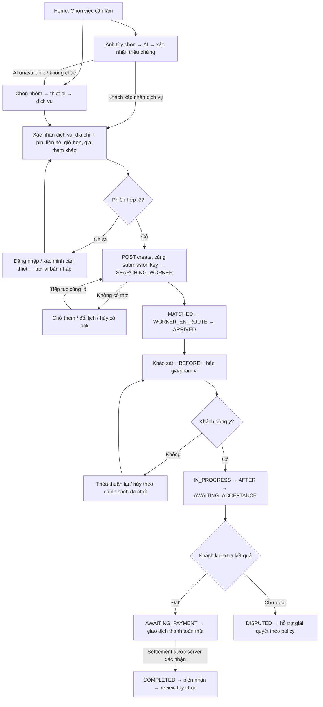

# Target user flow — đề xuất triển khai

Đây là hành vi mục tiêu, chưa phải chức năng hiện có. Nền trạng thái giữ nguyên [FSM hiện tại](04-customer-worker-state-machine.md), đối chiếu từ [server/src/modules/orders/constants/order-status.js:54](../../server/src/modules/orders/constants/order-status.js#L54). ARRIVED biểu diễn lúc thợ đã tới; khảo sát và phê duyệt báo giá là dữ liệu/gate trong giai đoạn này, không thêm trạng thái đơn mới.

Mũi tên thỏa thuận lại/dispute resolution là **thiết kế cần chốt**, không khẳng định FSM hiện đã có đường chuyển; đối chiếu CUS-06/21. Tạo mới sau cancel cần ý định mới của khách và key mới; retry tìm thợ giữ id. Không tự chuyển đơn về searching sau MATCHED.

## Quyết định và CTA theo giai đoạn

| Giai đoạn | CTA chính mục tiêu | Dữ liệu bắt buộc | Dữ liệu tùy chọn / giải thích |
|---|---|---|---|
| Khám phá | Chọn dịch vụ | Catalog hợp lệ | Tìm kiếm bằng triệu chứng, không bắt biết thuật ngữ thiết bị |
| AI | Xác nhận tình trạng / Chọn dịch vụ | Ảnh nếu chọn quét; triệu chứng hoặc dịch vụ xác nhận | AI không bắt buộc; không gọi điểm tin cậy là mức độ hỏng |
| Booking | Xác nhận tìm thợ | service/category hợp lệ, địa chỉ + pin, liên hệ đúng, phiên hợp lệ | Ghi chú lối vào, ảnh sự cố, giờ hẹn; nói rõ giá tham khảo và vật tư |
| Tìm thợ | Xem tiến trình / tiếp tục chờ | orderId server | Timer không tạo cam kết ETA hay trạng thái kết thúc |
| Thợ đã nhận/đang tới | Xem vị trí; gọi là CTA phụ | Snapshot worker thật | Thời điểm check-in, GPS last seen; không hiển thị mẫu |
| Khảo sát | Xem và đồng ý báo giá | Tổng tiền, phạm vi, lý do phát sinh, BEFORE thực | Từ chối có lối thoát rõ; khảo sát miễn phí chỉ nếu chính sách thật |
| Đang sửa | Theo dõi công việc | Giá được duyệt và startedAt | Không cho khách vô tình bấm hoàn tất trước khi thợ gửi kết quả |
| Chờ nghiệm thu | Tôi đã kiểm tra, đồng ý | Kết quả, ảnh trước/sau của đúng order | AI hỗ trợ; CTA Chưa hài lòng mở lý do và bằng chứng |
| Chờ thanh toán | Thanh toán [số tiền] | Amount/server, phương thức có hỗ trợ | Tiền mặt và online phải có quy tắc xác nhận riêng, không chung mock success |
| Đã hoàn tất | Xem biên nhận; Đánh giá tùy chọn | Payment/ledger/order nhất quán | Không ép review để thoát màn hình; hỗ trợ sau dịch vụ theo policy |

## Luật phục hồi chung

1. Mở app/deep link/foreground: chờ auth restore, kiểm tra quyền, GET snapshot theo id, render panel theo canonical state. Cache chỉ để hiển thị gần nhất có nhãn, không cấp quyền thao tác.
2. Socket là thông báo có thay đổi, API là nguồn snapshot; join room có ack, nhận event đúng order, refetch, bỏ response/event cũ. Sau reconnect luôn refetch dù không có event mới.
3. POST/PATCH timeout là kết quả chưa rõ: giữ id/key, tra server trước retry. Không reset sang IDLE hoặc báo success. Gửi lại không tạo đơn/thu tiền/duyệt giá hai lần.
4. Offline: cho xem snapshot đúng tài khoản và draft; action quan trọng chờ mạng, không xếp success local. Upload đang dở có trạng thái và retry rõ ràng.
5. Không tìm được thợ, thợ bỏ việc, từ chối giá/nghiệm thu đều có hướng dẫn; các hành vi chưa có backend không đưa vào CTA hứa thực hiện.

Các luật trên giải quyết các gap CUS-01/03/04/06/07/09/11; bằng chứng hiện trạng và AC ở [06](06-gap-analysis.md). Thời gian hiển thị theo Việt Nam, dạng `14:00, 12/11/2026`; backend truyền ISO timestamp, frontend không ghi nhãn giờ hẹn bằng chuỗi tự do vào trường DateTime.
