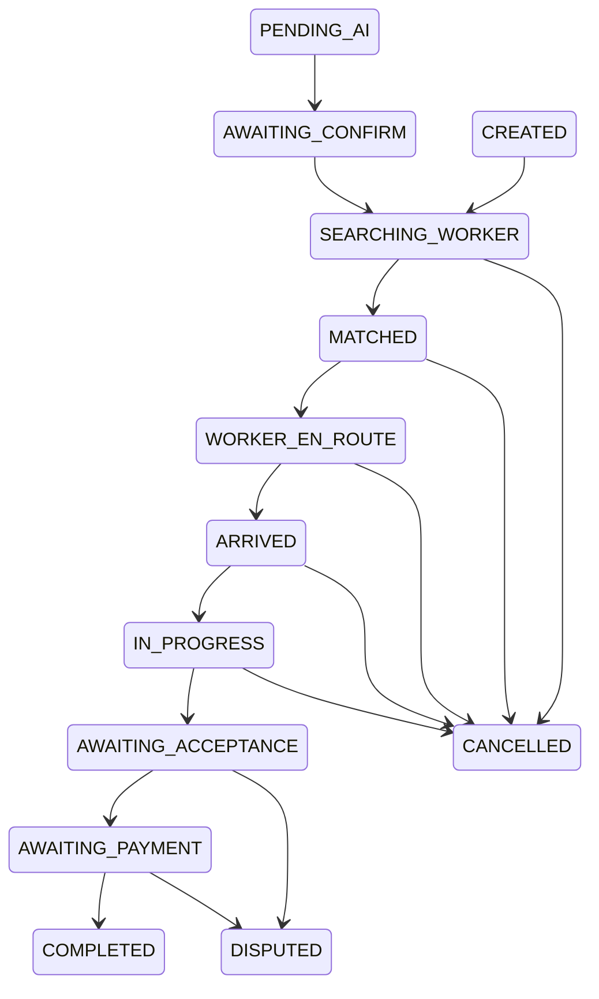

# Customer – Worker – Backend state machine

## Nguồn chuẩn và alias thực tế

[server/src/modules/orders/constants/order-status.js:1](../../server/src/modules/orders/constants/order-status.js#L1), [server/src/modules/orders/validators/order-transition.validator.js:8](../../server/src/modules/orders/validators/order-transition.validator.js#L8), [server/prisma/schema.prisma:476](../../server/prisma/schema.prisma#L476). Enum DB còn các tên legacy; FSM normalize đầu vào trước kiểm tra transition. Không dùng tên UI `PENDING_ADMIN`, `EXPIRED`, `REJECTED` làm trạng thái backend vì không có trong enum đã đọc.

| Wire/DB legacy | Canonical FSM |
|---|---|
| SEARCHING | SEARCHING_WORKER |
| ASSIGNED | MATCHED |
| WORKER_ARRIVING | WORKER_EN_ROUTE |
| AWAITING_CONFIRMATION | AWAITING_ACCEPTANCE |
| PAID | COMPLETED |

`PENDING_AI`, `AWAITING_CONFIRM`, `CREATED` là trạng thái có trong graph, nhưng **POST create hiện ghi trực tiếp SEARCHING_WORKER** ([server/src/modules/orders/orders.service.js:134](../../server/src/modules/orders/orders.service.js#L134)). Không suy ra “Dịch vụ khác đã gửi admin” chỉ từ AWAITING_CONFIRM tồn tại trong enum.

Graph còn cho PENDING_AI/AWAITING_CONFIRM/CREATED → CANCELLED. Diagram mô tả transition validator, **không đồng nghĩa mọi cạnh có action public hiện đã chạy được**: transition tới AWAITING_CONFIRM chưa nằm allowed targets của workflow.transition ([server/src/modules/orders/order-workflow.service.js:123](../../server/src/modules/orders/order-workflow.service.js#L123)). DISPUTED không có cạnh ra; COMPLETED/CANCELLED là terminal. Transition cùng state có idempotent no-op ở nhiều action sau policy checks; riêng COMPLETED luôn kiểm tra settlement trước no-op.

## Actor, gate và hành vi hai ứng dụng

| From → To | Actor/action hiện có | Backend gate xác định | Customer / Worker hiện tại |
|---|---|---|---|
| create → SEARCHING_WORKER | CUSTOMER POST /orders | Account ACTIVE, catalog active, tọa độ parse được, giá lấy catalog | Customer chuẩn có API; custom chỉ local |
| SEARCHING_WORKER → MATCHED | WORKER POST/PATCH accept | lock worker rồi order, chưa assigned thợ khác, online/APPROVED, face <24h, không bận | Worker Home có accept; chuyên môn/radius chưa gate khi accept |
| MATCHED → WORKER_EN_ROUTE | Worker được gán hoặc ADMIN qua workflow | Actor/order, transition hợp lệ | Job route gọi status rồi start GPS |
| WORKER_EN_ROUTE → ARRIVED | Worker được gán / ADMIN | Actor/order, transition hợp lệ | Có CTA đã đến; stop GPS |
| ARRIVED → IN_PROGRESS | Worker được gán / ADMIN | Face còn hạn; BEFORE sau ARRIVED; latest quote nếu tồn tại phải approved | Job route có start nhưng thiếu upload; không quote vẫn qua gate |
| IN_PROGRESS → AWAITING_ACCEPTANCE | Worker được gán / ADMIN | startedAt + AFTER uploadedAt ≥ startedAt | Job route chưa có finish |
| AWAITING_ACCEPTANCE → AWAITING_PAYMENT | CUSTOMER chủ đơn | Actor và transition | API có, component rời có, detail thiếu CTA |
| AWAITING_ACCEPTANCE/AWAITING_PAYMENT → DISPUTED | CUSTOMER chủ đơn | reason không trống, optional evidence HTTP(S) | Backend ghi history/images, chưa ticket/resolve |
| AWAITING_PAYMENT → COMPLETED | CUSTOMER chủ đơn hoặc ADMIN | Payment PAID + paidAt + amount bằng giá + PAYOUT thuộc worker và amount khớp workerPayoutAmount | /pay chỉ finalize; settlement producer đang lỗi |
| Đến CANCELLED | Actor có quyền đơn, reason; cạnh phải cho phép | Phí 20% estimatedPrice khi cancel action có chargeCancellationFee, sau searching | Detail local sai; acceptance/payment không có cancel edge |
| SEARCHING_WORKER → cùng state đổi lịch | CUSTOMER qua schedule | Date tương lai, chưa worker; options.schedule riêng | Chưa requeue dispatch theo giờ hẹn |

Bằng chứng quyền/gates: [server/src/modules/orders/order-workflow.service.js:25](../../server/src/modules/orders/order-workflow.service.js#L25), [server/src/modules/orders/order-workflow.service.js:77](../../server/src/modules/orders/order-workflow.service.js#L77), [server/src/modules/orders/order-workflow.service.js:194](../../server/src/modules/orders/order-workflow.service.js#L194), [server/src/modules/orders/order-workflow.service.js:239](../../server/src/modules/orders/order-workflow.service.js#L239). HTTP status endpoint chỉ Roles WORKER, nên ADMIN phải qua admin action thay vì giả gọi worker API; admin transition AWAITING_PAYMENT/DISPUTED cũng bị CUSTOMER_REQUIRED theo workflow.

## Invariants hiện có và các lỗ hổng

- **Đã có:** kiểm actor ACTIVE từ DB, authorization theo User.id/WorkerProfile.id, locking chống hai thợ nhận một đơn/hai đơn cùng thợ; transaction history cùng order; status event sau commit. [server/src/modules/orders/order-workflow.service.js:25](../../server/src/modules/orders/order-workflow.service.js#L25), [server/src/modules/orders/order-workflow.service.js:268](../../server/src/modules/orders/order-workflow.service.js#L268).
- **Cần hoàn thiện:** một quote được chấp thuận rõ cho mọi lần start; nguồn ảnh có uploader/storage provenance; settlement một lần; không thu hồi thợ/xóa lịch sử ngoài workflow; candidate eligibility khi accept. Xem CUS-05/06/07/12/23.
- **Không có trong graph hiện tại:** rematch sau matched, yêu cầu sửa lại từ disputed, dispute resolution/refund. Thiết kế nghiệp vụ trước thêm action/edge, tránh gán “đang sửa lại” bằng local state. Xem CUS-21/22.
- **Không coi AI score là nghiệm thu:** accept-completion hiện không yêu cầu passed; đây là sự đồng ý của khách. AI đang mock ở fallback nên không được dùng làm chứng nhận chất lượng. CUS-08.
- **Không coi PAID legacy là bằng chứng tiền đã về:** alias chỉ tương thích state; phải đối chiếu Payment/ledger trước backfill hoặc hiển thị biên nhận đã trả tiền.

## Migration đề xuất

1. Inventory dữ liệu theo enum, workerId null ở active, paid không ledger, quote note không parse được; chỉ query read-only trước. Bổ sung contract đọc canonical + legacy ở cả app/admin.
2. Backend viết canonical, giữ alias nhận request/event cũ. Deploy response additive trước mobile; giữ POST/PATCH accept và các alias arrivals/start/finish đang có. Không xóa route cũ.
3. Quote: tạm dựng structured snapshot từ history cũ, đánh dấu legacy/unknown khi thiếu bằng chứng; không tự approve. Entity/version riêng nếu được duyệt cần migration và audit backfill, không đổi order state để che lấp thiếu dữ liệu.
4. Payment/wallet: lấy schema hiện tại làm baseline, kiểm version Prisma generated đang chạy. Đối soát đơn/Payment/WorkerWallet/Wallet/ledger legacy; backfill có bằng chứng nguồn, không tạo PAID/PAYOUT giả để vượt gate.
5. Active query đổi về User.id + canonical/aliases; kiểm full snapshot/History và hai app trước backfill DB alias theo lô. Giữ parser alias tới khi version cũ ngừng sử dụng theo telemetry.
6. Resolution/rematch: phê duyệt policy, transitions, quyền, fee/tiền, room revoke và audit trail; additive action/contract có version, rollback ứng dụng vẫn đọc được state hiện hữu. Không áp dụng migration trong giai đoạn audit.
