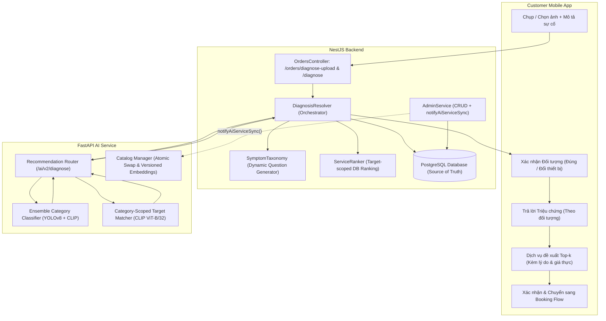
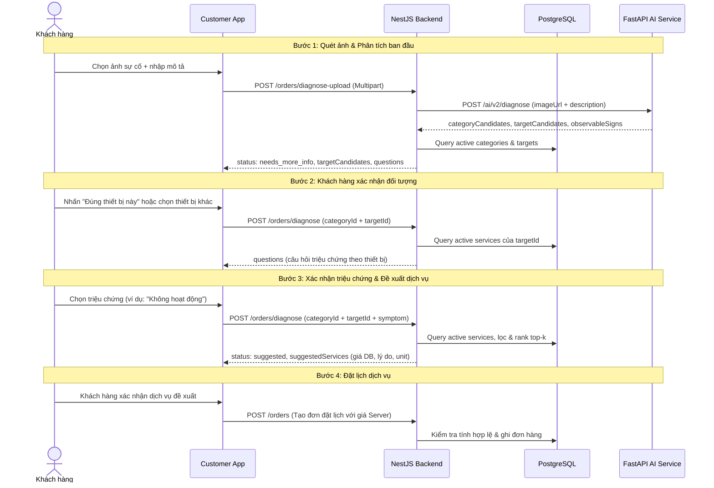

# Kiến trúc Hiện tại và Mục tiêu (Current-to-Target Architecture)

## 1. Bối cảnh và Đánh giá Hiện trạng (Baseline Audit)

Tại thời điểm baseline (`integration/fixgo-sprint-02`), hệ thống chẩn đoán và đề xuất dịch vụ gặp các vấn đề nghiêm trọng về tính đúng đắn (correctness) và toàn vẹn dữ liệu:

1. **FastAPI JSON Description bị bỏ qua**: Endpoint `diagnose` chỉ đọc `imageUrl` từ request JSON, khiến mô tả sự cố của khách hàng hoàn toàn bị mất trong nhánh gọi từ NestJS.
2. **Backend bỏ qua kết quả Target/Service từ AI**: `diagnosis-resolver.js` chỉ lấy `ai.suggestedCategoryId` và điểm `confidence`, toàn bộ suy luận về thiết bị cụ thể bị vứt bỏ.
3. **Danh mục dịch vụ tĩnh (Static Catalog)**: AI Service dựa vào danh sách tĩnh `SUB_SERVICES_CATALOG` gồm đúng 25 dịch vụ, trong khi cơ sở dữ liệu thực tế có 693 dịch vụ thương mại, 70 đối tượng và 6 danh mục.
4. **Vi phạm quan hệ Category - Target - Service**: Target softmax tính trên toàn bộ 70 targets mà không lọc theo category; service fallback tự động gán phần tử đầu tiên của danh mục với điểm nhân hệ số tùy ý `score * 0.92`.
5. **Thiếu kiểm tra trạng thái hoạt động (Active status)**: Resolver và AI Service không kiểm tra `target.isActive` và `service.isActive`, dẫn đến nguy cơ đề xuất dịch vụ đã bị vô hiệu hóa.
6. **Đồng bộ Catalog thiếu tin cậy**: Khi Admin cập nhật Category hoặc Service, AI Service không được kích hoạt làm mới embeddings; bộ đệm RAM không có versioning.

## 2. Kiến trúc Đích (Target Architecture)

Hệ thống được tái cấu trúc theo mô hình phân tách trách nhiệm rõ ràng:

## 3. Luồng Tương tác Dữ liệu Chi tiết

