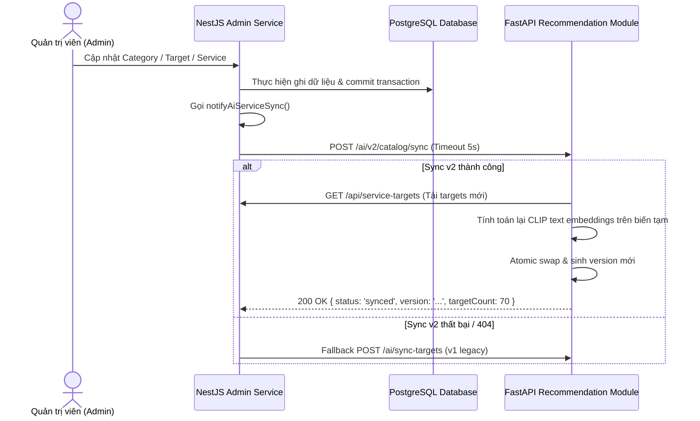

# Chiến lược Đồng bộ và Quản trị Phiên bản Catalog (Catalog Sync Strategy)

## 1. Nguyên tắc An toàn Dữ liệu

1. **DB là nguồn sự thật duy nhất**: AI Service chỉ lưu bản sao tạm (cache/embeddings) để phục vụ tính toán similarity. AI Service không có quyền quyết định giá cả hay tính hợp lệ thương mại của dịch vụ.
2. **Atomic Snapshot Swap**: Quá trình tính toán embedding mới diễn ra trên biến tạm. Khi hoàn thành, con trỏ trạng thái catalog được tráo đổi nguyên tử (`threading.Lock`), bảo đảm các request đang phục vụ không đọc phải trạng thái dở dang.
3. **Phiên bản hóa (Catalog Versioning)**: Mỗi bản snapshot được băm mã SHA-256 từ danh sách ID/slug của các đối tượng và dịch vụ (`version = sha256(content)[:12]`), kèm dấu thời gian `updated_at`.
4. **Server-side Validation khi Tạo đơn**: Khi khách hàng nhấn xác nhận đặt lịch (`POST /orders`), Backend NestJS luôn truy vấn trực tiếp bảng `services` để lấy giá chính thức tại thời điểm đó, ngăn chặn hoàn toàn việc làm sai lệch giá từ client hoặc cache cũ.

## 2. Luồng Kích hoạt Đồng bộ từ Admin

Khi Admin thực hiện các thao tác thêm, sửa, bật/tắt hoặc xóa đối tượng và dịch vụ trên Web Admin:

## 3. Quản trị Khi AI Service Khởi động lại (Restart)

1. Khi AI Service khởi động, `catalog_manager` khởi tạo trạng thái `init`.
2. Khi nhận request đầu tiên hoặc lệnh sync, hệ thống gọi API Backend (`GET /api/service-targets`) để đồng bộ dữ liệu mới nhất.
3. Nếu Backend tạm thời chưa sẵn sàng, hệ thống sử dụng bản snapshot dự phòng an toàn (`TARGET_PROMPTS`) với cờ cảnh báo rõ ràng trong log, tuyệt đối không crash service.
4. Endpoint kiểm tra sức khỏe `GET /ai/v2/catalog/status` cho phép đội vận hành và monitoring giám sát phiên bản catalog đang được nạp trong bộ nhớ.
