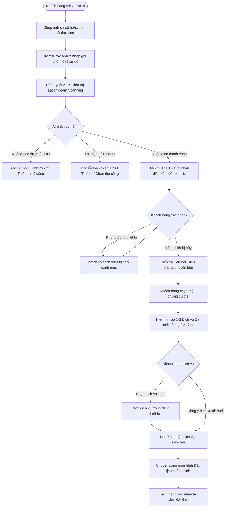

# Thiết kế Trải nghiệm Người dùng (Customer AI Scan UX Flow)

## 1. Sơ đồ Luồng Trải nghiệm Người dùng

## 2. Các Tiêu chuẩn UX Bắt buộc đã Đáp ứng

### 2.1. Không hiển thị kết quả chắc chắn khi AI không chắc
- Khi độ tự tin của mô hình dưới $0.48$ hoặc khoảng cách với nhãn thứ hai dưới $0.10$, giao diện hiển thị trạng thái trung thực: *"Chưa xác định được nhóm thiết bị. Vui lòng chọn danh mục phù hợp"* thay vì đoán mò một dịch vụ bất kỳ.

### 2.2. Minh bạch lý do đề xuất (Explainability)
- Mỗi dịch vụ đề xuất đều hiển thị thẻ lý do rõ ràng:
  - *"Khớp chính xác triệu chứng đã xác nhận: Sửa công tắc không hoạt động"*
  - *"Khớp với mô tả của khách hàng (2 từ khóa)"*
- Mức giá hiển thị minh bạch từ cơ sở dữ liệu kèm đơn vị tính chuẩn (ví dụ: `100.000 đ ~ 200.000 đ / điểm`), kèm ghi chú: *"Giá tham khảo từ catalog; thợ kiểm tra và báo giá thực tế"*.

### 2.3. Quyền kiểm soát thuộc về khách hàng (Human-in-the-loop)
- Khách hàng luôn có nút:
  - **"Đúng thiết bị này"** để tiến nhanh sang câu hỏi triệu chứng.
  - **"Không đúng thiết bị"** để chọn lại thiết bị hoặc đổi ngành nghề sửa chữa.
  - Nút đổi dịch vụ khác nếu dịch vụ AI đề xuất chưa hoàn toàn ưng ý.
- **Tuyệt đối không tự động đặt đơn**: Nút xác nhận chỉ chuyển dữ liệu đã chọn sang màn hình Booking Flow để khách hàng xác nhận địa chỉ, thời gian và phương thức thanh toán.

### 2.4. Khả năng chịu lỗi và Giữ trạng thái (Resilience & State Persistence)
- Khi gặp lỗi mạng (`ERR_NETWORK`, timeout 15s), giao diện hiển thị thông báo lỗi rõ ràng kèm nút **"Thử lại"**.
- Ảnh đã chụp, ghi chú mô tả và các lựa chọn trước đó được giữ nguyên vẹn trong bộ nhớ component, khách hàng không bao giờ phải chụp lại từ đầu khi thử lại kết nối.
