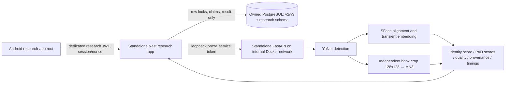

# Face Research architecture

Research Android uses the normal Expo Router entrypoint with an explicitly separate
`research-app/` root and application ID `com.fixgo.faceresearch`. It does not import
production `app/`, AuthProvider, sockets, account/token storage, Firebase or remote logger.
`FACE_RESEARCH_APP=true` changes only this build variant; normal Worker config is preserved.
The source-map verifier checks the actual exported graph instead of relying on this diagram.

The Nest entrypoint imports neither production AppModule nor FaceCoreModule. It accepts
only an explicit loopback, randomly named research DB with a matching environment marker.
The prepare script creates that DB itself; it never uses an existing DATABASE_URL/.env.
Research SQL is separate from project Prisma migrations. Sessions bind authenticated
user/worker, purpose, order, nonce and expiry; measured results persist with idempotency
and claim checks. Images and embeddings do not persist in PostgreSQL.

The FastAPI entrypoint imports the existing pinned identity model loader and decoding/
validation primitives, plus the experimental PAD provider. Production AI app/router and
YuNet/SFace behavior are unchanged. Identity feature and PAD share detection but use
independent alignment/cropping and inference. Quality is diagnostic; no threshold in this
app produces an authorization decision. Enrollment measurement discards its feature;
Daily/Order measurement compares two same-session camera captures after future consent.
It does not pretend to have stored a trusted enrollment template.

Every research result has `verified=false`, `enrolled=false`, `proof=null` and
`padDecision=NOT_EVALUATED`. Nest rejects malformed authority/provenance fields and
whitelists output before persistence. The default production gateway still reports
`padEvaluated=false`; production enrollment/template/proof gates remain closed.
There is no dependency from production controllers to these standalone research routes.

Until separate consent/protocol approval, both services reject camera upload; synthetic
input is generated by FastAPI, not accepted as client media. Actual YuNet correctly
rejects blank pixels before SFace/PAD. Real positive-face evaluation, persistent trusted
enrollment and evaluated-PAD proof issuance remain separate blocked milestones.

See [runbook](research-e2e-runbook.md), [executed report](research-e2e-report.md) and
[Android checklist](research-android-checklist.md).
