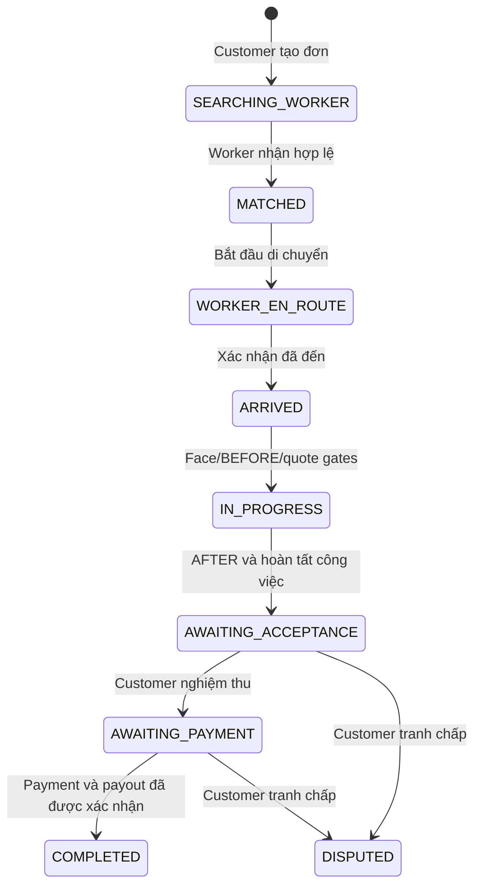

# FIXGO — MASTER IMPLEMENTATION ROADMAP
> **Tệp đề xuất trong repository:** `docs/master-plan/00-master-roadmap.md`  
> **Phiên bản:** 1.0 | **Ngày:** 12/11/2026  
> **Phạm vi:** `customer-app`, `worker-app`, `server`, `ai-service`, `client` (Admin), kiểm thử liên thông và phát hành  
> **Tính chất:** Kế hoạch triển khai, **không** phải báo cáo toàn bộ tính năng đã hoàn thành.

## 1. Mục tiêu và nguyên tắc

Hoàn thiện FixGo theo một hành trình nghiệp vụ có thể kiểm chứng: **khách tạo đơn → hệ thống điều phối → thợ nhận/di chuyển/đến nơi → khảo sát và ảnh BEFORE → thực hiện công việc → ảnh AFTER → khách nghiệm thu → thanh toán được xác nhận → COMPLETED**.

- Giữ **một monorepo**; dùng **hai Git worktree** và hai nhánh riêng để phát triển song song.
- **Gemini Pro:** sở hữu `customer-app/**` trên `agent/gemini-customer`.
- **Codex:** sở hữu `worker-app/**` trên `agent/codex-worker`.
- `server/**`, `ai-service/**`, `client/**`, schema và contract là **tài nguyên chung**; không để hai agent sửa đồng thời khi chưa có task backend riêng và người điều phối chấp thuận.
- API/DB backend là **nguồn sự thật**; UI không báo thành công chỉ nhờ cache, params, socket emit hay dữ liệu giả.
- Đọc code trước khi sửa; tài liệu audit ghi nhận hiện trạng tại thời điểm khảo sát, không thay thế bằng chứng trong working tree hiện tại.
- Mỗi thay đổi phải có test phù hợp, báo cáo file sửa và commit; không tự merge/push vào nhánh tích hợp hoặc `main`.
- Những hạng mục thanh toán, face verification, AI compare phải phân biệt rõ **verified/settled thực**, **sandbox**, **unavailable** và **manual review**.

## 2. Baseline và trạng thái được biết

Theo báo cáo `docs/worker-implementation/10-arc01-report.md` ngày 12/11/2026, **ARC-01 đã triển khai và vượt qua các kiểm thử trong phạm vi báo cáo**: FSM/actor/ownership, transaction/history, một phần WebSocket auth và cập nhật client. ARC-01 **chưa** triển khai camera BEFORE/AFTER, timer, payment provider, payout writer/ledger mới, hoặc E2E trên thiết bị thực; chưa thay schema/migrations. Báo cáo ARC-01 cũng ghi **chưa commit/push**, nên mỗi agent **phải xác minh commit hiện tại thật sự chứa thay đổi ARC-01** trước khi code.

Luồng trạng thái chuẩn (happy path) cần giữ:



**Không tự thêm** `ASSESSING`, `PAUSED`, `WORK_FINISHED`, `REWORK_REQUESTED` vào enum `OrderStatus`; dữ liệu phụ/substate hoặc thay đổi schema cần một thiết kế được duyệt riêng. Giữ alias legacy theo ARC-01.

## 3. Bảng tổng quan 8 giai đoạn

| Giai đoạn | Mục tiêu | Mức ưu tiên | Điều kiện qua cổng (gate) |
|---|---|---|---|
| **0. Baseline** | Xác nhận ARC-01, tài liệu/API, ownership code | Nền tảng | Mọi agent dùng cùng commit/contract, biết blocker hiện hữu |
| **1. Authentication** | Hai app đăng ký/đăng nhập đúng vai trò, không nhầm luồng | P0/P1 | Login/register/session/role guard đúng, check-in thợ đáng tin |
| **2. Order Foundation** | Khách tạo đơn thật, thợ nhận, cả hai khôi phục đơn | P0 | Cùng `orderId`, server snapshot, retry và ownership đúng |
| **3. Matching & Tracking** | Điều phối, nhận việc, GPS/realtime nhất quán | P0 | Accept không trùng, tracking đúng worker/order, reconnect phục hồi |
| **4. Job Execution** | ARRIVED, BEFORE, báo giá, sửa, AFTER | P0 | Gates không bị vượt; ảnh và giá persisted, finish hợp lệ |
| **5. Acceptance & Payment** | Nghiệm thu, settlement, ledger, kết thúc | P0 | Không `COMPLETED` trước settlement; đối soát DB/payment/worker |
| **6. Supporting Features** | Lịch sử, hồ sơ, thông báo, ví, hỗ trợ | P1 | Không placeholder giả nghiệp vụ; dữ liệu có nguồn |
| **7. E2E & Release** | Kiểm thử liên thông, UX/UI, build/deploy độc lập | Bắt buộc | Test matrix và bằng chứng đủ cho phạm vi phát hành |

**Lưu ý phụ thuộc:** Giai đoạn 1–3 có thể thực hiện các tác vụ độc lập song song, nhưng luồng end-to-end phải vượt các gate 2→3→4→5. Thiết kế settlement có thể chuẩn bị sớm, không được giả rằng provider đã sẵn sàng.

## 4. Chi tiết triển khai và phân công

### Giai đoạn 0 — Baseline & hợp đồng cộng tác

**Mục tiêu:** Chốt nền kỹ thuật trước khi các agent viết tiếp.

- [ ] Kiểm tra `git status`, branch, commit trong 3 worktree; xác minh `ARC-01` có trong `HEAD` đang dùng.
- [ ] Đọc `docs/customer-audit/` và `docs/worker-implementation/`, đặc biệt báo cáo ARC-01.
- [ ] Inventory các REST route, response shape, socket namespace `/orders`, canonical status và aliases đang chạy.
- [ ] Khóa quy tắc ownership: Gemini chỉ sửa Customer, Codex chỉ sửa Worker; backend cần task riêng.
- [ ] Chốt quy ước báo cáo issue ID / AC / file / test / commit / blocker; chuẩn bị DB test riêng và không dùng DB phát triển chung cho destructive tests.

**Gate:** Hai agent tham chiếu cùng contract thật; không có sửa đổi chưa xác minh trong commit nền.

### Giai đoạn 1 — Authentication & Role Separation

**Gemini / Customer**
- [ ] Kiểm tra entry routes và luồng đăng ký/đăng nhập chỉ dành cho `CUSTOMER`; loại bỏ điều hướng chọn `WORKER` ở UI khách sau khi kiểm tra references/deep-link compatibility.
- [ ] Kiểm tra register, login, OTP/reset password, Google login (nếu cấu hình), auth restore, logout, 401/refresh.
- [ ] Session/cache theo tài khoản; khi chuyển tài khoản không lộ lịch sử/đơn của người trước (**CUS-04**, **CUS-18**).
- [ ] Không đánh dấu verified chỉ dựa vào OTP wizard ở frontend.

**Codex / Worker**
- [ ] Kiểm tra đăng ký hồ sơ thợ, trạng thái duyệt và role guard `WORKER`.
- [ ] Kiểm tra daily face check-in, hiệu lực và kết quả trả về server (**FACE-01**).
- [ ] Sau xác thực/điều hướng trở lại, refetch trạng thái từ backend; không hỏi lại nếu phiên còn hợp lệ, không tự `verified=true`.

**Backend/AI — task riêng khi cần**
- [ ] Kiểm tra ràng buộc OTP proof với registration, role/status DB, chính sách Face và heuristic fallback.
- [ ] Không cấp faceVerifiedAt nếu AI không khớp danh tính, timeout, lỗi model hoặc chỉ phát hiện có khuôn mặt.

**Gate:** Hai app không thể đăng nhập/đăng ký nhầm role; trái quyền bị API chặn; logout/đổi account không rò dữ liệu; Face lỗi không được coi là thành công.

### Giai đoạn 2 — Order Foundation

**Gemini / Customer**
- [ ] Giữ mô hình **Danh mục → Đối tượng (Target) → Dịch vụ** bằng catalog thật; AI chẩn đoán là đường hỗ trợ, có lựa chọn thủ công.
- [ ] Booking lấy dịch vụ/giá hợp lệ, địa chỉ chữ và pin GPS nhất quán; không báo tạo đơn thành công nếu server chưa ACK (**CUS-02, CUS-12, CUS-13, CUS-14**).
- [ ] Sửa cache theo userId, chi tiết đơn `GET /orders/:id`, active/history, deep link và retry (**CUS-01, CUS-04, CUS-19**).
- [ ] Hủy qua API thật; lỗi không cập nhật local thành `CANCELLED` (**CUS-03**).

**Codex / Worker**
- [ ] `GET /orders/worker/current` và `GET /orders/:id` để khôi phục active job (**ORD-02**).
- [ ] Render trạng thái theo snapshot, không fallback `ASSIGNED`, giá/địa chỉ/PII giả.
- [ ] Khởi tạo màn hình nhận offer đủ thông tin, không bấm nhận hai lần (**UX-01/02/03**).

**Backend — task riêng khi cần**
- [ ] Xác nhận current-order query trả đủ active states; kiểm tra eligibility, tạo đơn idempotent và API response.
- [ ] Bảo đảm role/ownership; không thay ARC-01 bằng mutation trực tiếp.

**Gate:** Customer và Worker tra cùng một orderId sau server ACK; kill/relaunch vẫn đúng trạng thái và owner; không có `ord-*` giả như đơn đã gửi.

### Giai đoạn 3 — Matching, Dispatch & Realtime Tracking

**Gemini / Customer**
- [ ] Searching UI theo server; timeout client không quyết định kết thúc đơn.
- [ ] Theo dõi đúng worker/order, join room được phép; refetch sau reconnect; không ETA/GPS giả (**CUS-09, CUS-11**).

**Codex / Worker**
- [ ] Offer nhận/bỏ qua theo thời hạn phía server; xử lý offer expired, conflict và worker busy (**ORD-01**).
- [ ] Gọi REST mutation chuyển `MATCHED → WORKER_EN_ROUTE → ARRIVED` trước khi báo success.
- [ ] GPS chỉ chạy đúng stage/quyền; permission denied, offline, foreground/reconnect có xử lý (**GPS-01**, **CUS-20**).
- [ ] Socket chỉ thông báo; không dùng `worker:status_update` làm thao tác ghi DB.

**Backend — task riêng khi cần**
- [ ] Eligibility/offer expiry/queue expansion và lịch hẹn; chống nhận trùng trên DB.
- [ ] Event auth/room scope, refresh snapshot và loại bỏ stale/out-of-order update (**SYNC-01**).

**Gate:** Hai worker tranh một đơn chỉ một nhận; cùng worker không có hai active trái policy; Customer thấy ARRIVED đúng thực tế kể cả sau reconnect.

### Giai đoạn 4 — Job Execution: BEFORE → Quote → Work → AFTER

**Codex / Worker**
- [ ] Camera chụp ảnh **BEFORE** sau ARRIVED; upload binary vào storage phù hợp rồi đăng ký metadata ảnh đúng contract (**IMG-01**).
- [ ] Khảo sát và đề xuất điều chỉnh giá/phạm vi; hiển thị trạng thái chờ khách duyệt (**QUO-01**).
- [ ] Chỉ `start` sau khi face/BEFORE/quote gate hợp lệ; timer hiển thị theo server `startedAt` (**TIMER-01**).
- [ ] Chụp **AFTER**, upload, ghi chú sửa chữa, gọi finish/report thật; CTA AFTER không mở Face ID (**IMG-02**).

**Gemini / Customer**
- [ ] Xem BEFORE, báo giá và lựa chọn chấp thuận/từ chối theo quote đã lưu.
- [ ] Hiển thị tiến trình đang sửa và thông báo báo hoàn thành theo trạng thái backend, không tự kết thúc.

**Backend/AI — task riêng khi cần**
- [ ] Thiết kế snapshot/version/idempotency báo giá; đường xử lý khi từ chối không gây kẹt.
- [ ] Xác nhận upload endpoint hiện `POST /orders/:id/images` nhận **URL metadata**, không phải multipart ảnh; cần storage/upload flow hợp lệ.
- [ ] AI đối chiếu BEFORE/AFTER không dùng điểm đạt giả; có fallback nghiệm thu thủ công.

**Gate:** Chưa BEFORE hoặc quote pending thì không start; chưa AFTER hợp lệ thì không finish; reopen giữ timer, ảnh, giá và giai đoạn đúng.

### Giai đoạn 5 — Acceptance, Payment & Completion

**Gemini / Customer**
- [ ] Tích hợp nghiệm thu vào route chi tiết đơn thật: xem bằng chứng, chấp nhận hoặc dispute có lý do.
- [ ] Chấp nhận nghiệm thu chỉ chuyển `AWAITING_PAYMENT`, không `COMPLETED`.
- [ ] Checkout/receipt chỉ hiển thị trạng thái server xác nhận; không sử dụng payment URL placeholder hoặc mock paid.

**Codex / Worker**
- [ ] Màn hình chờ nghiệm thu, dispute, chờ thanh toán và hoàn tất theo server.
- [ ] Thu nhập dự kiến/phải thu/khả dụng phân biệt rõ; không tự cộng ví trên client.

**Backend/Payment — bắt buộc có task riêng**
- [ ] Khóa ownership payment endpoints; xác thực callback/provider hoặc cash policy chính thức (**CUS-10**).
- [ ] Tạo/ghi settlement, payout/commission/ledger đúng schema, transaction và idempotency (**CUS-07**, PAY-01, WAL-01).
- [ ] Không dùng `/orders/:id/pay` để tự tạo bằng chứng đã trả tiền: theo ARC-01, endpoint này chỉ finalize khi payment và payout đã tồn tại hợp lệ.
- [ ] Định nghĩa tranh chấp và giải quyết trong Admin; không tự mở state `DISPUTED` sang `IN_PROGRESS` khi FSM chưa hỗ trợ.

**Gate:** Nghiệm thu mà chưa thanh toán vẫn nonterminal; callback lặp không tạo bút toán/lợi nhuận hai lần; `COMPLETED` có Payment/ledger/worker payout khớp trên DB test.

### Giai đoạn 6 — Supporting Features & UX

**Gemini / Customer**
- [ ] History phân trang, biên nhận, đánh giá sau hoàn thành; profile/address cập nhật server.
- [ ] Notifications, help/support/dispute, voucher/wallet chỉ bật khi có nghiệp vụ thật (**CUS-15/16/17/19/21/24**).

**Codex / Worker**
- [ ] Earnings/history từ ledger thực; profile, tay nghề, vùng nhận việc khi API hỗ trợ.
- [ ] Notification inbox, xử lý hủy/tranh chấp và các empty/error/retry states; màn hình placeholder phải ghi rõ/chặn CTA không hoạt động.

**Gate:** Không có số tiền, đánh giá, khuyến mãi hoặc nút “thành công” hardcode; đường vào/ra mọi màn hình rõ ràng, responsive và accessibility đã kiểm thử.

### Giai đoạn 7 — End-to-End Testing & Release

- [ ] Test **1 Customer + 2 Worker + backend + PostgreSQL/Redis test riêng**: tạo → offer → accept race → travel → ARRIVED → BEFORE → quote → start → AFTER → accept → pay → COMPLETED.
- [ ] Test âm tính: sai role/owner, timeout, offline, reconnect, force close, camera/GPS denied, retry, double click, event cũ, quote reject, dispute, payment fail/duplicate.
- [ ] Test Face/AI bằng model thực hoặc ghi rõ `NOT_VERIFIED`; không dùng heuristic success thay model.
- [ ] Test checkout provider sandbox (nếu triển khai) và đối soát Payment/CommissionRecord/WalletTransaction.
- [ ] Build riêng `customer-app` và `worker-app`; kiểm tra package ID/bundle ID, version, icon, env, signing và EAS configuration.
- [ ] Chuẩn hóa tài liệu KLTN: kiến trúc, sequence/activity/state diagrams, API, test evidence, ảnh/video demo và hạn chế chưa giải quyết.

**Release gate:** Không còn P0 chặn hành trình được công bố; E2E có bằng chứng đúng môi trường, không tuyên bố pass dựa trên unit mock hay source audit đơn thuần.

## 5. Task board khởi động — không giao tất cả cùng lúc

| Đợt | Gemini (`customer-app`) | Codex (`worker-app`) | Điều kiện/đầu ra |
|---|---|---|---|
| **S0** | Audit auth/role và CUS-04 | Audit active-order/Face và ORD-02 | Xác minh ARC-01 trên commit; thống kê blockers |
| **S1** | CUS-04 cache theo user; CUS-03 cancel API theo phụ thuộc | ORD-02 active order & detail snapshot | Test tài khoản A/B, relaunch, stale server snapshot |
| **S2** | Auth routes, CUS-18; create-booking an toàn | Worker auth/check-in; UX-01/02 | Role không lẫn; order thực/offer thực |
| **S3** | CUS-09 tracking | GPS-01 travel/arrival | Test một orderId, socket/reconnect/ARRIVED |
| **S4** | Quote review/approval UI | IMG-01, timer và IMG-02 | Backend quote/upload contract đã được chốt |
| **S5** | Acceptance/checkout UI | Completion/earnings read model | Backend settlement & ledger đạt integration test |
| **S6** | Profile/history/notifications, UX | Earnings/history/profile/notifications | P0 E2E core đạt rồi mới polish |
| **S7** | Mobile E2E Customer | Mobile E2E Worker | Một báo cáo release chung |

Các đợt là **thứ tự phụ thuộc**, không phải cam kết số ngày. Chỉ mở task có API/contract đủ; nếu blocker backend, lập task backend và tạm chuyển agent sang hạng mục độc lập.

## 6. Quy trình Git Worktree và tích hợp

**Bối cảnh ví dụ** (kiểm tra lại bằng `git worktree list`):
- Repo tích hợp: `~/Work/do-an-fix-go-tho-tot`, branch hiện tại `vanvi-worker-app`.
- Gemini: `~/Work/fixgo-gemini`, branch `agent/gemini-customer`.
- Codex: `~/Work/fixgo-codex`, branch `agent/codex-worker`.

1. Mỗi agent xác nhận đúng worktree/branch, chỉ sửa phạm vi sở hữu.
2. Mỗi task có commit riêng sau kiểm thử, ghi rõ issue ID; không tự push/merge, không tự chạy migrations trên DB dùng chung.
3. Người điều phối review `git diff` và test từng agent; **merge tuần tự vào nhánh `integration/fixgo-apps`**.
4. Chạy regression + integration trên nhánh tích hợp; xử lý conflicts, blocker backend và contract.
5. Chỉ khi đạt gate mới đưa vào nhánh đích (`vanvi-worker-app`/`main` theo quyết định nhóm).
6. Đồng bộ nhánh tích hợp đã kiểm thử trở lại hai nhánh agent trước vòng làm việc tiếp theo; không dùng `reset --hard` với thay đổi chưa lưu.

**Lưu ý:** Worktree cô lập file chưa commit và branch checkout, **không cô lập** database, Redis, local ports hoặc provider API. Một backend dev dùng chung cần được quản lý riêng; kiểm thử có ghi dữ liệu chỉ chạy trên môi trường test tách biệt.

## 7. Definition of Done (áp dụng cho từng task và giai đoạn)

- [ ] Có yêu cầu, issue ID, owner, dependencies, API contract và phạm vi file được duyệt.
- [ ] Code hoạt động trên **đường đi người dùng thực**, không chỉ component/route rời.
- [ ] Backend là nguồn sự thật; không có success/giá/face/payment giả trong luồng thực.
- [ ] Có test thành công, thất bại, quyền truy cập, retry, race/reconnect/relaunch phù hợp.
- [ ] Test chạy có lệnh, kết quả, môi trường và bằng chứng; ghi `NOT_RUN`/`NOT_VERIFIED` trung thực.
- [ ] Không xung đột FSM/alias, không phá compatibility hoặc làm lộ dữ liệu khác user.
- [ ] Có danh sách file thay đổi, commit hash, blocker và đánh giá ảnh hưởng Customer/Worker/Admin.
- [ ] Tích hợp hai app qua backend đã kiểm thử với cùng orderId trước khi đóng hạng mục E2E.

**Trạng thái chuẩn:** `TODO` → `IN_PROGRESS` → `IN_REVIEW` → `DONE`; hoặc `BLOCKED` / `PARTIAL`. Không tự đánh dấu DONE nếu thiếu gate.

## 8. Mẫu báo cáo bắt buộc của mỗi agent

```markdown
## TASK: <ID> — <Tên>
- OWNER: Gemini / Codex / Backend
- BRANCH / COMMIT:
- STATUS: TODO | IN_PROGRESS | IN_REVIEW | DONE | BLOCKED | PARTIAL
- IMPLEMENTED:
- FILES CHANGED:
- API / DB / SOCKET CONTRACT:
- TESTS RUN (command, result, environment):
- ACCEPTANCE CRITERIA PASSED / NOT_VERIFIED:
- RISKS / BLOCKERS:
- NEXT DEPENDENCY:
```

## 9. Nguồn tài liệu trong repository

**Worker:** `worker-app/worker-app-doc.md`; `docs/worker-implementation/01-codebase-audit.md`, `02-gap-analysis.md`, `07-implementation-plan.md`, `08-test-plan.md`, `09-progress-tracker.md`, `10-arc01-report.md`.

**Customer:** `docs/customer-audit/00-executive-summary.md`, `01-current-user-flow.md`, `02-target-user-flow.md`, `04-customer-worker-state-machine.md`, `05-api-socket-contract.md`, `06-gap-analysis.md`, `07-prioritized-backlog.md`, `08-acceptance-criteria.md`, `09-test-plan.md`.

**Thứ tự đọc cho agent:** ARC-01 report → master roadmap này → audit/backlog theo app → API/source thực → test/AC liên quan.

---

**Nguyên tắc cuối:** *Làm đúng một vertical slice từ Customer qua Backend tới Worker và quay về Customer, có kiểm thử thật, trước khi tối ưu những màn hình ít ảnh hưởng luồng cốt lõi.*
