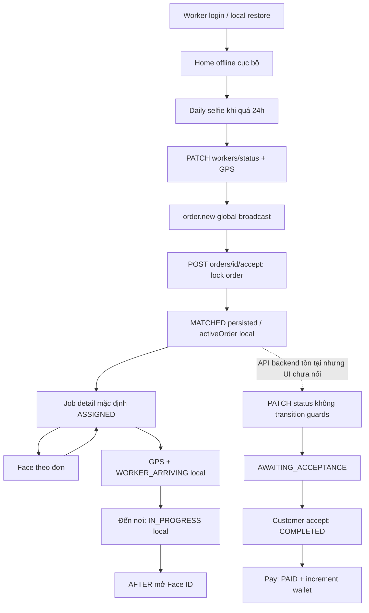
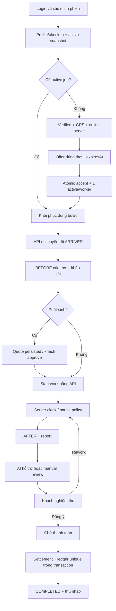

# Luồng nghiệp vụ và ngoại lệ

Thực trạng từ OrdersController → OrdersService, WorkerDashboardScreen, WorkerJobDetailScreen; xem mã chứng cứ [01](01-codebase-audit.md). Sơ đồ mô tả source, chưa phải flow đã test runtime.

## Lát cắt mục tiêu sau khi được duyệt

## Happy path và nhánh ngoại lệ theo giai đoạn

| Giai đoạn | Thực tế và gap | Nhánh cần kiểm thử / hành vi mục tiêu |
|---|---|---|
| 1 Login/check-in | W4 restore local/refresh có tests; W3/B1/AI có bypass | Sai role/401/refresh cạnh tranh → clear phiên; AI down/khác mặt → không cấp phiên, retry/manual có quyết định Admin thực |
| 2 Online/GPS | B5 guards có; W1 chỉ lấy GPS khi bật | Denied/timeout/stale GPS → hiển thị lý do, không online giả; profile online phải hydrate lại |
| 3 Offer | Global order.new, countdown client 30s | Ngoài vùng/không dịch vụ/đang bận không nhận; foreground sau expiry tự đóng |
| 4 Accept | Lock order; chưa lock worker/offer | 2 thợ/1 đơn: 1 success; 1 thợ/2 đơn: 1 active; retry cùng intention không duplicate history |
| 5 Travel/arrive | UI local, API alias arrive=start | API persist từng bước; GPS chỉ stage được phép; unmount/relaunch khôi phục theo consent, không tự start work |
| 6 BEFORE | Ảnh khách bị dùng BEFORE; UI chưa có | Ảnh thợ có nguồn/upload status; upload fail giữ preview/retry; ISSUE không thay BEFORE |
| 7 Quote | Note/event, client quyết số tiền accept | Lưu version/items/total server; pending chặn start; reject được điều chỉnh/hủy theo policy |
| 8 Work/time | API startedAt, chưa session/pause | Reload timer từ server; pause/resume idempotent; giá fixed không tăng theo đồng hồ |
| 9 AFTER | Route Face ID | Camera/preview/report/upload có retry; thiếu AFTER không submit |
| 10 AI review | Heuristic success cả Node/FastAPI | Unavailable/uncertain không sinh score đạt; vẫn có đường khách xem bằng chứng/manual review |
| 11 Customer decision | COMPLETED trực tiếp; dispute chưa rework | Chấp thuận lưu acceptedAt nhưng chờ tiền; reject lưu reason và rework/resolution; im lặng không tự accept |
| 12 Payment/commission | Pay tự ghi PAID, increment lặp | Failure/pending không complete; callback lặp chỉ 1 ledger; server tính tiền, owner, signature/sandbox mode |
| 13 Earnings | Worker placeholder; profile đọc wallet khác | Đối soát từng đơn/ledger; pending/available khác nhau, withdrawal chưa khả dụng nếu thiếu backend |
| 14 Cancel/recover | Cancel API, không UI; không queue | Hủy đồng thời pay/start cần CAS; preserve history, refetch sau reconnect; không replay accept/payment mù |

API luôn xác nhận sự thật trước UI; socket chỉ thông báo dữ liệu đã commit. Không dùng route params để xác nhận face/state/price. Ngoại lệ thiếu an toàn/khách vắng/chưa sửa được cần reason và hỗ trợ, không tự kết thúc đơn.
