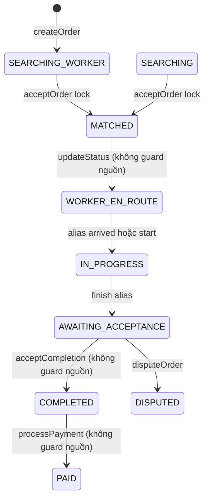

# Order state machine: thực tế và phương án tương thích

> Cập nhật 12/11/2026: ARC-01 đã triển khai policy/guards/transaction và contract mới; xem [báo cáo ARC-01](10-arc01-report.md). Phần audit/kế hoạch dưới đây được giữ làm baseline lịch sử, không phải tất cả đều là contract hiện hành.

Nguồn: schema.prisma/OrderStatus; OrdersService.updateStatus/acceptOrder/acceptCompletion/processPayment; OrderWorkflowService; VALID_STATUS_TRANSITIONS. Đây là audit, không đổi enum.

## Enum hiện có

`PENDING_AI, AWAITING_CONFIRM, SEARCHING_WORKER, MATCHED, WORKER_EN_ROUTE, IN_PROGRESS, AWAITING_ACCEPTANCE, DISPUTED, COMPLETED, PAID, CANCELLED, CREATED, SEARCHING, ASSIGNED, WORKER_ARRIVING, ARRIVED, AWAITING_CONFIRMATION, AWAITING_PAYMENT`.

Thiếu enum của đề xuất: `PENDING, EN_ROUTE, ASSESSING, AWAITING_QUOTE_APPROVAL, PAUSED, WORK_FINISHED, REWORK_REQUESTED`. Có thể map/biểu diễn bằng substate bền vững sau review. DISPUTED không nên coi terminal giải phóng thợ tự động khi chưa có policy.

Các cạnh trên là đường đi dự kiến của source chính, KHÔNG phải tập cạnh duy nhất server đang cho phép: updateStatus bỏ kiểm tra nguồn; acceptCompletion/processPayment/disputeOrder còn bypass. Một sơ đồ “đẹp” không phản ánh enforcement thực.

## FSM cũ tồn tại nhưng controller chính không gọi

`CREATED → SEARCHING → ASSIGNED → WORKER_ARRIVING → ARRIVED → IN_PROGRESS → AWAITING_CONFIRMATION → AWAITING_PAYMENT → COMPLETED`.

VALID_STATUS_TRANSITIONS còn cho ASSIGNED→SEARCHING, AWAITING_CONFIRMATION→IN_PROGRESS, và cancel trước terminal. WorkflowService kiểm tra actor cho nhiều method, nhưng customerProfileId so với Order.customerId (User ID) khác semantics; repository include customer.user sai. Không chỉ nối controller vào service cũ mà không sửa contract.

## Mapping đề xuất cần duyệt ở ARC-01

| Ý nghĩa | State source chính | Alias cũ / cách ít phá vỡ |
|---|---|---|
| Tìm thợ | SEARCHING_WORKER | SEARCHING |
| Đã phân công | MATCHED | ASSIGNED |
| Di chuyển | WORKER_EN_ROUTE | WORKER_ARRIVING / EN_ROUTE mục tiêu |
| Đến nơi | ARRIVED có enum nhưng alias hiện bỏ qua | Dùng ARRIVED rõ ràng |
| Khảo sát / quote pending | Chưa có | Substate/quote persisted, không thêm enum ngay |
| Đang làm | IN_PROGRESS | startedAt/work session server |
| Pause / finish chưa submit | Chưa có | Session/report flags; phase chưa được tự coi terminal |
| Chờ nghiệm thu | AWAITING_ACCEPTANCE | AWAITING_CONFIRMATION |
| Rework | Chưa có luồng chuyên biệt | Decision persisted + chuyển có guard theo policy |
| Chờ trả tiền | AWAITING_PAYMENT có enum, source chính chưa dùng | Customer accept chuyển vào đây sau compatibility update |
| Kết thúc đã đối soát | Source chính PAID; Workflow COMPLETED | Chốt COMPLETED là target; PAID là legacy alias chỉ sau xác minh payment/ledger |
| Hủy / tranh chấp | CANCELLED / DISPUTED | Giữ enum và audit, thêm resolution khi cần |

## Actor và điều kiện mục tiêu

| Mutation | Actor | Điều kiện cần thêm/giữ | Atomicity |
|---|---|---|---|
| Accept | Worker eligible được offer | Chưa hết hạn, online/approved/face valid/skill/vùng, chưa active | Khóa worker và order theo thứ tự cố định + offer CAS |
| Travel/arrive | Assigned worker | Đúng state nguồn, face policy, GPS theo policy | CAS version và ghi history cùng transaction |
| Start | Assigned worker | ARRIVED + BEFORE của thợ persisted + quote approved hoặc unchanged scope | Timestamp server + CAS |
| Pause/resume/finish | Assigned worker | Session đúng state, pause reason; finish lưu time/report | Dedupe operation + intervals không chồng |
| Submit acceptance | Assigned worker | AFTER/report đã upload, AI optional/manual rõ | CAS + submittedAt |
| Accept/rework | Customer owner | Submitted, chưa quyết định version này | Acceptance decision unique/version |
| Settle | Verified provider/sandbox handler được phân quyền | Đúng amount/currency/order, accepted, chưa settled | Payment+ledger+commission+terminal trong transaction |
| Cancel/dispute/resolution | Owner/Admin theo policy | Nonterminal, fee/reason, chặn race payment | CAS + history, không xóa audit |

Ownership hiện có ở updateStatus nhưng chưa đủ preconditions. Actor Admin không có quyền tùy ý bypass điều kiện tiền/ledger; override cần audit và policy riêng.

## Khôi phục và bất biến

Active phải gồm mọi state chưa terminal đã có worker, kể cả chờ nghiệm thu/chờ tiền; quyết định DISPUTED riêng. `findCurrentOrderForWorker` hiện chỉ ASSIGNED/WORKER_ARRIVING/ARRIVED/IN_PROGRESS/AWAITING_CONFIRMATION/AWAITING_PAYMENT nên bỏ sót luồng chính. Sau khi sửa filter và relation: startup/focus/foreground/reconnect refetch; nếu server null thì xóa cache active. Socket timestamp phát không thay version; thêm version tăng nguyên tử rồi bỏ event cũ/refetch khi thiếu version.

Migrations đề xuất chỉ additive (version, quote/session/acceptance, keys/metadata); kiểm tra lịch sử D2 trên DB test trước, không reset DB. Inventory dữ liệu cũ và consumers trước backfill. Rollback ứng dụng bằng adapter đọc cũ, giữ cột/bảng mới; không drop enum/key hay xóa ledger đã settled. Chưa có migration nào được viết/chạy trong audit.
