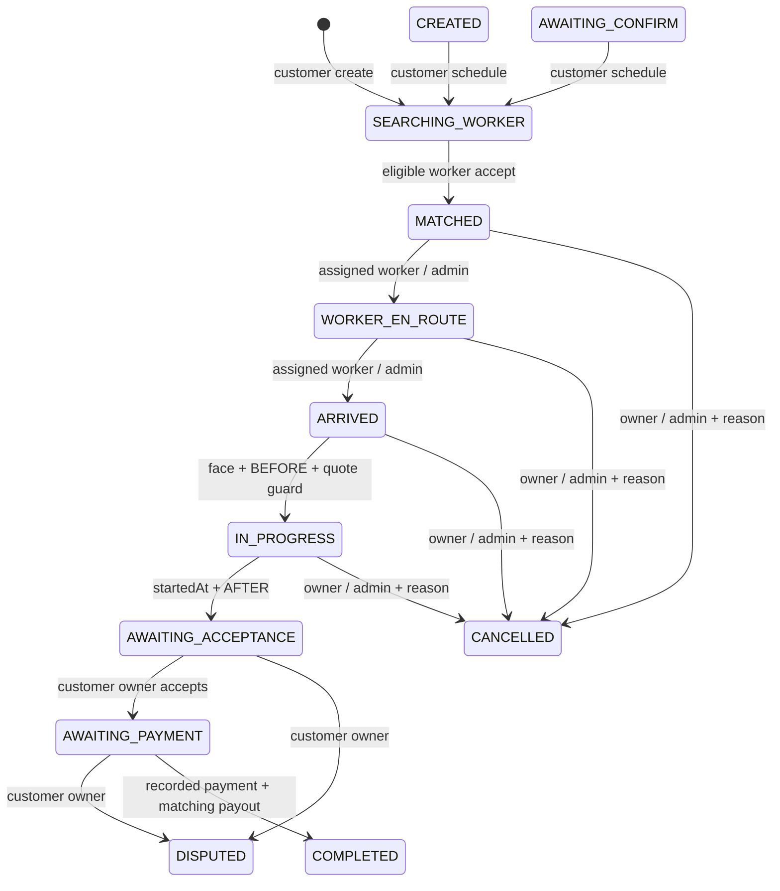

# ARC-01 — Báo cáo triển khai Order FSM

Ngày: 12/11/2026. Phạm vi: policy/FSM/ownership, transaction/history, order socket và cập nhật tối thiểu consumers. Không thay enum/schema, không migration, không triển khai camera BEFORE/AFTER, timer, ví, provider thanh toán hay AI nghiệm thu. Không commit/push/chuyển task.

## CURRENT STATUS

Trước task: hai FSM song song; OrdersService/Admin bỏ validator; accept lock chỉ theo order; arrive=start; nghiệm thu COMPLETED trước tiền; pay tự ghi PAID/cộng ví; socket room/GPS không auth và broadcast global. Xem audit lịch sử 01–08; báo cáo này mô tả implementation mới, không viết lại lịch sử audit.

## IMPLEMENTED

`OrderWorkflowService.transition` là nơi duy nhất ghi chuyển trạng thái đơn đang tồn tại. OrdersService, AdminService và compatibility methods của Workflow/Repository đều đi qua đây. Create-order chỉ khởi tạo state cố định SEARCHING_WORKER; client không điều khiển initial status. Quote price edit không đổi order state và cùng khóa order với start-work.



PENDING_AI→AWAITING_CONFIRM và hủy từ PENDING_AI/AWAITING_CONFIRM/CREATED/SEARCHING_WORKER nằm trong bảng policy để mô tả dữ liệu cũ; không mở API client chuyển tùy ý các initial states. DISPUTED không có lối resolve mặc định; chờ EXC-02. Không tự chuyển tranh chấp về làm tiếp hoặc hoàn tất.

| Alias đầu vào/dữ liệu cũ | Canonical ghi mới / ý nghĩa |
|---|---|
| SEARCHING | SEARCHING_WORKER |
| ASSIGNED | MATCHED |
| WORKER_ARRIVING | WORKER_EN_ROUTE |
| AWAITING_CONFIRMATION | AWAITING_ACCEPTANCE |
| PAID | Được đọc như terminal COMPLETED; không backfill bản ghi cũ hoặc tự tạo settlement |
| ARRIVED / AWAITING_PAYMENT | Giữ riêng, không trộn với IN_PROGRESS / COMPLETED |

`PAID` cũ vẫn giữ raw status khi trả lại bản ghi không đổi; normalization chỉ phục vụ policy. Các enum database khác vẫn tồn tại, không rename/drop hoặc data migration.

## Actors / điều kiện nghiệp vụ

- REST JWT từ chối refresh token dùng như access token; kiểm tra User ACTIVE và role hiện tại trong DB thay vì role cũ trong claims. FSM lấy workerProfile từ User ID đã xác thực, bỏ qua profile/role client tự đưa.
- Accept: WORKER có profile, faceVerifiedAt hợp lệ (0≤age<24h), online/APPROVED, chưa có active order. Worker lock trước order lock: cùng worker/khác đơn và cùng đơn/khác worker được serialize. Retry cùng worker/đơn đã nhận trả snapshot, không thêm assignment/history/event.
- Travel/arrive/start/finish: assigned worker hoặc Admin, đúng cạnh FSM. Admin không được thay khách nghiệm thu hoặc vượt điều kiện ảnh/face/thanh toán. Không thể dùng generic status để gán worker qua Admin.
- Start: ARRIVED, face hợp lệ; BEFORE phải được ghi sau mốc ARRIVED. Ảnh khách khi tạo đơn được lưu ISSUE; không coi ảnh đó là BEFORE. Legacy ảnh không đủ provenance phải tải BEFORE lại qua endpoint đúng quyền. Latest quote history có pending/rejected thì chặn start. Đây là guard bảo thủ dùng schema hiện tại, không thay thế Quote version của QUO-01.
- Finish: IN_PROGRESS, có startedAt và AFTER ghi sau thời điểm bắt đầu. Chưa làm UI media/report; không giả ảnh để mở guard.
- Customer owner nghiệm thu → AWAITING_PAYMENT, không đặt completedAt. Dispute chỉ từ chờ nghiệm thu/chờ tiền, giữ reason và evidence trong cùng transaction; retry không tạo evidence trùng.
- Complete: chỉ customer owner/Admin và đã có Payment PAID+paidAt, amount khớp final/estimated price, payout ledger thuộc ví đúng worker và amount khớp workerPayoutAmount. **ARC-01 không tạo payment, không cộng ví.** `/pay` và alias trả PAYMENT_NOT_SETTLED nếu chưa có bằng chứng ghi nhận. Fixture PAID trong test là fixture test, không bằng chứng provider thật.
- Cancel: chỉ owner/assigned worker/Admin trên cạnh được phép, có reason. Route cancel đơn giữ cách tính phí cũ (0 trước matching, 20% estimatedPrice sau matching), lưu số phí trong cancellationReason và trả cancellationFee; Admin cancel riêng không tự phát sinh phí mới. Đây không phải settlement khoản phí hủy.
- Read detail/media/compare/order-face/schedule kiểm tra quyền; match endpoint bị giới hạn ADMIN. Face upload guard chạy trước FileInterceptor. BEFORE chỉ worker ở ARRIVED; AFTER chỉ worker ở IN_PROGRESS; ISSUE chỉ customer trước phân công. URL lặp cùng type/đơn trả image cũ dưới order lock. Không thêm metadata uploader/checksum schema ở task này.

## Concurrency / history / realtime

Transaction PostgreSQL dùng SELECT FOR UPDATE và updateMany với điều kiện id+status+updatedAt; update count khác 1 → 409. History cùng transaction. Chỉ sau commit mới emit trạng thái; rollback hoặc no-op không emit. Không có migration version/outbox: ARC-02/SYNC-01 vẫn cần cho operation dedupe tổng quát, event version và reliable delivery đa instance. Socket emit lỗi sau commit được log, không báo DB rollback giả; client có thể refetch.

Socket `/orders` có JWT handshake, hết hạn token thì disconnect; room order yêu cầu owner/assigned worker/Admin, room Admin yêu cầu ADMIN; `join_room` chỉ dùng identity server, bỏ role/profileId client. GPS yêu cầu assigned WORKER ở EN_ROUTE, derive profile ID, kiểm tra range/tần suất và update DB trước phát vị trí. Offer chỉ phát tới worker rooms từ candidate list; bỏ order/matched/status broadcast toàn namespace. Đã kiểm tra socket thật một instance; Redis pubsub/đa node NOT_VERIFIED.

## API / consumer compatibility

Giữ đường dẫn và HTTP methods. Mutations trả `{success, order, changed}` với raw persisted status; cancellation thêm cancellationFee khi phù hợp. Same-state retry không update updatedAt/history. Status aliases legacy vẫn được normalize nhưng phải qua actor/edge/guard; không có arbitrary status update.

Các thay đổi contract có chủ đích:

1. `/orders/:id/arrived` → ARRIVED, không tự start.
2. `accept-completion`/`confirm-completion` → AWAITING_PAYMENT, chưa hoàn tất.
3. `/pay`/`complete-payment` chỉ finalize settlement đã ghi; không giả PAID hay tăng ví.
4. Full detail không còn cho worker bất kỳ xem đơn SEARCHING. Offer là kênh thông tin giới hạn của ứng viên, full detail sau assignment.
5. `DELETE /admin/orders/:id` bị từ chối để không xóa audit/ledger qua route đơn; các chức năng xóa catalog/user khác còn rủi ro riêng bên dưới.
6. Error invalid edge/race → 409; thiếu điều kiện → 400; sai quyền → 403; JWT thiếu/hết hạn/refresh → 401. Chưa đổi toàn API sang 422 để tránh mở rộng contract ngoài ARC-01.

Customer accept/pay dùng status trong response, không ép COMPLETED/PAID ở local. Tracking nhận event thì refetch snapshot. Admin thêm badge canonical/waiting-payment/dispute, đọc User.name/phone/email đúng schema và bỏ mock orders che API error; event làm refetch thay ASSIGNED cục bộ. Admin giữ socket root phục vụ tính năng khác, thêm kết nối /orders có auth cho đơn. Worker detail fetch bằng ID/focus, mutation qua REST và render snapshot; bỏ worker:status_update làm mutation, tách ARRIVED/start, bỏ AFTER→Face route sai (chưa thêm camera UI). Home restore/banner/summary và recovery đầy đủ vẫn thuộc ORD-02/UX/SYNC.

## FILES CHANGED

- [client/src/features/orders/components/OrderDetailModal.jsx](../../client/src/features/orders/components/OrderDetailModal.jsx): Consumer lấy state thật, tương thích aliases/API/socket có auth.
- [client/src/features/orders/pages/OrdersManagementPage.jsx](../../client/src/features/orders/pages/OrdersManagementPage.jsx): Consumer lấy state thật, tương thích aliases/API/socket có auth.
- [client/src/features/orders/services/adminOrders.service.js](../../client/src/features/orders/services/adminOrders.service.js): Consumer lấy state thật, tương thích aliases/API/socket có auth.
- [client/src/services/socket/socketService.js](../../client/src/services/socket/socketService.js): Consumer lấy state thật, tương thích aliases/API/socket có auth.
- [customer-app/__tests__/socketConnection.test.js](../../customer-app/__tests__/socketConnection.test.js): Bằng chứng kiểm thử và cấu hình test tách DB.
- [customer-app/src/screens/order/AcceptanceScreen.jsx](../../customer-app/src/screens/order/AcceptanceScreen.jsx): Consumer lấy state thật, tương thích aliases/API/socket có auth.
- [customer-app/src/screens/order/PaymentReviewScreen.jsx](../../customer-app/src/screens/order/PaymentReviewScreen.jsx): Consumer lấy state thật, tương thích aliases/API/socket có auth.
- [customer-app/src/screens/order/TrackingScreen.jsx](../../customer-app/src/screens/order/TrackingScreen.jsx): Consumer lấy state thật, tương thích aliases/API/socket có auth.
- [customer-app/src/services/socket/socketService.js](../../customer-app/src/services/socket/socketService.js): Consumer lấy state thật, tương thích aliases/API/socket có auth.
- [server/package.json](../../server/package.json): Lệnh chạy suite ARC-01.
- [server/src/modules/admin/admin.module.js](../../server/src/modules/admin/admin.module.js): Admin dùng FSM chung, giữ lịch sử và đọc customer đúng schema.
- [server/src/modules/admin/admin.service.js](../../server/src/modules/admin/admin.service.js): Admin dùng FSM chung, giữ lịch sử và đọc customer đúng schema.
- [server/src/modules/auth/strategies/jwt.strategy.js](../../server/src/modules/auth/strategies/jwt.strategy.js): JWT lấy identity/role hiện tại từ DB.
- [server/src/modules/orders/constants/order-status.js](../../server/src/modules/orders/constants/order-status.js): Policy/guards/transaction/history hoặc route/schema-compatible read model.
- [server/src/modules/orders/diagnosis/create-order-validation.spec.js](../../server/src/modules/orders/diagnosis/create-order-validation.spec.js): Policy/guards/transaction/history hoặc route/schema-compatible read model.
- [server/src/modules/orders/order-workflow.service.js](../../server/src/modules/orders/order-workflow.service.js): Policy/guards/transaction/history hoặc route/schema-compatible read model.
- [server/src/modules/orders/orders.controller.js](../../server/src/modules/orders/orders.controller.js): Policy/guards/transaction/history hoặc route/schema-compatible read model.
- [server/src/modules/orders/orders.gateway.js](../../server/src/modules/orders/orders.gateway.js): Policy/guards/transaction/history hoặc route/schema-compatible read model.
- [server/src/modules/orders/orders.module.js](../../server/src/modules/orders/orders.module.js): Policy/guards/transaction/history hoặc route/schema-compatible read model.
- [server/src/modules/orders/orders.repository.js](../../server/src/modules/orders/orders.repository.js): Policy/guards/transaction/history hoặc route/schema-compatible read model.
- [server/src/modules/orders/orders.service.js](../../server/src/modules/orders/orders.service.js): Policy/guards/transaction/history hoặc route/schema-compatible read model.
- [server/src/modules/orders/validators/order-transition.validator.js](../../server/src/modules/orders/validators/order-transition.validator.js): Policy/guards/transaction/history hoặc route/schema-compatible read model.
- [worker-app/__tests__/socketConnection.test.js](../../worker-app/__tests__/socketConnection.test.js): Bằng chứng kiểm thử và cấu hình test tách DB.
- [worker-app/app/(worker)/job/[id].jsx](../../worker-app/app/(worker)/job/[id].jsx): Consumer lấy state thật, tương thích aliases/API/socket có auth.
- [worker-app/src/services/socket/socketService.js](../../worker-app/src/services/socket/socketService.js): Consumer lấy state thật, tương thích aliases/API/socket có auth.
- [server/src/modules/orders/order-access.guard.js](../../server/src/modules/orders/order-access.guard.js): Policy/guards/transaction/history hoặc route/schema-compatible read model.
- [server/src/modules/orders/validators/order-transition.validator.spec.js](../../server/src/modules/orders/validators/order-transition.validator.spec.js): Policy/guards/transaction/history hoặc route/schema-compatible read model.
- [server/test/arc01.e2e-spec.js](../../server/test/arc01.e2e-spec.js): Bằng chứng kiểm thử và cấu hình test tách DB.
- [server/test/jest-arc01.config.cjs](../../server/test/jest-arc01.config.cjs): Bằng chứng kiểm thử và cấu hình test tách DB.
- [worker-app/__tests__/orderFsm.test.js](../../worker-app/__tests__/orderFsm.test.js): Bằng chứng kiểm thử và cấu hình test tách DB.

## API/DATABASE CHANGES

Không sửa `schema.prisma`, không tạo/chạy migration vào DB dự án, không seed/reset DB dùng chung. Integration dùng container PostgreSQL/PostGIS riêng và `prisma db push --skip-generate` từ schema hiện tại để dựng DB rỗng. Điều đó **không chứng minh lịch sử migrations hiện tại dựng đúng schema**; migration drift ở audit vẫn mở cho ARC-02. Không thêm dependency. Container test được dọn sau kiểm tra.

## TEST RESULTS

Kết quả cuối xem [09-progress-tracker.md](09-progress-tracker.md). Suite `test/arc01.e2e-spec.js` gọi OrdersController và AdminController thật qua HTTP, guards/JWT thật, workflow/Prisma thật, PostgreSQL thật, Socket.IO thật. Redis dependency ở harness được thay bằng stub và queue không chạy; không coi là đã test Redis/provider/AI/mobile thiết bị.

Chạy lại trên DB test riêng đã được dựng:

```bash
cd server
ARC01_TEST_DATABASE_URL='<URL database local có tên kết thúc _test>' npm run test:arc01
```

Suite không fallback DATABASE_URL, từ chối host ngoài localhost/127.0.0.1 và DB không có hậu tố `_test`; nếu thiếu biến test thì skip. Tạo fixtures riêng, cleanup theo IDs; không truncate/reset database. SQL trigger ép lỗi history chỉ được tạo trong DB test và được drop sau case.

## RISKS / ngoài phạm vi chưa triển khai

- Check-in hiện vẫn dựa faceVerifiedAt đã lưu; AI face/daily còn heuristic/detection-only success và phiên cũ không đủ provenance. ARC-01 ngừng cấp timestamp khi verifyFace trả false, nhưng **chưa sửa model/fallback/expiry audit đầy đủ**: FACE-01 là ưu tiên ngay sau nền FSM.
- Chưa có Offer/expiresAt/quote entity/version/work session/outbox/ledger keys; accept chưa chứng minh eligibility offer theo GPS/kỹ năng/thời hạn. Quote guard history chỉ tạm thời; QUO-01 phải lưu proposal/decision có version. Client amount ACCEPT được đối chiếu số đã ghi ở proposal note; không dùng làm thiết kế Quote lâu dài.
- Dữ liệu COMPLETED/PAID cũ không được tự coi có settlement hợp lệ hoặc backfill. Complete mới đòi payment+payout; legacy dùng `/pay` mà chưa có provider sẽ bị chặn đúng policy. PAY-01/WAL-01 mới tích hợp settlement/commission/ledger idempotency; không release flow thu tiền thật từ task này.
- Camera BEFORE/AFTER và report chưa nối, nên app có thể bị chặn start/finish cho tới IMG tasks; server guard không bị bỏ để demo. Device relaunch/offline/GPS background chưa test. Typecheck không thay thế QA native.
- Admin deleteUser có thể gỡ worker khỏi đơn/xóa lịch sử; force delete category/service có đường xóa dữ liệu đơn. Các luồng quản trị dữ liệu này ngoài task FSM đang làm, được ghi nhận riêng; cần hardening/data retention task trước vận hành. Route deleteOrder trực tiếp đã bị chặn nhưng chưa thể tuyên bố mọi đường xóa đều an toàn.
- Generic AiController endpoints có vấn đề ownership/schema và root AdminGateway chưa có ACL đầy đủ; không được coi đã bảo mật toàn bộ AI/Admin chỉ vì /orders đã được khóa. Cloudinary config có secrets mặc định trong source: cần xử lý/rotate riêng, không in giá trị vào báo cáo.
- Redis pubsub và event sau commit vẫn best effort, chưa có version/outbox; mất event cần refetch. Không tuyên bố exactly-once delivery hoặc thử nghiệm multi-node. Admin/Vite có cảnh báo chunk >500kB, không tối ưu bundle ngoài task.

## NEXT TASK

Đề xuất ARC-02 để baseline migration + version/idempotency; FACE-01 cần ưu tiên trước khi tin phiên biometric trong môi trường dùng thật. Chưa tự bắt đầu task nào. Không đánh dấu toàn Worker App hay 25 AC E2E hoàn tất từ kết quả backend.
