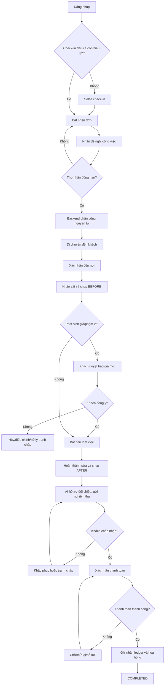

# FIXGO WORKER APP — KẾ HOẠCH HOÀN THIỆN NGHIỆP VỤ, UI/UX VÀ TÍCH HỢP HỆ THỐNG

> **Tên tệp:** `worker-app-doc.md`  
> **Loại tài liệu:** Implementation plan + Functional specification + AI execution guide  
> **Phiên bản:** 1.0 — 12/11/2026  
> **Phạm vi:** Ứng dụng người lao động (`worker-app`), những thay đổi liên quan tại backend, app khách hàng và Admin để hoàn tất luồng end-to-end.  
> **Trạng thái:** TÀI LIỆU ĐỀ XUẤT — chưa phải đặc tả đã được xác minh toàn bộ từ source code.

---

## 0. Cách đọc tài liệu và quy tắc làm việc cho AI

### 0.1. Mục đích

Tạo một kế hoạch có thể giao cho Codex/Gemini hoặc lập trình viên để:

1. Kiểm tra thực trạng `worker-app` và các hệ thống liên quan.
2. Chuẩn hóa trải nghiệm người thợ từ đăng nhập đến kết thúc giao dịch.
3. Hoàn thiện nghiệp vụ backend, đồng bộ trạng thái, ảnh nghiệm thu, thanh toán, hoa hồng.
4. Triển khai từng lát cắt dọc (*vertical slice*) có kiểm thử, không tạo màn hình giả chỉ để demo.
5. Đảm bảo luồng hoạt động sau khi app bị đóng, mạng chập chờn, thao tác lặp hoặc phát sinh tranh chấp.

### 0.2. Phân loại độ tin cậy

- **[CONFIRMED-BY-USER-REPORT]**: Được cung cấp trong bản đối chiếu mã nguồn người dùng gửi; AI **vẫn cần kiểm tra lại code thực tế** trước khi sửa.
- **[REQUIREMENT]**: Mục tiêu của đề tài FixGo được người dùng cung cấp.
- **[PROPOSED]**: Thiết kế được khuyến nghị trong tài liệu này, **chưa mặc định đã tồn tại**.
- **[VERIFY]**: Điểm phải kiểm tra trong repository hoặc xác nhận nghiệp vụ; không được tự suy diễn.
- **[DECISION]**: Quy tắc được tài liệu chọn làm mặc định triển khai; nếu mâu thuẫn hiện trạng, phải báo cáo trước khi thay đổi phá vỡ tương thích.

### 0.3. Mệnh lệnh bắt buộc cho AI triển khai

1. **Đọc code trước khi sửa.** Không suy đoán framework, endpoints, bảng DB, thư viện hoặc đường dẫn thực tế chỉ từ tài liệu.
2. **Tận dụng kiến trúc hiện hành.** Không rewrite toàn bộ app, không tự ý đổi navigation/framework/design system.
3. **Backend là source of truth** cho order state, quyền thợ, phiên xác thực, timestamp và transaction.
4. **Mỗi thay đổi phải có kiểm thử và bằng chứng:** đường dẫn file, endpoint, trạng thái trước/sau, ảnh/chỉ dẫn test nếu có.
5. **Không đánh dấu hoàn tất khi chỉ tạo UI.** Chức năng hoàn tất khi chạy xuyên suốt UI → API → DB → realtime → tái mở app → test.
6. **Không hardcode thống kê, thu nhập, trạng thái hoặc các ảnh nghiệm thu** như dữ liệu thật.
7. **Không tự thay đổi nghiệp vụ thanh toán trong production.** Nếu chưa có payment provider, xây demo/sandbox minh bạch, không giả định đã thu tiền thật.
8. **Mọi thay đổi schema/API phải kiểm tra và cập nhật client khách, worker, admin**, có kế hoạch migration và giữ tương thích khi phù hợp.
9. **Đảm bảo người dùng không bị kẹt ở màn hình:** có loading/empty/error/retry, đường hỗ trợ khi AI lỗi, mất GPS, khách vắng và tranh chấp.
10. **Không để AI xác định chất lượng sửa chữa chỉ dựa trên ảnh**, đặc biệt sửa lỗi vô hình (mạch điện, gas, đường ống, phần mềm).

### 0.4. Đầu vào cần đọc trong repository

Các đường dẫn dưới đây được người dùng cung cấp, cần xác nhận lại trong workspace:

- `worker-app/app/(worker)/(tabs)/index.jsx`: trang chủ, bật nhận đơn, socket, popup đơn mới, `activeOrder`.
- `worker-app/app/(worker)/job/[id].jsx`: chi tiết công việc, GPS, trạng thái, hành động.
- `worker-app/app/(worker)/verification/face.jsx`: xác thực khuôn mặt theo đơn.
- Các modules authentication/session, API client, WebSocket, GPS, image upload.
- Backend: modules/order lifecycle, matching, worker availability, face check-in, face verification, image comparison, pricing, payment, wallet, notification, websocket gateways.
- App khách: tạo đơn, xem báo giá, theo dõi vị trí, nghiệm thu, thanh toán.
- Admin: quản lý đơn, dịch vụ, mức hoa hồng, tranh chấp, thanh toán.

**Đầu ra bắt buộc trước khi bắt đầu coding:** file `docs/worker-audit.md` gồm bảng `Requirement | Existing file/API/table | Status | Gap | Decision`, sơ đồ thực tế, và danh sách câu hỏi/blocker.

---

## 1. Bối cảnh đề tài và giới hạn phạm vi

### 1.1. Mục tiêu đề tài [REQUIREMENT]

**“Xây dựng hệ thống phần mềm kết nối dịch vụ gia đình theo mô hình On-Demand tích hợp xử lý ảnh và AI.”**

- Khách chọn/đặt dịch vụ, đăng ảnh sự cố; AI hỗ trợ phân tích và gợi ý dịch vụ/giá tham khảo.
- Hệ thống phân phối đơn theo vị trí GPS và mức độ phù hợp của thợ; thợ nhận đơn realtime.
- Thợ check-in khuôn mặt để xác minh đúng người lao động đăng ký.
- Thợ ghi nhận ảnh kết quả; AI hỗ trợ đối chiếu trước/sau để phục vụ nghiệm thu.
- Khách hàng nghiệm thu, thanh toán; nền tảng tính hoa hồng, ghi nhận thu nhập/ví thợ.
- Các thành phần: Worker Mobile App, Customer Mobile App, Admin Dashboard, Backend và AI.

### 1.2. Phạm vi chính của bản kế hoạch

**In scope:** đăng nhập, check-in, sẵn sàng nhận việc, popup đơn, nhận đơn nguyên tử, active order, GPS/di chuyển, đến nơi, khảo sát và báo giá, ảnh BEFORE/AFTER, chấm giờ công việc, nghiệm thu, thanh toán/hoa hồng/thu nhập, thông báo và xử lý ngoại lệ, kiểm thử.

**Out of scope cho bản MVP:** gamification, chatbot tổng quát, tối ưu tuyến đường nâng cao, thưởng phức tạp, phân tích hiệu suất đa chiều, tự động phán quyết tranh chấp bằng AI, nhận nhiều đơn đồng thời (mặc định chỉ một đơn active/thợ), tự động rút tiền thật khi chưa có tích hợp và kiểm tra pháp lý.

### 1.3. Nguyên tắc UX cốt lõi

- Một màn hình chi tiết đơn có **một CTA chính** theo bước; CTA phụ có thể là gọi khách, chỉ đường, báo sự cố.
- Không yêu cầu thợ nhập/chụp lại dữ liệu đã có, trừ khi lỗi/đã hết hiệu lực.
- Không để ảnh khách đăng `CUSTOMER_ISSUE` bị hiểu nhầm thành ảnh do thợ chụp `BEFORE`.
- Không yêu cầu selfie cho mọi đơn nếu phiên check-in hợp lệ; có thể step-up verification dựa trên rủi ro.
- Thời gian di chuyển **khác** thời gian làm việc; thời gian làm việc **không tự quyết định tiền công** cho mọi loại dịch vụ.
- “Thợ hoàn tất sửa chữa” **khác** “khách đã nghiệm thu”, **khác** “thanh toán thành công”, **khác** “đơn hoàn tất”.
- Mọi giá và thu nhập hiển thị rõ **dự kiến** hay **đã xác nhận**.

---

## 2. Thực trạng theo bản đối chiếu được cung cấp

> Các dòng sau là [CONFIRMED-BY-USER-REPORT], chưa phải kết quả AI trực tiếp đọc repository.

| Chức năng | Hiện trạng được báo cáo | Kết luận triển khai |
|---|---|---|
| Đăng nhập/khôi phục phiên | Có gọi API và lưu phiên | Kiểm tra refresh token, lỗi phiên và logout |
| Bật/tắt nhận đơn | Có GPS và backend update | Thêm chặn khi đang có đơn, lỗi quyền GPS |
| Check-in đầu ca | Selfie nếu chưa xác thực hoặc quá 24 giờ | Chuẩn hóa hiệu lực và trạng thái theo server |
| Popup đơn realtime | WebSocket, 30 giây, nhận/bỏ qua, báo đã có thợ khác | Xác minh deadline từ server và race condition |
| Chi tiết công việc | Điều hướng bằng ID, nội dung có thể fallback mock | Bắt buộc fetch order detail từ backend |
| Ảnh BEFORE | Có API/backend nhưng worker UI chưa nối | Tích hợp upload/camera và metadata |
| Face verification theo đơn | Có màn hình và gọi API, hiện trước di chuyển | Tách check-in ca và step-up theo rủi ro |
| Di chuyển/GPS | Có socket tracking nhưng luồng verification lỗi | Backend transition + vị trí định kỳ/độ chính xác |
| Đến nơi/bắt đầu sửa | State cục bộ và socket event chưa chắc được gateway xử lý | Gọi API transition rõ ràng |
| Đồng hồ | Chưa có UI; backend có `startedAt` | Đồng hồ dựa timestamp server; tính cả pause |
| Ảnh AFTER | Nút đang điều hướng nhầm Face ID | Sửa route, upload ảnh AFTER thực sự |
| Báo hoàn thành | Backend có endpoint liên quan; UI chưa hoàn chỉnh | Khớp nghiệm thu, thanh toán, trạng thái cuối |
| Active order khôi phục | State trang chủ, mất sau khi mở lại | API active order + refetch ở startup/focus |
| Nearby jobs | Màn hình mẫu | Không ưu tiên trước core E2E |
| Thu nhập/Ví | Màn hình mẫu | Kết nối sau payment ledger |
| Thông báo | Màn hình mẫu | Tạo inbox sự kiện quan trọng |
| Hồ sơ thợ | Chưa hoàn thiện chứng chỉ/đánh giá/vùng nhận việc | Ưu tiên sau E2E, trừ thông tin bắt buộc matching |
| Thống kê trang chủ | Giá trị cố định | Đổi sang API và skeleton/empty/error |

### 2.1. Lỗi cần sửa ngay

- Quay về từ Face ID không khôi phục xác thực đúng từ backend; có nguy cơ bắt xác thực nhiều lần.
- Trạng thái chi tiết đơn khởi tạo lại `ASSIGNED` khi vào lại trang.
- `worker:status_update` được phát nhưng gateway theo mô tả chưa có handler; **không dùng socket emit làm nguồn cập nhật DB**.
- Mất `activeOrder` khi remount/relaunch.
- CTA ảnh AFTER điều hướng sai sang màn hình Face ID.
- Chưa có chuỗi BEFORE → khảo sát/báo giá → START → FINISH → AFTER → nghiệm thu.

---

## 3. Quy trình mục tiêu (Happy Path)

### 3.1. Sáu giai đoạn

1. **Sẵn sàng:** Đăng nhập → kiểm tra phiên khuôn mặt đầu ca (24h theo mô tả hiện tại, xác minh policy trong backend) → check-in nếu cần → bật nhận đơn → cập nhật GPS.
2. **Tiếp nhận:** Nhận thông báo → xem vị trí, dịch vụ, giá/thu nhập dự kiến, thời gian hẹn, ảnh khách cung cấp → bấm nhận → backend xác nhận phân công duy nhất.
3. **Di chuyển:** Xem thông tin khách/địa chỉ → bắt đầu di chuyển → gửi GPS trong phạm vi cho phép → đến nơi → xác nhận đã đến.
4. **Khảo sát:** Kiểm tra hiện trạng → chụp ảnh BEFORE → xác định công việc/giá đã thỏa thuận hoặc tạo báo giá phát sinh → chờ khách chấp thuận khi có thay đổi.
5. **Thực hiện & nghiệm thu:** Bắt đầu dịch vụ và đồng hồ → có thể tạm dừng theo policy → hoàn thành phần sửa → chụp AFTER, ghi chú/test kết quả → AI hỗ trợ so sánh → gửi nghiệm thu cho khách.
6. **Thanh toán & kết thúc:** Khách chấp nhận nghiệm thu → thanh toán thành công/được xác nhận hợp lệ → backend ghi ledger giao dịch và hoa hồng → trạng thái cuối `COMPLETED` → lịch sử/thu nhập cập nhật.

**Luồng ngoại lệ:** Hủy, khách vắng, thợ gặp sự cố, không thể sửa, thiếu mạng, AI không chắc chắn, khách từ chối nghiệm thu, chậm/thất bại thanh toán, tranh chấp. Phải có hành động phục hồi, không được bỏ qua.

### 3.2. Mermaid — luồng tổng quan



### 3.3. Định nghĩa thời gian

- `travelStartedAt`: bắt đầu di chuyển; có thể lưu lịch sử GPS.
- `arrivedAt`: thợ xác nhận đến nơi (không chỉ suy từ GPS).
- `workStartedAt`: thời điểm bắt đầu công việc theo server.
- `workFinishedAt`: thời điểm hoàn thành thao tác sửa/dịch vụ.
- `pauseIntervals`: các khoảng tạm dừng đã xác nhận.
- `effectiveWorkSeconds = (workFinishedAt - workStartedAt) - SUM(pauseIntervals)`; chỉ dùng tính phí khi pricing model quy định theo giờ và có luật làm tròn được duyệt.
- `acceptanceSubmittedAt`, `acceptedAt`, `paidAt`, `completedAt`: bốn mốc khác nhau.
- Toàn bộ timestamp lưu UTC tại backend; hiển thị theo múi giờ thiết bị. Không dựa vào `setInterval` để tích lũy thời gian chính thức.

---

## 4. State Machine và các nguyên tắc bất biến

### 4.1. Các trạng thái đơn chính [PROPOSED]

| Trạng thái | Ý nghĩa | Người/hệ thống chuyển vào | CTA chính trên worker |
|---|---|---|---|
| `PENDING` | Chờ phân công; có offer nhưng chưa assigned | Backend | Không có active order |
| `ASSIGNED` | Thợ đã nhận thành công | Matching/order service | Bắt đầu di chuyển |
| `EN_ROUTE` | Đang tới khách | Worker qua API | Đã đến nơi |
| `ARRIVED` | Đã đến vị trí khách | Worker qua API | Khảo sát hiện trạng |
| `ASSESSING` | Chụp BEFORE, khảo sát, xác nhận phạm vi | Worker/backend | Gửi báo giá hoặc bắt đầu làm |
| `AWAITING_QUOTE_APPROVAL` | Có thay đổi giá/phạm vi, chờ khách duyệt | Backend | Chờ duyệt / liên hệ khách |
| `IN_PROGRESS` | Đang thực hiện dịch vụ | Worker qua API | Tạm dừng hoặc hoàn thành sửa |
| `PAUSED` | Tạm ngưng theo chính sách | Worker/backend | Tiếp tục công việc |
| `WORK_FINISHED` | Thợ báo sửa xong, cần AFTER và báo cáo | Worker qua API | Chụp AFTER / gửi nghiệm thu |
| `AWAITING_ACCEPTANCE` | Đã gửi kết quả cho khách | Backend | Chờ khách / phản hồi yêu cầu sửa lại |
| `REWORK_REQUESTED` | Khách từ chối và yêu cầu khắc phục | Customer/backend | Khắc phục / tranh chấp |
| `AWAITING_PAYMENT` | Khách đã nghiệm thu, chờ thanh toán | Backend | Xem tình trạng thanh toán |
| `COMPLETED` | Đã đủ điều kiện kết thúc và ghi nhận giao dịch | Backend | Xem biên nhận |
| `CANCELLED` | Đã hủy hợp lệ | Backend | Xem lý do |
| `DISPUTED` | Tranh chấp chờ xử lý | Backend/Admin | Xem tiến trình xử lý |

**[VERIFY]** Đối chiếu enum/contract hiện có trước khi đổi trạng thái: có thể map `WORK_FINISHED` hoặc các trạng thái tạm thời thành substate/task flags để tránh phá vỡ hệ thống. Không thực hiện migration enum khi chưa đánh giá consumers.

### 4.2. Chuyển trạng thái hợp lệ cốt lõi

```text
PENDING -> ASSIGNED                                      (chấp nhận offer nguyên tử)
ASSIGNED -> EN_ROUTE -> ARRIVED -> ASSESSING
ASSESSING -> IN_PROGRESS                                 (BEFORE + giá hợp lệ)
ASSESSING -> AWAITING_QUOTE_APPROVAL -> IN_PROGRESS       (có báo giá phát sinh đã duyệt)
IN_PROGRESS -> PAUSED -> IN_PROGRESS
IN_PROGRESS -> WORK_FINISHED -> AWAITING_ACCEPTANCE       (AFTER + báo cáo hợp lệ)
AWAITING_ACCEPTANCE -> REWORK_REQUESTED -> IN_PROGRESS    (khắc phục theo policy)
AWAITING_ACCEPTANCE -> AWAITING_PAYMENT                   (khách xác nhận)
AWAITING_PAYMENT -> COMPLETED                             (payment settled + ledger ghi đúng)
ACTIVE -> CANCELLED / DISPUTED                            (chỉ ở các bước được policy cho phép)
```

### 4.3. Invariants — phải có test

- Tối đa **một active order/thợ** (MVP); active là tất cả state chưa terminal sau khi assigned. Enforcement bằng DB/service, không chỉ frontend.
- Chỉ thợ được assigned mới được cập nhật, upload ảnh, gửi báo giá cho đơn.
- Chỉ backend được xác nhận chuyển trạng thái; client nhận order snapshot mới từ API/server.
- Không được `IN_PROGRESS` khi thiếu xác thực hợp lệ theo policy, chưa đến nơi, thiếu ảnh BEFORE bắt buộc, hoặc chưa duyệt giá phát sinh.
- Không được `AWAITING_ACCEPTANCE` nếu thiếu ảnh AFTER/bằng chứng bắt buộc và báo cáo kết quả.
- Không được `COMPLETED` khi thiếu xác nhận nghiệm thu, thanh toán hợp lệ hoặc ghi nhận ledger idempotent.
- Hủy/hoàn tiền/sửa lại phải theo quyền và chính sách; không xóa lịch sử.
- WebSocket có thể đến chậm/lặp/sai thứ tự; order `version`/`updatedAt` dùng bỏ qua event cũ; app có thể refetch.
- Request retry dùng `Idempotency-Key` hoặc khóa nghiệp vụ tương đương, đặc biệt accept offer, payment, ledger, completion.
- Không được tin giá, hoa hồng, quyền, thời gian hoặc tọa độ do client gửi mà thiếu xác thực/đối chiếu ở server.

### 4.4. Khi chuyển trạng thái thất bại

- API trả `409 CONFLICT` + trạng thái mới nhất nếu cạnh tranh cập nhật.
- API trả `422 UNPROCESSABLE_ENTITY` + thiếu điều kiện cụ thể (ảnh, duyệt giá, quyền/phiên).
- UI khóa nút khi request đang xử lý, nhưng backend vẫn cần idempotency.
- Nếu mất mạng: giữ dữ liệu nhập/ảnh trong queue cục bộ an toàn; **không được tự báo trạng thái đã cập nhật**. Hiển thị “Đang chờ đồng bộ”.

---

## 5. UX và đặc tả màn hình

### 5.1. Navigation đề xuất

Tabs: **Trang chủ | Đơn hàng | Thu nhập | Tài khoản**. Notification inbox có biểu tượng trên header. Active job mở màn hình riêng bằng ID; có thể quay về từ mọi tab thông qua banner công việc đang thực hiện.

**[VERIFY]** Sử dụng Expo Router/stack hiện có theo mã thực tế, không tự tạo tab mới nếu app đã có cấu trúc khác tương đương.

### 5.2. Trang chủ (`worker-app/app/(worker)/(tabs)/index.jsx`)

| Trạng thái | UI hiển thị | Hành động |
|---|---|---|
| Chưa login/session expired | Đăng nhập | Đăng nhập lại |
| Check-in hết hiệu lực | Lý do và hướng dẫn selfie, trạng thái offline | Check-in |
| Offline/Tạm nghỉ | Toggle không nhận đơn, thông tin vị trí | Bật nhận đơn |
| Đang nhận đơn, chưa có việc | Online badge, vị trí/bán kính nhận việc, chỉ số thực từ API | Tắt nhận đơn |
| Có offer mới | Modal/bottom sheet có deadline server | Nhận / Bỏ qua |
| Có active job | Card ưu tiên trên đầu, trạng thái mới nhất, địa chỉ | Mở chi tiết |
| Không có GPS/network | Banner cảnh báo và retry; không mô tả online sai | Cấp quyền/thử lại |

**Yêu cầu:**
- Khi app startup/focus/reconnect: `GET active order` và `GET worker availability`; không dựa `useState` từ lần mount trước.
- Khi có active order, tạm chặn nhận đề nghị mới theo MVP; phản ánh đúng sự thay đổi ở server.
- Thu nhập ngày, số đơn hoàn tất chỉ từ backend; có skeleton, empty, error.
- Trạng thái online được cập nhật ở backend rồi mới render xác nhận.
- Không gửi vị trí chi tiết khi thợ offline/không có căn cứ nghiệp vụ.

### 5.3. Popup đơn mới

Bắt buộc hiển thị: tên dịch vụ, đối tượng cần sửa (nếu có), mô tả của khách, ảnh khách, khoảng cách ước tính, khung giờ hẹn, giá khách trả/thu nhập dự kiến được phân biệt, đếm ngược từ `expiresAt`, nút Nhận/Bỏ qua.

- 30 giây là default theo bản mô tả; phải lấy từ cấu hình server nếu có, tránh hardcode.
- Bấm nhận → trạng thái `accepting` → chờ server trả `ASSIGNED`; không đóng popup với thông báo thành công trước khi xác nhận.
- Khi offer hết hạn, đã có thợ khác hoặc app foreground muộn, tự đóng và giải thích.
- Modal cần hỗ trợ accessibility, text dài, không chặn thao tác khẩn cấp.

### 5.4. Chi tiết đơn — màn hình trọng tâm (`worker-app/app/(worker)/job/[id].jsx`)

**Khối thông tin:** mã đơn, dịch vụ/đối tượng, tên khách, liên hệ an toàn, địa chỉ, ảnh sự cố khách, giá đã duyệt, trạng thái, timeline, lịch sử hành động, trợ giúp.

**CTA theo state:**

| State | CTA chính | CTA phụ / điều kiện |
|---|---|---|
| `ASSIGNED` | Bắt đầu di chuyển | Chỉ đường, gọi khách, yêu cầu hủy |
| `EN_ROUTE` | Tôi đã đến nơi | Mở bản đồ, gọi khách, báo sự cố |
| `ARRIVED` | Bắt đầu khảo sát | Gọi khách, xác nhận địa chỉ |
| `ASSESSING` | Chụp ảnh trước sửa / Xác nhận phạm vi | Gửi báo giá phát sinh; CTA thay đổi theo việc thiếu ảnh |
| `AWAITING_QUOTE_APPROVAL` | Chờ khách duyệt | Xem/sửa báo giá theo policy; hủy nếu từ chối |
| `IN_PROGRESS` | Hoàn thành sửa chữa | Tạm dừng, ghi chú; đồng hồ hiển thị |
| `PAUSED` | Tiếp tục công việc | Hiển thị lý do + thời gian tạm dừng |
| `WORK_FINISHED` | Chụp AFTER / Gửi nghiệm thu | Sửa ghi chú, xem BEFORE |
| `AWAITING_ACCEPTANCE` | Chờ khách nghiệm thu | Theo dõi tiến trình, liên hệ hỗ trợ |
| `REWORK_REQUESTED` | Xem phản hồi / Khắc phục | Tạo tranh chấp nếu bất đồng |
| `AWAITING_PAYMENT` | Xem trạng thái thanh toán | Thanh toán tiền mặt theo policy, hỗ trợ |
| `COMPLETED` | Xem biên nhận | Đánh giá/lịch sử |
| `CANCELLED` / `DISPUTED` | Xem thông tin | Liên hệ hỗ trợ nếu được phép |

**Điều kiện UX:**
- Refresh/relaunch phải ra đúng state/backend snapshot, không fallback trạng thái `ASSIGNED`.
- Route nhận `orderId`; không dùng route params làm source of truth của `faceVerified`, giá, tên khách, state.
- Timeline hiển thị cả những bước đã hoàn thành và bước đang làm; step tương lai disabled.
- Khi đang lưu: spinner + disable CTA; khi lỗi: retry không mất form/ảnh; khi conflict: refetch và giải thích.
- Khi khách đổi trạng thái realtime: cập nhật header/CTA một cách ổn định, không nhảy màn hình bất ngờ.

### 5.5. Check-in khuôn mặt

- **Check-in đầu ca:** camera trước + hướng dẫn ánh sáng/khuôn mặt, xác thực ở backend, lưu expiry server, 24 giờ là chính sách hiện mô tả cần xác minh.
- **Xác thực bổ sung theo rủi ro (step-up):** chỉ khi phiên hết hiệu lực, thay đổi thiết bị/tài khoản, phát hiện bất thường hoặc đơn yêu cầu đặc biệt; policy do backend quyết định.
- Không yêu cầu selfie riêng cho mỗi đơn mặc định.
- Không chấp nhận ảnh gallery cho kiểm tra tính sống nếu model/provider yêu cầu ảnh sống; [VERIFY] đánh giá lại flow hiện tại “chụp/chọn ảnh” và khả năng liveness.
- Phân biệt xác thực AI thành công/thất bại/không chắc chắn/lỗi mạng; có retry giới hạn và hỗ trợ xác minh thủ công.
- Tránh lộ dữ liệu sinh trắc học, có chính sách lưu/xóa và quyền truy cập; không dùng ảnh khuôn mặt cho mục đích ngoài xác thực.

### 5.6. Ảnh BEFORE / AFTER

**Loại dữ liệu:**
- `CUSTOMER_ISSUE`: ảnh do khách đưa lên khi đặt dịch vụ.
- `BEFORE`: ảnh do thợ chụp khi khảo sát trước sửa.
- `AFTER`: ảnh do thợ chụp sau sửa.
- `EVIDENCE`/`PART_REPLACEMENT` (nếu cần): ảnh linh kiện, số đo hoặc minh chứng bổ sung.

**UI:** camera + preview + xóa/chụp lại + upload progress + thumbnail + retry. Cho phép nhiều ảnh theo policy và đặc điểm dịch vụ, ít nhất một ảnh bắt buộc nếu nghiệp vụ yêu cầu.

**Metadata:** `orderId`, `type`, `uploadedBy`, `capturedAt` (server nhận làm mốc đáng tin), `storageKey`, `mimeType`, `size`, `uploadStatus`, `checksum`; tọa độ EXIF chỉ lưu nếu cần/được phép. Kiểm tra ảnh an toàn, định dạng/kích thước và chống upload trái quyền.

**Gợi ý UX:** chụp cùng góc, overlay ảnh BEFORE khi chụp AFTER (tùy kỹ thuật), ảnh toàn cảnh/cận cảnh, hướng dẫn hạn chế lộ người và tài sản cá nhân.

**AI:** trả `result`, `confidence` nếu mô hình hỗ trợ chuẩn hóa, `explanation`, `limitations`, `needsHumanReview`; kết quả AI là gợi ý. Cần đường nghiệm thu thủ công khi AI lỗi/không thể đánh giá. Ví dụ máy lạnh sửa mạch bên trong không thể chỉ đánh giá bằng ảnh vỏ ngoài.

### 5.7. Khảo sát và báo giá phát sinh

- Khách có giá ban đầu/giá dự kiến từ booking; thợ xác nhận phạm vi thực tế.
- Không phát sinh: đánh dấu giá/điều kiện ban đầu hợp lệ → được bắt đầu.
- Có phát sinh: nhập dịch vụ bổ sung/vật tư, số lượng, đơn giá, lý do, ảnh minh chứng, tổng tiền; backend tính lại, lưu **phiên bản báo giá**.
- Gửi khách duyệt → khóa nút bắt đầu khi chưa duyệt; khách chấp nhận/từ chối; hiển thị lịch sử các phiên bản.
- Không tự coi AI-estimate là giá cam kết. Giá chốt phải được định nghĩa từ pricing policy hợp lệ.
- Nếu khách từ chối: điều chỉnh/hủy có lý do, áp dụng chính sách phí khảo sát nếu được công khai trước.

### 5.8. Đồng hồ

- UI hiển thị `HH:MM:SS` dựa trên `workStartedAt` và pause intervals từ server.
- Có `Bắt đầu`, `Tạm dừng`, `Tiếp tục`, `Hoàn thành sửa` tùy state.
- Backend ghi sự kiện, không chấp nhận client cung cấp thời lượng cuối làm căn cứ tiền.
- Các gói giá cố định không thay đổi phí chỉ vì đồng hồ tăng. Với dịch vụ theo giờ, backend áp dụng đơn giá, min duration và quy tắc làm tròn đã duyệt.

### 5.9. Thu nhập và ví

**Các trường hiển thị:** thu nhập hôm nay, thu nhập đang chờ, số dư có thể rút, lịch sử cộng/trừ, hoa hồng từng đơn, trạng thái rút tiền (nếu thực hiện được).

- Không hiển thị tính năng rút tiền hoạt động nếu backend/payment chưa hỗ trợ; có trạng thái “Chưa khả dụng” rõ ràng.
- Thanh toán tiền mặt cần luồng đối soát riêng: số tiền thợ đã thu, nghĩa vụ hoa hồng, hạn mức nợ theo policy.
- Không ghi một giao dịch vào ví hai lần khi webhook và API cùng báo thành công.

### 5.10. Thông báo, hồ sơ, lịch sử

- **Thông báo:** offer mới (realtime), khách duyệt báo giá, nghiệm thu, thanh toán, yêu cầu sửa lại, hủy, hỗ trợ; có read/unread và deep link.
- **Lịch sử đơn:** bộ lọc theo trạng thái, ngày, dịch vụ; xem timeline, ảnh, báo giá, biên nhận.
- **Hồ sơ thợ:** thông tin cơ bản, danh mục/đối tượng có kỹ năng, chứng chỉ, vùng/bán kính nhận việc, đánh giá; cần quy trình duyệt từ Admin nếu sửa thông tin ảnh hưởng matching.
- **Việc quanh đây:** hoãn đến khi cơ chế matching, GPS và phân quyền rõ; không triển khai danh sách gây xung đột với cơ chế offer nếu sản phẩm chưa chọn mô hình marketplace mở.

---

## 6. Đề xuất mô hình dữ liệu logic

> Đây là **conceptual data model**, không khẳng định tên bảng/cột hiện có. AI phải map sang schema hiện tại thay vì tạo trùng bảng.

| Entity | Các trường tối thiểu đề xuất | Ghi chú |
|---|---|---|
| `WorkerAvailability` | workerId, status, locationUpdatedAt, lastKnownAccuracy, updatedAt | Tách `online`, `busy`, `offline` |
| `WorkerCheckin` | id, workerId, verifiedAt, expiresAt, verificationMethod, result | Nhạy cảm sinh trắc học, không lưu raw face tùy tiện |
| `Order` | id, customerId, workerId, state, version, createdAt, updatedAt, pricingSnapshot | Snapshot immutable các thông số giá đã duyệt |
| `OrderOffer` | id, orderId, workerId, sentAt, expiresAt, acceptedAt, status | Chống nhận trùng, expire theo server |
| `OrderStatusHistory` | id, orderId, fromState, toState, actorId, reason, createdAt, requestId | Audit trail |
| `OrderPhoto` | id, orderId, type, storageKey, uploadedBy, uploadedAt, metadata | `CUSTOMER_ISSUE`/`BEFORE`/`AFTER` |
| `Quote`/`QuoteItem` | id, orderId, version, subtotal, extras, total, status, approvedAt | Báo giá có version và bằng chứng duyệt |
| `WorkSession` | orderId, startedAt, finishedAt, pauseIntervals | Để server tính thời lượng |
| `Acceptance` | orderId, submittedAt, customerDecision, decidedAt, comment, aiReviewId | Phân biệt AI với quyết định khách |
| `Payment` | orderId, provider, method, amount, status, settledAt, externalRef | Idempotent và đối soát |
| `WalletLedger` | id, workerId, orderId, type, amount, currency, createdAt, uniqueBusinessKey | Bút toán bất biến/điều chỉnh bằng entry mới |
| `Dispute` | id, orderId, actor, reason, evidence, status, resolution | Không xóa lịch sử |
| `Notification` | id, recipientId, type, payload, readAt, createdAt | Hỗ trợ inbox |

### 6.1. Cấu trúc danh mục → đối tượng → dịch vụ

Giữ nguyên yêu cầu quản lý nghiệp vụ: **Danh mục → Đối tượng → Dịch vụ**. Ví dụ `Điện lạnh → Máy lạnh → Sửa máy lạnh không mát`.

Mỗi `Order` nên tham chiếu service được đặt và lưu snapshot tên/giá/phạm vi tại thời điểm đặt, tránh sau này Admin đổi catalog làm sai lịch sử giao dịch. AI đề xuất dịch vụ theo dữ liệu catalog nhưng phải có quyền điều chỉnh thủ công của khách.

### 6.2. Tài chính

- Công thức mẫu: `workerNet = capturedAmount - platformCommission - adjustments` với định nghĩa adjustments và người chịu phí được phê duyệt.
- Hoa hồng theo policy có hiệu lực lúc giao dịch, snapshot trên đơn.
- `walletPending`, `walletAvailable`, `walletWithdrawn` nên được tính từ ledger hoặc ledger-derived balances có đối soát, không tin số trên app.
- Refund/chargeback tạo bút toán bù và cập nhật trạng thái giao dịch, **không sửa/xóa bút toán quá khứ**.
- Cần xác định riêng loại thanh toán tiền mặt để không tự coi tiền đã vào tài khoản nền tảng.

---

## 7. API Contract đề xuất (sẽ điều chỉnh sau audit)

### 7.1. Quy tắc contract

- REST/auth theo chuẩn dự án hiện có; đây chỉ là route **minh họa**.
- Server kiểm tra quyền worker/customer/admin trên từng resource.
- Response state-changing trả về `orderId`, `state`, `version`, `updatedAt`, `allowedActions`, và phần dữ liệu liên quan.
- Có mã lỗi máy đọc được: `ORDER_ALREADY_TAKEN`, `OFFER_EXPIRED`, `INVALID_TRANSITION`, `MISSING_BEFORE_PHOTO`, `QUOTE_NOT_APPROVED`, `FACE_CHECKIN_EXPIRED`, `PAYMENT_PENDING`, `ORDER_VERSION_CONFLICT`.
- Hành động critical nhận idempotency key; UI retry với **cùng** key cho cùng intention.
- Hệ thống tách quyền upload ảnh, ký URL, lưu metadata và antivirus/content validation nếu dùng object storage.

### 7.2. Danh sách chức năng

| Endpoint minh họa | Actor | Preconditions | Kết quả |
|---|---|---|---|
| `GET /worker/me/availability` | Worker | Auth | Trạng thái và điều kiện online |
| `POST /worker/me/check-in` | Worker | Auth, selfie/live verification | Phiên check-in và expiry |
| `PATCH /worker/me/availability` | Worker | Face policy + GPS hợp lệ | Availability cập nhật |
| `GET /worker/orders/active` | Worker | Auth | 0 hoặc 1 order active |
| `GET /worker/orders/:id` | Worker | Assigned/authorized | Snapshot chi tiết và allowedActions |
| `POST /worker/offers/:offerId/accept` | Worker | Offer chưa hết hạn, worker available | Assigned hoặc conflict |
| `POST /worker/orders/:id/start-travel` | Worker | `ASSIGNED` | `EN_ROUTE` |
| `POST /worker/orders/:id/arrive` | Worker | `EN_ROUTE` | `ARRIVED` |
| `POST /worker/orders/:id/start-assessment` | Worker | `ARRIVED` | `ASSESSING` |
| `POST /worker/orders/:id/photos` | Worker | Assigned, type hợp lệ | Ảnh được ghi nhận |
| `POST /worker/orders/:id/quotes` | Worker | `ASSESSING` | Draft/submitted quote |
| `POST /customer/orders/:id/quotes/:quoteId/decision` | Customer | Đúng khách, quote pending | Approved/rejected |
| `POST /worker/orders/:id/start-work` | Worker | BEFORE và giá hợp lệ | `IN_PROGRESS` + timestamp |
| `POST /worker/orders/:id/pause-work` | Worker | `IN_PROGRESS` | `PAUSED` |
| `POST /worker/orders/:id/resume-work` | Worker | `PAUSED` | `IN_PROGRESS` |
| `POST /worker/orders/:id/finish-work` | Worker | `IN_PROGRESS` | `WORK_FINISHED` |
| `POST /worker/orders/:id/submit-acceptance` | Worker | AFTER + report hợp lệ | `AWAITING_ACCEPTANCE` |
| `POST /customer/orders/:id/acceptance/decision` | Customer | Đúng khách, submitted | Accepted / rework |
| `GET /worker/earnings/summary` | Worker | Auth | Tổng hợp thu nhập, ví |
| `GET /worker/earnings/ledger` | Worker | Auth | Giao dịch phân trang |
| `GET /worker/notifications` | Worker | Auth | Notification inbox |

### 7.3. Ví dụ response chi tiết đơn (minh họa)

```json
{
  "id": "order-123",
  "state": "ASSESSING",
  "version": 8,
  "updatedAt": "2026-11-12T08:00:00Z",
  "service": { "category": "Điện lạnh", "object": "Máy lạnh", "name": "Sửa máy lạnh không mát" },
  "customer": { "displayName": "Khách hàng A", "contactAvailable": true },
  "address": { "displayText": "Địa chỉ đã được phân quyền xem" },
  "pricing": { "currency": "VND", "estimatedTotal": 200000, "approvedTotal": 200000, "isFinal": false },
  "photos": { "customerIssue": [], "before": [], "after": [] },
  "workSession": null,
  "verification": { "checkinValid": true, "stepUpRequired": false },
  "allowedActions": ["UPLOAD_BEFORE", "SUBMIT_QUOTE", "START_WORK", "REPORT_ISSUE"]
}
```

**Lưu ý:** `allowedActions` có thể là policy computed trên backend; frontend chỉ dùng để quyết định CTA, server vẫn validate khi thực thi. Địa chỉ và liên hệ phải giới hạn theo quyền/giai đoạn đơn.

### 7.4. WebSocket events

Các event chỉ là **notification của sự thật đã lưu**:

- `order:offer_created`, `order:offer_expired`, `order:assigned`
- `order:state_changed` (gồm `orderId`, `state`, `version`)
- `order:quote_updated`, `order:acceptance_updated`, `order:payment_updated`
- `worker:availability_changed`, `worker:notification_created`
- `worker:location_update` chỉ cho GPS theo chính sách, có authorization và rate limiting.

**[VERIFY]** Xác định gateway hiện có. Không tiếp tục emit `worker:status_update` nếu server không xử lý; ưu tiên API mutation + server broadcast thành công. Nếu hệ thống hiện đã có event contract khác, giữ tương thích hoặc viết adapter.

---

## 8. Frontend architecture và đồng bộ dữ liệu

### 8.1. Cấu trúc logic đề xuất (không áp đặt đường dẫn)

```text
worker-app/
  app/                         # routes hiện có
  src/ (hoặc thư mục hiện hành)
    features/
      auth/
      availability/
      offers/
      orders/
        api/
        hooks/
        components/
        screens/
        state/
      verification/
      photos/
      earnings/
      notifications/
    shared/
      api/
      socket/
      location/
      storage/
      ui/
```

Không chuyển file hàng loạt chỉ vì cấu trúc ví dụ. Ưu tiên sửa theo conventions đang có.

### 8.2. Quy tắc quản lý state

- **Server state:** order, availability, offers, check-in result, quotes, payments, wallet. Sử dụng query/refetch/cache library đã có; nếu chưa có, chọn giải pháp nhất quán, không thêm dependency không cần thiết.
- **Local transient state:** modal, form tạm, ảnh chưa upload, loading, đồng hồ hiển thị.
- On startup, screen focus, reconnect, app foreground: fetch `activeOrder`, refresh current order.
- Socket events → update/invalidate cache theo `version`; không coi packet là transaction đã committed nếu event không có xác nhận.
- Bảo vệ mutation với pending flag, idempotency key, retry policy.
- GPS location tracking chỉ chạy khi trạng thái phù hợp và quyền người dùng cho phép; stop khi không cần.

### 8.3. Khôi phục ứng dụng

Kịch bản khởi động:

```text
read auth session -> validate/refresh -> fetch worker profile/check-in/availability
-> fetch active order -> fetch order detail -> subscribe to relevant realtime
-> show correct stage, timer and pending photo queue
```

Nếu server không trả active order, không giữ state cũ ở trang chủ. Nếu có conflict giữa cached version và server, server thắng.

### 8.4. Offline và retry

- Được queue an toàn: ảnh chưa tải lên, notes, draft quote chưa submit.
- Không auto queue mù các thao tác trọng yếu như `accept offer`, `payment confirm`, `complete order`; cần xác nhận server và/hoặc user retry có kiểm tra expiry/version.
- Tự tải lại ảnh có checksum và trạng thái rõ ràng, không làm mất media khi chuyển screen.
- Khi mạng phục hồi: refetch order trước khi replay thao tác được phép.

---

## 9. Bảo mật, riêng tư, pháp lý và độ tin cậy

- Auth/authz mọi API bằng user/worker role + assigned order scope; không tin ID trên URL.
- Thông tin khách chỉ hiện khi thật sự được phân đơn và đủ mục đích sử dụng.
- Selfie/face embedding là dữ liệu nhạy cảm: giới hạn truy cập, mã hóa nơi lưu/truyền, retention policy, consent/notice, không log base64 hoặc public URL.
- Chống giả mạo ảnh và tái sử dụng ảnh cũ: liveness nếu khả thi, cơ chế giám sát/rủi ro; đánh giá failure modes, không tuyên bố bảo đảm tuyệt đối.
- GPS: chỉ lấy đúng lúc cần, cho biết vì sao cần quyền, xử lý permission denied và background restrictions theo nền tảng.
- Upload ảnh: validate mime/file size, signed URL TTL, hạn chế public access, xóa metadata không cần thiết, che dữ liệu cá nhân nếu phù hợp.
- Payment: dùng gateway sandbox/demo nếu chưa có integration thật; webhook được ký/verify và idempotent; không lưu bí mật payment ở client.
- Ledger bất biến, audit logs với requestId, actorId, trạng thái trước/sau và thời điểm.
- Admin tranh chấp không được tự thay đổi lịch sử; dùng resolution/audit.
- Kiểm tra quy định pháp lý áp dụng trước khi vận hành thanh toán/ví và xử lý dữ liệu sinh trắc học thật tại Việt Nam; bản tài liệu này không thay thế tư vấn pháp lý.

---

## 10. Acceptance Criteria và kiểm thử E2E

### 10.1. Các tiêu chí bắt buộc

| ID | Given / When / Then | Kết quả mong đợi |
|---|---|---|
| AC-01 | Worker login hợp lệ, check-in còn hạn, bật online | Backend online, GPS hợp lệ, UI phản ánh đúng |
| AC-02 | Check-in hết hạn, thợ bật online | UI yêu cầu xác thực; backend từ chối online trước khi pass |
| AC-03 | Hai thợ nhận cùng offer/order đồng thời | Chỉ một worker được assigned; còn lại nhận conflict |
| AC-04 | Offer hết hạn trước khi bấm nhận | Backend reject, UI hiển thị offer expired |
| AC-05 | Đã assigned, kill và mở lại app | `active order` và trạng thái chính xác được khôi phục |
| AC-06 | Thợ xác thực rồi quay lại job detail | Không bị lặp Face ID nếu server policy vẫn hợp lệ |
| AC-07 | Thợ bấm bắt đầu di chuyển | API update `EN_ROUTE`, socket phản ánh, reload vẫn đúng |
| AC-08 | Thợ báo đến nơi | Server lưu `ARRIVED`; GPS tracking chuyển chế độ phù hợp |
| AC-09 | Chưa có BEFORE, thợ bấm bắt đầu sửa | Backend trả lỗi điều kiện; UI hướng dẫn chụp ảnh |
| AC-10 | Đã BEFORE, cần báo giá mới nhưng khách chưa duyệt | Không được vào `IN_PROGRESS` |
| AC-11 | Khách từ chối báo giá phát sinh | Thợ không bị ghi nhận đã bắt đầu; có chọn sửa/hủy |
| AC-12 | Đang tính giờ, kill app rồi mở lại | Đồng hồ tính theo server đúng, không về 0 |
| AC-13 | Ảnh upload lỗi/mất mạng | Có retry và không giả vờ đã upload |
| AC-14 | Bấm nút AFTER | Mở camera ảnh AFTER, không điều hướng Face ID |
| AC-15 | AI không đánh giá được ảnh | Chuyển sang nghiệm thu thủ công, không chặn vô hạn |
| AC-16 | Thợ gửi nghiệm thu hợp lệ | Khách thấy báo cáo, worker state là `AWAITING_ACCEPTANCE` |
| AC-17 | Khách yêu cầu sửa lại | Worker thấy lý do, chuyển flow khắc phục theo policy |
| AC-18 | Khách chấp nhận nhưng chưa thanh toán | Không chuyển `COMPLETED`, ví chưa cộng khả dụng |
| AC-19 | Payment webhook bị gửi lặp | Ledger/hoa hồng chỉ phát sinh một lần |
| AC-20 | Thanh toán thành công, ledger commit | Đơn `COMPLETED`, thu nhập phản ánh đúng |
| AC-21 | User khác truy cập order ID không thuộc mình | API từ chối, không rò dữ liệu |
| AC-22 | WebSocket bị ngắt/kết nối lại, event trễ | Refetch/phiên bản state phục hồi đúng |
| AC-23 | Thợ đang có active job bị offer mới | Không được nhận đơn thứ hai theo MVP |
| AC-24 | Gửi cùng mutation nhiều lần liên tiếp | Không tạo trạng thái/ảnh/bút toán trùng |
| AC-25 | Khách không có nhà hoặc thợ hủy hợp lệ | Log lý do, chính sách áp dụng, cả hai app nhận cập nhật |

### 10.2. Test matrix

- **Unit:** transition policy, pricing formulas, effective work duration, allowedActions, check-in validity, input validation.
- **Integration:** DB transaction for accept order, image metadata, quote approval, payment ledger, socket emit after commit.
- **E2E:** 2 worker devices + 1 customer + backend (+ admin cho tranh chấp), happy path và lỗi.
- **Mobile QA:** Android/iOS nếu hỗ trợ, camera permission, denied location, backgrounding, force close, low memory, slow network.
- **AI QA:** ảnh không cùng đối tượng, thiếu sáng, góc khác, trước/sau giống nhau, lỗi không thấy bằng ảnh, khuôn mặt khác, ảnh giả nếu có liveness.
- **Accessibility:** text scaling, contrast, target size, thông báo thời gian đếm ngược dễ hiểu.

**Definition of Done cho một task:** code + test tự động (nếu hạ tầng có) + manual test + cập nhật docs + không phá flow cũ + screenshot/log/report + checklist acceptance đã được chứng minh.

---

## 11. Backlog triển khai theo phụ thuộc

### 11.1. Quy tắc ưu tiên

- **P0:** Luồng E2E, an toàn giao dịch, state consistency, dữ liệu thật, không bị mất/nhân đôi đơn.
- **P1:** Xử lý ngoại lệ, UX có thể vận hành, lịch sử/thu nhập, hardening.
- **P2:** Nâng cao, tối ưu, phân tích nâng cao.

### 11.2. Các Epic và Task chi tiết

| ID | Ưu tiên | Task | Phụ thuộc | Deliverable/DoD |
|---|---|---|---|---|
| AUD-01 | P0 | Audit worker/backend/customer/admin; xác nhận API, schema, enum, routes | Không | `docs/worker-audit.md`, evidence per gap |
| ARC-01 | P0 | Chốt FSM, actors, terminal states, mapping enum cũ | AUD-01 | State diagram + transition tests |
| ARC-02 | P0 | Bổ sung status history/version/idempotency và migration an toàn | ARC-01 | DB/contract tests, rollback |
| ORD-01 | P0 | Atomic offer acceptance; expire from server | ARC-01 | Chỉ một worker nhận thành công |
| ORD-02 | P0 | GET active order + details thật, quyền đọc | AUD-01 | Reload/kill restore |
| ORD-03 | P0 | Backend mutation start travel/arrive/assess/start work/finish | ARC-01 | Transition API và validation |
| SYNC-01 | P0 | Realtime state events + reconnection/refetch/version | ORD-02/03 | Không lệch trạng thái sau reconnect |
| FACE-01 | P0 | Check-in expiry policy + server result + sửa double prompt | AUD-01 | AC-02, AC-06 |
| UX-01 | P0 | Trang chủ online/offline, active job, stats thật | ORD-02 | State-driven UI + empty/error |
| UX-02 | P0 | Popup offer đủ dữ liệu và deadline server | ORD-01 | AC-03/04 |
| UX-03 | P0 | Chi tiết đơn timeline & CTA theo allowedActions | ORD-02/03 | Không có CTA sai state |
| GPS-01 | P0 | Start/stop tracking, permissions, GPS error | ORD-03 | GPS chỉ hoạt động đúng stage |
| IMG-01 | P0 | BEFORE camera + upload + metadata | UX-03 | Ảnh persisted, reload được |
| QUO-01 | P0 | Khảo sát, báo giá, duyệt khách, pricing snapshot | IMG-01 | Không sửa trước khi duyệt nếu phát sinh |
| TIMER-01 | P0 | WorkSession, pause/resume, UI server-clock | ORD-03 | Không mất thời gian khi relaunch |
| IMG-02 | P0 | AFTER camera, sửa wrong route, upload + report | IMG-01 | AC-14, AC-16 |
| AI-01 | P0 | AI compare endpoint/results/fallback manual | IMG-02 | Không quyết định hoàn thành chỉ từ AI |
| ACC-01 | P0 | Gửi nghiệm thu, khách duyệt/từ chối | AI-01 | Cả hai app và backend khớp |
| PAY-01 | P0 | Thanh toán có trạng thái rõ, sandbox khi cần | ACC-01 | Không đánh dấu đã trả khi chưa xác nhận |
| WAL-01 | P0 | Commission snapshot + ledger idempotent | PAY-01 | Tính đúng, không ghi hai lần |
| E2E-01 | P0 | Test toàn bộ happy path và race/restart | Các P0 core | 25 AC liên quan pass hoặc log gap |
| EXC-01 | P1 | Hủy đơn, khách vắng, thiếu an toàn, không thể sửa | ARC-01 | Audit và thông báo cả hai bên |
| EXC-02 | P1 | Rework, tranh chấp, admin workflow | ACC-01 | Case resolution trail |
| OFF-01 | P1 | Offline media queue và retry có kiểm soát | IMG-01/02 | Không mất ảnh, không replay mutation nguy hiểm |
| NOT-01 | P1 | Notification inbox + deeplink | SYNC-01 | Read/unread, link đúng order |
| HIST-01 | P1 | Lịch sử đơn + filter | ORD-02 | Dữ liệu thật, phân trang |
| EARN-01 | P1 | UI summary, transaction, pending/available | WAL-01 | Tổng hợp đối soát đúng |
| PROF-01 | P1 | Kỹ năng, chứng chỉ, vùng nhận đơn, duyệt hồ sơ | AUD-01 | Phân quyền và matching đúng |
| HARD-01 | P1 | Bảo mật, logging, performance, accessibility | Các core | Security and usability review |
| NEAR-01 | P2 | Việc quanh đây nếu policy mở marketplace | Chốt matching policy | Không xung đột dispatch |
| ADV-01 | P2 | Dashboard thống kê và tối ưu UX nâng cao | E2E-01 | UX improvements measured |

### 11.3. Thứ tự thực thi đề xuất — vertical slices

**Sprint/Phase A — Core consistency:** `AUD-01 → ARC-01 → ARC-02 → ORD-01/02/03 → SYNC-01 → FACE-01`. Demo: khách tạo đơn → 2 thợ tranh nhận → một người được phân công → reload vẫn có đơn.

**Sprint/Phase B — Field work:** `UX-01/02/03 → GPS-01 → IMG-01 → QUO-01 → TIMER-01 → IMG-02`. Demo: đến nơi → ảnh BEFORE → báo giá → duyệt → sửa tính giờ → AFTER.

**Sprint/Phase C — Acceptance & finance:** `AI-01 → ACC-01 → PAY-01 → WAL-01 → E2E-01`. Demo: AI hỗ trợ → khách duyệt → thanh toán sandbox → hoa hồng/thu nhập đúng.

**Sprint/Phase D — Reliability & polish:** `EXC-01/02 → OFF-01 → NOT-01 → HIST-01 → EARN-01 → PROF-01 → HARD-01`. Demo: mất mạng, retry, hủy, tranh chấp, thông báo, lịch sử.

Không ước lượng thời gian/days tùy tiện; để nhóm ước lượng sau audit về số người, khối lượng code và coverage.

---

## 12. Mẫu giao nhiệm vụ cho Codex/Gemini

### 12.1. Prompt audit đầu tiên (không sửa code)

```text
Bạn là Software Architect/Full-stack Engineer của FixGo.
Hãy đọc toàn bộ worker-app và những modules backend/customer/admin liên quan,
sau đó đối chiếu với worker-app-doc.md.

QUY TẮC:
- CHỈ PHÂN TÍCH, KHÔNG CHỈNH SỬA MÃ NGUỒN.
- Mọi kết luận phải kèm đường dẫn file, function, API, schema hoặc bằng chứng.
- Phân biệt Existing/Partial/Missing/Broken/Unknown.
- Không giả định endpoint hay DB field theo tài liệu đề xuất đã tồn tại.

ĐẦU RA:
1. Bản đồ cấu trúc và dữ liệu giữa worker, backend, customer, admin.
2. Bảng gap theo các ID backlog trong worker-app-doc.md.
3. Order statuses, API routes, socket events và schema hiện có.
4. Những mâu thuẫn giữa tài liệu và source; phương án ít phá vỡ nhất.
5. Kế hoạch file-by-file cho phase A, các test cần viết và migration nếu có.
Ghi vào docs/worker-audit.md và trả về tóm tắt blockers quan trọng.
```

### 12.2. Prompt giao một task triển khai

```text
Hãy triển khai task [TASK_ID] trong worker-app-doc.md.

Trước khi coding:
- Đọc worker-app-doc.md và docs/worker-audit.md.
- Xác nhận code hiện tại, dependency, conventions, endpoint/schema thực.
- Nêu phạm vi file định sửa, acceptance criteria và backward compatibility.

Khi coding:
- Chỉ sửa phần cần thiết cho task; không tự mở rộng scope.
- Backend là source of truth; xử lý loading/empty/error/retry và authorization.
- Cập nhật API/schema/types và tất cả consumers chịu ảnh hưởng.
- Viết/bổ sung unit/integration/E2E test phù hợp.

Kết thúc:
- Liệt kê file thay đổi và lý do.
- Cung cấp lệnh test và kết quả đã chạy (không bịa).
- Đối chiếu từng AC/DoD, đánh dấu PASS/FAIL/NOT TESTED.
- Nếu còn blockers hoặc thiếu môi trường/provider, nêu rõ.
- Đề xuất task phụ thuộc kế tiếp; không tự nhảy sang task khác.
```

### 12.3. Prompt code review đối chiếu nghiệp vụ

```text
Review diff hiện tại với worker-app-doc.md và docs/worker-audit.md.
Tập trung state machine, quyền theo order, race conditions, idempotency,
server timestamps, reload/offline, upload BEFORE/AFTER, quote approval,
AI fallback, payment ledger và side effects socket.
Chỉ ra bugs bằng file/line, mức severity, bước tái hiện, và đề xuất fix.
Không đánh dấu pass nếu chưa chạy test liên quan.
```

---

## 13. Danh sách quyết định cần xác nhận trong bước audit

Các mục dưới đây **không đủ dữ liệu trong mô tả hiện có**; AI cần báo cáo và đưa phương án mặc định, không tự khẳng định đã có:

1. Enum trạng thái đơn và điều kiện chuyển trạng thái thực tế hiện có là gì?
2. Ứng dụng cho một thợ nhận đồng thời bao nhiêu đơn? Tài liệu chọn **một đơn active** cho MVP.
3. “Check-in 24h” tính từ lúc xác thực thành công hay ca làm; backend có policy đồng nhất không?
4. Có cần step-up selfie theo đơn không; nếu có, ở thời điểm và loại đơn nào?
5. Pricing: giá cố định, giá theo giờ, phí khảo sát, vật tư và chiết khấu được xác định thế nào?
6. Ảnh BEFORE/AFTER bắt buộc với tất cả dịch vụ (kể cả giúp việc) hay cấu hình theo loại dịch vụ?
7. Nếu khách không phản hồi nghiệm thu, áp dụng timeout/quy trình Admin nào? **Không tự nghiệm thu mặc định nếu chưa có policy.**
8. Provider thanh toán hiện có là gì? Tiền mặt, chuyển khoản, sandbox hay gateway thật?
9. Số dư thợ là ví nội bộ/ledger demo hay dịch vụ ví điện tử được cấp phép? Không gọi “rút tiền thật” nếu không có hạ tầng hợp lệ.
10. Mô hình AI trả về output/schema gì, độ tin cậy ra sao, xử lý lỗi và human review thế nào?
11. Ảnh khách đã chụp có thể dùng làm tài liệu tham khảo, không thay thế ảnh BEFORE của thợ theo policy mặc định.
12. Quy định hủy sau khi thợ di chuyển/đến nơi, bồi hoàn và xử lý tranh chấp là gì?
13. Chính sách vị trí khi app background, frequency, retention và consent thế nào?
14. Admin có quyền duyệt hồ sơ, giải quyết tranh chấp, chỉnh mức commission như yêu cầu đề tài chưa?
15. Hạ tầng test, seed data, mock payment, fake camera/location và staging có sẵn không?

---

## 14. Checklist bàn giao cuối cùng

### Nghiệp vụ

- [ ] Đơn từ khách đến đúng thợ hợp lệ, không nhận trùng.
- [ ] Check-in đầu ca không bị hỏi lặp vô lý.
- [ ] Đơn active khôi phục đúng sau khi kill/relaunch.
- [ ] Trạng thái worker/customer/admin đồng nhất và có audit history.
- [ ] Điều hướng/đến nơi/khảo sát có API và dữ liệu thật.
- [ ] BEFORE/AFTER lưu ảnh thật, sửa đúng route camera.
- [ ] Phát sinh giá được khách phê duyệt trước khi làm.
- [ ] Đồng hồ server không mất dữ liệu khi thoát app.
- [ ] AI chỉ hỗ trợ so sánh, có manual fallback và minh chứng kiểm thử.
- [ ] Khách nghiệm thu thành công hoặc yêu cầu khắc phục/tranh chấp.
- [ ] Thanh toán và hoa hồng được ghi đúng một lần.
- [ ] Thu nhập, ví và lịch sử không hiển thị dữ liệu giả như dữ liệu thật.

### Chất lượng

- [ ] Có loading/empty/error/retry ở mọi màn hình chính.
- [ ] Có xử lý GPS/camera permission denied, timeout và offline.
- [ ] Có authorization/resource ownership cho toàn bộ API.
- [ ] Có log/audit và kiểm tra idempotency/race conditions.
- [ ] Có migration/rollback khi đổi schema.
- [ ] Có kịch bản E2E ít nhất 2 worker, 1 customer, 1 backend.
- [ ] Có kết quả kiểm thử AI với cả trường hợp thành công và thất bại.
- [ ] Có bản demo video/screenshots, ERD/API/State/Activity diagrams để đưa vào báo cáo.
- [ ] Toàn bộ mục `[VERIFY]` được kiểm tra và cập nhật bằng dữ liệu từ code thực tế.

---

## 15. Tiêu chí nghiệm thu toàn dự án worker-app

**Có thể tuyên bố `worker-app` hoàn thiện cho phạm vi đồ án khi:**

1. Worker đăng nhập, xác thực đầu ca, nhận đúng một đơn, di chuyển, khảo sát, chụp ảnh trước, bắt đầu sửa, chụp ảnh sau, gửi nghiệm thu và theo dõi kết thúc đơn mà không cần sửa tay DB.
2. Customer thấy trạng thái tương ứng, chấp thuận phát sinh và kết quả, thực hiện thanh toán qua phương thức được tích hợp và chứng minh hoạt động (có thể là sandbox được dán nhãn rõ).
3. Backend đảm bảo vòng đời đơn, quyền truy cập, định thời, lịch sử, giao dịch và hoa hồng không bị sai khi reload, retry hoặc có hai worker cạnh tranh.
4. AI có đầu vào/đầu ra và kiểm thử chứng minh vai trò hỗ trợ gợi ý dịch vụ, xác thực mặt và hỗ trợ nghiệm thu; không hứa khả năng nhận biết lỗi vô hình qua ảnh.
5. Admin xem được bằng chứng, trạng thái và dòng tiền liên quan để đối soát/xử lý trường hợp ngoại lệ thuộc phạm vi đồ án.
6. Các acceptance criteria trọng yếu được kiểm thử và ghi kết quả rõ ràng, các giới hạn còn lại được mô tả trung thực trong báo cáo.

**Nguyên tắc hoàn tất:** Ưu tiên chất lượng luồng xuyên suốt và chứng cứ kiểm thử hơn số lượng màn hình. Tất cả các đề xuất trong file này cần được map sang source code thực tế trong audit trước khi AI tiến hành triển khai.
